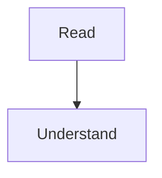

# Readora

A beautiful, focused reading experience for Markdown in Visual Studio Code.

本仓库为 Readora 的**实现工程**（从零构建），规范基线为 `docs/` 下的
PRD / ARC / IMP 冻结文档；实现与文档冲突时，按治理规则以权威 ARC 为准并登记裁决。

## 工程结构（IMP-001 §4）

```
apps/
  extension/        VS Code 扩展（Extension Host，esbuild 打包）
  webview/          阅读器前端（React + Vite，产物落入 extension/dist/webview）
packages/
  contracts/        Host / Webview 共享消息协议（ARC-004 §8 权威表 + Zod）
  markdown-core/    Markdown 渲染管线（M2 落地，运行于 Webview 侧；M6 补 KaTeX 与 Wiki Link 处理器）
  diagram-core/     图表渲染引擎适配层（M3 落地，Pele Adapter + Sanitizer）
  design-tokens/    设计令牌清单、宿主主题映射、对比度工具与自定义 CSS 净化（M5 落地，
                    M6 补 `custom-css.ts`；颜色取值权威仍在 CSS）
  test-utils/       共享测试夹具
scripts/            构建与产物验证脚本
tests/              e2e / security / integration（M6 起为 Playwright 三个 project）+ visual 基线 + fixtures
reports/            交付报告（M6 起：测试 / 安全 / 性能 / 依赖审计 / 平台验证 / 发布说明）
                    —— 未随本仓库分发，见下方开源整理说明
```

开源整理说明：`docs/` 的两篇派生文档（《Readora 技术架构总览》与《Readora 分阶段实现
计划》）、0.6.0～0.10.0 的逐版发布说明，以及 `reports/` 下的六份交付报告（测试 /
安全 / 性能 / 依赖审计 / 平台验证 / 发布说明）**未随本仓库分发**——两篇派生文档与
ARC / IMP 单篇重复，逐版发布说明的结论已完整记在下面对应的里程碑小节里。`reports/`
的三份读数报告（`performance-report.md`、`dependency-audit.md`、
`platform-verification.md`）
是 `pnpm perf` / `pnpm quality:report` / `pnpm install:check` 的写入目标，本机重跑会
由脚本重建目录并写出；另三份记的是当时实跑的取证明细，结论同样已抄进下面的里程碑
小节。因此**下文出现的这些文档名与 `reports/**` 路径指的是当时的工作树产物，不指
仓库里的文件**。

本仓库公开发布于 <https://github.com/RegalPine/readora>：根 `package.json` 与
`apps/extension/package.json` 的 `repository` 均指向该地址，后者还带 `bugs` /
`homepage` 与 `repository.directory: "apps/extension"`（供 vsce 把包内链接指到子目录）。
`publisher` 仍是占位 `readora-dev`，只在上扩展市场前需要替换。

内部包 `exports` 直接指向 `src/index.ts`，由 esbuild / Vite / Vitest
直接消费 TypeScript 源码，无独立构建步骤。

## 常用命令

```bash
pnpm install --frozen-lockfile   # 安装（CI 口径）
pnpm typecheck                   # 全包严格类型检查
pnpm lint                        # ESLint（flat config）
pnpm test                        # 全包单测（Vitest）
pnpm coverage                    # Host 与 diagram-core 的覆盖率阈值门禁
pnpm build:host                  # esbuild 打包 Extension Host（产物出完即跑激活冒烟）
pnpm smoke:host                  # 单独跑产物激活冒烟（vscode stub + activate() + 逐条 invoke 声明的全部命令）
pnpm build:webview               # Vite 构建 Webview（固定产物名）
pnpm fixtures                    # 生成/刷新三档性能夹具（缺失即生成）
pnpm notices                     # 由 lockfile 生成 resources/NOTICES.md 第三方许可证清单
pnpm license:sync                # 根 LICENSE → apps/extension/LICENSE（供 vsce 打包）
pnpm package                     # 门禁全量 + vsce 打包 VSIX
pnpm verify                      # VSIX 产物完整性验证
pnpm visual:check                # 显式步骤：浏览器视觉基线比对（M5，不进默认门禁链）
pnpm visual:update               # 显式步骤：重采 tests/visual/baseline.json 与截图
pnpm test:e2e                    # 显式步骤：Playwright 三个 project（e2e / security / integration）
pnpm test:e2e:security           # 显式步骤：只取安全准入（project=security）的证
pnpm perf                        # 显式步骤：首屏与交互性能采样 → reports/performance-report.md
pnpm quality:report              # 显式步骤：依赖审计汇总 → reports/dependency-audit.md
pnpm install:check               # 显式步骤：`code --install-extension` 安装验证 → reports/platform-verification.md
```

`visual:check|update`、`test:e2e`、`perf`、`quality:report`、`install:check` 依赖本机
浏览器 / `code` CLI，**不进默认门禁链**。环境缺失时 `visual:check`、`perf`、
`install:check` 打 `SKIPPED: <原因>` 并 exit 0 —— 那是「未执行」，不是「通过」；
`test:e2e` 反过来会**明确报错**，静默跳过一支安全用例比红灯危险得多。

### Mermaid 标题、引用与导出

给图表添加稳定 ID 和显示标题，正文链接用标准 Markdown 片段语法跳转；图表工具栏可将当前渲染结果导出为带主题样式的 SVG 或 PNG，文件名取图表标题（未设置时回退到 `filename`）：

````markdown
[查看系统图](#system-map)


````

`diagram_id` 仅允许字母开头的字母、数字、下划线和连字符；`diagram_title` 为纯文本，最长 120 个字符。省略这两个属性时图表照常渲染与导出。

## 能力边界（诚实声明）

### M1 · v0.1.0（Host / Webview 骨架）

已实现：

- 3 条命令：`readora.openReader` / `readora.openToSide` / `readora.refresh`
- 文档打开 / 侧开 / 会话复用、编辑与保存增量更新（防抖 + 版本护栏）
- FileSystemWatcher（变更 / 新建 / 删除）自 M1 即实现
- `reader.ready` 门控首帧投递、CSP + nonce、链接策略（仅 http/https）
- 配置 5 键（theme / fontSize / lineHeight / contentWidth / showOutline）
- 阅读状态会话内保存与恢复

### M2 · v0.2.0（Markdown 核心渲染）

管线全部在 Webview 侧运行（`packages/markdown-core`，零 VS Code / 零 Node 依赖），
Host 仍只负责文档快照与投递门控，`reader.ready` / `document.load` / `document.update`
协议未变。已实现：

- CommonMark + GFM 表格 / 删除线 / 任务列表展示态；`markdown-it` 冻结配置
  `html: false, linkify: true, breaks: false, typographer: false`
- Frontmatter（浅层 `key: value` + `tags`）提取为文档元数据，正文不再显示
- 语法高亮：highlight.js `lib/core` + 按需注册的 15 语言子集
  （javascript / typescript / json / python / bash / shell / yaml / markdown /
  css / scss / html / diff / sql / rust / go），未命中语言降级为普通代码块 +
  `warning` 诊断，不引全量包
- 文档内锚点：CJK 保留的 slug 生成 + 重复标题序号 + 点击 `scrollIntoView`
- 代码块复制按钮（`navigator.clipboard` 失败回退 `execCommand`）
- 表格对齐 / 表头 scope / 外层横向滚动容器；嵌套引用、嵌套列表、有序列表 `start`
- Outline 数据产出（`renderMarkdown().outline`，层级 + anchor + 位置）
- 安全：DOMPurify 白名单集中一处，原始 HTML 一律转义为可见文本，
  `on*` / `style` / `javascript:` / `data:` / `file:` 全部剥离；
  Sanitizer 异常 fail-closed 为转义纯文本，绝不回退未验证 HTML
- 诊断体系：单块失败不扩散整篇，`error` 级在页内以可折叠提示条呈现（不弹通知）

仍未实现（不得对外宣称）：

> 下述「Mermaid 图形渲染」「图片实际加载」「跨文档跳转」三条已在 M3（v0.3.0）交付，
> 「Outline 侧栏面板」已在 M4（v0.4.0）交付，分别以对应小节为准；其余条目仍未实现。

- 数学公式 KaTeX —— 属 EPIC-06 / S6，本期只预留 `mathBlock/mathInline` 节点与
  Processor 槽位；`keywords` 因此不加 `mermaid` / `katex`
- Mermaid 图形渲染 —— 本期只识别 ` ```mermaid ` 转 `diagramBlock`、原样保留源码并
  输出降级占位 + `info` 诊断；渲染属 ARC-003 / M3（`diagram-core` 仍是骨架）
- 图片实际加载 —— 产出无 `src` 的 `` 语义结构与占位提示，本地路径与远程
  图片均不加载，依赖 M3 `resource.resolve`（当前仍返回 unsupported）
- 跨文档跳转（相对 Markdown 链接）—— 渲染为 inert 链接 + 行内降级提示；Path
  Resolver 属 Host / ARC-008，协议未为此扩展
- Outline 侧栏面板 —— 面板属 EPIC-07 / M4；增量渲染属后续批次（本期全量渲染 +
  内容 hash 跳过重复渲染）
- 设计令牌主题（M5）—— 本批样式仍写在 `html[data-readora-theme]` 单层口径下

版本同步口径：版本号同步写入根 + `apps/extension` + `apps/webview` +
`packages/contracts` + `packages/markdown-core` + `packages/diagram-core` +
`packages/design-tokens` + `packages/test-utils`（共 8 处）。骨架包一起抬版本是
对既有「五处同步」流程的有意扩展，避免版本线分裂。

### M3 · v0.3.0（图文渲染：IMP-002 EPIC-05 + EPIC-08）

图表引擎为 **`pele@1.13.0`**（MIT，零运行时依赖，`engines.node >= 20`），按 IMP-001
§3.3/§3.4 精确锁版（禁 `^`）。只走 `pele/core` + 显式 `register()`，不用全量入口
（会把 33 类打进包，违背 F11-001）也不用 lazy 入口（依赖动态 import，在
`script-src 'nonce-…'` + `connect-src 'none'` 的 CSP 下不可靠）。Pele 只能经
`packages/diagram-core/src/engines/pele/**` 使用，这条约束由 ESLint
`no-restricted-imports` 白名单机器守护（IMP-001 §9.3）。

已实现：

- **14 类已启用图表**（= IMP-001 §9.4 兼容性清单，含 F04-001~005 全部 P0）：
  flowchart / sequence / class / state / er / gantt / pie / gitGraph / mindmap /
  timeline / requirement / quadrantChart / sankey / xychart。未启用类型显示源码 +
  「类型未启用」提示（浏览器实测 `journey` / `packet` 走该分支），不影响其它图表
- 安全：源码上限 50 000 字符（F04-058）；Pele 输出必经 DOMPurify SVG profile
  Sanitizer，剥离 `script` / `foreignObject` / 动画元素 / `on*` / 外部实体；
  SVG `<a>` 的 `href` 与 `xlink:href` 一律改写为 `data-readora-external`（点击交
  Host `document.open`，包内不残留 `href`）；Sanitizer 失败即错误态，绝不回退未验证插入
- 诊断：`PeleError`（syntax / semantic / limit / unsupported-diagram + line/column/snippet）
  映射为 `DiagramDiagnostic`；错误卡提供展开源码 / 复制 / 重试，单图失败不炸整篇
- 容器与交互（F04-031/032/035/036）：工具栏 zoom in / out / fit / reset /
  Fullscreen / Copy Source；Fullscreen 先翻 CSS 全屏层，环境提供原生 Fullscreen API
  时一并调用；引擎隐式的拖动平移 / 双击 / `+` `−` `0` `Escape` 方向键同样可用
- **交互实测口径（ARC-003 §12.2 偏差 D-5 的补充数据）**：Pele 的缩放与平移改写的
  是 `<svg>` 的 `viewBox`（不是 CSS `transform`）；`zoom: "auto"` 只在渲染宽度真的
  小于固有宽度时才打开接管闸门。由于 Adapter 固定传 `responsive: true`（按容器宽度
  重排），窄屏 420px 实测 14 类中只有 `stateDiagram-v2`（533→398）、`gantt`（779→356）、
  `requirementDiagram`（657→398）三类打开闸门，其余 11 类 ratio=1、工具栏 zoom 为空操作。
  普通滚轮不被拦截（页面照常滚动），只有 `ctrl`/`meta`+滚轮（触控板捏合）才缩放
- 本地图片（STORY-08-01/08-02）：`resource.resolve` 转正并带 `kind`；路径解析用
  `Uri.joinPath` 而非字符串拼接，拒绝绝对 `file:`、反斜杠别名、`..` 与编码穿越
  （`..%2f` / `%2F` / `%5c` / 双重编码），授权根 = 文档所在目录 + 所属 workspace folder，
  符号链接逃逸按 `realpath` 二次校验拒绝；MIME 白名单 `image/{png,jpeg,gif,webp,svg+xml}`
  与 `text/markdown`，大小受配置约束，每次 resolve 先 `stat`、缓存键含 `mtime + size +
  策略版本`，`webviewUri` 带 `?v=<mtime>-<size>` 破 Webview 图像缓存（改图即刷新）
- 图片三态 `data-readora-image-state="ready|missing|blocked"`（pending 为挂载中间态）：
  IntersectionObserver（rootMargin 200px）懒解析；本地 SVG 一律走 ``、永不内联
  （`` 语境下 SVG 脚本不执行，作纵深防御）；远程与 `data:` 图片按策略显示 `blocked`
  + 原因，不发请求
- Lightbox（IMP-003 §4.4，优先于 F06-010 的 P1 标记）：放大 / 缩小 / 拖动 / 适应窗口 /
  关闭 + 键盘 `Esc` `+` `−` `0`，`role="dialog"` + `aria-modal` + 焦点陷阱与归还
- 跨文档最小跳转（STORY-08-03）：相对 `.md` 链接点击 → `document.navigate` → Host
  解析后 `openDocument`；解析失败回退行内提示，不静默失效
- 协议与安全码：`ResourceResolveResultSchema` 严格对象 + Host 发送前校验 + Webview
  侧响应复判（防伪造 Host 消息）；新增 `readora.resource.notFound` / `.denied` /
  `.tooLarge` / `.unsupported` / `.unreadable`
- 配置：`readora.resources.allowExternalImages`（默认 `false`）、
  `readora.resources.maxImageSizeMb`（默认 10，范围 1~50）；取值只来自配置，文档正文不得覆盖
- 主题：`--pele-*` 8 项 token 与 8 色系列表映射写在 `html[data-readora-theme]` 单层下，
  `PELE_TOKEN_MAP` 常量表被 CSS 与测试双向锁定；主题切换只换 CSS class，不重排图表
  （实测 viewBox 与尺寸不变、文字 fill 随 token 变化）。`--readora-*` 全量 Token 体系仍属 M5
- 覆盖率门禁：`packages/diagram-core` 与 `apps/extension/src/resources` 按 IMP-001 §14.3
  设 80% 四项阈值，不追溯既有模块
- 包体实测：`main.js` 由 M2 的 549,039 B 增至 **980,514 B**（+431 KB，Pele 14 类 +
  图文渲染层），仍低于 1.2 MiB 预算（`pnpm verify` 打印 957.5 KB，gzip 342.8 KB），
  14 类注册集无需退化到 5 类 P0；`readora-0.3.0.vsix` 为 9 个文件 / 477,979 B
  （M2 为 311,046 B）。`pnpm verify` 除产物清单外还断言 `main.js` 内含
  `readora-diagram-container` 与 `data-readora-image-state`，并按预算判定
- 打包卫生：跑过 `pnpm coverage` 后 `coverage/`（含源码 HTML 报告）会被 vsce 收进包，
  已在 `.vscodeignore` 排除 `coverage/**`，并在 `verify` 的禁止前缀里补一层兜底

浏览器取证（真实 Chromium，夹具 `tests/fixtures/{images,diagrams}.md`）：

- `diagrams.md` 18 个 diagram 块 → `state="rendered"` 14 / `failed` 4，容器内
  `<svg>` 14 个；4 个失败块分别是语法错误（带 `line 2`）、无法识别类型、
  `journey`、`packet`，其余 14 类渲染不受影响；工具栏按钮 120 个
- `images.md` 29 个图片容器 → `ready` 14（`naturalWidth` 320×200 与 1×1 实测非零）/
  `missing` 12（不存在、目录、空引用、7 类路径穿越、符号链接、非图片类型）/
  `blocked` 3（远程与 `data:`），失败原因逐条对上
- Lightbox 键盘 `+ + − 0` → scale 1→1.25→1.5625→1.25→1，拖动 `translate(90px, 40px)`，
  `Tab` 循环 5 次焦点仍在层内，`Esc` 关闭并把焦点还给触发元素
- 跨文档跳转：`./sample.md` 被 Host 接受（`text/markdown 4918B`），
  `./other-note.md` 拒绝并回退行内提示
- console 错误 0 条

仍未实现（不得对外宣称）：

> 「Outline 面板与搜索」一项已在 M4（v0.4.0）交付，以 M4 小节为准；其余条目仍未实现。

- PDF / 附件（F06-004/005）
- 外部 HTTPS 图片自动加载、`data:` 图片、SVG 内联渲染
- Export SVG / PNG（F04-038/039）
- Wiki Link 与数学公式（EPIC-06）
- `--readora-*` 设计令牌体系与自定义主题（M5）
- 14 类之外的 Pele 图表类型（含 `journey` / `packet` 等）不会渲染，只给未启用提示

### M4 · v0.4.0（导航与阅读交互：IMP-003 §4.5 + ARC-007 §6~§9）

承载形态是 Webview 内三栏 Reader Shell 的**左栏**（ARC-005 §5.1/§5.2）：
`ReaderShell`（CSS grid）+ `TopBar`（3 按钮工具栏）+ `OutlinePanel` +
`ReadingCanvas`；右栏只保留布局槽位与注释，**本批不渲染**（按半交付登记）。
滚动容器仍是 window 级，左栏自身 `overflow-y: auto`，不引入内层滚动容器。

已实现：

- **Outline Tree**（ARC-007 §6.1、PRD-002 §5.1）：层级缩进、折叠/展开
  （`aria-expanded`，隐藏后代而不删数据）、活动项 `aria-current="location"`、
  祖先自动展开、长目录滚动、溢出省略 + `title` 兜底、无标题空态；
  折叠状态 `OutlineViewState{ collapsedIds, activeHeadingId? }` 只存 UI，
  不回写 outline 数据，按文档会话管理
- 标题 Anchor 全部消费既有渲染产物（`<h2 id class="readora-heading">`），
  导航层不生成第二套 slug（ADR-007-02）
- **点击定位**（§5.3/§5.4）：`HeadingLocator.navigateTo` 默认平滑滚动，
  `prefers-reduced-motion` 下降级即时；`.readora-heading { scroll-margin-top:
  var(--readora-navigation-offset, 5rem) }`
- **活动标题同步**（§7.3 五条 + PRD-002 §5.3）：单个 IntersectionObserver 随文档
  生命周期建立，锚点集合或版本变化才重建（不为每次滚动新建）；基准线由 CSS 变量
  `--readora-baseline-ratio`（默认 0.25）换算，不硬编码像素；只在结果真的变化时
  setState；点击期间挂起抖动窗口；Observer 缺席或初始化失败退化为 `scroll` +
  `getBoundingClientRect` 检测（§12）；本层异常一律吞掉降级为「不更新活动标题」，
  正文保持可用
- **阅读位置恢复**（§8.2 六步 + §8.4 三例）：`state.save` 携带真实
  `activeHeadingId`（此前恒为 `null`），防抖 500ms → 800ms（§8.3），
  `visibilitychange` / `pagehide` 前 flush；`state.restore` 不再在消息到达即滚动，
  而是等渲染完成后按「headingId 存在 → 定位标题；否则 → `scrollTop` 回退；
  两者都不可用 → 顶部」执行。折叠与搜索状态不入 `state.save`（§10.1/§10.3）
- **左侧栏显隐 + 专注模式 + 阅读宽度**（PRD-002 §11.2/§11.3）：focusMode 隐藏目录
  与工具栏、保留文档标题与唯一退出入口，退出不重置阅读状态；宽度步进 ±80px、
  clamp `[480, 1600]`，与 `ReaderPreferencesSchema.contentWidth` 同界；
  窄窗口（`max-width: 900px`）自动收起左栏（ARC-005 §5.3）
- **命令与键位**（ARC-004 §4.1/§4.5）：`readora.focusMode`、`readora.toggleOutline`
  进命令面板，`readora.adjustContentWidth`（`-1/+1`）为内部命令（`commandPalette:
  when false`）；键位 `cmd/ctrl+alt+f`、`cmd/ctrl+alt+o`、`cmd/alt+←/→`，
  `when` 用新 context key `readora.readerActive`（会话创建/显示置 `true`，
  `onSessionDisposed` 与面板不可见置 `false`）；无活动会话时 no-op，不弹错误通知
- **文档内搜索**（ARC-007 §9.1 首期八能力全量，补 DEFER-01 的 P0 缺口 /
  PRD-001 F05-001~003、IMP-002 STORY-07-03）：`TreeWalker` 只走文本节点，
  默认不区分大小写、可切；命中带 `id / text / position / headingId`；受控 Range
  拆分高亮，关闭即按还原栈复原并 `normalize()`（**不使用 innerHTML 拼接用户输入**）；
  结果带 `data-readora-search-version`，与正文 `data-readora-document-version`
  不一致即丢弃；防抖 250ms，`Enter` / `Shift+Enter` / `↑` / `↓` 与上一个/下一个
  按钮循环导航，首尾相接；活动命中 `scrollIntoView({ block: "center" })`；
  无结果显示「No matches」；命中上限 5000 条即截断并显示 `999+`（§13）
- 搜索入口两条（工具栏按钮与 `cmd/ctrl+f`）与 `Escape` 优先级：Lightbox /
  图表全屏等更上层浮层在场时先交还它们，搜索面板不被越级关闭；关闭时清除临时
  高亮并把焦点归还正文。代码块参与匹配，图表子树（`.readora-diagram` /
  `.readora-diagram-container` / `<svg>`）整体排除；MathML 排除位以
  `MATH_EXCLUDED_SELECTOR` 预留（M6）
- 阅读工具栏最小集：UX-001 Toggle Outline、UX-003 Focus Mode、UX-006 Search，
  常驻不超 3 个、均带 `aria-pressed`（PRD-002 §4.3）
- 协议扩面：新增 Host → View 消息 `reader.viewState`
  （`focusMode` / `outlineVisible` / `contentWidth`，`ViewStatePayloadSchema`
  严格对象 + 宽度上下界），Host 侧 `ReaderSession.viewState` 由
  `session-manager.patchViewState` 维护、`webview-manager.postViewState` 下发；
  不新增 request/response 通道，搜索/定位/折叠全部在 View 内闭环
- 包体实测：`main.js` 由 M3 的 980,514 B 增至 **996,252 B**（+15,738 B，
  预算 1 258 291 B 不变，gzip 348.25 kB，`pnpm verify` 打印 972.9 kB）；
  `readora-0.4.0.vsix` 仍为 9 个文件 / 486,282 B（M3 为 477,979 B）。
  `pnpm verify` 的内容标记新增 `readora-outline-panel` 与 `readora-search-panel`
- 测试：全仓 749 用例（contracts 22 / diagram-core 101 / markdown-core 195 /
  extension 156 / webview 275，其中 M4 新增 webview 与 Host 用例约 140 条）；
  ARC-007 §14.1 十三项逐条对应测试，docs 里未勾选的「重复标题定位」
  （`outline-tree` 重复锚点不撞 key + `OutlinePanel` 两条目各自上报）、
  「删除标题回退」（恢复时 headingId 不存在 → `scrollTop` 回退 + 失效锚点不进
  观察集合）、「导航异常隔离」（观察器工厂抛错与测量抛错均不影响正文）本批已覆盖

浏览器取证（真实 Chromium + Vite dev，1440×900 与 820×900，夹具为 12 个标题 +
1 个 mermaid flowchart + 1 个 javascript 代码块的合成文档；Host 命令在预览页不可用，
改由 harness 直接投递 `reader.viewState` 信封模拟）：

- 目录与文档标题逐项一致：outline 12 = 正文 12
- 点击「Document Search」定位：`window.scrollY` 0 → 3028，标题在视口 top 80px，
  与 `scroll-margin-top: 80px`（5rem）相等，`aria-current` 命中该条目
- 基准线切换（ratio 0.25 → 基准线 225px）：连续滚动时活动标题的 top 依次为
  119 / 224 / 266，到底部（scrollY 上限 3565）停在「Wrap Up」，`aria-current`
  恒为 1 处
- 折叠「Architecture」：目录项 12 → 10，被折叠后代的锚点仍在正文（隐藏不删），
  正文标题仍 12；活动标题进入其子树后祖先自动展开回 12
- focusMode：`data-readora-columns="one"`、左栏不渲染、工具栏只剩
  「Exit focus mode」、正文容器 `max-width: 1100px`、文档头仍可见；
  宽度下发 560 → 正文 `max-width: 560px`；`outlineVisible=false` → 单列且按钮
  `aria-pressed="false"`；按钮本地覆写在 Host 一下发后立即让位（two → one）
- `state.save` 3 次，最后一次为 `{ scrollTop: 2400,
  activeHeadingId: "diagrams-inside-the-document" }`；恢复分支：消息到达即刻
  `scrollY` 仍为 0，渲染完成后标题 top 80、活动标题「Reading Position」；
  headingId 不存在时回退 `scrollTop` 2100
- 换文档（当前文档 version 9 → 新文档 version 1）：正文与目录切到新文档
  （h1「Second Fixture」、目录 12 项、`data-readora-document-version="1"`），
  折叠不残留、搜索浮层清空
- 搜索：两条入口 + Escape 焦点归还 `.readora-document`；防抖窗口内 0 marks，
  窗口过后 33 hits「1 / 33」；`Enter` / `Shift+Enter` / `↑` / `↓` / 按钮计数依次
  2→1→2→1→2，`33 / 33` 再按一次回到 `1 / 33`，活动命中恒 1 且实测在视口内
  （top 440、scrollY 896，归属「Webview Shell」小节）；`The` 大小写不敏感 154
  → 敏感 13
- 排除与还原保真：`scrollIntoView`（只出现在图表 SVG 与源码 `<pre>` 内）
  → 「No matches」、0 marks，图表源码仍可读；`resolveActiveHeading`（代码块内）
  → 1 mark；关闭后正文 `textContent` 6403 字符、45 个子元素与搜索前**逐字符全等**，
  marks 0，图表仍 `rendered`
- 图表在高亮一轮之后仍可交互：工具栏 6 个按钮可用，Fullscreen 把包裹层从
  760×508 变为 1440×900 并能退回内联（zoom 在 ratio=1 时不改 `viewBox`，
  属 M3 已登记口径）
- Escape 优先级：全屏在场时按 Escape 关掉全屏、搜索面板与其 21 处高亮不动；
  再按一次才关面板并清空高亮
- 版本失效：高亮 `markVersion=1` → `document.update` 到 version 2 后重建为
  `markVersions=["2"]`、34 hits「1 / 34」，新增「Appended」标题已在 DOM
- 深色主题（`data-readora-theme="dark"`）与 820px compact 单列（回 1440 恢复两列）
- **console 错误 0 条**；截图 `/tmp/readora-preview/m4-*.png`
  （click-navigation / active-heading-mid-document / outline-collapsed /
  focus-mode / outline-hidden-single-column / restore-after-render /
  outline-dark / compact-820px / search-panel / search-code-block-hit /
  diagram-after-search / escape-priority-diagram-fullscreen /
  search-version-invalidated）

偏差登记 · `reader.viewState` 通道：ARC-004 §8.3 的消息表未列任何 Host→View 的
视图状态通道，属设计缺口（§4.1 的 `readora.focusMode` / `readora.toggleOutline`
与 §4.5 的宽度键位都必须把状态送进 Webview）。本批沿用 M1–M3 口径 —— docs 为外部
权威、不改动文档，按 §6.2 `ReaderSessionState` 已含视图态字段这一事实推导新增消息，
方向 `host-to-view` 与既有投递门控（ready 前排入 `PendingDeliveries`、与
`document.load` 同批补投）一致。同理，ARC-005 §6.2 与 ARC-007 的实现注记描述的是
上一代 V1.1.1 基线（`src/features/**`、`OutlinePanel.tsx`、`useActiveHeading.ts`、
`apps/webview/src/search/`），当前仓库并无这些目录与文件，本批全部新建并沿用现有
`src/app` + `src/content` 扁平布局（见下方环境偏差登记）。

未纳入（不得对外宣称）：

- 右栏 `AuxiliaryPanel` 与 Properties / Backlinks（F07-005 P2、F03-005 P1、UX-002）：
  按 STORY-09-03「不得伪装已完成」显式声明未实现，三栏布局按半交付登记
- 跨会话阅读位置（F05-008/010）：ARC-004 §12 明确不使用 `workspaceState` /
  `globalState`，本批只到会话级
- 字号快捷键与 UX-004 / UX-005 / UX-007：ARC-004 §4.5 偏差 D-3 第 3 条本身登记为
  后续补齐项
- Outline 标题过滤（PRD-002 §5.1「搜索标题」）：F02 与 STORY-07 均无对应验收项
- F02-008 返回顶部、F02-009 阅读进度、F02-010 面包屑
- ReaderStatusBar（ARC-005 §5.2 注记 V1.1.x）、侧栏宽度拖拽（ARC-005 §5.3，M5 仍未纳入，
  见 M5 未纳入清单）、`--readora-*` 全量 Token 体系（M5 已落地）
- 正则 / 工作区 / 跨文档搜索与搜索索引（ARC-007 §9.1 明确暂不支持，ADR-007-05
  只搜当前文档）

### M5 · v0.5.0（主题与视觉：IMP-003 §4.6 + ARC-006 + PRD-003）

主题是**两轴**的（ARC-006 §4.1 / §7.3）：palette 轴 `data-readora-theme ∈ {light,
dark, vscode}` 决定语义色从哪里取，明暗轴 `data-readora-scheme ∈ {light, dark}`
决定代码配色、图表系列色与阴影形状。取值的权威只存在于 CSS 文本
（`apps/webview/src/styles/tokens.css`）——`packages/design-tokens` 与运行态 JS 都不
持有第二份色值，双源迟早漂移，所以护栏测试一律直接读 CSS 拼接文本按名逐项断言。

已实现：

- **契约扩面**（ARC-006 §5.1 / §7.3）：新增 `ThemeSourceSchema =
  z.enum(["product","vscode","system"])`；`ReaderPreferencesSchema.theme` 扩为五值
  `["auto","light","dark","vscode","system"]`，`auto` 保留为 `system` 的兼容别名
  （不破坏既有用户配置值）；`ThemeUpdatePayloadSchema` 改为
  `z.strictObject({ theme: ResolvedThemeSchema, source: ThemeSourceSchema })`，解析
  结果只允许 `light|dark`。`protocol.spec.ts` 断言 `source` 缺失即拒绝、
  `theme: "vscode"` 作为解析结果被拒绝、偏好侧 `vscode` / `system` 可接受、
  `high-contrast` 仍拒绝
- **Host 解析五模式**：`readTheme` 白名单扩到 5 值（非法值回落 default）；
  `resolveTheme()` 返回 `{ mode, source }` —— `light|dark` → `product`，`vscode` /
  `system` 由 `activeColorTheme.kind` 定 `mode`；`onDidChangeActiveColorTheme` 只在
  `source !== "product"` 时重发 `theme.update`（产品模式不打扰），
  `webview-manager.postTheme` 按 `(mode, source)` 去重且只 `postMessage`，
  不重建 `panel.webview.html`（ARC-006 §11.1）
- **首帧预置**（PRD-003 §11.3 防闪白）：`html-template.ts` 服务端插值输出
  `<html lang="en" data-readora-theme="${palette}" data-readora-scheme="${scheme}">`
  （`palette = source === "vscode" ? "vscode" : mode`），属性值一律 `escapeAttribute`，
  不新增内联脚本、CSP 串不变；`readora.theme` 配置项 `enum` 同步扩为 5 值，
  `manifest.spec.ts` 锁死它与契约的一致性
- **Token 三层结构**：`packages/design-tokens` 由占位包改为清单包
  （`token-registry` 21 个语义名 + 组件层清单、`host-theme-map` ARC-006 §6.1 九条宿主
  映射 + §13.3 中转名、`contrast` WCAG 2.2 计算器），补 `vitest` 接入后自身 22 条用例
  自动进 `pnpm -r test`；`tokens.css` 461 行 / 314 条自定义属性声明，`:root` 双色板 +
  语义层 + 组件层 + 非颜色尺度，`[data-readora-theme="dark"]` 逐个覆盖 21 个语义名
  （漏一个就是「暗色里渗出一块亮色」），`[data-readora-theme="vscode"]` 九项走宿主、
  十三项留在产品色板，`[data-readora-theme="vscode"][data-readora-scheme="dark"]`
  连宿主映射的 fallback 一起换暗
- **样式系统重构**（PRD-003 §13.4，停顿点 A → B）：`global.css` 1116 行机械拆为
  `fonts / tokens / tailwind / base / markdown / components / shell /
  lightbox-search` 八个文件，`main.tsx` 按此固定顺序 import，8 文件合计 1509 行；
  `--readora-navigation-offset`（5rem）与 `--readora-baseline-ratio`（0.25）按原值迁入
  `tokens.css`，M4 的定位 / 活动标题 / 搜索三条回归用例护航
- **硬编码色清零**（IMP-003 §4.6 第 5 项）：原 113 处 hex 全部改判为 Token 引用，hljs
  语法色改挂 `--readora-syntax-*`（8 名，明暗各一组）；`--readora-diagram-*` 8 名改为引用
  `--readora-color-*`（兑现 `packages/diagram-core/src/theme.ts` 的 M5 待办，双向锁定测试
  同步更新，主题切换不重解析 Mermaid）；业务样式不再出现 `[data-readora-theme=...]` 选择器
- **无障碍**（ARC-006 §12、PRD-003 §7.2 / §12.3）：新增 `--readora-color-focus`
  （`var(--vscode-focusBorder, <色板 accent>)`）+ 单条
  `:where(a, button, input, [tabindex]):focus-visible` 焦点环；四组偏好查询齐备
  （`prefers-reduced-motion` 收敛到 1ms、`forced-colors: active` 保边界与焦点、
  `prefers-contrast: more`、`prefers-reduced-transparency: reduce`）；`backdrop-filter`
  只有三处（毛玻璃工具条、搜索浮层、图表全屏），每处都带 `@supports` +
  `backdrop-filter: none` 双回退
- **偏好变量驱动**（PRD-003 §11.4）：`applyTheme(root, { mode, source }, preferences)`
  只写两个属性 + `--readora-font-size` / `--readora-line-height` /
  `--readora-content-width`，数值先夹回区间再拼单位（不把不可信输入拼进 CSS）；
  撤掉 `ReadingCanvas` 的三期内联 style
- **Tailwind v4 utility 层**（ARC-005 §11.3）：`tailwindcss` 与 `@tailwindcss/vite`
  实测 **4.2.4**，Vite 插件已注册；`styles/tailwind.css` 只导入 `theme.css` +
  `utilities.css`（不启用 preflight，基础重置留在 `base.css`），`@theme inline` 把 21 个
  语义 token 逐名映射为 `--color-*`，不使用 `dark:` 变体
- **字体**（PRD-003 §5.2）：`@fontsource/newsreader`（latin 400/500/600）、
  `@fontsource/geist`（latin 400/500）、`@fontsource/jetbrains-mono`（latin 400/500），
  实测版本 **5.3.0**；产物 **7 个 `.woff2` / 139,232 B**，`font-display: swap` 由
  fontsource 自带，CSP `font-src ${cspSource}` 已放行、不改
- **React 集成**（ARC-006 §10 / §11）：`App.tsx` 订阅 `{ theme, source }` 并调
  `applyTheme`；新增 `src/app/theme-context.tsx` 提供只读
  `ThemeContextValue { theme, source, preferences }`（**不含 `setMode`**，见未纳入）；
  `theme-runtime.spec.tsx` 13 条逐一对应 §11.1 的六条约束
- **门禁内视觉护栏**（PRD-003 §13.4 四份 spec / 59 用例）：`design-tokens.spec.ts` 13 条
  （三层结构、三块语义清单逐名、组件层向下引用、无悬空 `var(--readora-*)`、只有
  `tokens.css` 声明、四组偏好查询、阴影必须挂明暗轴）；`contrast.spec.ts` 28 条
  （WCAG 2.2 AA 矩阵 light / dark 各一遍）；`no-hardcoded-color.spec.ts` 11 条（含
  `dev/visual.css`）；`tailwind.spec.ts` 7 条（含「无 `bg-[#` / `text-[#` 任意色值、
  无 `dark:` 变体」）
- **对比度实测**：light 正文 16.34、次文 8.89、弱文 5.37、链接 9.74、`accent-on` on
  `accent` 7.10、`accent` on canvas 6.76，语法色最低 4.55；dark 14.26 / 10.88 / 5.81 /
  7.31 / 4.53 / 3.24，语法色最低 6.29。原型 `text-muted #7b7486` 只有 4.27（不达标），
  加深为 `#6b6478` 后写入固化断言
- **显式浏览器基线**（`pnpm visual:check` / `pnpm visual:update`）：夹具
  `apps/webview/dev/visual.{html,tsx}` 按 `?palette=` 一次一档（light / dark /
  vscode-light / vscode-dark），主题写入走与生产完全相同的
  `applyTheme(document.documentElement, …)` 与同一作用域；采集前依次等目录列出现、
  `document.fonts.ready`、颜色过渡收敛（`waitForSettled()` 用不参与过渡的探针元素取目标色，
  否则会把 220ms 过渡的中间值记成基线）。`tests/visual/baseline.json` 81,689 B 记录每档
  198 个 Token 计算值 + 20 个选择器 × 8 属性 + 4 个 rect + grid 轨道 + 880px 单列复量 +
  PNG sha256，截图落 `tests/visual/artifacts/`（gitignore）供人工复核
- **`pnpm verify` 扩面**：条目比对由子串匹配改为 `unzip -Z1` 精确匹配，marker 增
  `--readora-palette-light-canvas` / `--readora-palette-dark-accent`，新增 `main.css`
  预算 ≤ 163,840 B、`.woff2` ≥ 7 条、禁止 `.map` 与 dev 夹具入包
- **版本**：8 处 `package.json` 0.4.0 → **0.5.0**（根 + `apps/{extension,webview}` +
  `packages/{contracts,design-tokens,markdown-core,diagram-core,test-utils}`）
- **包体实测**：`main.js` **997,204 B**（预算 1 258 291 B 不变，M4 为 996,252 B）、
  `main.css` **37,776 B**（M4 17,041 B，新预算 163,840 B）；`readora-0.5.0.vsix`
  **16 个文件 / 631,347 B**（M4 为 9 个 / 486,282 B）
- **测试**：全仓 **857 用例 / 60 个文件**（contracts 23 / design-tokens 22 /
  diagram-core 101 / markdown-core 195 / extension 168 / webview 348）；门禁链
  `typecheck → lint → pnpm -r test → coverage → build:webview → package → verify →`
  （显式）`visual:check` 全绿

浏览器取证（真实 Chromium + Vite dev 的 `/dev/visual.html?palette=…`，1280×900 与
880×900，四档 palette 逐档导航）：

- 四档的 `<html>` 属性与页面回报的档位标记一致：light `light/light`、dark
  `dark/dark`、vscode-light `vscode/light`、vscode-dark `vscode/dark`；宿主档在无
  `--vscode-*` 注入的环境下 fallback 生效（真实宿主取值见下方人工确认项）
- 逐档实测 Token 与渲染值（light → dark，宿主两档与对应产品档逐项相同）：
  `--readora-color-canvas` `#f8f9ff` → `#10141a`、`text-primary` `#0b1c30` → `#dfe2eb`、
  `accent` / `focus` `#6d28d9` → `#7c3aed`、`overlay` `rgb(11 28 48 / 0.86)` →
  `rgb(3 6 10 / 0.86)`、`--readora-diagram-text` `#0b1c30` → `#dfe2eb`、
  `--readora-syntax-keyword` `#cf222e` → `#ff7b72`、`--readora-shadow-pill`
  `0 4px 12px rgb(109 40 217 / 0.08)` → `0 8px 24px rgb(0 0 0 / 0.35)`；正文 computed
  `rgb(11, 28, 48)` → `rgb(223, 226, 235)`
- 排版：正文 Geist、标题 Newsreader、代码 JetBrains Mono，`document.fonts` 有 5 个
  FontFace 处于 `loaded`（Geist 400/500、Newsreader 500/600、JetBrains Mono 400）；
  夹具偏好 `fontSize: 17` → 正文 17px / 行高 29.75px（1.75）
- 偏好变量驱动：`:root` 改写 `--readora-font-size: 21px` → 正文 17px → 21px、行高
  36.75px；`--readora-content-width: 600px` → 正文容器 `max-width: 820px → 600px`；
  撤掉内联变量后回到 `tokens.css` 的默认（`--readora-font-size: var(--readora-font-base)`
  = 16px），证明排版只由这三个变量决定，没有内联样式叠加
- 布局：1280px 下 grid 轨道 `256px 1024px`（左栏 256 = `--readora-outline-width`）、
  正文 `max-width: 820px`；880px 收单列（轨道 `880px`、`data-readora-columns="one"`、
  `.readora-shell-nav` 不再渲染）
- 主题就地切换（light → dark，同一次页面加载内调 `applyTheme`）：段落与标题节点
  `sameNode: true`、`scrollY` 316 切换前后不变、段落数 4 不变、`[aria-current]` 仍 1 处、
  body 底色 `rgb(248, 249, 255)` → `rgb(16, 20, 26)`、正文色 `rgb(11, 28, 48)` →
  `rgb(223, 226, 235)`、语法/图表/阴影 Token 同步翻转、三个偏好变量保持
  `17px / 1.75 / 820px` —— ARC-006 §11.1「不重建 Reader Shell」的六条约束逐条成立
- 焦点环实际取值 `2px solid` + `outline-offset: 2px` 且 `:focus-visible` 命中，颜色随
  `--readora-color-focus`（light `rgb(109, 40, 217)`、vscode-dark `rgb(124, 58, 237)`）；
  `prefers-reduced-motion: reduce` → `--readora-motion-slow` 1ms、body
  `transition-duration: 0s`；`forced-colors: active` → `--readora-color-border`
  `CanvasText`、`--readora-color-focus` `Highlight`、hairline 1px、代码块上边框
  `1px rgb(0, 0, 0)`、引用强调轨 3px（正常态 `rgb(204, 195, 215)`）
- **console 错误 0 条**（favicon 404 与 React DevTools 提示除外）；截图
  `/tmp/readora-preview/m5-audit-{light,dark,vscode-light,vscode-dark}.png`、
  `m5-audit-theme-switch-in-place.png`、`m5-audit-forced-colors.png`，以及首轮取证留下的
  `m5-palette-*.png` / `m5-theme-switch-in-place.png`

偏差登记（M5）：

- docs 不改口径（沿用 M1–M4）：ARC-006 §8.1 描述的 `applyTheme` 逐 token 注入在实现里收敛
  为「两个属性 + 三个偏好变量」——权威已在 `tokens.css`，JS 再写一遍就是第二份色值
- `auto ≡ system`：契约保留 `auto` 作为 `system` 的别名，只为不破坏既有用户配置
- `--readora-color-border-strong` 不纳入 3:1 非文本对比（PRD-003 §4.2 有此要求）：实测
  light 1.62 / dark 1.98。分隔线不承担「可交互边界」语义，改由 `focus` / `accent` /
  `warning` / `danger` 承担 ≥3:1，并对 `border-strong` 设 ≥1.5 下限护栏
- `WebviewHtmlOptions` 的字段名是 `palette` / `scheme`（而非文档的 `theme` / `source`）：
  首帧需要的是已解析的两轴，直接传原始值会漏掉 `vscode` 判定
- 阴影覆盖挂在 `[data-readora-scheme="dark"]` 而非 `[data-readora-theme="dark"]`：宿主暗色
  模式的 palette 恒为 `vscode`，挂 palette 轴就会漏掉那一格（取证时实测到的缺陷，已修并固化）
- PRD-003 §13.4 清单里的 `katex.min.css` 本批跳过（仓库无 KaTeX 依赖，V1.0.0 决策）
- Tailwind 实测锁定 **4.2.4**（Vite 8 兼容自 4.2.2 起）；`@tailwindcss/oxide` 原生 binding
  实测无需写进 `pnpm-workspace.yaml` 的 `onlyBuiltDependencies`
- `@fontsource/geist` 可直接安装，§6 预案的三级降级未触发；Inter 与 CJK 仍不打包（体积优先，
  走字族栈的系统回退）；fontsource 附带的 `.woff` 回退文件由构建产物白名单排除
- 浏览器基线是**显式步骤**，不进默认门禁链；Playwright 不作为仓库依赖，脚本回退到全局 /
  系统 Chrome，两者都不可用时打印 `SKIPPED: <原因>` 并 exit 0
- dev 夹具（`apps/webview/dev/visual.*`）参与 typecheck 但不进产物：`.vscodeignore` 排除 +
  `pnpm verify` 反向断言
- `--readora-color-overlay` 取值自定（light `rgb(11 28 48 / 0.86)`、dark
  `rgb(3 6 10 / 0.86)`）：PRD-003 §4.2 的表里没有 `overlay`，ARC-006 §4.3 有语义名无取值
- utility 层只是能力就位：新写样式优先 utility，既有业务 CSS 排在 utility 之后可覆盖，
  `markdown.css` 与 Pele 引擎覆盖保持非 utility 形态
- 真实宿主 `--vscode-*` 的实际取值、以及高对比主题下的边界表现，需在 VS Code 内人工目视确认
- ARC-006 §13.1 的两项未勾选（高对比度边界与焦点、不可信 Token 不进 CSS 注入）本批已有实现与
  证据：`@media (forced-colors: active)` 分支 + `design-tokens.spec.ts` 断言 + 浏览器实测
  （边界 `CanvasText` / 焦点 `Highlight`）；偏好数值经 `applyTheme` 夹回区间后才拼单位。
  按 docs 不改口径，此处登记，不回填文档勾选项

未纳入（不得对外宣称）：

> 下列各项是 **M5 当批的边界**，作为历史快照保留。其中除「侧栏宽度拖拽」外均已在
> M6 落地，逐项去向见下面的 M6 章节。

- PRD-003 §10.5 外壳四段中的 StatusBar、面包屑、阅读时长 pill、缩放组、Reader Settings
  弹层、浮动快速条（属组件功能，非主题）
- PRD-003 §10.7 大纲面板四项扩展（过滤输入、进度块、行内标签、底部统计）
  —— 0.7.0 后进度块与源行号标签已下线，见下面的「M8 · 归档一」
- §11.4 页面缩放（50%~200%）与 `readora.typography` 字族切换偏好
- F08-010 主题预设（P1）、F08-011 自定义 CSS（P2）、主题 `setMode` 写入通道
  （ARC-006 §10.1 没有 View → Host 的主题写回路径，给了就是假开关）
- KaTeX 数学公式（V1.0.0 决策，IMP-003 §5 门槛登记）
- 侧栏宽度拖拽（ARC-005 §5.3）：本批只把 `--readora-outline-width` 落成 Token，
  **拖拽交互至 M6 结束仍未实现**（本批未纳入，见 M6「未纳入清单」）

### M6 · v0.6.0（功能补齐与质量冻结：IMP-003 §4.7 + EPIC-06/11/12）

docs 把这一批记作 **V0.9.0**（§4.7）并把 M7（§4.8）的功能项排在后面；本仓库按
「版本顺延」的既定口径合并为 **0.6.0**，语义差登记在下方偏差。四组功能包
（外壳与阅读辅助、大纲扩展、KaTeX、Frontmatter/Wiki Link、预设与自定义 CSS）
全部落地，随后做质量冻结：Playwright 进仓库依赖，`tests/{e2e,security,integration}`
三个 project 补齐，性能与依赖审计出报告，许可证与图标这类发布元数据补齐。
**不引入 CI**（沿用既有治理口径，发布动作留给人做）。

已实现：

- **契约与偏好扩面**（ARC-004 §8.3 / §11）：`ReaderPreferencesSchema` 增
  `typography ∈ {newsreader, geist, inter}`（默认 `newsreader`）与
  `themePreset ∈ {default, high-contrast}`（默认 `default`）；新增
  `ConfigPatchPayloadSchema = z.strictObject({ key: z.enum(CONFIG_PATCH_KEYS), value: … })`，
  键表 7 项（`theme / fontSize / lineHeight / contentWidth / showOutline / typography /
  themePreset`）；`MESSAGE_TYPES` 增 `config.patch` 与 `metrics.report` 两条
  **view-to-host**，`protocol.ts` 注册 payloadSchema；manifest 三个新配置项
  （`readora.typography`、`readora.theme.preset`、`readora.customCss`）的默认值与
  enum 由 `manifest.spec.ts` 与契约双向锁定；`configuration-service.getPreferences()`
  映射新字段并夹区间，非法值退回默认；`html-template.ts` 首帧预置补
  `data-readora-typography` / `data-readora-preset`（防闪白与 §6 同一条路径）
- **外壳四段**（PRD-003 §10.5）：`ReaderShell.tsx` 改为
  `topbar 44px → searchbar 随内容 → body 两列 → statusbar 24px`，三个尺度全部落
  Token（`--readora-topbar-height` / `--readora-searchbar-height` /
  `--readora-statusbar-height`）并进 `token-registry` 清单；`TopBar.tsx` 由 75 行
  三枚按钮扩为 255 行，补面包屑（`documentUri` 去 scheme 取末 3 段，目录段 muted、
  文件名 primary、纯文本不可点）、阅读时长 pill、模式 pill、缩放组、
  Reader Settings 触发器（`aria-haspopup="dialog"` + `aria-expanded`）
- **阅读辅助组件**（PRD-003 §10.5 / §4.6 / §5.6）：`Icon.tsx`（221 行内联 SVG，
  统一 24 viewBox、`stroke="currentColor"`、`stroke-width: 1.5`、`aria-hidden`，
  不引图标字体）；`text-metrics.ts`（CJK 感知计数，表意字符与 CJK 扩展 A 区各 1 单元、
  连续非 CJK 字母数字序列 1 单元、标点空白与 Markdown 语法字符不计，
  `readingMinutes = max(1, ceil(units / 300))`，空文档 0 字且不出 pill）；
  `use-reading-progress.ts`（`rAF` 节流，唯一滚动容器，输出 `progress` + `activeHeading`）；
  `StatusBar.tsx`（**只上能自证的六项**：节数、字数、文档版本、缩放、主题、
  Bridge: Connected —— 判据为收到过 `document.load`；不上光标位置、编码、可点面包屑）；
  `ReaderSettingsDialog.tsx`（381 行，主题模式/预设/字号/行高/内容宽度/字族/大纲显隐，
  改动即发 `config.patch`，`Escape` 关闭、焦点收拢在弹层内、关闭归位触发器）；
  `QuickBar.tsx`（`sticky bottom`：活动标题 + 进度百分比 + 回到顶部）
- **页面缩放**（§11.4）：50%–200%、步长 10%、点百分号复位，`Ctrl/Cmd + =/-/0`
  沿用「画面有文档才接管按键」的策略；缩放是**会话内状态**，不写 `readora.*`；
  `applyTheme` 增 `zoom` 入参，`--readora-font-size` 取 `round(fontSize × zoom)`
  后仍夹在 8–32px
- **大纲面板四块**（§10.7）：`OutlinePanel.tsx` 113 → 306 行，头部「展开全部 /
  过滤」+ 按 `title` 子串的过滤输入（命中自动展开、`Escape` 清空）；进度条用
  `--readora-progress-fill-start/end` 渐变；行内标签 H1 显示字数、更深层显示行号
  （`position` 缺失则不显示）；底部 `N Sections` + `Depth: H1–H{max}`。
  新增 `content/section-metrics.ts`（130 行）按 outline 顺序取相邻标题的源行区间计数，
  `useMemo` 依赖 `[text, outline]`，`OutlineItem.position` 早已带 `startLine`，契约不动
  （0.7.0 后：进度块与 `L{行号}` 标签已下线，只留 H1 字数，见下面的「M8 · 归档一」）
- **KaTeX 数学公式**（IMP-001 §10.2 / §10.3，STORY-06-01）：`katex@0.19.1`；
  `parser.ts` 用 `md.inline.ruler.before("escape", …)` 与
  `md.block.ruler.before("paragraph", …)` 装 `readora.math_span` / `readora.math_block`
  （顺序不可调换，`escape` 会先损坏 `\,` `\_` `\\`）；定界符为 `$…$` / `$$…$$`，
  M9 起再加 LaTeX 传统的 `\(…\)` / `\[…\]`（见下方「偏差登记（M9）」）；
  行内另有三条拒判（开界后空白、闭界前空白、跨行）以免把货币写法当公式，
  其中两条空白拒判**只对 `$` 系生效**（`\(` 没有这种歧义）；
  `processors.ts` 增 `readora.ast.math` 处理器，判定不成立则原样还原为散文；
  `KATEX_OPTIONS = {throwOnError:false, strict:false, trust:false, output:"html",
  maxSize:32, maxExpand:1000}`；输出包
  `<span class="readora-math readora-math--{inline|block}" data-readora-math-status="{ok|error}">`，
  降级内容就是公式自身源码，单条失败不炸整篇；sanitizer 新增
  `MATH_MARKUP_TAGS` / `MATH_MARKUP_ATTRIBUTES` / `MATH_MARKUP_SCOPE`，且只在
  `.readora-math` 作用域内放行（文档自带 HTML 取不到这些标签）；`main.tsx` 把
  `katex/dist/katex.min.css` 置于八条样式 import **最前**（§13.4 不变量）；
  `vite.config.ts` 的 `woff2Only()` 同时剥离 katex 的 woff/ttf 引用与产物
- **Frontmatter Properties 卡片**（STORY-06-02）：`DocumentHeader.tsx` 由原文罗列升级为
  键值卡片（日期/布尔/数组按类型排版），两条既有验收不变：不执行任何脚本或表达式、
  非法 Frontmatter 不影响正文
- **Wiki Link**（STORY-06-03）：`RESERVED_PROCESSORS` 由 `["wikiLink","asset"]` 缩为
  `["asset"]`，`[[目标|别名]]` 渲染为 `<a data-readora-wikilink="目标">` 且**不生成 href**
  （IMP-001 §12.2「Webview 不拼本地路径」）；点击走 `document.navigate`，Host 以当前文档
  目录为基准补 `.md` / `.markdown` 候选并做存在性检查，命中投新快照，全部落空回
  `readora.wikilink.missing`（与 `readora.resource.notFound` 是两个码），Webview 用既有
  `showInlineNote` 就地提示，不弹错误对话框
- **主题预设 high-contrast**（F08-010）：`tokens.css` 在 palette 与 scheme 两层之后覆写
  `text-secondary` / `text-muted` / `border-strong` / `accent-text` 四项，
  light/dark/vscode-light/vscode-dark 各一格；`contrast.spec.ts` 按 4 张面板 × 2 明暗 ×
  2 预设**实测**断言（含「默认档必须不达标」与「预设严格更好」两条，排掉巧合），
  同时闭合 ARC-006 §13.1 未勾选的高对比边界
- **自定义 CSS**（F08-011）：`css-tree@3.2.1` 只进 Host 侧；`packages/design-tokens/src/custom-css.ts`
  （210 行）按「长度上限 32 768 字符 → AST 校验 → **任一违规整段拒绝**」执行，at-rule 只
  允许 `@media` / `@supports`，每个 selector 必须以 `.readora-` 或 `[data-readora-` 开头，
  属性名禁 `behavior` / `-moz-binding` / `binding` / `expression`，值禁 `expression(` /
  `javascript:` / `vbscript:` / `progid:` / `@import` / 非 base64 `data:image` 的 `url()` /
  反斜杠混淆 / C0 控制字符；**注入的是重新 `generate()` 的 AST 而非原文**，于是净化与
  转义不再是两件要同时做对的事；`html-template.ts` 在 `main.css` 之后写
  `<style data-readora-custom-css>`（首帧生效、无 FOUC），拒绝时发诊断
  `readora.custom-css.rejected`
- **质量冻结**（EPIC-11 / EPIC-12，IMP-003 §7.1~§7.4）：`@playwright/test` +
  `playwright` **1.56.1** 进根 `devDependencies`；`playwright.config.ts` 三个 project 各收
  一个目录（少了 `testMatch` 就没法「只跑安全准入」），`webServer` 起
  `pnpm --filter @readora/webview dev --port 5199 --strictPort --host 127.0.0.1`
  （`--host` 必需：Vite 默认只绑 `localhost`，本机解析到 `::1` 而 baseURL 是 `127.0.0.1`）；
  夹具 `apps/webview/dev/e2e.{html,tsx}` 挂真实 `App` + 真实 `HostBridge` + 脚本化页面内
  Host，喂 `renderMarkdown` 的真实产物；`scripts/visual-baseline.mjs` 由外部
  `playwright-cli` 迁到仓库 `playwright` 库 API（保留「起不来即 `SKIPPED` + exit 0」）；
  新增 `scripts/perf-report.mjs`、`quality-report.mjs`、`install-check.mjs`、
  `gen-notices.mjs`、`sync-license.mjs`，`gen-fixture-assets.mjs` 扩出三档夹具
- **F11-013 / F11-014**：Host 侧新增命名 OutputChannel `Readora`（`apps/extension/src/diagnostics.ts`，
  之前只有 `console.error`，用户在输出面板里看不到 Readora 的任何东西），承载激活异常、
  消息校验失败、CSS 拒绝与渲染指标；懒创建且不 `show()`；Webview 侧新增只读消息
  `metrics.report`（`app/render-metrics.ts`）上报单次渲染的耗时与规模
- **发布元数据**：根 `LICENSE`（MIT，1 077 B）+ `apps/extension/LICENSE`，
  `package.json` 补 `license: "MIT"` 与 `icon: "resources/icon.png"`；
  `resources/icon.png` 128×128 / 15 659 B；`scripts/gen-notices.mjs` 从 lockfile +
  `node_modules` 的 LICENSE 元数据生成 `resources/NOTICES.md`（1 261 行 / **23 个包**）；
  `repository` 字段仍不填（docs DEFER-02 保持「仍开放」），`verify` 继续输出提醒
- **`verify` 扩面**：`EXPECTED_WOFF2` 7 → 27，新增「样式表每个 `url()` 都能在归档内解析」
  与「归档不含 woff/ttf」两条断言，`MAIN_JS_BUDGET_BYTES` 1.2 MB → **1.6 MB**
  （1 677 722 B）并在输出行同时打印 KaTeX 实测增量
- **产物激活冒烟**（新增 `scripts/host-activation-smoke.mjs` + `pnpm smoke:host`）：
  `build:host` 之后测工作区产物、`verify` 再把 vsix 内那份解出来测一次 —— 以宿主的
  方式 `require` 单文件 CJS、拦截 `require("vscode")` 换最小 stub、跑 `activate()`，
  断言 manifest 声明的六条命令全部注册且命令体可调。§6 引入 `css-tree` 后这是必需的：
  它的 ESM 入口在加载时用 `createRequire(import.meta.url)` 读同包 JSON，而 esbuild 出
  CJS 时 `import.meta` 是空对象，产物一被加载就抛 `TypeError`（构建与 1269 条单测全绿，
  用户只看到 `command not found`）；`build-host.mjs` 的 `preferCjsEntries` 因此把该包
  固定到 `exports.require` 入口，名单是 `CJS_ONLY_PACKAGES`
- **版本**：8 处 `package.json` 0.5.0 → **0.6.0**，`pickCurrentVsix()` 自动跟随；
  旧 `readora-0.1.0`~`0.5.0.vsix` 留在目录里由 stale 提醒覆盖

取证（命令与真实数字，全部本机当次实跑）：

- 默认门禁链 `pnpm typecheck && pnpm lint && pnpm -r test && pnpm coverage &&
  pnpm build:webview && pnpm package && pnpm verify` **EXIT=0**
- 单元与组件测试 `pnpm -r test`：**1269 条 / 73 文件**，0 失败 0 跳过
  （contracts 31 / design-tokens 63 / diagram-core 101 / markdown-core 235 /
  extension 209 / webview 630）
- `pnpm test:e2e`：**66 passed（23.4 s），0 失败 0 跳过，EXIT=0** ——
  e2e 35 / security 20 / integration 11；`pnpm test:e2e:security` 可单独取安全准入的证
- `pnpm visual:check`：**10 档全等**（4 palette + 4 palette × high-contrast +
  light/dark × geist），每档 209 个 Token 计算值，`tests/visual/baseline.json` 284 666 B；
  基线相对 M5 的逐项差异（4 → 10 档、198 → 209 Token、20 → 33 选择器、4 → 11 rect、
  旧档 0 处色值漂移）与**核对时发现并修掉的哑护栏**（`gridTemplateColumns` 随栅格下沉
  到 `.readora-body`，脚本还在量 `.readora-shell` 于是恒为 `none`）记在
  `reports/test-report.md` 第 6.1 / 6.2 节
- `pnpm perf`（每档 25 样本，最近秩取 P95）：首次渲染 small **39 ms** / medium
  **359 ms** / large **1 025 ms**，主题切换 94.8 ms、目录定位 54.7 ms、普通文档刷新
  17 ms（中型档刷新 399 ms 作参考不设门槛）；large 档 DOM 节点 27 901 → 27 901、
  JS 堆 145 → 145 MB，3 个图表容器首帧 pending 3 → 滚动后 0。P95 逐次实跑有小幅波动
  （同批前一次为 38 / 342 / 1 013 ms），所以判定与阈值都以
  `reports/performance-report.md` 第 3~4 节的当次实跑为准，不在文档里做均值
- `pnpm quality:report`：`--prod` 28 包 **0 条 advisory**，生产依赖闭包（`pnpm ls --prod
  --depth 10` 对账得 20 包）**0 条**，`--dev` 321 包 1 条 moderate
  （`minimatch@10.2.6`，GHSA-g3hv-75wg-m249，补丁 `>=11.0.1`，经 `.>eslint>minimatch`
  引入、不随 VSIX 分发）；NOTE-01 三项复扫：`@eslint/plugin-kit` 与 `glob` 已不在
  advisory 列表，`minimatch` 未闭合；审计端点本机配的镜像不可用，已退回官方端点取数
- `pnpm install:check`：VS Code 1.118.1（commit 034f571d…）安装
  `readora-0.6.0.vsix` 后 `--list-extensions --show-versions` 报
  `readora-dev.readora@0.6.0`，版本一致
- `pnpm coverage`：`apps/extension` 97.59 / 94.56 / 100 / 97.55（S/B/F/L），
  `packages/diagram-core` 89.75 / 82.60 / 100 / 89.58
- `pnpm verify`：`readora-0.6.0.vsix` **39 个文件 / 1 130 718 B（1104.2 kB / 1.08 MB）**，
  `main.js` **1 287 871 B**（预算 1 677 722 B，M5 基线 997 204 B，**KaTeX 增量
  +290 667 B**），`main.css` **76 520 B**（预算 163 840 B），**27 个 `.woff2`（20 个 KaTeX）**，
  `LICENSE.txt`（MIT）与 `resources/icon.png 128x128`、`NOTICES.md` 均在包内；
  同一次 `verify` 还会把 vsix 内的 `extension.js` 解出来跑**产物激活冒烟**
  （`[smoke] OK … activate() registered 6/6 commands, all command bodies invoked`）
- Host 侧产物体积（`css-tree` 只进这里，无包体门禁，数字留痕）：`extension.js`
  **821 303 B（M5，从 `readora-0.5.0.vsix` 内解出）→ 1 685 808 B**，增量 **+864 505 B**；
  css-tree 必须走 CJS 入口（ESM 入口的 `createRequire(import.meta.url)` 在单文件 CJS
  产物里会当场抛错、六条命令一条都注册不上），代价见 `reports/test-report.md` 第 8.1 节
- 高对比预设实测（WCAG 相对亮度 + alpha 合成，4 张面板为区间两端）：light
  `text-secondary` **14.02–16.34**、`text-muted` **7.18–8.37**、`accent-text`
  **10.17–11.85**、`border/border-strong` **3.50–4.09**；dark **11.12–14.26 /
  7.03–9.01 / 10.04–12.87 / 3.54–4.54**；默认档的 `border` 只有 1.25–1.45、
  `border-strong` 1.39–1.98（即 M5 登记的不达标项，被预设拉到 3:1 以上）
- 浏览器取证（真实 Chromium 驱动 dev 夹具页，截图
  `/tmp/readora-preview/m6-audit-{shell-light-math-frontmatter,settings-dialog,scrolled-progress,
  dark-high-contrast,wikilink-missing-note,visual-light-high-contrast,visual-dark-geist}.png`）：
  topbar 实测 `44px` / statusbar `24px`（searchbar 未开搜索时整段不输出 DOM，与
  `shell.css` 注释一致）；4 个 `.readora-math` 为 3 条 `status=ok` 真排版 + 1 条非法表达式
  `status=error` 降级为源码；Properties 卡 4 行；2 个 wikilink 的 `href` 均为 `null`；
  面包屑 `vault/notes/M6 Audit.md`；pill `2 min read` / `Reading`；状态条六项齐；
  大纲 `5 Sections` + `Depth: H1–H3` + 行内标签 `15w/L10/L14/L24/L28`（本行是当时快照，
  行内标签现只剩 H1 字数）；交互侧逐条验过
  `Ctrl+F` 命中计数、缩放 + → 110% 且 `--readora-font-size: 18px`（状态条同步）与复位、
  弹层焦点收拢与 `Escape` 归位、主题模式与 high-contrast 真实落色（computed
  `#7d7884` / `#4e4857`）、`geist` 换字族、目录点击 → `scrollY` 721 且 `aria-current`
  与 QuickBar 同步、回到顶部 → 0、Wiki Link 未命中出 `.readora-inline-note` 且
  0 个 dialog；console 的 error 级信息 0 条（只有 favicon 404）；KaTeX 的 20 个 woff2
  按文档内容只 `loaded` 4 个 face（Main/Math/Size1/Size2 400），其余 `unloaded` 属按需加载
- **浏览器取证抓到一处夹具缺陷**（详见 `reports/test-report.md` 第 3.1 节）：弹层点「Dark」
  后 `config.patch` 发出去了但 `data-readora-theme` 不动 —— 夹具 `dev/e2e.tsx` 的
  `config.patch` 分支缺生产侧 `application.ts` 的 `broadcastTheme` 那一条（取色的唯一入口
  是 `theme.update`），65 条全绿也证不了这个开关可用。夹具补 `resolveTheme` /
  `broadcastTheme` 后新增 `tests/e2e/theme.spec.ts:66` 锁住，并**反向证伪**（临时停用该
  分支后用例在 85 行变红），用例数 65 → 66
- 交付报告六份落 `reports/`：`test-report.md`、`security-report.md`、
  `performance-report.md`、`dependency-audit.md`、`platform-verification.md`、
  release-notes-0.6.0（该份未随仓库分发；`docs/` 全程未改，`git status` 里 docs 零改动）；
  RC 产物即 `apps/extension/readora-0.6.0.vsix`。IMP-002 的
  STORY-06-01/02/03、STORY-11-01/02/03、STORY-12-01/02/03 按 docs 原文逐条勾对在
  `reports/test-report.md` 第 9.1 节，其中两条明确不闭合：CI、Windows/Linux；
  「扩展激活」这一条本批已有**产物级**专项断言（`verify` 真跑 vsix 内产物的
  `activate()`，见 `reports/test-report.md` 第 8.1 节），留人工的只剩真实宿主内的目视
- 改动面：`git status` 140 条（新增 66 / 修改 74），`docs/` 一条都没有

偏差登记（M6）：

- **版本口径**：IMP-003 §4.7 记作 V0.9.0、§4.8 的 M7 在其后，本批按仓库既定顺延口径
  做 **V0.6.0** 并把两批功能合并交付；docs 不改，此处登记
- **`config.patch` 与 `metrics.report` 是补设消息**：ARC-004 §8.3 既没有偏好写回通道，
  也没有指标上报通道，规范缺口沿用 M4 `reader.viewState` 的做法补设（点式命名，
  禁冒号式），并登记为缺口而非「文档已覆盖」
- **`main.js` 预算 1.2 MB → 1.6 MB**：KaTeX 引擎不可 tree-shake，M5 基线 997 204 B 必超
  旧预算；IMP-001 通篇没有数字包体口径，1.2 MB 属本仓自算，提预算合法但必须留痕
- **`MATH_MARKUP_TAGS` / `MATH_MARKUP_ATTRIBUTES` / `MATH_MARKUP_SCOPE` 在 ARC-002 §11
  并不存在**：IMP-001 §10.3 引用的这套名字属文档缺口，本批在 `sanitizer.ts` 里定义并
  以「只在 `.readora-math` 作用域内放行」收口
- **ARC-006 全文没有主题预设与自定义 CSS 的任何条款**（grep 0 命中）：F08-010 / F08-011
  的这套规则（整段拒绝、选择器作用域、at-rule 白名单、注入重生 AST）是本批定案
- `readora.customCss` 的上限按**字符数** 32 768 计（计划写的是 32 KB），且 `url()` 只接受
  `data:image/…;base64,` —— 比计划的「非 `data:image/` 一律拒」更严
- `maxSize: 32` 是 **32 ex** 而非像素：docs 只给「>480px 的公式按失败降级」，按 16px 字号
  与 KaTeX 默认 ex 换算取整为一致近似，这条近似无规范出处
- **超 `maxSize` 的公式不降级、由 KaTeX 夹到上限照常出图**（`math.spec.ts:181` 锁死：
  `\rule{100em}{100em}` 产物里是 `height:32em` 而不是 `height:100em`）：`throwOnError:
  false` 下 KaTeX 对尺寸超限的处理是钳制不是报错，要按 docs 字面「按失败降级」就得自造
  一套尺寸核算去否定引擎的产物 —— 那比引擎自己更不准。**真正会降级的是**解析失败与
  源码超 8 000 字符两种（`isRenderableMath` + `katex-error` 标记判定）
- IMP-001 §10.3 点名的 `katexWoff2Only()` 未新建插件，改为**扩面既有 `woff2Only()`**
  （同一职责不出现两处），注释已指向真实实现
- **性能目标双口径**：PRD-001 §7.1 给 300 ms / 800 ms，IMP-001 §15.1 给 500 ms /
  1000 ms 且写的是「不超过」而非 P95；本批**按严者判定**，两套数字都留在
  `reports/performance-report.md` 第 3 节
- **定界符只有 `$…$` / `$$…$$`**：IMP-001 §10.2 / §10.3 未要求 `\(…\)` / `\[…\]`，
  故未实现（不是遗漏，也无需登记为缺陷）→ **M9 作废**：两种定界符已实现，
  见下方「偏差登记（M9）」
- **Inter 与 CJK 字体仍不打包**（沿用 M5）：`typography: "inter"` 命中系统字体或回退，
  中文排版走系统字族栈
- **e2e 与视觉基线依赖本机 Chromium**：缺失时 `visual:check` 打 `SKIPPED` 并退 0，
  这是「不阻塞也不声称已验」，不是通过；`pnpm test:e2e` 起不来会明确报错，不静默跳过
- **Windows / Linux 安装未验证**：本机只有 macOS，STORY-12-02 的这一半未闭合，
  `reports/platform-verification.md` 的平台矩阵记为「未覆盖」
- **MIT 许可证与 128×128 图标属本批决策**，不是 docs 规定；`verify` 的 NOTE 与
  `待办（发布前）`都在提醒这一点，图标观感需人工确认
- **不引入 CI**：五个显式步骤（`test:e2e` / `visual:check` / `perf` /
  `quality:report` / `install:check`）不进默认门禁链，每次交付手工跑并在报告留痕；
  代价是 IMP-002 STORY-12-01 的「测试可以在 CI 中运行」这条验收**不闭合**
  （命令都是非交互可跑的，缺的是工作流文件，不是能力）
- 弹层**不提供**「代码行号 / 平滑滚动 / 公式渲染逐项开关」：§4.6 未列前两项的开关语义，
  「公式渲染」没有逐项关闭的实现语义（关掉就该原样显示源码，那是渲染器行为不是偏好）
- `--readora-searchbar-height` 只在搜索条实际存在时生效：生产里未开搜索时该段**不输出
  DOM**（`ReaderShell.tsx` 的条件渲染，与 `shell.css` 注释一致），因此浏览器取证里
  未开搜索的页面量不到它；而视觉夹具 `dev/visual.tsx` 特意**无条件**渲染
  `SearchPanel`，为的是让「随内容」这一档高度（实测 40px）也进基线，而不是因为它
  常驻

未纳入（不得对外宣称）：

- **侧栏宽度拖拽**（ARC-005 §5.3）：M5 起登记，至 M6 结束仍未实现 —— 只有
  `--readora-outline-width` 这个 Token
- **Git Tag 与 commit**：IMP-003 §7.4 最后一条不闭合，发布动作留给人做
- **真实 publisher 与 `repository` 字段**：仍是占位 `readora-dev`、字段仍空（DEFER-02）
- **Windows / Linux 的平台矩阵**：只有 macOS 一侧有证据
- **CI 工作流**：本批不引入，STORY-12-01 的「测试可以在 CI 中运行」不闭合
- **真实宿主内的激活与渲染**：`activate()` 已有产物级断言（`verify` 用 vscode stub 真加载
  vsix 内的 `extension.js` 并跑一遍，六条命令注册齐、命令体可调，见
  `reports/test-report.md` 第 8.1 节），但 stub 代替不了真宿主的那半：`activationEvents: []`
  依赖 VS Code ≥1.74 由 `contributes.commands` 隐式生成 `onCommand`、菜单里是否真的出现、
  点开后的 webview 渲染 —— `pnpm install:check` 只证明扩展被登记
- **真实宿主目视确认**：`--vscode-*` 实际取值、高对比主题下的预设边界、扩展图标与
  Reader Settings 弹层观感、OutputChannel 在面板销毁后的计数，CLI 只能证明包被登记
- **公式渲染的交互式编辑与 `\(…\)` 定界符**、**Mermaid 之外的第二个图表引擎**、
  **多标签阅读**：docs 未在本批要求，未做

### M7 · v0.7.0（阅读面与图表交互修订：用户实测反馈）

docs 没有为这一批新增功能项：0.6.0 交付之后是连续三轮**你在真实宿主里用出来的反馈**
（代码块灰底、全屏按钮、连线太细、Reader Settings 抖动、图表缩放无反应、按钮对齐、
1:1 与 Fit 的区别），按仓库既定的 0.x 顺延口径抬到 **0.7.0**（8 处 `package.json` 同步）。
**docs 全程未改**，与文档不一致处一律登记为偏差（见下方「偏差登记（M7）」）。

已实现：

- **代码块底色回到画布**（用户：「代码块背景应该与其容器背景一致 不能是灰色的！」）：
  `--readora-code-background` 由 `--readora-color-surface-sunken` 改为
  `--readora-color-canvas`。改前实测 light `#ffffff` vs 画布 `#f8f9ff`、
  dark `#0a0e14` vs 画布 `#10141a`，改后两套都相等（`.readora-code-block` 外壳不画底）。
  顺带重排内边距：头部 `space-1 space-3` → `space-2 space-5`、代码区
  `space-3 14px` → `space-5`，语言标签与代码左缘对齐，裸值 `14px` 出仓
- **章节条改顶部 sticky 通栏**：从 `bottom: statusbar + space-2` 的浮层卡片
  （`width: min(content-width, 100%)` + 阴影）改为 `top: topbar-height` 的通栏条
  （下边框 + `surface-subtle` 底 + `line-height: 1.5`）；长标题 ellipsis 截断、完整文本
  走 `title` —— 一条长标题不再把进度与动作顶出窗口
- **左栏目录满高**：侧栏从 `max-height` + 自身 `overflow-y` 改为
  `height: calc(100vh - topbar - statusbar - hairline)` 的 flex 列，头部/进度/meta/底部
  四段 `flex: 0 0 auto`、只有列表段 `flex: 1 1 auto; min-height: 0` 自己滚 ——
  统计与动作不随内容滚走，也不再在正文结束处提前收口
- **Reader Settings 弹层高度稳定**（用户：「窗口高度不应该随着设置 Line height 即时改变」）：
  弹层钉 `line-height: 1.5`。钉之前实测行高 1.4 / 1.75 / 2.4 三档下正文行高
  19.6 / 24.5 / 33.6 px、弹层从 529.2 → 596.3 → 690.0 px；钉后三档等高，正文行高照常变
- **图表缩放四钮真的生效**（用户：「放大缩小 Fit 点击没反应」）：根因在引擎闸门
  `always === true || fit < 0.999` —— 我们原先传 `zoom: "auto"`（`always: false`），于是
  **没有溢出的图**里 `zoomBy` / `zoomTo` 一律 early-return。实测一张 130×401 的图
  （栏宽 754）连点 ＋／－／Fit／1:1，`viewBox`、元素盒、各层 `transform` 一字不动。
  改为 `zoom: true`；代价可控 —— 引擎的滚轮缩放只在按住 Ctrl/Cmd 时动手，
  普通滚轮仍是页面滚动。**曾据此推断要加 `maxScale`，实测推翻后撤销**：CSS 的
  `max-width: 100%` 使 `fit = 元素盒宽 / 图纸自然宽 ≤ 1` 恒成立，引擎区间
  `[fit, max(maxScale ?? 3, fit)]` 不会塌缩，改代码的假设不成立就不改
- **Fit 与 1:1 拆成两件事**（用户：「1:1与fit有什么区别？」）：答：**改之前没有区别**。
  引擎的未缩放态被 `max-width: 100%` 夹成 fit，而 `zoomTo(fit)` 落在区间下限又退回
  未缩放态 —— 实测 1159×64 的宽图两个按钮点出的 `viewBox` 同为 `0 0 1159 64`、
  元素盒同为 754×41.6 px。现在 `reset()` 走 `zoomTo(1)`：**Fit = 整图都看得见**
  （宽图缩到栏宽，1 个图纸单位 = 0.651 个 CSS 像素），**1:1 = 图纸原始像素**
  （1 个单位 = 1 个像素，实测 `viewBox` 变 `202.5 11.179 754 41.625`，超出栏宽的部分
  由引擎拖动查看）。比栏窄的图 `fit` 本来就是 1，两者仍同义且都正确
- **全屏/退出全屏改用图标**：四角括号朝外=进入、朝内=退出，14 px，复用顶栏那套
  `viewBox="0 0 24 24"` / `currentColor` / `stroke-width: 1.5` 口径；按钮不承载文案，
  所以 `aria-label` 与 `title` 跟着状态换（退出态还挂着 "Fullscreen" 是在骗读屏器）
- **连线加粗并跟着主题换色**：新增 `--readora-diagram-edge-width: 1.5px`（引擎根本不写
  `stroke-width`，全部落在 SVG 初始的 1 px）与 `--readora-diagram-line`，并把
  `--pele-line` 接进主题映射（第 9 路）。此前 `--pele-line` 从未被映射，两套主题的边线
  都是引擎默认 `#1f1f1f` —— 暗色下几乎看不见；现为 light `#0b1c30` / dark `#dfe2eb`。
  箭头 `path.pele-marker` 是填充不是描边，不受加粗影响
- **工具栏按钮沿右收尾**（`justify-content: flex-end`）：图在栏内居中，沿口左侧留着的
  是图的余量，按钮钉在左上会和那块余量打架
- **契约与 Token 面**：`--readora-*` 声明新增 2 项 → 视觉基线每档 **209 → 211** Token；
  `PELE_TOKEN_MAP` 8 路 → **9 路**；`DiagramZoomControls.reset()` 的契约注释改口径为
  「一个图纸单位 = 一个 CSS 像素，比容器宽的图会溢出，靠拖动看局部」

取证（命令与真实数字，全部本机当次实跑）：

- 门禁链 `pnpm typecheck && pnpm lint && pnpm -r test && pnpm visual:check &&
  pnpm test:e2e && pnpm package && pnpm verify` **EXIT=0**
- 单元与组件测试 **1269 条 / 73 文件** 0 失败（条数不变，改的是断言口径：`zoom: true`、
  工具栏图标与两态可读名、Token 计数与 9 路映射）
- Playwright **74 条 / 14 文件**（e2e **43** / security 20 / integration 11）0 失败 ——
  相对 0.6.0 累计 **+8** 条（e2e 35 → 43）。其中缩放这批的 **6 条**：
  `tests/e2e/media.spec.ts` 窄图缩放、宽图 Fit vs 1:1、工具栏沿右与全屏
  图标、连线宽度与暗色边线色四条；`tests/e2e/theme.spec.ts` 代码块底色 == 画布、
  弹层高度不随行高抖动两条。另 2 条是上一批为「图在栏内居中且无浮层缩放控件」与
  「全屏自动缩放到可用画面」补的。判据一律取 `getScreenCTM().a` 与 `viewBox` 宽度，
  不看元素盒（Fit 与 1:1 的元素盒都等于栏宽 754，会把要量的区别抹平）
- `pnpm visual:update` 重采后 `visual:check` **10 档全等**，每档 211 个 Token 计算值，
  `tests/visual/baseline.json` 285 556 B（10 档取值都有变化：代码块底色 + 两个新 Token）
- `pnpm package` → `apps/extension/readora-0.7.0.vsix` **39 files / 1 131 358 B**，
  `main.js` 1 258.8 kB（预算 1 638 kB）、`main.css` 75.5 kB（预算 160 kB）、27 个 woff2；
  `pnpm verify` 含解包后的激活冒烟 **6/6** 命令
- **产物内容实证**：`pnpm package` 后的整链里另从 vsix 解出 `main.css` / `main.js` 逐条
  grep，**10 处标记均命中**：`--readora-code-background:var(--readora-color-canvas)`、
  `--readora-diagram-edge-width:1.5px`、`--pele-line:var(--readora-diagram-line)`、
  `justify-content:flex-end`、`readora-diagram-tool--icon`、`line-height:1.5`（4 处，
  弹层是其中之一）、`` `Actual size (1:1)` ``、`` `Fit whole diagram` ``、
  `` `Exit fullscreen` ``、`zoomTo(1)`。两个匹配口径要记着：esbuild 把这些 title
  压成了**模板字面量**，拿 `"Actual size (1:1)"` 这种带双引号的串去 grep 会 0 命中；
  而引擎闸门的 `zoom: true` 在产物里是 `zoom:!0`。解包目录 `test-results/tmp-vsix/`
  取完已删，不留取证痕迹
- 改动面：代码与测试 **26 个文件**（含 8 处版本号与视觉基线重采），另有 3 份文档
  （README 本节、release-notes-0.7.0、`reports/test-report.md` §13）；
  一次性取证 spec 已完成使命并删除，其结论固化为上面那 6 条常驻门禁

偏差登记（M7）：

- **PRD-003 §4.2 / §4.3**：文档把 `surface-sunken` 分配给代码块底色。本批改判为
  `color-canvas` —— 那个分配属于「面板」思路，而阅读面里代码块直接坐在画布上，
  再套一层 sunken 就是正文里嵌一块灰
- **ARC-003 §7.3 注 2 / §12.2 偏差 D-5**：原口径「溢出才由引擎接管缩放」（`zoom: "auto"`）
  改为工具栏四条缩放指令**恒可用**（`zoom: true`），因为「按了什么都不发生」比
  「多接管了手势」严重得多
- **ARC-003 §7.3 的 Reset 行**：文档写「恢复默认状态」，实现落为「1:1 实际尺寸」
  （`zoomTo(1)`）—— 在本仓库的 CSS 夹持下「恢复默认状态」与 Fit 是同一个动作，
  两个按钮不该做同一件事；引擎自己的 `reset()` 仍由 Fit 走到
- **ARC-003 / ARC-006 的 Pele 主题映射**：docs 与实现此前都是 8 路，本批扩到 9 路
  （`--pele-line`）。文档未列这一路，而缺它的后果是暗色下边线用引擎默认 `#1f1f1f`
- **PRD-003 §10.5「浮动快速条」**：位置与形态按产品反馈从底部浮动卡片改为顶部 sticky
  通栏，字段与数据源不变；长标题截断策略文档未写，本批按目录行既有口径补
  ellipsis + `title`
- **命名撞车**：顶栏文档缩放按钮已占 `"Reset zoom"`，图表那颗改名 `"Actual size (1:1)"`、
  Fit 那颗 `"Fit whole diagram"` —— 页面缩放与图表缩放是两个尺度，可访问性名字必须分开

未纳入（不得对外宣称）：

- **窄图不能缩到比 fit 更小**：引擎区间硬夹在 `[fit, max(maxScale ?? 3, fit)]`，没有
  `minScale` 出口，比栏窄的图点「－」会退回未缩放态而不动 —— 这是引擎语义；上限同样
  保持引擎默认 3×（未抬高）
- **1:1 下宽图溢出部分只能拖动看**：容器 `overflow: hidden`，无滚动条，也没有「已缩放」
  的可视指示，回来靠 Fit 一键
- **视觉与观感的人工确认**：图标观感、暗色边线粗细是否合意、全屏 72 px 让位高度在真实
  宿主里的观感，e2e 与基线只能证明几何与配色
- 沿用 M6 的未闭合项：侧栏宽度拖拽、Windows / Linux 平台矩阵、真实 publisher 与
  `repository` 字段、CI 工作流、Git Tag 与 commit、真实宿主内的目视确认

### M8 · v0.8.0（代码块换用真正的代码编辑器，并归档 v0.7.0 之后的未发布变更）

用户诉求只有一句话：「代码块用代码编辑器组件」。定案走 **CodeMirror 6 + 只读**；
随批带上 0.7.0 之后未发布的两项（大纲去进度与源行号、分节字数区间改 0 基，
见本节末尾两份归档），按仓库既定的 0.x 顺延口径抬到 **0.8.0**（8 处
`package.json` 同步）。**编辑器本体不动 docs** —— 它落在文档未覆盖的区域；
归档的两项各自带了规范同步（PRD-003 1.2.0、ARC-006 1.3.0、ARC-002 1.2.0，
已在下面两份归档里逐项登记）。与文档不一致处一律登记为偏差
（见下方「偏差登记（M8）」）。

已实现：

- **接管层 `content/code-editor/`（三个文件）**：`languages.ts` 语言表、`theme.ts` 配色、
  `code-editor-layer.ts` 生命周期。与图表层同一条设计线 —— **markdown-core 的静态产物
  永远是真相**，本层只做接管与降级：源码取自 `<pre class="readora-code-pre">` 的
  `textContent`，不新增 data 属性、不扩大 Sanitizer 可信面
- **编辑器形态**：`lineNumbers()` + `foldGutter()` + `codeFolding()` +
  `EditorState.readOnly.of(true)` + `EditorView.editable.of(false)`。只读不等于不能选：
  鼠标选择与 Ctrl+C 照常（选中面由编辑器画），键盘输入与 IME 改不动正文；
  复制按钮零改动 —— `interactions.ts` 读的仍是 `pre code` 的 `textContent`，两个视图同源
- **语言 parity（15 门）**：markdown-core 静态高亮注册的语言逐一对应到编辑器语法
  （12 个 `@codemirror/lang-*` + `legacy-modes` 的 shell / diff 流式语法），键还收读者
  真会写进围栏的别名（`js` `py` `sh` `yml` `golang`…）；`PLAIN_TEXT_LANGUAGES` 从
  markdown-core 门面导出，两边共用同一个「无后缀族不算缺失语言」的判断 ——
  各抄一份清单必然漂移。表项齐全性由 `code-editor-theme.spec.ts` 与
  `supportedLanguages()` 双向锁定
- **配色一个色值都不写死**：`EDITOR_THEME_SPEC` 写成**导出的普通对象**而不是内联给
  `EditorView.theme`，单测因此能结构化逐条查颜色（拿正则扫源码那种断言本身就很脆，
  `varOf(…)` 调用形式都认不出来）；全部颜色走 `var(--readora-*)`，引用到的 15 个 Token
  与 `tokens.css` 双向核对；tag → Token 映射照抄 markdown.css 的 `.hljs-*` 那一段
  （两个视图共用一份源码，映射不一致就会在搜索回显时看见配色跳变），语法色仍然只用
  存量的 8 路，**本批不扩表** → 视觉基线每档仍是 209 个 Token
- **底色硬口径不破**：0.7.0 把 `--readora-code-background` 改成 canvas 之后，换组件不能
  把灰底带回来 —— 编辑器外壳 / 当前行 / gutter 一律 `transparent`，`background` 只允许
  `accent-soft`（选中面）与 `surface-subtle` 两处，画布从块底透上来；
  `tests/e2e/theme.spec.ts` 那条门禁现在同时量 `pre` 与 `.readora-code-editor` 两个表面，
  单测另有「外壳不铺底」的硬口径用例
- **懒挂载与逐块降级**：进入视口（含 400 px 余量）才建实例，长文档首屏不铺 N 个
  编辑器；无 IntersectionObserver 的环境（jsdom）退化为立即挂载；挂载失败**只降级那
  一块**——删宿主、标 `data-readora-code-editor-state="failed"`，静态高亮照常显示，
  不连坐其它块；状态属性同时是样式与测试的口径
- **与文档内搜索共存**：静态 `<pre>` 挂载后**继续留在 DOM 里**（CodeMirror 只渲染视口
  内的行，拿它的 DOM 去匹配会漏命中），搜索层把 `.readora-code-editor` 加进排除选择器
  所以不会二次计数；命中落进块里时 `markdown.css` 的
  `:has(.readora-code-pre .readora-search-hit)` 把静态视图临时显形、把编辑器暂时收起 ——
  搜索层不需要知道编辑器存在，「命中看得见」与「编辑器是主视图」同时成立
- **依赖只进 `apps/webview`**：18 个直接运行时依赖（16 个 `@codemirror/*` + 2 个
  `@lezer/*`），连同传递依赖把第三方清单由 23 项撑到 60 项；Host 侧零影响，
  markdown-core 只多导出了一个常量

门禁与产物（数字全部来自本机当次实跑）：

- 单元与组件测试 **1301 条 / 75 文件** 0 失败（M7 是 1269 / 73，**+32 条 / +2 文件**：
  `code-editor-layer.spec.ts` 16 条状态机与降级、`code-editor-theme.spec.ts` 14 条表齐全性
  与颜色护栏、`search-engine.spec.ts` +2 条搜索回归）
- Playwright **81 条 / 15 文件**（e2e **50** / security 20 / integration 11）31.4 s 0 失败
  （M7 是 74 条 / 14 文件）：新增 `tests/e2e/code-editor.spec.ts` 6 条常驻门禁 ——
  行号数 == 静态行数、只读（键盘改不动正文而鼠标仍能选中）、底色 == 画布、
  搜索命中回显静态视图并收起编辑器、无语法语言照样有行号、切主题不重建实例且
  换文档后旧实例销毁；另加固 `theme.spec.ts` 的底色用例与 `media.spec.ts` 的窄图缩放
- `pnpm visual:check` **10 档全等**，每档 209 个 Token 计算值（本批不新增 Token 的取舍
  奏效），`tests/visual/baseline.json` 279 976 B
- `pnpm package` → `apps/extension/readora-0.8.0.vsix` **39 files / 1 394 753 B**（1362.1 kB），
  `main.js` 2 012 193 B = 1965.0 kB（预算 2253 kB）、`main.css` 77 088 B = 75.3 kB（预算
  160 kB）、27 个 woff2；`pnpm verify` 的 marker 断言由 5 项扩到 **7 项**（新增
  `data-readora-code-editor-state`、`cm-editor`），激活冒烟 **6/6** 命令
- **体积代价如实登记**：`main.js` 从 0.7.0 的 1 288 987 B 跳到 2 012 193 B（**+723 206 B**），
  `MAIN_JS_BUDGET_BYTES` 1.6 MB → **2.2 MB**。增量里 core（state + view + language +
  `@lezer` 运行时）约 250 kB，其余是 15 门语法表；早先用 esbuild 估的 +465 kB 明显偏小
  （打包器不同），所以**登记的数字一律是打包后从 vsix 里量出来的**
- **显式步骤也重跑了**：`pnpm perf` 首屏 P95 small 36 / medium 344 / large 1004 ms（上一轮
  39 / 359 / 1025），主题切换 P95 92.7 ms、目录定位 56.2 ms、资源泄漏探针 DOM 节点
  27968 → 27968 —— 夹具 `large.md` 里有 340 个 `ts` 块、`medium.md` 103 个，编辑器接管
  路径本来就在采样里，没看到回归；`pnpm quality:report` prod 65 包 / 0 漏洞，
  随包分发 0 条（dev-only 1 条走 NOTE-01 复扫）
- 改动面：代码与测试约 20 个文件（新增 3 个源文件 + 3 个 spec），另有 3 份文档
  （README 本节、release-notes-0.8.0、`reports/test-report.md` §14）与
  8 处版本号；一次性取证 spec 与两张目视截图已完成使命并删除，结论固化为上面那 6 条

偏差登记（M8）：

- **ARC-002 §8 / PRD-003 §8.6**：文档把代码块定义为静态 `<pre>` + hljs span，从未设想
  编辑器组件。本批是用户指令驱动的产品决策，docs 未改；静态产物仍是唯一真相源，
  接管层只加视图、不改渲染管线
- **IMP-001 §12 F11-001**：`main.js` 预算 1.6 MB → 2.2 MB 只发生在仓库侧，docs 未回填
- **不削减语言集**：15 门语法表全量进包（约 470 kB），与「按需动态加载语言」的常见做法
  相反。理由：那样会让同一篇文档里有些块有行号、有些没有，两个视图也会分色；而
  webview 的 CSP 与产物白名单本来就不允许运行时从包外拉脚本，动态加载并不成立
- **第三方清单 23 → 60 项**（`pnpm notices` 重生成，111 020 B）：新增的是
  `@codemirror/*` 与 `@lezer/*` 一族，许可证全部 MIT
- **不铺底色的编辑器**：与主流代码卡片（独立面板色 + 圆角阴影）相反的选择，
  服从用户对代码块定下的硬口径
- **归档两项的规范同步已落 docs**（不属于偏离）：PRD-003 1.2.0、ARC-006 1.3.0、
  ARC-002 1.2.0，逐项内容见下面两份归档

未纳入（不得对外宣称）：

- **折叠只做了一半**：`foldGutter()` 的标记确实渲染出来，但只读态下的折叠点击既没有
  e2e 门禁也没有逐项人工确认，不得宣称已验
- **编辑器内不提供查找/替换**：`Ctrl+F` 仍走文档内搜索那条路（命中回显静态视图），
  CodeMirror 自己的 find panel 未接入
- **视口外的块不接管**：懒挂载的代价是滚动前那一屏还是静态视图
- **逐块挂载的耗时没有被单独计时**：`pnpm perf` 只有整段管线的口径（而夹具里确实有
  340 / 103 个代码块），所以上面那组数字只能证明「没看到回归」，不能宣称编辑器的
  挂载开销已被量化；长文档多块的耗时与内存目前只有设计层面的约束（逐块、进视口才建）
- **行号 gutter 末尾有一枚隐藏占位元素**：CM 的 `maxLineNumber()` 会为将来可能的行数预留
  列宽（4 行的块里写 "9"，`visibility:hidden; height:0`），测试按可见性过滤掉它并反向断言
  它存在，用户视觉上无影响但 DOM 里确实在
- **触屏与真实宿主观感**：图标观感、编辑器字号（0.88em / 行高 1.55，与静态视图同值）
  在 VS Code 里的实际观感仍需人工目视确认
- 沿用 M6 / M7 的未闭合项：侧栏宽度拖拽、Windows / Linux 平台矩阵、真实 publisher 与
  `repository` 字段、CI 工作流、Git Tag 与 commit

#### 归档一 · 大纲面板去进度与源行号（用户实测反馈）

左栏目录不再报告阅读进度，也不再在 H2+ 条目右侧排源行号；进度只住在顶部
快速条一处（PRD-003 §10.5），行内标签只剩 H1 的分节字数。

- `content/OutlinePanel.tsx`：删去进度块（`data-readora-outline="progress"` 整段
  DOM、`role="progressbar"` 与渐变条）与 `progress` 入参；`inlineLabelOf` 现在只会
  返回 `string | null`，不再输出 `{ kind: "line" }`，行内标签的
  `data-readora-outline-label` 属性随之消失（只剩一种形态就不必再区分）
- `app/text-metrics.ts`：`formatSourceLine`（`L28`）删除，无消费方不留假 API
- `styles/shell.css`：四条 `.readora-outline-progress*` 规则删除
- Token 层同步：`--readora-progress-fill-start/end` 从 `tokens.css` 与
  `token-registry.ts` 一并移除——大纲进度条是它们唯一的消费方，快速条只报百分比文本
- 规范同步：PRD-003 升 1.2.0（§10.7 四块→三块 + §13.1 token 清单）、ARC-006 升 1.3.0
  （§4 示例与修订记录）
- 取证同步：`scripts/visual-baseline.mjs` 的采样选择器从 33 → 32 项（去
  `.readora-outline-progress-track`），`pnpm visual:update` 重采后每档 token 从 211 → 209，
  `pnpm visual:check` 十档全等；除上述两处键名外无任何取值、rect、栅格漂移
- 单测口径：`outline-panel.spec.tsx` 改为断言面板不再出 `progressbar` 且行内标签只剩
  `5w` 一条；`app-navigation.spec.tsx` 原「两处读同一个进度」改为「进度只在快速条一处」
- 浏览器级回归：`tests/e2e/outline.spec.ts` 新增一条用例，验生产渲染的大纲里既没有
  进度 DOM 也没有 `L\d+` 形态的行内标签，只剩 `\d+w` 这一种

#### 归档二 · 分节字数的源行区间从 1 基改为 0 基（同批取证发现）

去行号之后，字数标签成了大纲里唯一的行内标签，取证时才发现它在最常见的文档形状
上根本不显示。这是先于本批存在的错位，不是本次改动引入的：

- 根因：`markdown-core` 的 `SourcePosition.startLine` 是 **0 基**（`ast.ts` 直接透传
  markdown-it `token.map`，`packages/markdown-core/src/__tests__/outline.spec.ts` 断言
  首条大纲为 `{ startLine: 0 }`），而 `content/section-metrics.ts` 按 **1 基** 用（
  `usableLine` 要求 `> 0`、切片写 `lines.slice(startLine - 1, …)`）
- 取证：修前生产夹具页里 H1 在首行的 `RICH_DOC` 得到 0 条行内标签，加一行引言把
  H1 推到第三行才报出 `7w`（那一例的数值恰好还对，但区间两端已经各偏一行）
- 修法：`sectionMetricsOf` 改为 0 基、区间左闭右开 `[startLine_i, startLine_{i+1})`，
  乱序输入时右边界夹回 `startLine + 1` 以保住标题自己那一行；`SectionMetrics.startLine`
  的注释同步写明基序（UI 已不消费它，只有区间边界用它）
- 测试口径：`section-metrics.spec.ts` 的夹具全部改为 0 基（各节 `units` 不变，
  因为旧的 1 基夹具与旧的 1 基实现刚好互相抵消），新增「startLine 0 是合法位置」
  一条钉住回归；`outline-panel.spec.tsx` 的 `PLACED` 行号同步改 0 基，`5w` 断言不变
- 文档口径：ARC-002 升 1.2.0（§4.3 `SourcePosition` 补基序注记 + §17.3 修订记录），
  PRD-003 §10.7 补写「区间按 0 基、左闭右开」（归入本批已开的 1.2.0 条目，不另起版本）
- 取证同步：基线只有 10 档截图像素变了（`tokens` / `styles` / `rects` /
  `gridTemplateColumns` 零漂移，脚本自报「取值变化 0 档」），原因就是首行 H1
  终于拿得到字数；`pnpm visual:update` 重采后 `pnpm visual:check` 十档全等，
  目视复核 `light.png` 确认大纲 H1 行出现 `26w`、无进度块、无行号
- 回归：`section-metrics` + `outline-panel` + `text-metrics` + `app-navigation` 四档
  101 passed；`tests/e2e/outline.spec.ts` + `shell.spec.ts` 13 passed（新用例改用
  `RICH_DOC`，即首行 H1 那个形状）

### M9 · v0.9.0（阅读面六项收口：用户实测反馈）

docs 没有为这一批新增功能项：0.8.0 交付之后是连续两轮**你在真实宿主里用出来的反馈**
（代码段加边框、Reading / min read / Focus 挪到底部右侧、去掉 1:1 保留 Fit、去掉返回顶部、
去掉大纲 Sections / Depth、目录焦点跟随不出窗口），按仓库既定的 0.x 顺延口径抬到
**0.9.0**（8 处 `package.json` 同步）。两处范围先问清再动手：pill **放进底部状态条右端**
（不是再飘一层），1:1 在**图表工具栏与图片查看器都**下掉。**docs 全程未改**，与文档
不一致处一律登记为偏差（见下方「偏差登记（M9）」）。

已实现：

- **代码块围上一圈边框**（用户：「代码段加边框」）：`.readora-code-block` 新增
  `border: var(--readora-hairline) solid var(--readora-code-border)`。底色仍是画布
  （M7 硬口径，不铺第二层面），轮廓全部由这根线承担；`box-sizing: border-box` 是这里
  必须的 —— 本仓无全局 border-box，不给的话左右两条线各向外撑 1 px，宽代码块顶出正文栏
- **pill 搬到状态条右端**（用户：「Reading / min read / Focus 等标签放底部右侧」）：顶栏
  只留动作控件，`readora-toolbar-meta` 那一段连同 720 px「先挤掉 pill」的媒体查询一起
  撤下（没 pill 可挤了），靠右全靠 `.readora-toolbar-actions` 一枚 `margin-left: auto`；
  状态条新增 `.readora-status-pills`（`margin-left: auto; flex: 0 0 auto`）按
  [阅读时长, 模式] 固定顺序输出，各字段补 `min-width: 0` + ellipsis —— 让位的永远是
  左侧字段而不是 pill。**迁位不迁语义**：外观仍是 `.readora-pill`，定位属性仍是
  `data-readora-pill`，空文档不出时长 pill（§5.6），模式标签跟着真的专注态走
- **缩放归位只剩 Fit**（用户：「去掉 1:1 保留 fit」）：图表工具栏六件套 → 五件套
  （＋/－/Fit/Fullscreen/Copy Source），`reset` 那条 action 分支删除；图片查看器五件套
  → 四件套。窄图上两者本来同义（`max-width: 100%` 把未缩放态夹成 fit，M7 已实测），
  宽图上那第二枚是一个「看了不知道下一步该按哪个」的档位。**图片查看器的复位只剩键盘 `0`**
- **「回到顶部」下掉**（用户：「去掉返回顶部」）：快速条只剩「活动标题 + 进度百分比」
  （专注模式另加一枚展开大纲），`QuickBarProps.onBackToTop` 与 `Icon.tsx` 的
  `ArrowUpIcon` 一并删除 —— 没有消费方不留假 API。理由是它把「读」与「导航」两个不相干
  的动作挤在同一行，而窗口滚动随时可用
- **大纲不再输出底部统计**（用户：「去掉大纲视图里 Sections Depth」）：
  `footer.readora-outline-footer` 整段删除，`section-metrics.ts` 的 `outlineSummaryOf` /
  `formatSectionCount` / `formatDepth` 三个 formatter 随之删除（节数在状态条已有同一份，
  都由同一份 outline 数出来；层级跨度读者用不上）
- **目录焦点跟随**（用户：「焦点跟随实现了 但是如果超出窗口没有滚动到」）：活动标题落到
  列表可见区外时 `.readora-outline-list` 自己滚到它身上。四条实现口径：只改列表自己的
  `scrollTop`（不用 `scrollIntoView`，它会沿祖先链把 window 也一起滚走，读者被目录拽走一屏）；
  用 rect 差值而不是 `offsetTop`（左栏本身 `position: sticky`，条目行没有 `position: relative`）；
  rect 高为 0（栏被收起）时一笔都不写，否则会把「上次滚到哪」的读数当成 0 丢掉位置；
  即时而不是平滑（正文每滚过一节换一个活动项，动画会让列表一直在追目标）。依赖是
  `[activeKey, visible]`，折叠与过滤把活动项移出 / 移回可见区时也要重算；条目靠
  `data-readora-outline="active"` 定位，不靠高亮样式反推
- **Token 零新增零删除**：边框用的 `--readora-hairline` 与 `--readora-code-border` 都是存量，
  视觉基线仍每档 209 个 Token；`scripts/verify-vsix.mjs` 的 7 项 marker 零改动仍全绿

门禁与产物（数字全部来自本机当次实跑）：

- 门禁链 `pnpm lint && pnpm typecheck && pnpm test && pnpm visual:check && pnpm test:e2e &&
  pnpm package && pnpm verify` **EXIT=0**
- 单元与组件测试 **1301 条 / 75 文件** 0 失败（与 M8 持平：新增的 pill 3 条 + 焦点跟随 5 条
  正好抵掉顶栏 pill 2 条、底部统计 5 条、快速条「回到顶部」1 条 —— 逐文件看是
  `status-quick-bars` 12→15、`outline-panel` 32→37、`topbar-fields` 14→12、
  `section-metrics` 15→10、`zoom-progress` 17→16）
- Playwright **83 条 / 15 文件**（e2e **52** / security 20 / integration 11）29.3 s 0 失败
  （M8 是 81 条，e2e 50）。这批的取证形态以**反向断言**为主：`tests/e2e/outline.spec.ts`
  5→7 两条真实几何用例（长目录滚到末尾：活动项被列表带进可见区而 `window.scrollY` 一动不动；
  滚回开头：活动项回第一条、列表也跟着回顶）；`shell.spec.ts` 的 pill 用例改写成位置契约
  （状态条段内 `data-readora-pill="mode"` 恰 1 枚、顶栏 `[data-readora-pill]` 0 枚）并把
  快速条那条改成 `.readora-quickbar button` 计数 0；`media.spec.ts` 宽图那条从「Fit vs 1:1」
  改写为「宽图靠 Fit 看全图 + 第二枚归位按钮不存在」，工具栏 `chrome.count` 6→5
- `pnpm visual:update` 重采后 `pnpm visual:check` **10 档全等**，每档 209 个 Token，
  `tests/visual/baseline.json` 279 976 B；取值变化逐项归因：quickbar 采样元素 33→27
  （少一颗按钮）、document/canvas 各 +2、body/shell-main −4、10 档截图像素（边框 + pill 迁位
  + 去 footer）
- `pnpm package` → `apps/extension/readora-0.9.0.vsix` **39 files / 1 394 525 B**（1361.8 kB），
  `main.js` 2 011 265 B = 1964.1 kB（预算 2253 kB）、`main.css` 76 891 B = 75.1 kB（预算
  160 kB）、`extension.js` 1 685 871 B、27 个 woff2；比 M8 **小 228 B**；`pnpm verify`
  激活冒烟 **6/6** 命令
- **产物内容实证**：从 vsix 解出后 grep，正向 `main.css` 的
  `.readora-code-block{box-sizing:border-box;border:var(--readora-hairline) solid var(--readora-code-border);…}`
  与 `.readora-status-pills{…}`、`main.js` 的 `readora-status-pills` / `data-readora-pill` /
  `` ` min read` `` / `data-readora-outline` 均命中；反向三条同样是硬证据 ——
  **`Actual size` 0 命中**（M8 是 1）、**`Back to top` 0 命中**、**`Sections` 0 命中**
  （`Depth` 那 2 处命中逐条看过，全是 KaTeX 的 `leftrightDepth` / `smashDepth`，不是大纲文案）
- `pnpm perf` 重跑：首屏 P95 small 37 / medium 357 / large 992 ms（上一轮 36 / 344 / 1004，
  同档抖动内），主题切换 89.7 ms、目录定位 33.4 ms、普通文档刷新 16 ms、资源泄漏探针
  DOM 节点 27 961 → 27 961（`reports/performance-report.md` 已由脚本重写）。
  **`pnpm quality:report` 本轮未重跑**：零新增依赖，`NOTICES.md` 逐字节未变（60 项 /
  108.42 kB），不在发布说明里伪造一次「实测」
- 改动面：代码与测试 **26 个文件**（`apps/webview` 23 + `tests/e2e` 3）、视觉基线 1 份、
  8 处版本号，另有 3 份文档（README 本节、release-notes-0.9.0、
  `reports/performance-report.md` 由脚本重写）

偏差登记（M9）：

- **PRD-003 §10.5 外壳布局表**：文档把「阅读时长 pill、模式标签」列在 TopBar 那一行，并写
  「浮动快速条：活动标题 + 进度百分比 + 回到顶部」。本批 pill 归状态条右端、快速条不再有
  回到顶部；`radius-full` / `shadow-pill` / `font-xs` / `tracking-label` 这套外观与 §5.6 的
  时长口径逐字未动
- **PRD-003 §10.7 大纲面板**：文档写三块，其中「底部：`N Sections` + `Depth: H1–H{max}`」
  本批下线，实现只剩两块
- **PRD-003 §5.6 首句**「顶栏的 `N min read` pill」：位置描述过期，计算口径（CJK 感知、
  300 单元/分钟、空文档不显示）未变
- **PRD-001 F02-008「返回顶部 P1」**：功能下线，文档未撤销该功能项
- **ARC-003 §7.3 工具栏表与「实现归属注记 2」**：文档要求自有工具栏覆盖
  zoom-in / zoom-out / fit / reset，本批只覆盖到 fit；M7 为此登记的「Reset 行实现为 1:1
  实际尺寸」口径随之**作废**（`DiagramZoomControls.reset()` 不再被调用）
- **PRD-003 §8.6「代码块使用独立背景表面」**：沿用 M7 已登记的偏差（底色 == 画布），本批
  把轮廓改由 hairline 边框承担；文档从未提边框
- **大纲焦点跟随没有规范出处**：ARC-007 §7.3 只规定活动标题如何判定，从未要求「活动项必须
  在目录可见区内」。这是新增行为而不是偏离，登记在此是为了说明它没有文档依据
- **定界符超出 docs 扩展到 `\(…\)` / `\[…\]`**：IMP-001 §10.2 / §10.3 只点名 `$…$` /
  `$$…$$`。外部工具导出的规范文档几乎清一色用 `\[…\]`，只认 `$` 会让整篇公式退化为
  裸 LaTeX 文本，因此 `math.ts` 的扫描器改为定界符表驱动并新增两族；`\[` 与 `$$`
  同归 display，`\(` 与 `$` 同归 inline（`isDisplayMathMarkup`）。这是**多做了能力**，
  不是偏离口径；docs 未改，本条即唯一出处
- **`\[…\]` 的固有代价**：写了转义方括号的 `\[Nota\]` 会被当公式尝试（与 KaTeX
  auto-render 同此口径）。要写裸方括号请用未转义的 `[Nota]` 或反引号包裹；
  未闭合的 `\[` 仍按散文处理不吞后文，两种行为都已被 `math.spec.ts` 钉成用例

未纳入（不得对外宣称）：

- **焦点跟随的几何只有两处取证**：单测用假几何（jsdom 无布局，rect 恒 0）验算术，e2e 用
  `longDoc(60)` 验真实溢出；栏宽极窄、活动项恰好在半行高边缘这类边界没有单独钉住，
  真实宿主里的观感未做目视确认
- **「回到顶部」下掉后没有替代入口**：键盘 `Home` 与滚轮是唯一通道，宿主里 `Ctrl+Home`
  会不会被 VS Code 键位吞掉没有验证
- **图表的 1:1 档位没有替代出口**：想要「一个图纸单位 = 一个 CSS 像素」现在只能靠 ＋ 逐档加
- **窄窗口的最窄可用宽度没有量化**：状态条要塞六项 + 两枚 pill，实测只验证了「让位的是
  字段而不是 pill」这个方向，没给出一个像素阈值
- 沿用 M6 / M7 / M8 的未闭合项：侧栏宽度拖拽、Windows / Linux 平台矩阵、真实 publisher 与
  `repository` 字段、CI 工作流、Git Tag 与 commit

### M10 · v0.10.0（渲染语义三件套：脚注 + 块属性 + CSV 围栏）

docs 同样没有为这一批新增功能项：能力清单来自与 vscode-markdown-preview-enhanced（MPE）
的逐项对比，取的是「渲染语义」那一档三件套 —— **脚注 `[^label]`、块属性 `{k=v}`、
CSV / TSV 围栏**，另外两档（滚动同步、TOC 写回）先问清再决定不做。三处范围先定死再动手：
块属性只覆盖**围栏 info + 块级尾随 + 图片尾随**，脚注只做**末尾脚注区 + 双向锚点跳转**
（无悬停预览），尺寸类属性**不走内联 `style`**。三项全部落在 `packages/markdown-core` 与
`apps/webview`，顺手收口两个挂账需求（PRD-001 `F01-017` 脚注、AUD-001 §4.4 的表格类语法
回归防线）。按 0.x 顺延口径抬到 **0.10.0**（8 处 `package.json` 同步），**Host、
`packages/contracts` 消息表、Sanitizer 标签/属性白名单、视觉基线夹具与 docs 全程未改**，
不一致处一律登记为偏差（见下方「偏差登记（M10）」）。

已实现：

- **脚注不再损坏正文**（本轮的起点是一条取证而不是一个假设）：markdown-it 默认 preset 里
  没有 footnote 规则，`[^note]: 第二条脚注` 被 `reference` 规则当成链接引用定义吞掉、
  `[^note]` 被 `link` 规则配成 shortcut 引用，产物是 `<a href="第二条脚注">^note</a>` ——
  定义行从正文消失、定义文本进了 href；`[^1]` 配不上引用则落成一段字面量。所以插入位置是
  硬约束：`md.block.ruler.before("reference", …, {alt: [paragraph, reference, blockquote,
  list]})`（`code` / `fence` 仍在前面，4 空格缩进照旧是代码块），行内
  `md.inline.ruler.before(WIKI_LINK_RULE_NAME, …)` ⇒ 最终顺序 footnote → wikiLink → link
  （用规则名而不是 `"link"` 作锚点，避免与已注册的 wiki 规则抢位；错一个顺序不是静默降级，
  是 `Parser rule not found` 抛穿到兜底分支）
- **脚注区与编号口径**：末尾追加 `<div class="readora-footnotes">`（`<hr>` + 「脚注」标题 +
  `<ol>`），标题是 `<p>` 而不是 heading ⇒ `extractOutline` 不受影响、目录不会多出一条「脚注」；
  编号按**首次引用顺序**而不是定义书写顺序，未被引用的定义仍进脚注区并排在已引用条目之后
  （GFM 口径）；同名标签的多条定义**合并**而不是丢后者；多处引用同一脚注 ⇒ 同一编号、不同
  `refAnchor`（`id` 必须唯一），条目回跳指向首次引用；标签上限 64、条目上限
  `FOOTNOTE_MAX_ITEMS = 200`（超限截断 + `FOOTNOTE_LIMIT` warning）
- **跳转零行新交互代码**：引用与回跳都只写 `data-readora-anchor`，走 `interactions.ts`
  既有委托；依赖是 `heading-query.ts` 的 `findHeading` 第一路径 `getElementById` 对非标题 id
  同样生效 —— 这条依赖被 `interactions.spec.tsx` 钉住，而不是留给运气
- **判不成一律还原**（与 math / wiki-link 同一条底线：绝不吞正文）：没有定义的引用只摘标记、
  `value` 仍是 `[^label]` 原文并记 `FOOTNOTE_UNRESOLVED`（info）；`{…}` 任一 key 不在白名单
  或任一值不合形状 ⇒ **整串不认**，于是 `{"json": 1}`、`{ a, b }`、`\\{` 这类正文永远不会被
  吃掉一半（「一半生效」是最难排查的失效），原始串留在纸上并记 `ATTRS_REJECTED`（info），
  「为什么我的花括号没生效」可取证
- **块属性白名单六个键**（`attrs.ts` 是唯一作者）：`align` ∈ `left|center|right`；
  `width` / `height` 匹配 `^\d+(\.\d+)?(px|%)?$` 且 ≤16 字符；`code_block` / `header` ∈
  `true|false`；`filename` ≤120 字符并拒绝控制字符与 `< > " &`，**`@` 前缀整体拒绝**
  （MPE 的 `filename=@README.md` 属文件导入，本批不实现就不能留一个「看起来能用其实不通」
  的形态）。core 规则装在 `inline` **之后**（linkify 之前）：早一步拿不到行内 children，
  晚一步改的字就不是自己改的。三个挂载点：围栏 info 尾部（解析成功后从 info 移除，`lang`
  仍取第一个词）、块级尾随（heading / paragraph / blockquote / list item / table /
  footnote definition）、图片尾随
- **尺寸不走 `style`**：`sanitizer.ts` 的 `restrictMathMarkup` 把 `style` 限定在
  `.readora-math` 子树内，放开限域等于扩大可达面，所以产物只到 `data-align` /
  `data-readora-width|height|diagram-filename|diagram-code-block` 为止，生效点在接管层 ——
  `image-layer.ts` 本来就是 `img.src` 的唯一作者，尺寸用同一通道落地（`img.style.width`，
  百分比走 `max-width`），`diagram-layer.ts` 同理写 container；赋值前都再过一次门面的
  `isDelimitedSizeValue`，尺寸正则不允许两边各写一份
- **`code_block=true` 的初始展开态要在两条路径之后按属性恢复**：`clearCard()` 无条件
  `remove(SOURCE_OPEN_CLASS)`，失败卡与重试都必经它 —— 不恢复的话写了该属性的围栏一旦重挂
  就静默丢掉展开态。恢复只读文档声明不读用户操作：手动收起之后归 class 自己管
- **CSV / TSV 围栏成真表**：`parseDelimitedTable` 处理 `"…"` 包裹、`""` 内嵌引号与 `\r\n`；
  上限 `CSV_SOURCE_MAX_LENGTH = 50_000` / `CSV_MAX_ROWS = 500` / `CSV_MAX_COLUMNS = 50`；
  **行列不规则一律返回 null** —— 不补空单元格、不假装是表（残缺数据摆成整表比不摆更糟），
  于是保留代码块 + `CSV_NOT_TABULAR`（info）。成功时就地把 `codeBlock` 改写成
  `table` / `tableRow` / `tableCell`，渲染完全复用 `renderers/table.ts`（滚动容器、
  `scope="col"`、对齐一并到位）；`{header=false}` 时整表都是 `td`
- **顺带修掉一条今天就在发生的失效**：出错卡的「展开源码」在真实浏览器里点了没反应 ——
  接管后 `.readora-diagram[data-readora-diagram-state="rendered"|"failed"]
  .readora-diagram-source{display:none}` 以 0-3-0 压过
  `.readora-diagram--source-open .readora-diagram-source{display:block}` 的 0-2-0，
  class 上了、`aria-expanded` 换了、源码仍不可见；两条规则同时落进 `bcc93d1`，而 jsdom
  没有布局所以层测一直全绿。选择器改为 `.readora-diagram.readora-diagram--source-open`
  提权，并把回归防线写在浏览器里（把 CSS 改回旧写法那条用例立刻红，实测过）
- **零扩面**：Sanitizer 的 `ALLOWED_TAGS` / `ALLOWED_ATTR` / `URI_SAFE_ATTRIBUTES` / math
  限域四张表一行未动（脚注只用 `span / a / div / p / ol / li` + `id / class / href /
  aria-label`，上标观感交给 CSS 而不是引入 `<sup>` / `role="doc-endnotes"`）；Token 零新增
  （`markdown.css` 追加 114 行、`components.css` 14 行只用存量变量），所以十档视觉基线
  **不必重采**；零新增依赖（`pnpm-lock.yaml` 与 `NOTICES.md` 逐字节未变）；
  `scripts/verify-vsix.mjs` 的 main.js marker 由 7 项增至 8 项（新增 `readora-footnotes`），
  把新能力钉进产物断言

门禁与产物（数字全部来自本机当次实跑）：

- 门禁链 `pnpm lint && pnpm typecheck && pnpm test && pnpm visual:check && pnpm test:e2e &&
  pnpm package && pnpm verify` **EXIT=0**
- 单元与组件测试 **1392 条 / 78 文件** 0 失败（M9 是 1301 条 / 75 文件：+91 条 / +3 文件）。
  分档：markdown-core **307 / 19**（新增 `footnote.spec` 19、`attrs.spec` 18、`csv.spec` 14；
  `security.spec` 20→23，`processors.spec` 两处顺序断言改到新 8 项，`ast.spec` 补 footnote
  token 不再走 `default` 穿透，`renderers.spec` 补属性输出）、webview **681 / 33**
  （`image-layer` 20、`diagram-layer` 28、`interactions` 22）、extension **209 / 15**、
  diagram-core **101 / 7**、design-tokens **63 / 3**、contracts **31 / 1**
- Playwright **95 条 / 16 文件**（e2e **63** / security 21 / integration 11）36.5 s 0 失败
  （M9 是 83 条，e2e 52）。新增 `tests/e2e/semantics.spec.ts` **11 条**只做真实 DOM 取证：
  `.readora-footnote-item` 计数与 `getAttribute("href")`、点引用 / 点回跳两端都用
  `getBoundingClientRect()` 真进视口（正文用 `longDoc(3)` 垫长，否则滚动被夹回 0、用例假绿）、
  CSV 的 `thead th` / `tbody td` 与 `scope="col"`、`img.style.width === "320px"` 且 rect 宽
  实测 320、`width=50%` 量到栏宽的 0.44–0.56、出错卡按钮点击前后的可见性翻转、
  `[data-align]` 元素 0 个带 `style`。文档串一律自带：**不新增 fixture、不动
  `dev/visual.tsx`**
- 安全：浏览器级 1 条（`tests/security/sanitize.spec.ts` 20→21）+ markdown-core 3 条 ——
  `<span style=…>`、`{width=1px" onload="x}`、`[^a]: <script>`、CSV 单元格里的
  `` 全部既无 `style` 也无事件属性，`__pwned_*` 与 CSP violation 计数 0，
  而脚注的 `id` / `href` 与 `data-readora-width` 照常存活
- `pnpm visual:check` **未重采基线仍 10 档全等**、每档 209 个 Token，
  `tests/visual/baseline.json` 279 976 B 逐字节未变
- `pnpm package` → `apps/extension/readora-0.10.0.vsix` **39 files / 1 399 726 B**
  （1366.9 kB），`main.js` 2 025 810 B = 1978.3 kB（预算 2253 kB，比 M9 **+14 545 B**）、
  `main.css` 78 995 B = 77.1 kB（预算 160 kB，+2 104 B）、`extension.js` 1 685 871 B
  **逐字节未变**（Host 一行都没动）、27 个 woff2；比 M9 大 5 018 B；`pnpm verify` 激活冒烟
  **6/6**，8 项 marker 全 OK（含新增的 `readora-footnotes`）。旧包 0.1.0～0.9.0 并存未覆盖
- **产物内容实证**：从 vsix 解出后 grep，`main.js` 的 `readora-footnotes` 4 /
  `data-readora-width` 3 / `data-readora-diagram-code-block` 2 / `readora-code-filename` 1 /
  `readora-diagram-filename` 3 / `data-align` 3 均命中；`main.css` 的 `data-align` 27 处与
  脚注五条 class 全在
- **`pnpm perf` 与 `pnpm quality:report` 本轮未重跑**：零新增依赖 ⇒ 第三方面与 M9 一致；
  三项能力的运行时代价只有上限没有实测曲线，登记在下方未纳入里，不在文档里伪造一次「实测」
- 改动面：代码与测试 **34 个文件**（markdown-core 17 改 + 7 新、`apps/webview` 7、
  `tests` 2、`scripts` 1）、8 处版本号、2 份文档（README 本节、
  release-notes-0.10.0）

偏差登记（M10）：

- **ARC-002 §4.2 / §4.3 的冻结节点表**未列 `footnoteDefinition` / `footnoteReference` /
  `footnoteSection` / `footnoteItem` 四类；它们与 `tableRow` / `tableCell` 属同一批
  「实现扩展登记」，对外 `MarkdownRenderResult` 的节点类型集合未扩
- **ARC-002 §5.3 处理器顺序表**新增 `csv` / `footnote` 两个槽位，`PROCESSOR_ORDER` 现为
  `frontmatter → heading → codeBlock → csv → math → wikiLink → footnote → asset`（8 项），
  文档那张六项表过期
- **ARC-002 §7 未描述块属性语义**：渲染器契约里从来没有 `{k=v}` 这套，白名单、形状判定与
  「整体拒绝」口径以 `packages/markdown-core/src/attrs.ts` 为准，本条即唯一出处
- **PRD-001 `F01-017` 由本批交付**，AUD-001 §4.4 的「无 footnote 插件」表述就此过期；
  该节要求的表格类语法回归防线现由 `csv.spec.ts` + `semantics.spec.ts` 承担
- **脚注跳转没有规范出处**：docs 从未描述「非标题 id 的锚点跳转」，实现依赖 `findHeading`
  的第一路径 `getElementById`。这是新增行为而不是偏离，登记在此是为了说明它没有文档依据
- **块属性依赖 DOMPurify 默认的 `ALLOW_DATA_ATTR`**：`ALLOWED_ATTR` 里只有存量的
  `data-align`，`data-readora-*` 一律靠默认放行 —— 这是一条隐式依赖（AUD-001 批评的正是
  这类写法），所以浏览器级安全用例直接断言 `data-readora-width` 清洗后仍在；若哪天显式
  关掉该默认值，块属性会静默失效而那条用例先红
- **`{code_block=true}` 与出错卡按钮**：ARC-003 §7.3 的工具栏表既没要求也没禁止「文档声明
  展开源码」；本轮修的 `.readora-diagram--source-open` 权重问题是实现**错误**而不是口径
  偏离，因此不改动 M9 已登记的那条工具栏偏差，只在此说明它存在过

未纳入（不得对外宣称）：

- 脚注**悬停预览**；`{: …}` **独占行**与 `.class` / `#id` 简写（markdown-it-attrs 的另外两档
  覆盖面）；`filename=@文件` **文件导入**（只拒收）；**行内任意元素**的属性挂载
- 编辑器 ↔ 预览的**滚动同步**与 **TOC 写回**（本轮开始前已单独选择暂不做）、
  **导出**（PDF / HTML / 图片）、**远程图片逐次授权**、`WebviewPanelSerializer`
- **运行时代价未量化**：脚注处理器要把定义与引用各扫一遍树、CSV 最多 500×50 单元格、
  块属性规则跑在 core 阶段，`pnpm perf` 未重跑 ⇒ 只有上限没有曲线
- **百分比宽度取决于容器**：图片外层是 shrink-to-fit 的 inline-flex，`img{max-width:60%}`
  实测解析为段落宽的 ~49%（用例因此锁 0.44–0.56 而不是「精确 60%」）；像素值走 `width`，
  与 intrinsic 比例可能不一致（本批不做等比缩放）
- **脚注的 GFM 边角没有逐条用例**：列表内脚注、嵌套引用、定义里的多段落续行只按 `alt` 交给
  原规则；真实宿主（VS Code）里的观感未做目视确认，`playwright.config.ts` 三个 project
  都只配 Desktop Chrome，webkit / firefox 未跑
- 沿用 M6 / M7 / M8 / M9 的未闭合项：侧栏宽度拖拽、Windows / Linux 平台矩阵、真实
  publisher 与 `repository` 字段、CI 工作流、Git Tag 与 commit

### M11 · v0.11.0（导出链路：HTML / PDF / PNG）

能力来源仍是与 vscode-markdown-preview-enhanced（MPE）的逐项对比，这一批取的是 P1 档里
单独成一项的「导出三级」。六条口径先锁再动手：**渲染来源是 Webview DOM 序列化**（所见即所
得，不是 Host 重渲染）、**交付物单文件自包含**（main.css 内联、`url()` 字体转 `data:`、本地
图片转 `data:`）、**格式 HTML + PDF + PNG**、**入口是顶栏单枚 Export 按钮 + 三档下拉**再加命令
面板 / 编辑器右键 / 资源管理器右键三条命令、**每次 `showSaveDialog`**（取消 = 零写盘）、
**与屏上完全一致**（被策略拦住的远程图导出仍是占位卡，没渲出来的图仍是失败卡）。落点在
`apps/webview` + `apps/extension` + `packages/contracts`，**`packages/markdown-core` 的源码零改动**
（`git diff --stat packages/markdown-core/src` 为空，该包唯一的差异是 `package.json` 里
那一行版本号；零改动的理由：导出源是已经过 DOMPurify 与 Pele SVG 净化的 DOM，
只需删节点，不需第二次渲染）。docs 三份同步修订（ARC-004 → 1.2.0、ARC-008 → 1.3.0、
PRD-003 → 1.3.0，另 AUD-001 补 §13.7）。按 0.x 顺延口径抬到 **0.11.0**（8 处 `package.json`）。

已实现：

- **三步式契约，两条入口在 Host 汇合**：`export.request`（View→Host）与 `export.data`
  （View→Host）夹一枚 `export.capture`（Host→View）。方向序列就是授权序列：Host 先验会话与
  文档、弹保存对话框，**只有用户选定路径之后**才向 View 取帧；取消则整条链路不付一次序列化。
  命令面板 / 两路右键与顶栏菜单汇进同一个 `ExportService.requestExport`，出口不会两套
  行为。三条都登记为规范缺口（ARC-004 §8.3 原表没有任何导出通道），推导依据写在
  `message-types.ts` 头注释与 ARC-004 §8.3 表下说明；代码侧的注册表 14 条→17 条，而 §8.3 那张表原本
  停在 11 行（M4 / M6 补设的三条从未入表），本批一并补齐到 17 行。`export.data` 的成功
  响应刻意留空载荷（与 `metrics.report` 同一口径）
- **错误三码与「取消不是错误」**：`readora.export.failed` / `readora.export.browserNotFound` /
  `readora.export.tooLarge`；取消对话框不占错误码，只记一条 `readora.export.cancelled` 的
  **info** 诊断。全部通知走 `toErrorMessage(new ReaderError(code, message))` 单一出口，
  所以 `Readora: ` 前缀在文案里只会出现一次（本轮实测修掉过一处双前缀）
- **载荷上限写进 schema 而不是口头约定**：`bodyHtml` ≤ 8 000 000 字符、`rootStyleText` ≤ 4096、
  `canvasWidthPx` / `contentHeightPx` 为 0–200 000 的整数、`requestId` 1–64；三份都是
  `strictObject`（未知键直接拒收）。陈旧护栏复用 `state.save` 那条范式：`documentUri` 与
  `version` 双校验不过就整帧丢弃；`requestId` 不匹配的迟到 capture 不会触发第二次序列化
- **序列化层只做三类操作**（`apps/webview/src/content/export-document.ts`）：删节点（CodeMirror
  宿主、图表工具栏、复制按钮、只服务接管期的提示行）、删属性（`data-readora-code-editor-state`
  一摘，静态 `<pre>` 自然重见 —— 不改一行 CSS）、剥包裹（搜索高亮 `mark` 用
  `replaceChildren` 摊回纯文本，**只降包裹不删字符**）。状态属性全部带走（图表 rendered/failed、
  图片 ready/blocked/missing、尺寸与 MIME），因此导出天然与屏上同形；全屏是面板内视图态，
  `readora-diagram--fullscreen` 不写进文件；图片的 `src` 与占位摘要 id 被摘下（那是
  `vscode-webview://` 的会话内地址），Pele 已净化的内联 SVG 原样带走。单测 22 条逐条钉住
  这份清单，额外一条断言「不新增任何文本节点」（`textContent` 前后全等）
- **交付物组装在 Host，且拿不到文件系统**：五个模块一律**不 import vscode**，对话框 / 读写 /
  spawn / 环境全经端口注入（与 `resources/` 同一分工）。产物形态：`<!DOCTYPE html>` +
  `lang="en"` + 四个主题属性 + 一份**永不带 `<script>`** 的 CSP（`default-src 'none'`、
  `script-src 'none'`、`img-src data:`、`font-src data:`、`style-src 'unsafe-inline'`、
  `connect-src 'none'`、`frame-src 'none'`）+ 内联样式（字体已 `data:`）+ 自定义 CSS（与面板
  同一个 `sanitizeInjectedCss` 出口）+ 打印层（`@page{size:A4;margin:18mm}`、图表/代码/表格/
  引用/图形 `break-inside:avoid`、标题 `break-after:avoid`、`@media print` 关过渡）。
  不复制 shell 栅格，宽度只走 `--readora-content-width`
- **内联层 fail-closed，绝不出「半内联」交付物**：样式表里每个 `url()` 必须能解析为归档内同名
  资产，缺一个就整体抛 `EXPORT_FAILED`；越目录与远端引用一律拒收（引用不参与任何路径拼接）。
  字体按 `size` + `mtimeMs` 做进程内缓存（与 `ResourceService` 同一判据）。图片走
  `ResourceService.readInline` —— 与屏上同一套策略、同一个 `maxImageSizeMb`；`blocked` 与
  `missing` 不补 `src`；MIME 串不合安全字符集时落回 `application/octet-stream`
- **PDF / PNG 靠本机 Chrome CLI，零新依赖**：探测顺序 `readora.export.chromePath` →
  `CHROME_PATH` → OS 候选（macOS / Linux / Windows 三段）→ `PATH` 扫描，全落空报
  `browserNotFound` 并明说「Export as HTML 仍可用」。argv 公共段
  `--headless=new --disable-gpu --no-first-run --virtual-time-budget=15000
  --allow-file-access-from-files`（**不加 `--no-sandbox`**，`spawn` 不经 shell）；PNG 额外
  `--screenshot --hide-scrollbars --force-device-scale-factor=1 --window-size=W,H`，
  `H = min(ceil(contentHeightPx × 1.08), 16 384)`，触顶在通知里如实告警。两个定时器硬上限：
  取帧 10 s、浏览器 30 s（超时 kill 并把 stderr 尾部送进输出通道）；临时 HTML 只写
  `os.tmpdir()` 且 `finally` 必删；总体积 > 64 MiB 直接 `tooLarge`，**不降级、不截断、不旁置
  assets 目录**
- **顶栏那枚菜单不带任何本地副作用**：点击只发 `export.request`，不本地写文件也不本地弹提示，
  结果反馈全归 Host 通知。a11y 行为与 Reader Settings 弹层同源（`role="menu"` + 三枚
  `menuitem`、方向键环、Esc 关闭、焦点归还触发器、`pointerdown` 捕获的 click-outside）；
  样式与定位全走 Token 变量，**不新增颜色常量**。专注模式不可达（顶栏整体收起是现有口径）
- **三条命令 + 六条菜单项 + 一枚配置键**：`readora.exportHtml` / `.exportPdf` / `.exportPng`，
  `editor/context` 与 `explorer/context` 各三条（`navigation@102..104`，`when` 沿用存量 markdown
  条件，菜单护栏不变：不得引用未注册命令）；`readora.export.chromePath`（默认 `""`，
  留空走自动探测）。**不加键位**（避免与宿主冲突），**不加 `outputDir`**（已锁：每次对话框）。
  命令体在没有活动阅读会话时直接早退，**不弹对话框、不 spawn**：`application.ts` 的
  `exportDocument` 在 `!session || !session.panel` 时只推一条「Readora: open the document in the
  reader before exporting.」就 return。这条分支由 `host-activation-smoke` 真跑钉住（逐条 invoke
  manifest 里的 **9** 条命令体，再把导出三条换上一个能解析的 markdown URI 重调一次，
  实测 `export early-exits: 3/3`）

门禁与产物（数字全部来自本机当次实跑）：

- 门禁链 `pnpm lint && pnpm typecheck && pnpm test && pnpm visual:check && pnpm test:e2e &&
  pnpm perf && pnpm package && pnpm verify` **八项逐项 EXIT=0**（0/0/0/0/0/0/0/0，不沿用旧里程碑数字）。
  整条链在最终树上跑过四遍，**第一遍 lint 是红的**：取证脚本里 `spawnSync` 只 import 不用
  （`no-unused-vars`）—— 它是在上一遍门禁之后才落进 `scripts/` 的，所以那句「全绿」当时
  并不成立；删掉那个 import 后重跑全链才拿到那八个 0。第三遍是在 `EXPORT_REQUEST_ID_MAX_LENGTH`
  落地之后跑的（改的是 `packages/contracts` 源码，bundle 必然变）；第四遍是补上
  `readInline` 的十条单测（见下面覆盖率那条）之后跑的 —— 这一遍只动了 `__tests__`，
  产物应当一字不变，实测确实一字不变：三个 bundle 文件与 vsix 体积与第三遍完全相同
  （1 412 657 / 2 031 647 / 80 465 / 1 722 469 B）—— 这本身就是「测试不进产品字节」的取证。
  下面的测试数、118 条 e2e、四个产物尺寸同源自这第四遍；perf 那一段是这一遍里的第五次
  perf 实跑（本批共五遍，见下面 perf 那条的抖动序列）
- 单元与组件测试 **1561 条 / 86 文件** 0 失败（M10 是 1392 条 / 78 文件：**+169 条 / +8 文件**）。
  分档：webview **727 / 36**（新增 `export-document.spec` 22、`export-menu.spec` 14、
  `app-export.spec` 8）、extension **322 / 20**（导出五模块 **101 / 5**：builder 13、inliner 22、
  runner 17、locator 14、service 35；另给既有的 `resource-service.spec` 补了 **10** 条
  `readInline`）、markdown-core **307 / 19**（**源码零改动**）、contracts
  **41 / 1**（31→41，+10 条：注册表 / 方向 / schema 拒收 / 超长拒收 / 三码唯一性 /
  `requestId` 上界）、diagram-core **101 / 7**、design-tokens
  **63 / 3**
- `pnpm coverage` **不在计划的八项门禁链里，但仓库有这条门禁，所以跑了 —— 它当场揪出一个真缺口**：
  两遍实跑（补测试前 / 后）EXIT 均为 0，阈值 80 都过；`packages/diagram-core` 侧
  **89.78 / 82.79 / 100 / 89.62**（语句/分支/函数/行，7 文件，本批零改动、两遍数字一字不变），
  `apps/extension/src/resources/**` 侧从 **92.04 / 89.69 / 96.36 / 91.92** 升到
  **95.45 / 92.26 / 98.18 / 95.38**（20 文件）。升上去的那一段就是问题所在：未覆盖行
  **169–188 恰好是 M11 新增的 `ResourceService.readInline` 全体** —— 导出内联图片的唯一字节出口，
  一条单测都没有（`resource-service.spec.ts` 里 harness 早就备好了 `readInline` 助手与
  `FakeFile.bytes`，却从未被任何用例调用）。已补 `describe("readInline：M11 导出内联的唯一字节出口")`
  **10 条**：与 `resolve` 在同一批 8 条引用上给出**同一个结论**（同源口径逐条比对 ok 与错误码）、
  拒绝时 `readPaths` 全程为空（零读取）、符号链接逃逸与断裂链接都拒、工作区资源总开关关闭时
  也拿不到字节、`maxImageSizeMb` 收紧后同一张图变太大（闸门与屏上共用同一个配置）、
  `notFound` 只给短名不外泄绝对路径、stat 过了但字节读不到（竞态删除）按 notFound 不抛错、
  读字节抛错 → `unreadable` 且原因原样带出、`kind=document` 走同一条 plan。补完 `resource-service.ts`
  那行为 **100 / 94.82 / 100 / 100**，未覆盖行只剩 104 / 179 / 303 三处分支。这件事的取证价值在于：
  「八项 EXIT=0」不会替你回答「新代码有没有被测过」
- Playwright **118 条 / 18 文件**（M10 是 95 / 16：**+23 条 / +2 文件**）0 失败，`pnpm test:e2e`
  六次实跑 36.6 s / 43.9 s / 47.7 s / 45.9 s / 40.0 s / 42.3 s（后四次的终端输出仍可直接复看）。新增 `tests/e2e/export.spec.ts` **11 条**（顶栏菜单开合与三项、
  键盘全程可达、专注模式不可达、八字段同源、重复 `requestId` 不二次导出、
  CodeMirror 摘除且静态 `<pre>` 文本完整、图表 SVG 原样带走、被拦远程图仍占位、
  `rootStyleText` 与 computed 逐字相等、量高/画布宽是真实读数、搜索高亮 unwrap）；
  新增 `tests/security/export.spec.ts` **9 条**（真浏览器里验 CSP 是活的：
  注入样本后 `__pwned` 仍 undefined、违规计数命中 `script-src` / `img-src` 且**零额外请求**；
  `</style>` breakout 整段作废；字体读不全整体失败；越界引用拒收；blocked/missing 不补 `src`）；
  `tests/integration/protocol.spec.ts` **+3 条**（capture 可路由、四类非法载荷全被丢且不产
  `export.data`、门控期间 capture 只排队）。安全层的被测代码用 esbuild **从生产源文件装载**
  （`tests/helpers/export-artifact.ts`），测试不落第二份组装规则
- `pnpm visual:check` **10 档全等**（重采后），每档 209 个 Token；`pnpm visual:update` 报
  「新增 0 档、移除 0 档、**取值变化 0 档**」。本批确实重采了基线（唯一一处既有产物变更），
  理由与差异范围实测如下：顶栏新增一枚按钮必然改变整屏像素，而 **Token / 计算样式 / rect /
  栅格四类取值一项未变**（包括 `.readora-topbar` 的 44px 高度）。逐像素包围盒（`scripts/export-evidence.mjs`
  在页内用 canvas 对「有按钮 / 摘掉按钮」两张同采 PNG 求差，对照组 DOM 不动连摄两张 = **0 px**，
  证明采集路径本身确定性）：light **6612 px / 1 152 000 = 0.574%**，包围盒 **y 8–36、x 729–1182**；
  dark 6603 px / 0.573%，同一包围盒 —— 顶栏底边 y=45，**差异全部落在顶栏带内**，
  正文区与其余三段栅格逐字节相同
- `pnpm perf`（因首帧 DOM 多一枚按钮而重跑，读数以 `reports/performance-report.md` 当前那一份
  为准，它是本批**第五次**实跑）：首屏 small 4482 B P50 38 / P95 50 ms，medium 123 338 B
  P50 407 / P95 439 ms，large 410 304 B P50 1299 / P95 1336 ms（主口径阈值 300 / 800，
  large 无产品门槛，三档均「达标」）；主题切换 P50 103.7 / P95 114.9 / max 132.6 ms（≤150）、
  目录定位 P50 31.1 / P95 63.1 / max 99.6 ms（≤100）、普通文档刷新 P95 14 ms（≤300）、
  中型文档刷新 P95 550 ms（不设门槛，参考值）；生命周期探针 DOM 节点 **27 967 → 27 967**
  （连装 30 次不增长；M10 报告同项是 27 961）、堆 184.1 MB → 184.1 MB。
  **同机同产物的跨轮抖动大于本批增量**（不粉饰）：五遍实跑的 medium P95 是
  342 / 395 / 399 / 349 / 439 ms（极差 97 ms ≈ 28%，把 M10 提交版的 357 ms 夹在中间；第一遍的
  终端输出已被后续同名文件覆盖，后四遍都能直接复看），主题切换 P95 是
  89.7（M10）→ 108.1 → 91.9 → 93.7 → 114.9 ms，目录定位 P95 是 33.4（M10）→ 51.9 → 65.4 →
  49.4 → 63.1 ms。**目录定位这一条本批点了两次名、又各被下一遍的读数推翻了一次**：
  M10 提交版是 P50 31.9 / P95 33.4 / **max 77**（拿 `git show HEAD:reports/performance-report.md`
  复核，不是凭印象），本批 P50 一直在 31–32 ms 不动，动的只是尾部那一个样本：它的 max
  在四遍里有三遍落在 **99.4 / 102.6 / 99.6 ms** —— 距 100 ms 阈值最窄只有 0.4 ms。
  因此本批不把它写成「回归」，但也不写成「无差异」：这个余量必须如实记下，而且没有为它做
  因果定位（不拿「顶栏多一枚按钮与目录滚动无因果」这个推断代替测量）。
  因此本节的硬结论是「三档首屏 + 四类交互全部在阈值内」与「DOM 节点数持平」，不是某个单个 ms 读数
- `pnpm package` → `apps/extension/readora-0.11.0.vsix` **39 files / 1 412 657 B**
  （1379.5 kB，**随包文件数与 M10 完全一致：导出不新增任何随包文件**），`main.js` 2 031 647 B
  = 1984.0 kB（预算 2 306 867 B，余量 275 220 B；比 M10 记录的 2 025 810 B **+5 837 B**）、
  `main.css` 80 465 B = 78.6 kB（预算 163 840 B；比 M10 **+1 470 B**）、`extension.js` 1 722 469 B
  （比 M10 **+36 598 B**，本轮 Host 确实改了）；27 个 woff2（其中 KaTeX 20）、无 woff/ttf、main.css 的 27
  条 `url()` 全部在归档内解析。与 M10 的差值是拿 README M10 那节记录的字节数算的，**不是**拿磁盘上
  那个 `readora-0.10.0.vsix` 算的 —— 那个文件已经被本轮覆盖（见下方偏差登记）
- `pnpm verify`：main.js marker 由 **8 项增至 10 项**（新增 `data-readora-export-menu` 与
  `readora-export-menu`，两者都是不参与 mangle 的属性名与类名字面量）；**新增一段 extension.js
  正向断言**，按字面 `indexOf`（不进 RegExp）要求含 `--print-to-pdf`、`--headless=new`、
  `--screenshot` 三枚 flag，全 OK；激活冒烟实跑输出
  `registered 9/9 commands, all command bodies invoked (no-target notices: 9, export early-exits: 3/3)`
- **激活冒烟补了一个真缺口**（`scripts/host-activation-smoke.mjs`）：它原本的 invoke 循环
  写的却是一串**硬编码的六条命令 id**，M11 加到九条后它依旧全绿 —— 三条导出命令的命令体
  **一次都没被调过**，上面那句「实测命中早退分支」在写下时并不成立（本轮才发现的）。
  三处修：清单改成从 `declared`（manifest 的 `contributes.commands`）驱动，以后再加命令不会静默漏；
  导出三条额外用一个能解析的 markdown URI 重调，让命令体真的走到会话查询那一层；
  `showSaveDialog` / `showInformationMessage` / `workspace.fs.writeFile|delete|createDirectory` /
  `env.openExternal` 五个 stub 从「缺席或默默返回」改成**调用即 `fail()`**，于是「没授权就没有
  任何 I/O」从一句注释变成断言。反证：把期望的提示文案改一个词复跑 → `[smoke] FAIL … got 0/3`、
  EXIT=1，改回复绿 —— 这条门禁是活的
- **本机真实浏览器与真实 Chrome 实证**（取证脚本 `scripts/export-evidence.mjs`，**不进门禁链**，
  产物写 `test-results/export-evidence/`：`topbar.png` / `menu-open.png` / `focus-mode.png` /
  `export.html` / `export.pdf` / `export.png` / `artifact-rendered.png` / `evidence.json`）：
  这些产物与脚本不住在同一处是有原因的 —— `test-results/` 是 `playwright.config.ts` 的
  `outputDir`，**每次 `pnpm test:e2e` 都会把它整个清空**（本轮就是这么把上一批一次性脚本连
  截图一起弄没的），所以可复跑的脚本进 `scripts/`，跑出来的像素与字节就地重生 —— 最后一遍
  门禁链跑完后它又被重跑了一次，下面每个数字都出自那一轮；唯一没能复现的是 `export.pdf`
  自己那份字节（见末尾那条）：
  - 顶栏（1280×900 真 Chromium）：动作区按无障碍名实测依序是 Toggle outline、Enter focus mode、
    Search in document、缩放三枚（`Zoom out / Reset zoom / Zoom in`）、**Export document**、
    Reader settings（导出在缩放组之后、Settings 之前）；触发器可见文案
    `Export`、包围盒 77.83×29 px 落在 x 1094.75 / y 7.5；菜单三项
    `Export as HTML / Export as PDF / Export as PNG`；`ArrowDown` → 首项、`ArrowUp` → 末项（环绕）、
    `Esc` 后 `[role="menu"]` 为 null 且焦点回到带 `data-readora-export-menu` 的触发器；点 PDF 只发
    一条 `export.request{pdf}` 且 `export.data` 计数仍为 **0**（View 不因菜单点击本地序列化）、
    菜单已收起；专注模式下触发器计数 **0**、工具栏只剩「Exit focus mode」；页面 console 错误 0 条
  - 它自己 spawn 的 dev server 会被 SIGKILL 漏下（上一轮就是这么留下一个 36 分钟的孤儿进程，
    占住 5199 让下一次跑「复用」一个行尸）：现在 `stop()` 同时挂在 `process.on("exit")` 与
    SIGINT / SIGTERM 上，`finally` 挡不住的退出路径也能回收
  - View 交回的那一帧（`export.capture` 之后）：`requestId=evidence-1`、`version=3`、
    `bodyHtml` 5327 字符、`rootStyleText` = `--readora-font-size: 16px; --readora-line-height: 1.75;
    --readora-content-width: 820px`、`canvasWidthPx` 820、`contentHeightPx` 901、载荷里
    `readora-code-editor` 命中 **0** 而静态 `readora-code-pre` 在场；`<html>` 四属性为
    `light / light / newsreader / default`，与面板写入的那一批同源
  - 交付物：把那一帧交给**生产源码**组装（esbuild 装载 `html-builder.ts` + `asset-inliner.ts`，
    与 `tests/helpers/export-artifact.ts` 同口径，字体读真的 `dist/webview/assets`），得
    **618 628 B** 单文件：`data:font/` face **27 条**、`url()` 残留 0、`<script>` 0、
    `vscode-webview://` 0、`file:/` 与 `src="../` 0、`javascript:` 0，CSP meta 七条齐全
  - 用 `file://` 在真浏览器里打开它：非 `file://` 请求 **0 条**（「单文件自包含」与
    `connect-src 'none'` 是渲染事实而不是文档措辞）、`getComputedStyle(h1).fontFamily` 为
    `Newsreader, "Songti SC", "Noto Serif CJK SC", serif`（内联字体真的生效，不是「装了个
    `@font-face`」）、`pre` 文本完整、图表 SVG 1 个且 `data-readora-diagram-state="rendered"`、
    shell 工具栏 / 图表工具栏 / CodeMirror 宿主合计 **0** 个、脚注条目 1 / 表格 `td` 2、
    console 错误 0；页面高 963 px 对上报的 901 px（Chrome 排版与量帧时刻的差，已按 8% 余量覆盖）
  - 真实 Chrome CLI：`findChromium("", {env, existsSync})` 命中
    `/Applications/Google Chrome.app/Contents/MacOS/Google Chrome`；PDF 退出码 0 /
    **1 页** / `/MediaBox 0 0 594.95996 841.91998`（即 A4，证明 `@page{size:A4}` 落地）/
    内嵌 4 个 `FontFile2` 子集且含 Newsreader；**PDF 逐字节不可复现**：拿同一份 `export.html`
    相隔 5 分钟再跑一次 Chrome，体积同为 62 742 B 但 456 个字节不同（差异落在
    `/CreationDate` 那一行）；本批四次取证运行的体积是 63 153 / 62 963 / 62 742 / 62 742 B
    （最后两次同体积；但按上面那个对照实验，同一输入也不会逐字节相同）——
    时间戳是定长的，所以跨运行的体积差另有来源（Chrome 内嵌子集与对象编号的非确定性），
    本批不把它说成确定的因果；因此钉的是页数 / MediaBox / 字体三个结构事实。PNG 退出码 0，
    `--window-size=820,974`（974 =
    `pngViewportHeight(901)` = ceil(901 × 1.08)，未触顶）出图实测 **820×974 px** / 52 821 B，
    md5 `7cfb72772d6c5b6242069d68884b6933` 在取证脚本那一跑与随后手动复跑 CLI、以及本轮重跑
    的取证之间**逐字节相同**
    （PNG 没有那份时间戳）；各次的 stderr 尾部都由 `runBrowser` 交回（Chrome
    自己写了「N bytes written to file」），argv 就是 `buildPdfArgs` / `buildPngArgs` 交出的那一串
- **零新增依赖**：`pnpm-lock.yaml` 与 `resources/NOTICES.md` 逐字节未变（Chrome 走本机 CLI，
  不引 puppeteer / playwright 做渲染）；Sanitizer 四张表、Token 体系、随包字体清单均一字未动
- 改动面：代码与测试 **54 个文件** —— `apps/extension` **26**（15 改 + 11 新，新的是
  `src/export/` 六个模块与五份导出 spec）、`apps/webview` **16**（11 改 + 5 新，新的是
  `ExportMenu.tsx`、`content/export-document.ts` 与三份对应 spec）、`packages/contracts` **5**
  （全部为改）、`tests` **4**（1 改 + 3 新）、`scripts` **3**（`verify-vsix.mjs`、
  `host-activation-smoke.mjs` 与新进的取证脚本 `export-evidence.mjs`）；
  另 8 处版本号、`eslint.config.js` 两处（把 `test-results/**` 加进 ignores：那是 Playwright 的
  `outputDir`，与 `**/coverage/**` 同一性质；并把 `scripts/export-evidence.mjs` 加进那条
  「外层 node + 页面内浏览器全局」双环境名单，与 `visual-baseline.mjs` / `perf-report.mjs` 同形）、
  `tests/visual/baseline.json` 重采、`reports/performance-report.md` 由
  `pnpm perf` 写回；文档 6 份（4 份 docs 修订 + README 本节 + `reports/release-notes-0.11.0.md`）

偏差登记（M11）：

- **ARC-004 §8.3 的消息表本身已过期**：本轮要改的只是 3 条导出通道，但该表停在 11 行而实现
  已有 17 条（M4 的 `reader.viewState` 与 M6 的 `config.patch` / `metrics.report` 只存在于代码
  注释里）。本次一并补齐到 17 行并在表下逐条写推导依据，文档版本 1.1.0 → 1.2.0；不这样做的话，
  「新增一条通道就登记一次偏差」会把同一个缺口数三遍
- **写盘授权边界没有规范出处**：docs 从未写过「Webview 触发 Host 写文件」该由谁授权。本轮按
  PRD-003 §10.5 顶栏动作与既有对话框口径推导，定下「`showSaveDialog` 是唯一授权者」并写进
  ARC-004 §8.5 第 8 条与 ARC-008 §14.4；该条不是引用现有规范，而是本批唯一出处
- **「覆盖确认」不是实现漏项，而是没有这个 API**：原计划写的是 `saveDialogOptions.overwrite = true`，
  但宿主的 `vscode.SaveDialogOptions`（`@types/vscode` 1.146.0）只有 `defaultUri` / `saveLabel` /
  `filters` / `title` **四项**，根本没有 `overwrite`（`openLabel` 与 `canSelectFiles` 那组是
  `OpenDialogOptions` 的，方向相反）；原生保存面板自己对已存在的文件问「是否替换」，
  `workspace.fs.writeFile` 本身就是覆盖写。因此实现不传该项也不另加「文件存在就报错」那一层
  （那是倒退），理由写在 `export/vscode-ports.ts` 的对话框端口注释里
- **导出件 CSP 与面板 CSP 不同一套**：面板需要 `vscode-webview:` 与 nonce，交付物不需要也不
  允许。ARC-008 §11.2 那张表描述的是面板；导出件那一份以 `html-builder.ts` 的
  `EXPORT_CSP_DIRECTIVES` 为准，已在 §14.4 逐条写明差异与理由
- **`--allow-file-access-from-files` 是 Chrome 侧的一个例外**：只为让临时 HTML 读同目录资产，
  不进入导出件本身；它与 §14.4 里「导出层拿不到文件系统」不矛盾（那是说模块本身不 import
  vscode / fs），但确实是一个比 CSP 宽的本地权限，因此只在临时件上生效且 `finally` 必删
- **PDF 版面固定 A4 / 18 mm**：docs 对 PDF 版面只字未提，这一组值是实现自定（PRD-001 只说
  「支持导出 PDF」）；纸张 / 边距 / 页眉页脚 / 分栏全部可配列入未纳入
- **64 MiB 总体积上限是实现自定**：docs 没有给交付物体积口径。超限 fail-closed 而不是截断或
  旁置目录，是为了守住已锁定的「单文件自包含」；该数字本身属可商量实现参数
- **视觉基线重采是本批唯一一处计划内既有产物变更**：10 档截图 sha 全变，但四类取值 0 变（见上方
  包围盒实测）；未「顺手」把别的档位一起换掉，也没删任何旧档
- **但本批误覆盖了一个历史产物：`apps/extension/readora-0.10.0.vsix`**（计划外，与上面那条并列才
  是事实）。取证：该文件的 mtime 是 18:10:27，而 8 处 `package.json` 抬到 0.11.0 是 18:17:06 ——
  即抬版本之前的一次 `pnpm package` 把当时已是 M11 代码的产物写进了 0.10.0 这个名字里；包内
  `extension/package.json` 仍写 `0.10.0`，但 `main.js` 含 `data-readora-export-menu`、`extension.js`
  含 `--print-to-pdf`（均为 M11 特征），体积 1 412 639 B 而不是 M10 记录的 1 399 726 B。逐包扫过：
  **0.1.0～0.9.0 九枚均干净**（内部版本号与文件名一致且不含导出特征），只有 0.10.0 这一枚受污染。
  vsix 不进版本库（`git ls-files` 计数 0），因此原 M10 产物无法从 git 恢复；它不影响 0.11.0 交付物
  本体，只影响「旧包可回退对照」这一项。可从 README / release notes 的 M10 记录重建参照数字，
  如需重新得到一份真正的 0.10.0 vsix，只能拿 HEAD（`92ffe48`）重建 —— 那需要先为本批全量改动
  腾出一棵干净的工作树（stash 或新 worktree），属风险动作，本轮没做
- **F05-006 只到「首个实例」**：顶栏 `role="menu"` 下拉与两路 VS Code 右键菜单已交付，但
  **正文区右键弹出的阅读器自有菜单仍未实现**。AUD-001 §4.4 那行「未实现」按该报告自己的口径
  不回改，状态变化记在新开的 §13.7
- **F06-005「PDF」不被本批兑现**：导出 PDF 与 PDF 附件预览是两件事，README M3 那行
  「Export SVG / PNG（F04-038/039）」指的是**图表单块**导出，同样也不在本轮范围内

未纳入（不得对外宣称）：

- **真实宿主里的人工目视确认未做**：`showSaveDialog` 在测试与冒烟里都是替身（后者现在把它
  造成「被调即 FAIL」），因此弹层长什么样、通知条上的 `Open` 按钮在 VS Code 里能不能开文件，
  都未目视确认。Chrome 则**真跑过**（上面那条），但那是 Node 侧直接调 CLI，不是在 VS Code
  面板里走完整条命令；导出件在 VS Code 内的实际观感同样未确认
- **Chrome 候选路径只在 macOS 本机跑过**：上面那条真跑命中的是 macOS 那一段候选，Linux / Windows
  的候选与 snap 沙箱差异未实测（`pnpm test` 里验的是 `findChromium` 的探测顺序纯函数）；同一批登记的
  还有 Windows / Linux 平台矩阵（沿用 M6 起未闭合）
- **导出链路耗时没有曲线**：`pnpm perf` 量的是渲染，不是导出；序列化 + 内联 + Chrome 渲染的
  端到端耗时只有上限（10 s / 30 s）没有实测样本（本机那一次只记了退出码与产物字节数）
- PDF 的纸张 / 边距 / 页眉页脚 / 分栏可配；专注模式下的导出入口；选中区域或单枚图表的
  局部导出；导出历史与静默 `outputDir`；多文件批量导出
- P1 档其余五项：**`@import` 文件包含**、**`customCssFile`**、**远程图片逐次授权**、
  **`WebviewPanelSerializer`**、**数学公式配置面**
- 沿用 M6 / M7 / M8 / M9 / M10 的未闭合项：侧栏宽度拖拽、真实 publisher 与 `repository` 字段、
  CI 工作流、Git Tag 与 commit（本批同样**不 commit、不 tag、不 push**）

### M12 · v0.12.0（图表标识与标题锚点、图表级 SVG / PNG 导出，并归档 v0.11.0 覆盖重打后的未发布变更）

能力来源两条：一是 MPE 对比里挂着许久的「图表单块导出」（M3 那行 F04-038 / F04-039，M11 的整篇
三级导出并没有兑现它，本轮才补上），二是用户实测反馈「正文要能跳到某张图、图要有个名字」。
六条口径先锁再动手：**属性走既有 `readora.attrs` 白名单**（不新增规则名、不新开 `{}` 语法面）、
**`diagram_id` 只做片段锚点**（不做跨块唯一性校验，重复 id 落 DOM 第一个，是浏览器原生行为）、
**导出是图表级而不是文档级**（与 M11 那三条 `showSaveDialog` 通道互不相干，两条管线共用不了实现）、
**文件名取 `diagram_title`，缺席回退 `filename`，再回退 `readora-diagram`**、**导出走浏览器下载**
（`<a download>` + `URL.createObjectURL`），不进 Host 保存面板、不新开任何 CSP 面、**外观与屏上
一致**（导出前把 computed style 逐元素内联，脱离阅读器样式表也是同一个观感）。落点
`packages/markdown-core`（白名单两键 + 校验器 + 围栏渲染）、`apps/webview`（工具栏两枚 + 样式 +
无障碍）、`packages/diagram-core`（Pele 全类型，见归档一）、`tests`；docs 五份一字未改，缺口登记在
下方偏差。按 0.x 顺延口径抬到 **0.12.0**（8 处 `package.json`）。

已实现：

- **白名单两键与校验器**（`packages/markdown-core/src/attrs.ts`）：`diagram_id` 走
  `^[A-Za-z][A-Za-z0-9_-]{0,63}$`（字母开头，只容字母 / 数字 / 下划线 / 连字符，总长 ≤ 64）；
  `diagram_title` 需非空且 ≤ 120 字符，含 `<` `>` 或任一 C0 控制字符（`< 0x20` 与 `0x7f`）即判不合格。
  两者都沿用该规则既有那一条「任一键不合格 ⇒ 整串不认，正文一个字都不少 + 一条 `ATTRS_REJECTED`
  info 诊断」，不做逐键忽略（「一半生效」是最难排查的那类失效）。挂载点是围栏 info 尾部，与 M10
  那六键同一个入口；`attrs.spec.ts` 现 **20 条**
- **渲染落在围栏块容器本身**（`renderers/html.ts` 的 `diagramBlockRenderer`）：`id="…"` 与
  `data-readora-diagram-title="…"` 都走既有 `escapeHtml` + `attr()` 双重出口，不新增属性写入面；
  `.readora-diagram[id]` 补 `scroll-margin-top: calc(var(--readora-topbar-height) + var(--readora-space-4))`，
  锚点跳转后目标不会被贴顶的快速条盖住；工具栏那枚名字标签现在优先取标题、无标题才回退 `filename`
- **正文片段链接**：`[查看系统图](#system-map)` 复用既有 link policy（不新增协议、不改 `href` 形态），
  e2e 钉住点击后图表容器成为焦点且 `location.hash` 不变
- **图表级 SVG / PNG 导出**（`apps/webview/src/content/diagram-layer.ts`）：`TOOLS` 新增
  `export-svg` / `export-png` 两枚，工具栏内 `button` 实测由 **5 枚增至 7 枚**。SVG 路径：克隆节点 →
  逐元素把 13 条绘制属性（`color` / `fill` / `fill-opacity` / `stroke*` / `font-*` / `text-anchor`）的
  computed 值写进 `style=` → `XMLSerializer` 序列化 → `image/svg+xml;charset=utf-8` 的 `Blob`；
  PNG 路径把同一串序列化结果以 `data:image/svg+xml` 喂给 `Image`（面板 CSP 的 `img-src` 允许 `data:`
  而刻意禁 `blob:`，所以光栅化走 `data:`，只有下载那一份才 `createObjectURL`）→ canvas `drawImage` →
  `toBlob`；两条都不为新功能放宽任何一条 CSP
- **导出失败不伪装成功**：光栅化失败或 canvas 拿不到时只把按钮文字改成 `Export failed`，
  `COPY_RESET_MS` 后按 `data-readora-diagram-action` 复位，不弹通知、不改图表状态属性；文件名走
  `exportBaseName`：NFKC 归一 + `\/:*?"<>|` 与空白转 `-` + 连字符折叠 + 去首尾 `-.` + 截 80 字符，
  净化后为空则落回 `readora-diagram`。`diagram-layer.spec.ts` 现 **30 条**；e2e 那条真读下载文件：
  SVG 含 `<svg` 与 `style=`，PNG 头 8 字节等于 `89 50 4E 47 0D 0A 1A 0A`，文件名分别是
  `System-map.svg` / `System-map.png`
- **无障碍与焦点可见性收口**：`:focus-visible` 环的选择器从 `a, button, input, [tabindex]` 扩到
  `select, textarea, summary, [role="button"]`，并补 `[role="dialog"], [role="menu"]` 容器级一环；
  删掉 `.readora-settings-dialog:focus{outline:none}` 与 `.readora-export-menu:focus{outline:none}`
  这两处「拿到焦点就把环关掉」的写法；`@media (forced-colors: active)` 下描边改 `Highlight`；
  快速条进度补 `role="progressbar"` 与 `aria-valuemin` / `max` / `now` / `text` 四件；专注模式退出钮
  补 `aria-label="Exit focus mode"` 与 `title`；目录链接补 `aria-label`
- **专注模式顶栏改「整条抬出视口」**（本轮做法已被下一节「补丁」推翻，这里留下过
  程与当时取证）：旧写法是工具栏内容 `opacity: 0`（带子留在流里当触发区），代价是顶部
  永挂一条 44px 空横带；本轮把段本身改成 `position: fixed` + `translateY(calc(4px - 100%))`，
  `:hover` / `:focus-within` 滑回 0，`prefers-reduced-motion` 关过渡，触发区就是那 4px 余量。
  **同时它带出一处真 bug**：那批改动顺手把快速条的 `top` 覆盖成 0，于是它与 z-index 70 的
  浮层落在同一段 0~44px，专注模式里唯一的导航退路「Outline」在浮层浮现态被自己的触发区
  挡住 —— `locator.click()` 停在「subtree intercepts pointer events」直到 30 s 超时。当时的修法
  是不覆盖 `top`（快速条继续钉在 `--readora-topbar-height` 下方）；e2e 侧把断言从 computed
  `opacity` 换成工具栏矩形，并在退出前先把指针移到顶部沿唤出浮层。这条用例是在改 CSS
  之前就是红的，不是测试噪声 —— 但「不覆盖 `top`」这一半把遮挡换成了空带，用户实测
  两个问题都还在，见下一节
- **长文行宽**：`.readora-canvas > .readora-document-header` 与正文 `p / heading / list / blockquote`
  统一 `max-width: 72ch` + `margin-inline: auto`，宽窗口下不再拉成整屏一行

#### 归档一 · Pele 全类型覆盖与主包预算（随 v0.11.0 覆盖重打出产物，从未进过发布文档）

- 注册 Pele 1.13.0 的全部 **33** 个内置图表入口（原 14 类），逐类型静态 import，不用 lazy 入口的
  运行时动态加载（那在面板 CSP 下不可靠）；统一夹具 `tests/fixtures/diagrams.md` 逐类型验证识别、
  SVG 渲染与安全清洗，`pele-compat.spec.ts` 的清单与 `REGISTERED_DIAGRAM_TYPES` 逐项对应。
- 静态注册后 `main.js` 到 2 343 242 B，越过原 2.2 MiB（2 306 867 B）护栏：`verify-vsix.mjs` 的
  `MAIN_JS_BUDGET_BYTES` 按已确认的覆盖范围提到 2.4 MiB（2 516 582 B），实测字节与 M5 基线差值
  仍由验证器打印，不做静默放行。
- CSP、安全限额与 SVG Sanitizer 一字未动。
- 这一批连同上面两条（无障碍收口、72ch 行宽）是在 0.11.0 那枚**覆盖重打**的产物里发出去的：
  磁盘现存那枚 `readora-0.11.0.vsix`（1 525 589 B）的 `main.js` 已含 `wardley`、
  `Document reading progress`，`main.css` 已含 `forced-colors` 与 `72ch`（解包 `indexOf` 取证），
  而这些在 README M11 那一节一个数字都没有。本节把它们转成有记录的内容。

门禁与产物（数字均来自本机当次实跑，跑在含遮挡修复的最终树上）：

- 门禁链八项逐项 EXIT=0：`lint` / `typecheck` / `test` / `visual:check` / `test:e2e` / `perf` /
  `package` / `verify`。遮挡修复之后 `test` 与 `test:e2e` 各自重跑过一遍，两遍均 EXIT=0
- 单元与组件测试 **1587 条 / 86 文件** 0 失败（M11 记 1561 / 86：**+26 条 / 文件数持平**）。
  分档实测：webview **729 / 36**、extension **326 / 20**、markdown-core **309 / 19**、
  diagram-core **119 / 7**、contracts **41 / 1**、design-tokens **63 / 3**。+26 条里 diagram-core 的
  **+18** 来自 Pele 全类型夹具、markdown-core 的 **+2** 来自属性白名单、webview 的 **+2** 来自图表
  工具栏导出；extension 的 **+4** 与 M11 记的 322 对不上，而本轮该包源码一字未动
  （`git diff --name-only HEAD -- apps/extension` 为空）—— 差额同属上面那条归档，
  覆盖重打那一轮只重打了产物，没补记任何数字
- Playwright **119 条 / 18 文件** 0 失败（e2e **75** / security **30** / integration **14**；M11 是
  118 / 18，+1 条就是 `tests/e2e/media.spec.ts` 那条锚点 + SVG/PNG 下载用例）。计数取自
  `test-results/playwright.json` 的逐文件读数，不用会把 `test.describe(` 算进去的行首正则
- `pnpm visual:check` **10 档全等**，每档 209 个 Token；基线**未重采**，理由实测：本批改动落在
  只随专注模式出现的顶栏浮层支路、`.readora-diagram[id]` 与 `forced-colors` /
  `prefers-reduced-motion` 支路，而基线采的是非专注档的四段栅格
- `pnpm perf`：首屏 small 4 482 B P50 27 / P95 38 ms，medium 123 338 B P50 339 / P95 347 ms，
  large 410 304 B P50 1002 / P95 1127 ms（主口径阈值 300 / 800，large 无产品门槛，三档均达标）；
  主题切换 P95 101.9 ms（≤ 150）、目录定位 P95 44.3 ms（≤ 100）、普通文档刷新 P95 15 ms（≤ 300）、
  中型文档刷新 P95 383 ms（参考值）；生命周期探针 DOM 节点 **27 967 → 27 967**，堆 195.5 MB → 195.5 MB
- `pnpm package` → `apps/extension/readora-0.12.0.vsix` **39 files / 1 526 501 B**，`main.js`
  **2 343 242 B**（verify 打 2288.3 kB，预算 2458 kB —— 那是 KiB 口径，余量 173 340 B；M5 基线
  997 204 B，差 +1 346 038 B）、`main.css` **81 059 B**（预算 160 KiB）、`extension.js` 1.64 MB；
  27 个 woff2（此中 KaTeX 20）、无 woff/ttf、`main.css` 的 27 条 `url()` 全部在归档内解析；
  `pnpm verify` 十项 marker 全 OK、激活冒烟 **9/9**。旧的 `readora-0.11.0.vsix` **未被覆盖**
  （verify 开头打 `NOTE ignoring stale artifacts: readora-0.11.0.vsix`），两枚并存可对照：与 0.11.0
  相比 `main.js` **+2 849 B**、`main.css` **−31 B**（遮挡修复删了两条规则）、vsix **+912 B**
- **产物内容实证**（解包后按字面 `indexOf` 计数，不把待测串塞进 `new RegExp`）：`main.js` 命中
  `export-svg` 2、`export-png` 2、`Export diagram as SVG` 1、`Export diagram as PNG` 1、
  `data-readora-diagram-title` 3、`diagram_title` 2、`SVG rasterization failed` 1；`main.css` 命中
  `translateY(calc(4px - 100%))` 1、`.readora-diagram[id]` 1、`forced-colors` 2、`72ch` 1；反向断言
  `[data-readora-focus-mode="true"] .readora-quickbar` **0 命中**（遮挡那行确实被移出产物）；
  包内 `extension/package.json` 版本回读 **0.12.0**
- 面向用户的说明写在本文「常用命令」之后的《Mermaid 标题、引用与导出》一节（属性名、取值约束
  与省略时的行为都在这里）

偏差登记（M12）：

- **文档落后实现两轮**：无障碍收口、72ch 行宽、Pele 全类型三批是在 0.11.0 那枚覆盖重打的产物里
  发出的，README 直到本节才补记。因此 M11 那节的 1 412 657 B / 1561 条 / 1984.0 kB 已不对应任何一枚
  现存产物；「同一版本号对应两种产物内容」在 0.11.0 上已经发生，而 `.gitignore` 含 `*.vsix`，
  首打那枚不可从 git 找回（只能回到当时源码重打复现）
- **docs 五份一字未改**：图表级导出（F04-038 / F04-039）在 ARC-003 / ARC-008 里仍写着未纳入，
  块属性两把新键也没进 PRD-001 的属性表；AUD-001 的状态行按该报告自己的口径不回改，也不为它
  开新章节 —— 那需要一次独立的 docs 修订轮，本节只把它登记为缺口而不是顺手改
- **图表导出的落点由下载行为决定**：走 `<a download>` + `URL.createObjectURL`，不进 M11 那条
  `showSaveDialog` 通道，因此没有覆盖确认、没有 `outputDir`、也不参与「每次都要用户选路径」那条授权
  口径；`playwright.config.ts` 为此新增一项 `acceptDownloads: true`。真实 VS Code 面板里的下载观感
  **未目视确认**
- **`diagram_id` 不做唯一性校验**：重复 id 时锚点落在 DOM 里第一个（浏览器原生行为），不报错也不
  给诊断；跳文档引用不在本批范围，只支持同一文档内的 `#id`
- **PNG 尺寸取当前渲染像素**（`naturalWidth` → `width` 属性 → `getBoundingClientRect()` → `viewBox`
  四级回退），没有 DPI / 倍率 / 自定义宽高选项；主题样式靠逐元素内联而不是附带一份 CSS，
  导出件因此是「快照」而不是「可再样式化的文件」
- **遮挡回归是在门禁里发现而不是在设计评审里**：那枚被推走的 0.11.0 产物并没跑过 e2e 全链，
  所以 M11 记录的「八项 EXIT=0」与磁盘上现存那枚 0.11.0 产物不是同一次动作的产物
- **本批未新开护栏也未收紧任何一条**；`MAIN_JS_BUDGET_BYTES` 从 2.2 MiB 到 2.4 MiB 是上一批
  （Pele 全类型）动过的，本节只是把它如实记下
- **本批的 git 事实与 M11 不同**：工作副本在本轮进行中被提交并推送过（`87a2ad3`，含 8 处版本号与
  图表属性 / 导出那批源码），但**遮挡回归的两处修复（`shell.css` + `shell.spec.ts`）与本节 README**
  并未进入那枚 commit —— 已推的那棵树同时带着「浮层挡住 Outline」与「顶部空带」两个缺陷，而
  0.12.0 那枚 vsix 是从只修了前者的树上打的。v0.12.1 出包时，包后的全部源码（含专注模式
  重做与 `eslint.config.js` 那一行 ignore）**仍未进入任何 commit**，HEAD 与实际交付物不同源。
  仓库仍无 tag

未纳入（不得对外宣称）：

- 图表级导出在真实宿主里的观感与落点（下载条、覆盖确认、Windows / Linux 差异）；
  图表导出到剪贴板、DPI / 倍率选项、多图表批量导出、写进 SVG 的 `<title>` / `<desc>` 元数据
- `diagram_id` 的唯一性检查与跳文档锚点；`{: …}` 独占行与 `.class` / `#id` 简写两类挂载点（承 M10）
- 专注模式只做到「指针进入快速条这一整条即浮现」，没有自动隐藏计时器与「离开多少像素才收」
  的调参；浮现也只走 opacity，没做位移或缩放动画（上一版把顶栏整段抬出视口带出的问题见「补丁」
  一节，那版已被推翻）
- 沿用 M6 / M7 / M8 / M9 / M10 / M11 的未闭合项：侧栏宽度拖拽、真实 publisher、CI 工作流、
  Git tag、`WebviewPanelSerializer`、`@import` 文件包含、`customCssFile`、远程图片逐次授权、
  数学公式配置面、PDF 版面可配

#### 补丁 · 专注模式顶部区域重做，出为 v0.12.1

用户实测反馈「专注模式 topbar 隐藏了，但透明占位还在，没法退出专注模式」。两条都在真实
Chromium 里逐 y 取证（`elementFromPoint` + 矩形读数）后坐实：

- **触发区只有 4px**：段被抬到 `top = -41 / bottom = 4`，指针停在 y = 8 / 16 / 24 / 30 命中的
  都是 `.readora-shell-main`，`:hover` 不成立 → 退出入口无法经「移到顶部」唤出，用户被
  困在专注模式里。4px 不是可用人因目标，而上一轮把断言改成矩形后仍全绿，因为用例
  直接把指针放在 `page.mouse.move(640, 2)` —— 测试与产品验证了同一件事，不等于可用
- **透明占位是真的**：段从流里拿走后快速条仍钉 `top: 44`，于是 4~44px 是一段空带（截图
  可直接看到），且快速条压在 `.readora-document-header`（57~138）上把文档标题切掉半截

两者在结构上互相冲突：同一段顶部区域不能既给浮层当触发、又给快速条当点击。用户选定
「只留一条贴顶快速条」：

- `ReaderShell` 在专注模式下**不输出顶栏段**；`TopBar` 因此不再接 `focusMode`，专注分支与
  `.readora-toolbar--focus` 规则一并删除 —— 隐藏的东西不留占位，也不留选不到的控件
- 退出入口搬到 `QuickBar` 右侧动作组，排在「展开大纲」之后（`data-readora-quickbar="exit"`，
  `aria-label="Exit focus mode"` 与 `title` 沿用旧值，e2e 与无障碍口径不变）
- 浮现由快速条自己的 `:hover` / `:focus-within` 驱动，作用在这枚按钮的 `opacity` +
  `pointer-events` 上：触发区因此是快速条整条（实测 33px 高、整屏宽），按钮原地不动，
  「想点它」与「触发它出现」同域，不存在上一版那种抢命中。宽度不用 `display` 收放，
  浮现时这一行不跳位；`prefers-reduced-motion` 关过渡
- 快速条在专注档 `top: 0` 贴顶（实测 `top = 0 / bottom = 33`），顶部无空带、标题不再被切

门禁与产物（数字均为本机当次实跑；修的是已出产物里的回归、无新能力，按 0.x 口径走 patch
位：8 处 `package.json` 0.12.0 → **0.12.1**，不覆盖重打旧包）：

- 门禁链八项逐项 EXIT=0：`lint` / `typecheck` / `test` / `visual:check` / `test:e2e` / `perf` /
  `package` / `verify`。单元 **1588 条 / 86 文件**（webview **730 / 36**，比上面 M12 记的 729 多
  一条 = 新增的退出入口用例）；Playwright **120 条 / 18 文件**（e2e **76** / security **30** /
  integration **14**；`shell.spec.ts` 8→9：原专注用例拆成「顶部区域与浮现」与「Outline 不被
  遮挡」两条）；`visual:check` **10 档全等** 209 Token，基线**未重采**（本批只动专注档支路，
  非专注档的顶栏与快速条渲染一字未改）
- `pnpm perf`：small 4 482 B P50 38 / P95 45 ms，medium 123 338 B P50 371 / P95 425 ms，
  large 410 304 B P50 1 060 / P95 1 112 ms（主口径阈值 300 / 800，三档均达标）；主题切换
  P95 106.1 ms（≤ 150）、目录定位 P95 51.3 ms（≤ 100）、普通文档刷新 P95 15 ms（≤ 300）、
  中型文档刷新 P95 442 ms（参考）；生命周期探针 DOM 节点 **27 967 → 27 967**，堆 195.5 MB →
  195.5 MB。与 M12 那行读数相比三档首屏 P50/P95 均有 10~20% 波动（同一台机器、同一
  样本数 25，本轮代码只删不增），不归因于本批改动也不当作已排除
- `pnpm package` → `apps/extension/readora-0.12.1.vsix` **39 files / 1 526 447 B**；`main.js`
  **2 343 127 B**（verify 打 2288.2 kB，那是 KiB；预算 2 516 582 B，余量 173 455 B）、`main.css`
  **80 936 B**；与 0.12.0 相比 `main.js` **−115 B**、`main.css` **−123 B**、vsix **−54 B**（删掉
  浮层与专注分支那几条规则与控件）。旧的 `readora-0.11.0.vsix` 与 `readora-0.12.0.vsix`
  **均未被覆盖**（verify 开头打 `NOTE ignoring stale artifacts: readora-0.11.0.vsix,
  readora-0.12.0.vsix`），三枚并存可对照
- **产物内容实证**（解包后按字面 `indexOf` 计数，不把待测串塞进 `new RegExp`）：`main.js` 命中
  `readora-quickbar-button readora-quickbar-exit` 1、`"data-readora-quickbar":`＋反引号 `exit` 1、
  `"aria-label":`＋反引号 `Exit focus mode` 1、`Exit full screen reading mode` 1；反向断言
  `topbar-reveal` **0**、`readora-toolbar--focus` **0**。`main.css` 命中 `.readora-quickbar-exit` 4、
  `quickbar:focus-within` 1；反向断言 `translateY(calc(4px - 100%))` **0**、
  `data-readora-topbar-reveal` **0**、`.readora-toolbar--focus` **0**；包内 `extension/package.json`
  版本回读 **0.12.1**。**两个引号坑本轮实测到**：属性选择器的值被压缩器去引号（源码
  `[data-readora-focus-mode="true"]` 在产物里是 `[data-readora-focus-mode=true] .readora-quickbar{top:0}`），
  而 JSX 属性值是反引号模板字面量（`"data-readora-quickbar":\`exit\``）—— 按源码字面串 grep
  会假阴性，锚点必须按产物形态写
- e2e 不是旁证而是同一份产物：`pnpm test:e2e` 开头先跑 `build:webview`，那 120 条里的
  `.readora-topbar` `toHaveCount(0)` 与 `elementFromPoint(640, 20)` 命中的就是入包的那份 bundle
- 首跑 `pnpm test:e2e`（本批修复后、出包前）曾报 3 条失败（`search.spec.ts` 2 条、
  `semantics.spec.ts` 1 条），形态都是「整篇文档没渲染出来」（`.readora-document` /
  `.readora-search-count` 元素不存在），与本批改动的专注档支路无关；单跑 15/15 通过，随后
  三次全链重跑均 120/120 —— 记为并行 worker 下的首跑冷启动抖动，成因未排除
- `eslint.config.js` 的 `ignores` 新增一项 `**/.tmp-evidence/**`：该目录已在 `.gitignore` 内，
  性质与已忽略的 `**/test-results/**` 一致（跑出来的日志与一次性取证脚本）；不加则出包时
  放在那里的 `.cjs` 脚本会让 `lint` 报 10 条 `no-undef` / `no-require-imports`（本轮首跑就
  是这样红的）。这不是新护栏，是把已有类别补全
- 未做：真实 VS Code 面板内的观感复核（本轮结论全部来自 Chromium 生产构建页）

## 环境偏差登记（IMP-001 §3.3）

规范参考版本为 Node 26.x / pnpm 12.x；本仓库当前按实际开发环境推进：

| 项 | 规范参考 | 实际使用 | 说明 |
| --- | --- | --- | --- |
| Node | 26.x | 24.13.0 | engines 设 `>=24`；正式版本以 CI 验证后写入锁文件为准 |
| pnpm | 12.x | 10.28.2 | packageManager 锁定实际版本 |
| TypeScript | — | ~5.9.3 | npm latest 为 7.x，为避免 typescript-eslint 8.x 兼容风险主动降档 |
| Webview 目录 | ARC-005 §6.2 / ARC-007 §8.3·§9.1 注记的 `apps/webview/src/features/**`、`OutlinePanel.tsx`、`useActiveHeading.ts`、`src/search/` | 扁平的 `src/app/**` + `src/content/**` | 文档注记描述的是上一代 V1.1.1 基线的既有产物，本仓库并不存在这些文件；M4 的 Outline / 活动标题 / 搜索全部新建并落在现有分层里（`content/OutlinePanel.tsx`、`content/use-active-heading.ts`、`content/search-engine.ts` + `content/SearchPanel.tsx`），不新增 `features/` 目录，以免同一职责出现两套归属 |

## 待办（发布前）

- publisher `readora-dev` 为占位，发布前需注册真实 publisher（IMP-003 阶段 4）
- marketplace 元数据：`categories` / `keywords` / `qna` 等仍按 M4 的写法，未经真实
  商店观感复核（M6 只补了 `license` 与 `icon` 两项）
- ~~`repository` 字段仍空~~ → 发布仓库定为 `https://github.com/RegalPine/readora`（DEFER-02
  闭合）：根与 `apps/extension` 的 `repository`、后者的 `bugs` / `homepage` 已写入，
  `apps/extension` 额外带 `directory: "apps/extension"` 供 vsce 改写包内链接；
  `manifest.spec.ts` 按三个字段成套断言，`pnpm verify` 改为回读包内产物打印
  `OK repository metadata`，半填（有 url 无 directory）会直接红
- ~~许可证选型未定~~ → M6 定为 **MIT**，权威只有根 `LICENSE` 一份，`pnpm license:sync`
  字节复制到 `apps/extension/LICENSE` 供 vsce 打包（进包后是 `extension/LICENSE.txt`），
  ~~图标缺失~~ → M6 生成 128×128 `resources/icon.png`；两者都是**本批决策**而非上游
  规定，若要改（例如换 CC-BY 或另有品牌图标）在发布前替换，`pnpm verify` 的 NOTE 会
  持续提醒这一条直到它们被确认为定案
- 第三方许可证清单由 `pnpm notices` 生成为 `apps/extension/resources/NOTICES.md`
  （M8 起 **60 个包**，新增的是 `@codemirror/*` / `@lezer/*` 一族）；新增运行时依赖时要
  重跑，`pnpm verify` 断言它在包内
