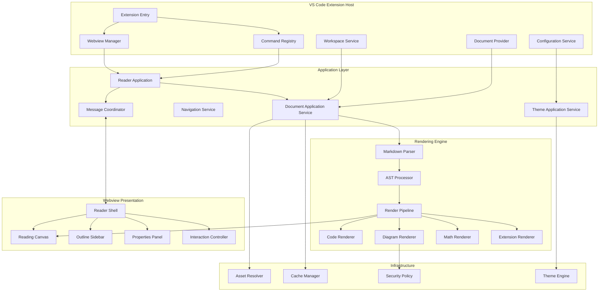
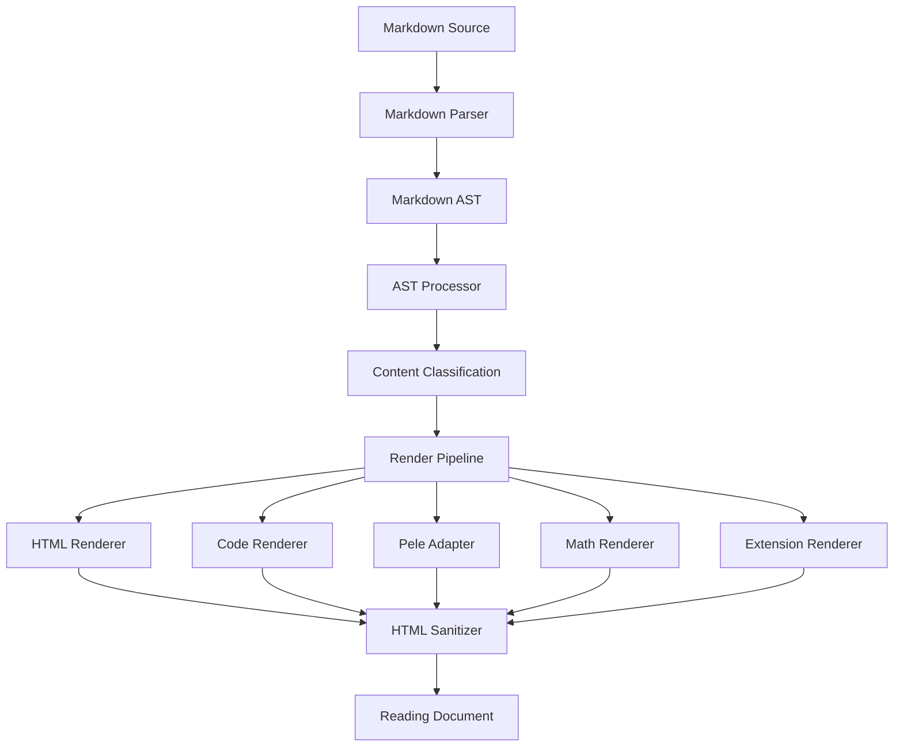
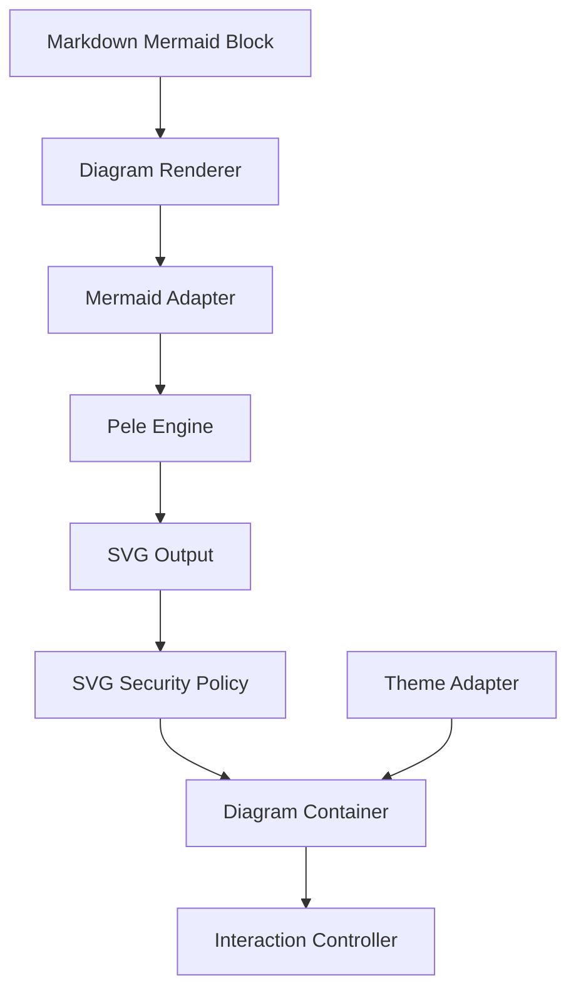
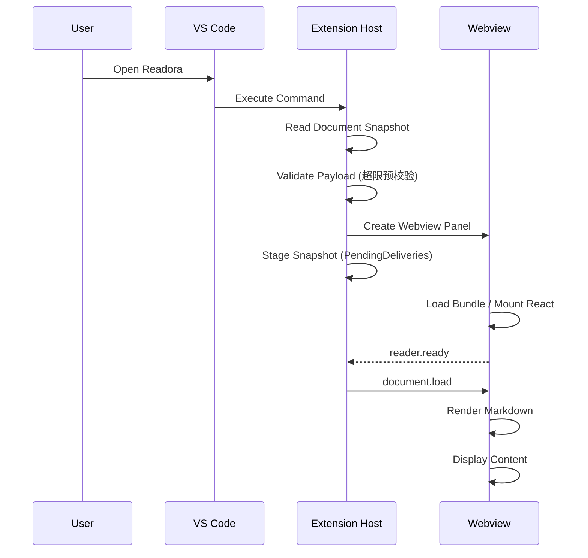
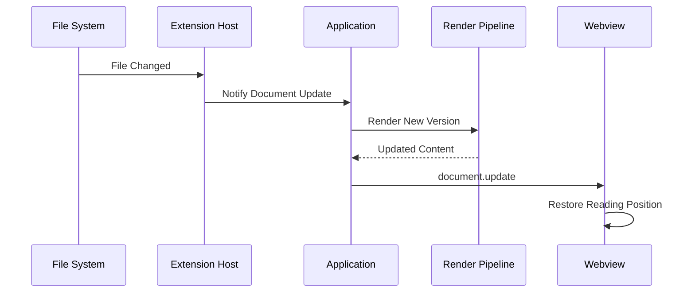
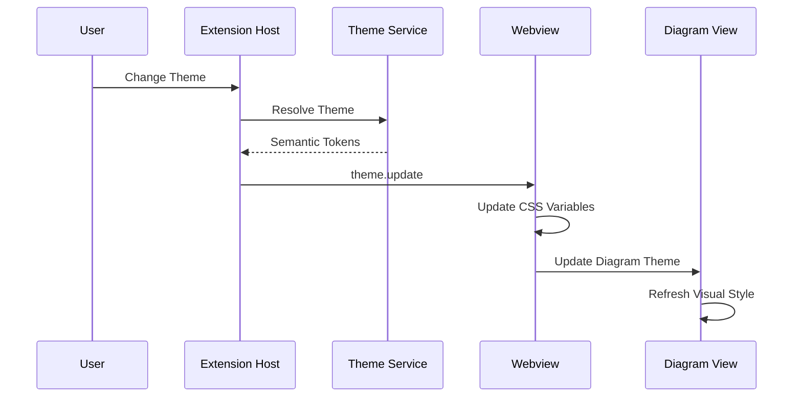

# ARC-001：Readora 总体架构设计

| 属性 | 内容 |
|---|---|
| 文档编号 | ARC-001 |
| 文档名称 | Readora 总体架构设计 |
| 文档版本 | 1.2.0 |
| 文档状态 | Final |
| 所属产品 | Readora |
| 关联需求 | PRD-001、PRD-002、PRD-003 |
| 开发语言 | TypeScript |
| 运行环境 | Visual Studio Code |
| UI 技术 | Webview + HTML + CSS |
| 核心渲染技术 | Markdown Parser + Pele + KaTeX |
| 架构风格 | Modular Architecture + Adapter Pattern |

---

## 1. 架构目标

### 1.1 设计目标

建立一套模块化、可扩展、轻量化的 VS Code Markdown 阅读器架构。

主要目标：

1. 将 VS Code 扩展宿主与阅读 UI 分离。
2. 建立独立的 Markdown 渲染管线。
3. 将 Mermaid 渲染作为独立子系统。
4. 通过 Pele 实现 Mermaid 图形渲染。
5. 建立统一的主题和设计 Token 系统。
6. 实现文档导航和资源管理。
7. 控制模块之间的依赖关系。
8. 保证 Webview 安全和渲染稳定性。

### 1.2 架构原则

| 原则 | 定义 |
|---|---|
| Separation of Concerns | 不同职责独立 |
| Modular Design | 功能模块化 |
| Dependency Inversion | 通过接口隔离具体实现 |
| Adapter Pattern | 隔离第三方渲染引擎 |
| Event Driven | 通过消息实现跨边界通信 |
| Rendering Pipeline | 统一内容处理流程 |
| Secure by Default | 默认安全 |
| Progressive Enhancement | 按能力逐步增强 |

---

## 2. 总体架构

### 2.1 架构分层

系统划分为五个逻辑层。

| 层次 | 名称 | 职责 |
|---|---|---|
| L1 | Extension Host | VS Code 生命周期和文件访问 |
| L2 | Application Layer | 阅读器应用服务和状态协调 |
| L3 | Rendering Engine | Markdown 内容解析与渲染 |
| L4 | Presentation Layer | Webview 阅读界面 |
| L5 | Infrastructure | 缓存、资源、安全和配置 |

### 2.2 总体架构图



### 2.3 架构边界

Extension Host 与 Webview 是两个独立运行环境。

Extension Host 负责：

- VS Code API。
- 工作区访问。
- 文件读取。
- 文件监听。
- 配置管理。
- 命令注册。
- Webview 生命周期。

Webview 负责：

- 阅读器 UI。
- Markdown 内容展示。
- DOM 交互。
- SVG 展示。
- 图表缩放。
- 搜索和目录交互。
- 主题视觉呈现。

二者只能通过定义好的消息协议通信，不允许直接访问对方的运行时对象。

---

## 3. 模块架构

### 3.1 Extension Host

#### 3.1.1 Extension Entry

职责：

- 扩展激活。
- 模块初始化。
- 服务注册。
- 生命周期管理。
- 扩展销毁。

不负责 Markdown 解析和具体 UI 实现。

#### 3.1.2 Command Registry

职责：

- 注册阅读器命令。
- 处理命令参数。
- 调用应用服务。
- 管理快捷键对应的命令。

核心命令（正式命名以 BRAND-001 为准）：

| 命令 ID | 功能 |
|---|---|
| readora.openReader | 打开阅读器 |
| readora.openToSide | 在侧边打开 |
| readora.focusMode | 切换专注模式 |
| readora.toggleOutline | 切换目录 |
| readora.refresh | 刷新阅读器 |

说明：

1. 早期草案中的 `readora.open`、`readora.toggle`、`readora.resetLayout` 已废弃，不再注册。
2. 命令的贡献点、入口矩阵与快捷键见 ARC-004 §4.4、§4.5。

#### 3.1.3 Document Provider

职责：

- 获取 Markdown 文档。
- 读取文件内容。
- 获取文档 URI。
- 监听文件变化。
- 维护文档版本信息。

统一提供 Document DTO。

#### 3.1.4 Workspace Service

**职责：**


- 工作区路径解析。
- 文档查找。
- 相对路径解析。
- 文件资源定位。
- 文档关联查询。

#### 3.1.5 Configuration Service

职责：

- 读取 VS Code 配置。
- 监听配置变化。
- 提供阅读器配置。
- 管理默认主题和布局偏好。

#### 3.1.6 Webview Manager

职责：

- 创建 Webview。
- 管理 Webview 生命周期。
- 配置本地资源访问。
- 注入 CSP。
- 管理消息通道。
- 恢复 Webview 状态。

---

## 4. Application Layer


应用层负责协调用户操作与底层模块。

### 4.1 Reader Application

核心职责：

- 创建阅读会话。
- 打开文档。
- 关闭阅读会话。
- 切换布局。
- 恢复阅读状态。

### 4.2 Document Application Service

职责：

- 获取文档内容。
- 调用渲染管线。
- 管理文档刷新。
- 处理渲染结果。
- 协调资源解析。

### 4.3 Navigation Service

职责：

- 生成文档大纲。
- 标题锚点管理。
- Wiki Link 解析。
- 反向链接查询。
- 文档跳转。

### 4.4 Theme Application Service

职责：

- 获取主题配置。
- 处理主题切换。
- 生成主题 Token。
- 同步图形主题。
- 同步 Webview 主题。

### 4.5 Message Coordinator

职责：

- 管理 Extension Host 与 Webview 消息。
- 验证消息类型。
- 路由应用操作。
- 处理异常消息。
- 管理请求关联标识。

---

## 5. Rendering Engine

### 5.1 架构目标

建立统一的 Markdown 渲染管线。

任何 Markdown 内容都必须经过统一解析和内容分类，不能让不同组件各自独立解析原始文档。

### 5.2 渲染流程



### 5.3 Markdown Parser

推荐采用 markdown-it。

职责：

- Markdown 语法解析。
- CommonMark 支持。
- GFM 扩展。
- 代码块识别。
- 标题识别。
- 链接识别。
- 图片识别。
- 自定义语法扩展。

Parser 不直接承担视觉呈现。

### 5.4 AST Processor

职责：

- 标题结构提取。
- 代码块分类。
- Mermaid 代码块识别。
- 数学公式识别。
- Wiki Link 识别。
- Frontmatter 识别。
- 资源引用提取。
- 文档元数据提取。

要求：

保留文档节点的来源位置信息，方便后续定位、错误提示和导航。

### 5.5 Render Pipeline

负责统一组织各个渲染器。

定义统一接口：

```typescript
interface ContentRenderer<TInput = unknown> {
  readonly id: string;

  canRender(input: RenderInput): boolean;

  render(
    input: TInput,
    context: RenderContext
  ): RenderResult;
}
```

统一渲染结果：

```typescript
interface RenderResult {
  html: string;
  diagnostics: RenderDiagnostic[];
}

interface RenderDiagnostic {
  severity: "info" | "warning" | "error";
  code: string;
  message: string;
  source?: {
    line?: number;
    column?: number;
  };
}
```

不同渲染器不得自行修改全局阅读器状态。

---

## 6. Diagram Rendering 子系统

### 6.1 架构定位

Diagram Rendering 是独立的图形渲染子系统。

第一阶段使用 Obsidian Pele 作为 Mermaid 引擎。

不直接将 Pele API 暴露给其他业务模块。

### 6.2 模块结构



### 6.3 Pele Adapter

负责：

- Pele 引擎调用。
- Mermaid 源码传递。
- SVG 结果接收。
- 渲染异常转换。
- 引擎能力隔离。
- 主题参数映射。

定义接口：

```typescript
interface DiagramEngine {
  render(
    source: string,
    options: DiagramRenderOptions
  ): Promise<DiagramRenderResult>;
}

interface DiagramRenderOptions {
  theme: DiagramTheme;
  width?: number;
}

interface DiagramRenderResult {
  svg: string;
  width: number;
  height: number;
}

interface DiagramTheme {
  background: string;
  foreground: string;
  accent: string;
  border: string;
}
```

说明：以上为阅读器内部适配接口，不代表 Pele 官方 API 的原始签名。同步 `render()` 和需要容器挂载的 `mount()` 应分别由适配器封装，避免强行统一不同生命周期。

### 6.4 图形渲染策略

第一阶段：

- 使用 Pele 生成 SVG。
- 采用统一图表容器。
- 使用 CSS Variables 控制容器主题。
- 支持缩放和拖动。
- 支持错误隔离。

后续阶段：

- 按图表类型加载。
- 图形结果缓存。
- 大型图表优化。
- SVG 导出。
- 图表无障碍增强。

### 6.5 引擎替换能力

业务模块只依赖 DiagramEngine。

未来如果需要替换 Pele，可以新增其他 DiagramEngine 实现，而不修改 Markdown Pipeline 和 Reading Canvas。

---

## 7. Presentation Layer

### 7.1 阅读器 UI 模块

| 模块 | 职责 |
|---|---|
| ReaderShell | 整体页面容器 |
| DocumentHeader | 文档标题与操作 |
| ReadingCanvas | 正文阅读区域 |
| OutlinePanel | 文档目录 |
| PropertiesPanel | 文档属性 |
| BacklinksPanel | 反向链接 |
| ReadingToolbar | 阅读工具栏 |
| SearchPanel | 文档搜索 |
| DiagramView | 图形展示 |
| CodeBlockView | 代码展示 |
| ImageViewer | 图片预览 |

### 7.2 UI 状态管理

建议按职责划分状态：

**Document State**

- 当前文档。
- 文档内容版本。
- 文档元数据。
- 渲染状态。

**Layout State**

- 左侧面板状态。
- 右侧面板状态。
- 专注模式。
- 内容宽度。

**Reading State**

- 当前滚动位置。
- 当前章节。
- 字号。
- 搜索状态。

**Theme State**

- 当前主题。
- 语义 Token。
- 图表主题。

状态管理应保持局部化，不引入过度复杂的全局状态系统。

---

## 8. Infrastructure

### 8.1 Asset Resolver

负责：

- 本地图片路径解析。
- 工作区资源定位。
- Markdown 相对路径解析。
- Webview 可访问 URI 转换。
- 资源加载异常处理。

### 8.2 Cache Manager

缓存类型：

| 缓存 | 内容 |
|---|---|
| Parse Cache | Markdown 解析结果 |
| Render Cache | 渲染结果 |
| Diagram Cache | Mermaid 图形结果 |
| Asset Cache | 资源元数据 |

缓存必须考虑：

- 文档 URI。
- 文档内容版本。
- 渲染器版本。
- 主题参数。
- 相关配置。

主题变化时，原则上优先更新样式，不重复执行不必要的 Markdown 解析和图表布局。

### 8.3 Security Policy

职责：

- HTML 安全处理。
- SVG 安全处理。
- 外部链接控制。
- 图片资源控制。
- CSP 生成。
- 消息验证。
- 本地文件访问控制。

### 8.4 Theme Engine

职责：

- 主题 Token 管理。
- Light / Dark 主题生成。
- VS Code 主题适配。
- 组件 Token 输出。
- 图形 Token 输出。

---

## 9. 跨模块通信

### 9.1 通信方式

Extension Host 与 Webview 使用 VS Code Webview 消息机制。

统一消息协议：

```typescript
interface ReaderMessage<T = unknown> {
  id: string;
  type: string;
  payload: T;
  timestamp: number;
}
```

消息方向：

- Host → Webview。
- Webview → Host。

### 9.2 核心消息类型

| 消息类型 | 方向 | 功能 |
|---|---|---|
| reader.ready | View → Host | Webview 就绪 |
| document.load | Host → View | 加载文档 |
| document.update | Host → View | 更新内容 |
| document.open | View → Host | 打开目标文档 |
| document.navigate | View → Host | 文档导航 |
| resource.resolve | View → Host | 请求资源 |
| theme.update | Host → View | 更新主题 |
| config.update | Host → View | 更新配置 |
| state.save | View → Host | 保存阅读状态 |
| state.restore | Host → View | 恢复阅读状态 |
| reader.error | View → Host | 错误通知 |

说明：

1. 消息协议的权威定义见 ARC-004 §8.3，本表与其保持一致。
2. 大纲数据随渲染结果投递（见 ARC-002 §12），不设独立的 `outline.update` 消息。
[^1]


### 9.3 消息约束

- 每种消息必须有明确 Schema。
- 禁止任意执行消息内容。
- 校验消息类型和数据结构。
- 对请求响应使用关联 ID。
- 避免重复消息。
- 处理 Webview 销毁和重建。
- 不允许将敏感文件内容写入日志。

---

## 10. 数据流设计

### 10.1 文档打开流程



说明（依据 AUD-001 §13.5 修订）：

1. `document.load` 必须在收到 `reader.ready` 之后投递。赋值 `webview.html` 后，Webview 的消息监听器尚未注册（bundle 未加载完成、React 未挂载），此时发送的消息会被丢弃；`postMessage` 返回 true 不代表消息已被接收。
2. Host 将文档快照暂存（PendingDeliveries），收到 `reader.ready` 时才投递。
3. 超限文档的载荷预校验在创建面板之前完成，保持早报，不留下空白面板。
4. Markdown 解析与渲染在 Webview 内完成，Host 只投递文档快照（见 §2.3 与 IMP-001 §2.2）。
5. 完整投递时序与回归护栏见 ARC-004 §8.7。

### 10.2 文档更新流程



### 10.3 主题切换流程



---

## 11. 工程目录结构

工程结构由 IMP-001 §4.1 冻结，采用 pnpm workspace Monorepo。本节不再维护独立目录树，只给出逻辑层与工程模块的映射。

工程骨架（完整目录树见 IMP-001 §4.1）：

```text
readora/
├── apps/
│   ├── extension/        # Extension Host（VS Code 扩展）
│   └── webview/          # Webview（React 阅读器应用）
├── packages/
│   ├── contracts/        # Host / Webview 消息契约
│   ├── markdown-core/    # Markdown 解析与渲染核心
│   ├── diagram-core/     # 图形渲染抽象与 Pele Adapter
│   ├── design-tokens/    # 设计 Token
│   └── test-utils/       # 测试工具与公共 Fixture
├── tests/                # integration / e2e / fixtures / security
├── scripts/
└── docs/
```

逻辑层与工程模块映射：

| 逻辑层（§2.1） | 工程模块 |
|---|---|
| L1 Extension Host | apps/extension（commands、document、session、webview、resource、configuration、security） |
| L2 Application Layer | apps/webview/src/app（前端应用服务）、apps/extension/src/session（Host 侧会话协调） |
| L3 Rendering Engine | packages/markdown-core、packages/diagram-core（运行于 Webview） |
| L4 Presentation Layer | apps/webview/src/shell、features、components |
| L5 Infrastructure | apps/extension/src/resource、security、configuration；packages/design-tokens |
| 跨层契约 | packages/contracts |

说明：

1. **Extension Host 与 Webview 必须拥有独立入口和独立构建产物（esbuild / Vite）。**
2. 共享包（contracts、design-tokens）只存放跨运行环境共享的数据契约和纯函数，不依赖 React、VS Code 或 Node.js。
3. 不允许 Webview 直接导入 VS Code API 或 Node.js 内置模块。
4. 不允许 Rendering Engine 依赖 UI 组件。
5. 不允许 Infrastructure 反向依赖 Application。


模块依赖方向与禁止项以 IMP-001 §4.3 为准。

---

## 12. 技术选型基线

| 技术 | 用途 | 决策 |
|---|---|---|
| TypeScript | 主开发语言 | 采用 |
| VS Code Extension API | 扩展宿主 | 采用 |
| React | Webview UI | 采用 |
| Vite | Webview 构建 | 采用 |
| esbuild | Extension Host 构建 | 采用 |
| pnpm | 包管理（workspace） | 采用 |
| markdown-it | Markdown 解析 | 采用 |
| highlight.js | 代码语法高亮 | 采用 |
| Pele | Mermaid 渲染 | 采用 |
| KaTeX | 数学公式 | 采用 |
| DOMPurify | HTML / SVG 安全处理 | 采用 |
| Zod | 消息与数据校验 | 采用 |
| CSS Variables | 主题系统 | 采用 |
| Tailwind CSS | 样式 utility 层（构建期编译） | 采用（IMP-001 §21 选型变更，见 ARC-005 §11.3） |
| Vitest | 单元测试 | 采用 |
| Playwright | UI E2E 测试 | 采用 |

技术选型由 IMP-001 §3 冻结（早期计划的 TSD-001 / TSD-002 编号从未独立成文，其内容已并入 IMP-001）。版本基线与锁定规则见 IMP-001 §3.2～§3.4。


****


---

## 13. 架构质量属性

### 13.1 可维护性

- 每个模块职责单一。
- 渲染器通过统一接口接入。
- 第三方引擎通过 Adapter 隔离。
- 消息协议集中管理。

### 13.2 可扩展性

未来允许扩展：

- 新的 Markdown 语法。
- 新的图形引擎。
- 新的数学渲染器。
- 新的阅读主题。
- 新的文档导航能力。

不要求第一阶段提前实现这些扩展。

### 13.3 性能

- 小型文档优先快速渲染。
- 大型文档支持分阶段处理。
- 缓存避免重复计算。
- 图表错误不影响整体页面。
- 主题切换尽可能只更新样式。

### 13.4 安全

- Host 与 Webview 隔离。
- 使用严格 CSP。
- 限制本地资源访问范围。
- 安全处理 HTML 和 SVG。
- 消息使用 Schema 验证。

---

## 14. 架构约束

### 14.1 必须遵守

1. 所有 Markdown 内容统一进入 Rendering Pipeline。
2. Mermaid 必须通过 Diagram Adapter。
3. Pele API 不得泄露到业务模块。
4. 主题必须通过统一 Theme Engine 管理。
5. Extension Host 与 Webview 必须通过消息协议通信。
6. 文件访问必须由 Extension Host 负责。
7. 渲染错误必须局部隔离。
8. 模块依赖方向必须保持单向。
9. 第三方库必须经过依赖和许可证审查。
10. 不允许为了抽象而过度设计。

### 14.2 暂不引入

- 微服务架构。
- 独立后端服务。
- 数据库。
- 云同步服务。
- 复杂插件运行时。
- 多进程渲染集群。
- 独立用户账户系统。

---

## 15. 架构验收标准

| 编号 | 验收项 | 要求 |
|---|---|---|
| ARC-AC-001 | Host / Webview 隔离 | 运行职责清晰 |
| ARC-AC-002 | Markdown Pipeline | 内容统一处理 |
| ARC-AC-003 | Renderer Interface | 渲染器可扩展 |
| ARC-AC-004 | Pele Adapter | 引擎实现隔离 |
| ARC-AC-005 | Theme Engine | 统一主题 Token |
| ARC-AC-006 | Message Protocol | 消息类型明确 |
| ARC-AC-007 | Asset Resolver | 本地资源正常解析 |
| ARC-AC-008 | Cache Manager | 支持版本化缓存 |
| ARC-AC-009 | Security Policy | 满足安全约束 |
| ARC-AC-010 | Module Dependencies | 无循环依赖 |

---

## 16. 后续架构文档

| 编号 | 文档名称 | 主要内容 | 状态 |
|---|---|---|---|
| ARC-001 | 总体架构设计 | 当前文档 | 已完成 |
| ARC-002 | Markdown 渲染架构 | Parser、AST、Pipeline | 已完成 |
| ARC-003 | 图形渲染引擎架构 | Pele Adapter、SVG、交互 | 已完成 |
| ARC-004 | VS Code 扩展集成架构 | Host、Webview、生命周期 | 已完成 |
| ARC-005 | 前端应用架构 | React、状态、组件体系 | 已完成 |
| ARC-006 | 主题系统架构 | Token、主题映射 | 已完成 |
| ARC-007 | 文档导航架构 | Outline、Wiki Link、Backlinks | 已完成 |
| ARC-008 | 资源与安全架构 | Asset、CSP、Sanitization | 已完成 |

---

## 17. 文档结论

Readora 采用单扩展、模块化架构。

Extension Host 负责 VS Code 集成和本地文件访问。

Application Layer 负责业务协调。

Rendering Engine 负责 Markdown 内容处理。

Presentation Layer 负责阅读器 UI。

Infrastructure 负责缓存、资源、安全和主题基础设施。

Mermaid 使用 Pele 作为独立渲染引擎，通过 Adapter 隔离第三方实现。

本架构在满足当前需求的前提下，保留必要扩展能力，不提前引入独立服务和复杂基础设施。

---

## 18. 修订记录

### 18.1 版本历史

| 文档版本 | 说明 |
|---|---|
| 1.0.0 | 初始架构基线 |
| 1.1.0 | 文档治理修订：依据 AUD-001 审计结论与 BRAND-001 命名基线补全缺口，状态转为 Final。修订不改变架构分层与模块职责，不新增文档编号（IMP-003 §10.5） |
| 1.2.0 | 选型变更同步：§12 技术选型基线新增构建期 Tailwind CSS utility 层（IMP-001 §21 用户决策）；架构分层与模块职责不变 |

### 18.2 1.1.0 修订内容

1. §3.1.2 命令表对齐 BRAND-001 正式命名（`readora.openReader` 等 5 命令），废弃早期草案命令名。
2. §9.2 消息表对齐 ARC-004 §8.3 权威协议：移除未实现的 `outline.update`（大纲随渲染结果投递），补充 `state.save` / `state.restore`。
3. §10.1 文档打开时序修正为 `reader.ready` 门控投递（依据 AUD-001 §13.5 首屏空白缺陷的根因与修复）。
4. §11 工程结构对齐 IMP-001 §4.1 冻结的 pnpm workspace，替换早期单包目录树草案。
5. §12 技术选型对齐 IMP-001 §3 冻结结论，消除 TSD-001 / TSD-002 悬空引用。
6. §16 后续文档表补充完成状态。
7. 新增 §18.3 实现偏差登记总表。

### 18.3 实现偏差登记总表

依据 AUD-001 §7 登记的偏差 D-1～D-5，详情与处置见对应文档：

| 编号 | 偏差摘要 | 详情位置 | 处置状态 |
|---|---|---|---|
| D-1 | 处理器第 7 步（资源引用提取）注释与实现不符，能力已由 P06 Image Renderer 与 Host 侧承担 | ARC-002 §5.1 | 已在 ARC-002 澄清职责；代码注释修正属实现侧后续动作 |
| D-2 | FileSystemWatcher 与文件级防抖未实现（F06-008 P0 缺口，DEFER-05） | ARC-004 §9 | 设计要求维持有效，待 V1.0.x / V1.1.x 补齐 |
| D-3 | PRD-002 §14 键位规范与实际键位不一致 | ARC-004 §4.5 | 实际键位已登记；PRD-002 修订属后续文档治理轮次 |
| D-4 | ReaderStatusBar 未实现（F10-006 P2、F02-009 P1） | ARC-005 §5.2 | 已标注为 V1.1.x 规划 |
| D-5 | Pele 隐式交互事件（拖动 / 滚轮 / 双击）项目侧 0 断言 | ARC-003 §12.2 | 已补交互回归测试要求，用例属实现侧后续动作 |

### 18.4 1.2.0 修订内容

1. §12 技术选型基线新增 Tailwind CSS（样式 utility 层，构建期编译），与 IMP-001 §3.1 / §21 选型变更同步。
2. utility 层定位为消费者而非新的架构层：主题值仍收敛于 Design Tokens（ARC-006），utility 架构与迁移策略见 ARC-005 §11.3，CSP 兼容性注记见 ARC-008 §11.2。

**文档状态：Final。**
