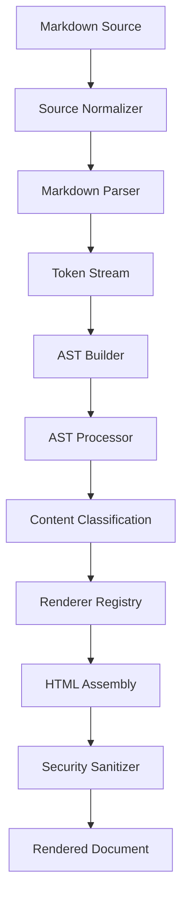
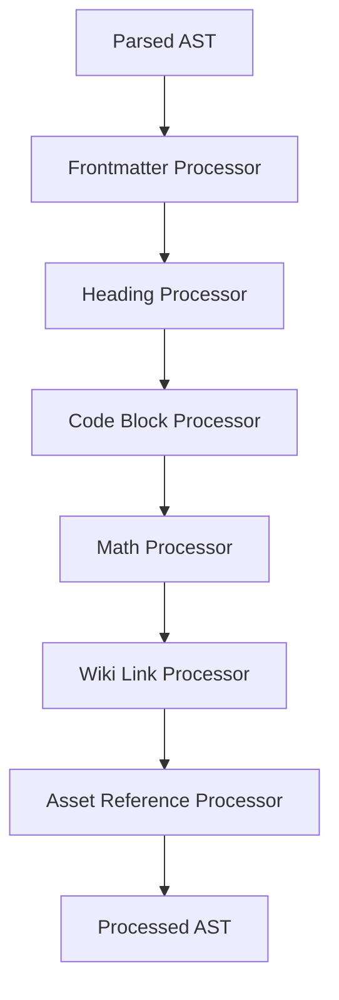
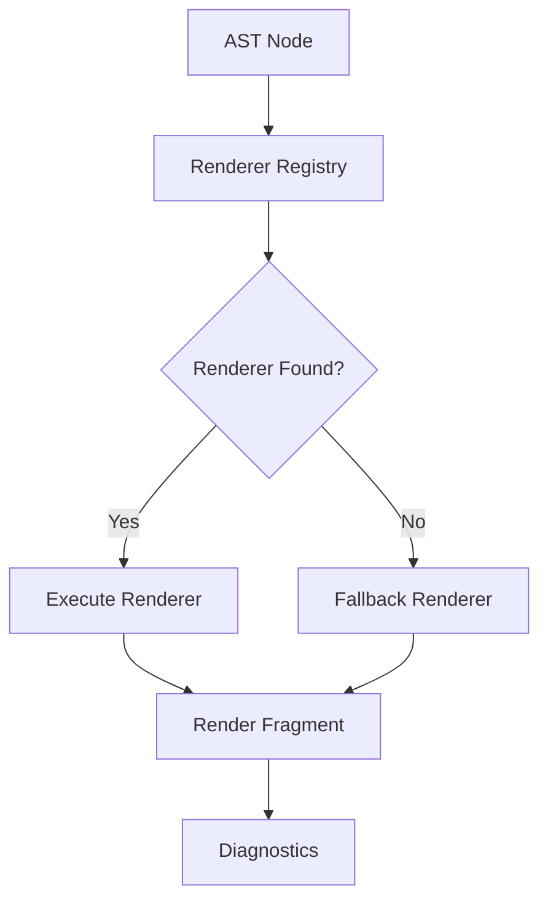
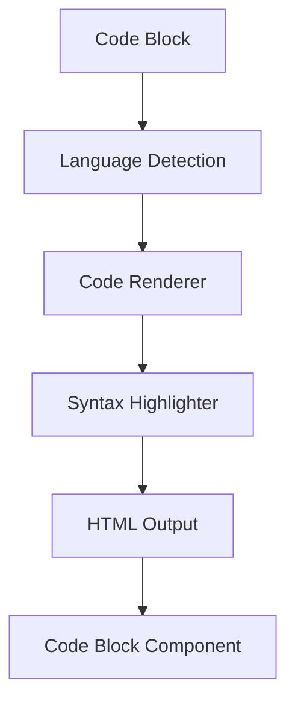
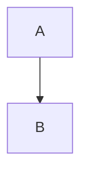
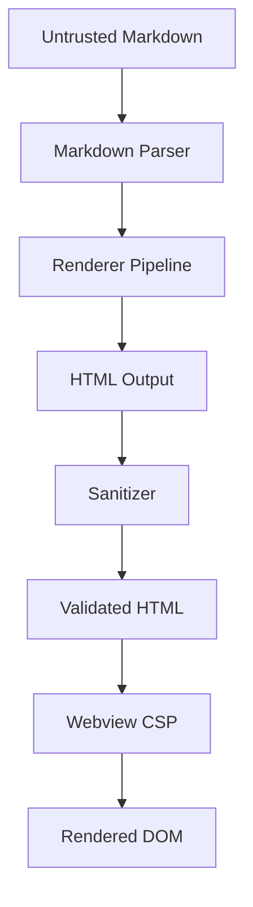

# ARC-002：Readora Markdown 渲染架构设计

| 属性 | 内容 |
|---|---|
| 文档编号 | ARC-002 |
| 文档名称 | Markdown 渲染架构设计 |
| 文档版本 | 1.4.0 |
| 文档状态 | Final |
| 所属产品 | Readora |
| 关联文档 | PRD-001、ARC-001、ARC-009（§12.3 区块源位置身份的消费方） |
| 核心技术 | TypeScript、markdown-it、KaTeX |
| 输出格式 | HTML |
| 适用范围 | Markdown 内容解析、转换与渲染 |

---

## 1. 设计目标

### 1.1 核心目标

建立统一的 Markdown 内容渲染架构，将 Markdown 源码转换为结构化、可展示、安全的阅读内容。

需要解决：

1. Markdown 标准语法解析。
2. Markdown 扩展语法处理。
3. AST 中间表示。
4. 内容节点分类。
5. 多类型内容渲染。
6. Mermaid 图表委托。
7. 数学公式渲染。
8. HTML 安全处理。
9. 文档大纲提取。
10. 增量更新与缓存。

### 1.2 设计原则

| 原则 | 说明 |
|---|---|
| Parser First | 统一使用解析器处理 Markdown |
| AST Based | 以结构化节点作为中间表示 |
| Renderer Independent | 渲染器之间相互独立 |
| Extension Friendly | 扩展语法通过插件机制接入 |
| Safe Output | 所有输出经过安全策略 |
| Deterministic | 相同输入和配置产生一致结果 |
| Incremental | 支持必要的局部更新 |
| Reading Oriented | 优先优化阅读体验 |

### 1.3 非目标

本模块不负责：

- VS Code 文件访问。
- Webview 生命周期。
- 阅读器整体布局。
- 图表缩放与拖动交互。
- 文档工作区搜索。
- 文档编辑和保存。
- 独立 Markdown 编辑器能力。

---

## 2. 总体处理架构

### 2.1 处理流程



### 2.2 处理阶段

| 阶段 | 模块 | 输入 | 输出 |
|---|---|---|---|
| P01 | Source Normalizer | 原始文本 | 标准化文本 |
| P02 | Markdown Parser | 标准化文本 | Token Stream |
| P03 | AST Builder | Token Stream | Markdown AST |
| P04 | AST Processor | Markdown AST | 处理后的 AST |
| P05 | Content Classification | AST | 分类节点 |
| P06 | Renderer Registry | 分类节点 | 渲染结果 |
| P07 | HTML Assembly | 渲染结果 | HTML |
| P08 | Security Sanitizer | HTML | 安全 HTML |

所有阶段必须有明确的输入输出契约。

---

## 3. Markdown Parser

### 3.1 技术选择

采用 `markdown-it` 作为 Markdown 解析器。

选择理由：

- TypeScript / JavaScript 生态成熟。
- 支持 CommonMark。
- 支持插件扩展。
- Token 结构清晰。
- 允许自定义语法规则。
- 可以控制 HTML 输出策略。

### 3.2 Parser 职责

Parser 只负责语法识别和 Token 生成。

不负责：

- 页面布局。
- 视觉样式。
- Mermaid SVG 生成。
- 数学公式排版。
- Webview DOM 操作。

### 3.3 初始化接口

```typescript
interface MarkdownParserOptions {
  html: boolean;
  linkify: boolean;
  typographer: boolean;
  breaks: boolean;
}

interface MarkdownParser {
  parse(
    source: string,
    options?: MarkdownParserOptions
  ): MarkdownToken[];
}
```

以上为内部抽象接口，不直接暴露 markdown-it 的具体实例。

### 3.4 基础配置

建议初始配置：

```typescript
const parserOptions = {
  html: false,
  linkify: true,
  typographer: false,
  breaks: false
};
```

配置原则：

- 默认关闭原始 HTML。
- 不自动将普通文本中的换行全部转换为 `<br>`。
- 链接识别由明确的解析规则控制。
- 标点自动替换默认关闭，避免改变原始文本含义。

---

## 4. Markdown AST

### 4.1 设计目的

markdown-it 原生 Token 结构适合语法解析，但不适合作为整个应用的长期业务数据契约。

因此增加内部 AST 层。

AST 负责：

- 统一节点结构。
- 维护文档层级。
- 提供源码位置信息。
- 支持不同渲染器。
- 支持大纲提取。
- 为后续增量处理保留基础。

### 4.2 节点类型

第一阶段支持以下节点：

| 节点类型 | 说明 |
|---|---|
| Document | 文档根节点 |
| Heading | 标题 |
| Paragraph | 段落 |
| Text | 文本 |
| Emphasis | 强调 |
| Strong | 加粗 |
| Link | 链接 |
| Image | 图片 |
| List | 列表 |
| ListItem | 列表项 |
| Blockquote | 引用 |
| CodeBlock | 代码块 |
| InlineCode | 行内代码 |
| Table | 表格 |
| ThematicBreak | 分隔线 |
| HtmlBlock | HTML 块（受控） |
| MathBlock | 块级公式 |
| MathInline | 行内公式 |
| DiagramBlock | 图形代码块 |
| WikiLink | 知识链接 |
| Frontmatter | 文档元数据 |

### 4.3 AST 基础接口

```typescript
type MarkdownNodeType =
  | "document"
  | "heading"
  | "paragraph"
  | "text"
  | "emphasis"
  | "strong"
  | "link"
  | "image"
  | "list"
  | "listItem"
  | "blockquote"
  | "codeBlock"
  | "inlineCode"
  | "table"
  | "thematicBreak"
  | "htmlBlock"
  | "mathBlock"
  | "mathInline"
  | "diagramBlock"
  | "wikiLink"
  | "frontmatter";

interface SourcePosition {
  // 行与列一律 0 基：值直接取自 markdown-it `token.map`（`ast.ts` 不做 +1 换算）。
  // 消费方（章节结构写回区间、诊断定位）不得按 1 基解释，否则源文件首行标题会被当成
  // 「没有位置」而整条丢弃，每一节的区间也会少算自己最后一行。
  startLine: number;
  startColumn?: number;
  endLine: number;
  endColumn?: number;
}

interface MarkdownNode {
  id: string;
  type: MarkdownNodeType;
  position?: SourcePosition;
  children?: MarkdownNode[];
  value?: string;
  attributes?: Record<string, unknown>;
}

interface MarkdownDocument extends MarkdownNode {
  type: "document";
  children: MarkdownNode[];
}
```

### 4.4 节点标识

节点 ID 用于：

- 节点定位。
- 渲染结果关联。
- 阅读位置恢复。
- 诊断信息定位。
- 后续增量更新。

第一阶段可以采用文档标识、节点类型和源码位置生成稳定标识。

不得依赖随机 ID 作为节点长期身份。

---

## 5. AST Processor

### 5.1 职责

AST Processor 对解析结果进行语义整理。

处理内容：

1. 标题层级整理。
2. 标题锚点生成。
3. Mermaid 代码块识别。
4. 数学公式识别。
5. Wiki Link 转换。
6. Frontmatter 提取。
7. 资源引用提取。
8. 节点位置校验。
9. 不支持语法诊断。

第 4 项的数学公式分两步完成：解析阶段（P02）负责占住公式的文本区间并保留原文，处理阶段（P04）负责判定它是行内还是块级。分两步的原因不是风格，而是 markdown-it 的 `escape` 规则在分词阶段就会改写反斜杠序列——`\,`、`\%`、`\{`、`\_` 以及矩阵行尾的 `\\` 到 AST 已变成普通字符，若由处理器从头识别表达式，交给渲染引擎的是损坏的源码且不产生任何错误。任务列表标记（§7.3）不需要这种处理：markdown-it 把 `- [ ]` 原样留在文本里，因此它可以在 P04 一次完成。占住区间依赖 §3.1 列为选型依据的自定义语法规则能力，实现落点见 IMP-001 §10.3。

实现职责澄清（依据 AUD-001 偏差 D-1 登记）：

1. 第 5 项（Wiki Link 转换）属 F03 Wiki Link 需求族（P1 / P2），延后到 V1.1.x，V1.0.0 未实现。实现侧在处理器注册表中显式声明该延后（测试断言 `deferred === ["wikiLink"]`），处理器位置保留。
2. 第 7 项（资源引用提取）的能力实际由 P06 Image Renderer（引用分类与惰性标记）与 Host 侧资源解析、访问策略共同承担（见 ARC-008 §5、§6），P04 不再单独执行资源引用提取。后续里程碑不得依据本项重复建设独立的资源提取处理器。
3. 其余各项已在 V1.0.0 实现。第 6 项 Frontmatter 提取仅覆盖识别与基础解析，Properties 展示属 F09（P1），未实现。

### 5.2 处理器接口

```typescript
interface AstProcessor {
  readonly id: string;

  process(
    document: MarkdownDocument,
    context: ProcessingContext
  ): MarkdownDocument;
}

interface ProcessingContext {
  documentUri: string;
  options: MarkdownRenderOptions;
}
```

### 5.3 处理顺序



处理顺序应固定，并通过测试保证结果稳定。

实现状态注记：Wiki Link Processor 为预留位（F03 延后，见 §5.1）；Asset Reference Processor 对应能力由 P06 Image Renderer 与 Host 侧承担（见 §5.1 与 ARC-008），P04 不实现为独立处理器。顺序不变量由注册表测试锁定。

---

## 6. Renderer Registry

### 6.1 设计目标

建立统一渲染器注册机制。

不同内容类型由不同 Renderer 负责，避免在一个大型 Markdown Renderer 中堆积所有业务逻辑。

### 6.2 渲染器分类

| Renderer | 负责内容 |
|---|---|
| Block Renderer | 块级节点 |
| Inline Renderer | 行内节点 |
| Code Renderer | 代码块 |
| Diagram Renderer | Mermaid 图表 |
| Math Renderer | 数学公式 |
| Link Renderer | 普通链接和 Wiki Link |
| Image Renderer | 图片 |
| Table Renderer | 表格 |
| HTML Renderer | 受控 HTML |

### 6.3 接口设计

```typescript
interface RendererContext {
  options: MarkdownRenderOptions;
  documentUri: string;
  theme: ThemeTokens;
}

interface MarkdownRenderer {
  readonly id: string;

  supports(node: MarkdownNode): boolean;

  render(
    node: MarkdownNode,
    context: RendererContext
  ): RenderFragment;
}

interface RenderFragment {
  html: string;
  diagnostics: RenderDiagnostic[];
}
```

### 6.4 注册机制

```typescript
interface RendererRegistry {
  register(renderer: MarkdownRenderer): void;

  unregister(id: string): void;

  resolve(node: MarkdownNode): MarkdownRenderer | undefined;

  getAll(): readonly MarkdownRenderer[];
}
```

规则：

- 一个节点应有明确的主渲染器。
- 不允许多个 Renderer 无序竞争。
- 注册顺序必须确定。
- 不支持的节点必须产生可诊断结果。
- 内置 Renderer 优先于可选扩展 Renderer。

### 6.5 渲染器执行规则



---

## 7. 基础内容渲染

### 7.1 标题

要求：

- 支持 H1 至 H6。
- 生成唯一锚点。
- 保留标题文本。
- 提供大纲数据。
- 支持标题跳转。

锚点生成规则：

1. 规范化标题文本。
2. 移除不适合作为锚点的字符。
3. 生成基础 slug。
4. 对重复标题追加序号。
5. 保证同一文档内唯一。

### 7.2 段落和文本

要求：

- 支持普通文本。
- 支持加粗。
- 支持斜体。
- 支持删除线。
- 支持行内代码。
- 保留语义结构。

### 7.3 列表

支持：

- 无序列表。
- 有序列表。
- 嵌套列表。
- 任务列表。

### 7.4 引用

支持：

- 普通引用。
- 嵌套引用。
- 引用内部的 Markdown 内容。

### 7.5 表格

支持：

- 表头。
- 多列。
- 对齐方式。
- 长文本换行。
- 横向滚动。

表格样式由视觉系统负责，Renderer 只输出语义结构。

### 7.6 链接

支持：

- 普通 URL。
- 文档内锚点。
- 相对 Markdown 路径。
- Wiki Link。

链接跳转由应用层接管，不允许 Renderer 直接调用 VS Code API。

---

## 8. 代码块渲染

### 8.1 职责

代码块渲染负责：

- 代码内容展示。
- 语言标识。
- 语法高亮。
- 复制操作。
- 行号。
- 长代码折叠。

范围注记：行号（F01-010）与长代码折叠（F01-012）为 P1 需求，V1.0.0 未实现，属 V1.1.x 规划；其余各项已在 V1.0.0 交付（AUD-001 §4.3 F01）。

### 8.2 渲染流程



### 8.3 设计约束

- 语法高亮失败时退化为普通代码块。
- 不支持的语言不应导致文档渲染失败。
- 代码内容必须进行 HTML 转义。
- 复制操作由 Webview UI 处理。
- 不允许代码块内容作为脚本执行。

---

## 9. 数学公式渲染

### 9.1 技术选择

采用 KaTeX。

支持：

- 行内数学公式。
- 块级数学公式。
- 常见数学符号。
- 矩阵。
- 分式。
- 上下标。
- 数学环境。

### 9.2 渲染接口

```typescript
interface MathRenderer {
  renderInline(source: string): RenderFragment;

  renderBlock(source: string): RenderFragment;
}
```

### 9.3 错误处理

- 单个公式失败不影响其他内容。
- 错误公式显示原始表达式或局部错误提示。
- 收集公式错误诊断。
- 禁止将公式输入作为任意 HTML 执行。

---

## 10. Mermaid 内容识别

### 10.1 识别规则

Mermaid 通过代码块语言标识识别。

示例：

````markdown

````

识别后转换为 DiagramBlock。

### 10.2 处理边界

Markdown Rendering 负责：

- 识别 Mermaid 代码块。
- 保留源码。
- 生成 DiagramBlock。
- 将节点交给 Diagram Renderer。

Markdown Rendering 不负责：

- Mermaid 语法解析。
- 图形布局。
- SVG 生成。
- 图形交互。

这些能力归属 ARC-003。

---

## 11. HTML 安全处理

### 11.1 安全原则

Markdown 源码属于不可信输入。

所有最终 HTML 必须经过统一安全策略。

### 11.2 默认策略

- 禁止默认执行原始 HTML。
- 禁止脚本标签。
- 禁止事件处理属性。
- 限制危险 URL Scheme。
- 禁止未经验证的内联脚本。
- 限制不安全 SVG 内容。
- 不允许渲染结果绕过安全处理。

### 11.3 Sanitizer

```typescript
interface HtmlSanitizer {
  sanitize(
    html: string,
    policy: SanitizationPolicy
  ): string;
}

interface SanitizationPolicy {
  allowHtml: boolean;
  allowSvg: boolean;
  allowExternalLinks: boolean;
  allowedUrlSchemes: string[];
}
```

安全处理不能仅依赖正则表达式。

应采用经过验证的 HTML Sanitization 实现，并针对 SVG 单独建立安全策略。

### 11.4 SVG 处理

SVG 主要来自 Diagram Renderer。

安全处理要求：

- 限制脚本元素。
- 移除事件处理属性。
- 检查外部资源引用。
- 限制危险 URL。
- 控制 SVG 元素和属性白名单。

### 11.5 安全边界



Sanitizer 与 CSP 是两层不同的安全措施，不应互相替代。

---

## 12. Render Result

### 12.1 统一结果结构

```typescript
interface MarkdownRenderResult {
  documentId: string;
  version: number;
  html: string;
  outline: OutlineItem[];
  diagnostics: RenderDiagnostic[];
  metadata: DocumentMetadata;
}

interface OutlineItem {
  id: string;
  title: string;
  level: number;
  anchor: string;
  position?: SourcePosition;
}

interface DocumentMetadata {
  title?: string;
  description?: string;
  tags: string[];
}
```

### 12.2 结果要求

渲染结果必须包含：

- HTML。
- 文档大纲。
- 文档元数据。
- 诊断信息。
- 文档版本。

应用层不得自行重新解析 HTML 来获取标题目录。

### 12.3 区块源位置身份（编辑锚点）

> 本节为 1.3.0 新增，服务于 **ARC-009 编辑模式**。§4.1 早已把「为后续增量处理保留基础」写进 AST 职责，`MarkdownNode.position` 也一直在携带 `token.map` 的行范围 —— 但渲染出口把它丢掉了，于是 DOM 里没有任何一个属性能回答「这段内容来自源文件的哪几行」。编辑模式需要的正是这个答案，本节只**补上已有信息的中途丢失**，不新增解析能力。

**契约**：块级渲染器必须为**顶层区块**输出源行范围属性。

```html
<p class="readora-paragraph" data-readora-source-range="12:15">…</p>
```

| 项 | 规定 |
|---|---|
| 属性名 | `data-readora-source-range` |
| 形状 | `"${startLine}:${endLine}"`，值形状 `^\d+:\d+$` |
| 行号基 | **0 基，且相对文件**。与 `ast.ts` 的 `positionOf` 同一基序（直取 `token.map`，不在中途换基），但 `positionOf` 交出的行号是**相对 body** 的 —— 管线解析的是剥掉 frontmatter 之后的正文，所以输出前必须加回被剥掉的行数（`FrontmatterOutcome.bodyLineOffset`）。漏这一步不是显示偏差：带 frontmatter 的文档每个区块都整体前移若干行，写回直接改到隔壁那几行去 |
| 区间 | 闭区间；**`endLine` 一律是区块自身的最后一行非空行**。`positionOf` 已把 `map[1]` 减一，但光这一下不够：列表这类块的 `map` 本身就把区块之后的分隔空行圈了进来（实测 `- a` / `- b` 后接空行再接 `---` 的 map 是 `[0, 3]`），还要按行内容收缩尾端 |
| `position` 缺失时 | **不输出该属性**。合成节点（`footnoteSection`、processors 造的 `tableRow` / `tableCell`）无可靠范围；属性缺失就是「此区块不可编辑」的唯一信号，不能退化成 `-1:-1` 这类看起来合法的值 |
| 标注层级 | 仅 `document.children` 一层；嵌套容器内的段落随所属顶层区块整体定位 |
| 发射点 | **管线顶层组装处**（`renderMarkdown` 逐子节点渲染并拼接的那一段），**不是**块级渲染器内部。理由：段落渲染器同时服务顶层段落与 `blockquote` / `list` 里的段落，在渲染器里无法自辨层级；要区分就得往 `RendererContext` 塞「我是不是顶层」再抄进每个块级渲染器，而且漏抄一个就是静默少标 |

「`endLine` 不含尾随空行」这一条是写回安全的前提：按 `[startLine, endLine]` 整段替换不会吃掉区块之间的分隔空行，也不会越到下一个区块头上——上面的列表实测已经给过一个反例：不收缩尾端时 `---` 会被写回一并替掉，下一个区块直接贴上来，连解析都会变。加偏移与收缩的**先后顺序**也是契约的一部分：行号内容判定必须发生在加偏移**之前**（它们看的是 body 坐标空间），先平移再收缩就会去数 frontmatter 那几行。

「为何只标顶层区块」：行内 token 的 `map` 继承自所属块，逐行标注只会得出一堆同一范围的假精度；而编辑单元的正确粒度就是顶层区块（ARC-009 §4.2）。

**安全面**：该属性是只读元数据，不产生可执行效果、不进 URL、不进样式，风险等同于既有的 `data-readora-width`。Sanitizer 侧**不需要改白名单**：清洗走 `ALLOW_DATA_ATTR: true`，DOMPurify 对匹配 `data-*` 的属性名直接放行而且**不查值**，所以「往 `ALLOWED_ATTR` 里添一行」既不是必要条件也不是充分条件。ARC-008 §9.3 要求的值形状校验只能自己做，干的是清洗后的一段剥离遍历：形状不匹配 `^\d+:\d+$`（或区间倒挂）就 `removeAttribute` 并记 `readora.render.source-range-stripped`（warning）。这段遍历不堵文档侧漏洞（parser 以 `html: false` 运行，文档自带 HTML 在渲染阶段就被转义成可见文本，没有写入自定义属性的路径），防的是生成侧把自己的编程错误（`NaN:NaN`、`-1:-1`）当成合法范围交给写回。

**门禁**（`packages/markdown-core/src/__tests__/source-range.spec.ts`，1.4.0 从 4 条扩到 6 条）：

1. 每个顶层区块的范围切出的源**单独再渲染一次**，产物与该块在文中的片段逐字节相同。用幂等式而不是手写期望行号：手写只能证明「我以为的行号」与「我以为的产物」互相一致，两个可以同时错。
2. 范围按文档顺序严格递增、两两不相交，相邻区块之间的间隙只能是空行（「整段替换吃不到隔壁区块」的可执行形态，比逐块断言更能抓 off-by-one）。
3. 行号是**文件绝对**行号：带 / 不带 frontmatter 的同一文档，各区块行号差正好是被剥掉的行数；围栏未闭合时偏移为 0（与提取层早退口径一致）。
4. 只标顶层：被标元素的后代不出现同名属性，合成脚注区不带属性，顶层元素数等于锚点数；`position` 缺失或形状非法时不输出属性，也不输出 `-1:-1` / `NaN`。
5. Sanitizer 按值形状剥离并给出 warning 诊断；合法值原样保留且**不产生**任何该诊断（正常渲染零命中）。
6. 本属性只**增加**：去掉它后产物不剩一个锚点字节，既有结构与 class 的命中数不变（回归护栏）。

另有两组不算独立契约、但撑着上面六条的用例：**注入健壮性**（一条形如 `\sqrt{a > "b"` 的公式必然走 KaTeX 失败降级分支，其产物里同时有 `>` 与 `"` —— 断言锚点仍落在开始标签末尾、源码原文仍在可见文本里，且先用 `data-readora-math-status="error"` 钉住「确实走的是降级分支」，否则公式哪天能正常渲染就会静默失去覆盖）与 `decorateFragment` 的**六条白盒**（自闭合 / 裸文本 / 残缺标签 / 只改第一个标签 / 引号感知 / 幂等）。

---

## 13. 增量更新与缓存

### 13.1 第一阶段策略

第一阶段优先实现文档级缓存和完整渲染。

不要求立即实现复杂的 AST 局部增量渲染。

> **与编辑模式的关系（1.3.0）**：本节的「全量渲染」策略**不因 ARC-009 而改变**。编辑态不是把整页变成可输入 DOM（那会要求增量 reconcile 与光标保持），而是单区块隔离编辑，提交后照旧走全量重写（ARC-009 §3.1）。因此 §13.4 的「局部节点重渲染」仍按原条件 —— 只在性能测试证明有必要后才做，编辑模式不构成那个必要性。

### 13.2 缓存键

建议缓存键由以下数据构成：

```typescript
interface RenderCacheKey {
  documentUri: string;
  contentHash: string;
  parserVersion: string;
  rendererVersion: string;
  optionsHash: string;
  themeVersion: string;
}
```

### 13.3 缓存失效

| 变化 | 处理策略 |
|---|---|
| 文档内容变化 | 重新解析和渲染 |
| Parser 配置变化 | 重新解析和渲染 |
| Renderer 版本变化 | 重新渲染 |
| 主题变化 | 优先更新样式 |
| 图表主题变化 | 更新图表主题 |
| 资源变化 | 更新相关资源 |

### 13.4 后续优化

在实际性能测试证明有必要后，再增加：

- AST 节点级缓存。
- 局部节点重渲染。
- 图表独立缓存。
- 大文档分块处理。

---

## 14. 错误与诊断

### 14.1 诊断级别

| 级别 | 含义 |
|---|---|
| Info | 提示 |
| Warning | 可恢复问题 |
| Error | 局部渲染失败 |

### 14.2 诊断结构

```typescript
interface RenderDiagnostic {
  code: string;
  severity: "info" | "warning" | "error";
  message: string;
  source?: SourcePosition;
  nodeId?: string;
}
```

### 14.3 故障隔离

必须满足：

1. 单个代码块错误不影响正文。
2. 单个公式错误不影响其他公式。
3. 单个 Mermaid 图表错误不影响其他图表。
4. 图片加载失败不影响文档布局。
5. 未知语法提供降级输出。
6. Sanitizer 失败时不得直接输出未经验证的 HTML。

---

## 15. 测试策略

### 15.1 单元测试

覆盖：

- Markdown Parser。
- AST Builder。
- AST Processor。
- 标题锚点。
- Renderer Registry。
- 代码块渲染。
- 数学公式渲染。
- HTML Sanitizer。

### 15.2 集成测试

覆盖：

- 完整 Markdown Pipeline。
- 多种语法混合。
- Mermaid 委托。
- 图片与链接解析。
- Frontmatter 提取。
- 错误隔离。
- 主题更新。

### 15.3 安全测试

测试输入包括：

- Script 标签。
- 事件处理属性。
- 危险 URL Scheme。
- 恶意 SVG。
- 非法 HTML。
- 嵌套 HTML。
- 异常超长输入。

### 15.4 验收标准

| 编号 | 验收项 | 标准 |
|---|---|---|
| RND-AC-001 | Markdown 解析 | 支持规定的基础语法 |
| RND-AC-002 | AST | 节点类型和源码位置完整 |
| RND-AC-003 | Renderer Registry | 支持统一注册与解析 |
| RND-AC-004 | 代码块 | 支持语言识别与高亮 |
| RND-AC-005 | 数学公式 | 支持行内和块级公式 |
| RND-AC-006 | Mermaid | 正确委托 Diagram Renderer |
| RND-AC-007 | HTML Sanitizer | 危险内容被拦截 |
| RND-AC-008 | Outline | 标题目录准确 |
| RND-AC-009 | Diagnostics | 错误可定位 |
| RND-AC-010 | Cache | 内容版本变化可正确失效 |

---

## 16. 本文档冻结范围

ARC-002 只定义 Markdown 内容处理架构。

以下内容归其他文档负责：

| 内容 | 归属 |
|---|---|
| Pele API 与 Mermaid 渲染 | ARC-003 |
| SVG 交互 | ARC-003 |
| Webview 生命周期 | ARC-004 |
| Host / Webview 消息协议实现 | ARC-004 |
| React 组件体系 | ARC-005 |
| 主题 Token 体系 | ARC-006 |
| Wiki Link 和反向链接业务 | ARC-007 |
| 文件资源访问与安全策略实现 | ARC-008 |

---

## 17. 修订记录

### 17.1 版本历史

| 文档版本 | 说明 |
|---|---|
| 1.0.0 | 初始渲染架构基线 |
| 1.1.0 | 文档治理修订：依据 AUD-001 偏差 D-1 澄清处理器实现职责，登记代码块 P1 范围，状态转为 Final。不改变管线阶段划分与处理器顺序不变量（IMP-003 §10.5） |
| 1.2.0 | §4.3 AST 基础接口给 `SourcePosition` 补上基序注记（行与列 0 基，取自 markdown-it `token.map`）。不改变 AST 形态、锚点规则与管线划分 |
| 1.3.0 | 新增 §12.3 区块源位置身份（`data-readora-source-range`）与 §13.1 与编辑模式的关系注记。均为**只增不改**：不动 AST 形态、不动渲染器划分、不动全量渲染策略。服务于 ARC-009 / PRD-001 F12 |
| 1.4.0 | §12.3 按 E0 实现结果回写三处口径修正（行号相对文件而非相对 body、`endLine` 收缩尾随空行、Sanitizer 无需改白名单而是做值形状后置剥离）、补充「发射点在管线顶层组装」一行、门禁从 4 条扩到 6 条。不改属性名、不改值形状、不改渲染器划分 |

### 17.2 1.1.0 修订内容

1. §5.1 澄清第 5 项 Wiki Link 的延后状态（F03，V1.1.x）与第 7 项资源引用提取的实际职责归属（P06 Image Renderer + Host 侧），消除偏差 D-1 的注释与实现不符问题在文档侧的根源。
2. §5.3 注明 Wiki Link Processor / Asset Reference Processor 为预留位，顺序不变量由测试锁定。
3. §8.1 注明行号与长代码折叠为 P1 范围（F01-010 / F01-012），V1.0.0 未实现。

### 17.3 1.2.0 修订内容

1. §4.3 `SourcePosition` 增加基序注记：`startLine` / `endLine` 为 0 基，由 `ast.ts` 直接透传 markdown-it `token.map`，不做 +1 换算。
2. 触发条件：下游 `apps/webview/src/content/section-metrics.ts` 曾按 1 基解释该字段，导致源文件首行标题被误判为「无位置」、其余各节区间少算一行；原文只写了字段名与类型，没写基序，两个消费方各猜一套。
3. 不改变 AST 节点形态、锚点规则（§7.1）与管线阶段划分；`packages/markdown-core` 的实现与测试本来就以 0 基为准（`__tests__/outline.spec.ts` 断言首条大纲 `startLine === 0`），本次只把既有事实写进权威文档。
   （追记：该消费方 `content/section-metrics.ts` 已随 PRD-003 1.8.3 删掉行内字数标签时一并移除，同一基序现在由 `content/outline-section-ops.ts` 与 §12.3 的写回路径继承。）

### 17.4 1.3.0 修订内容

1. 新增 §12.3：顶层区块的 DOM 必须携带 `data-readora-source-range`，并固定为 **0 基闭区间**、缺失即不输出、仅标 `document.children` 一层。
2. 基序重申是必要的：§17.3 第二条记录了同一个字段被两个消费方各猜一套基序、导致首行标题误判为「无位置」的实际缺陷。本节的消费方（ARC-009 写回路径）猜错的后果比显示错误更严重 —— **会改错文件的那几行**，因此 §12.3 把「不在中途换基」写成硬规定而不是建议。
3. 新增 §13.1 注记：编辑模式不构成交付「局部节点重渲染」的理由，全量渲染策略维持不变。
4. 本节只**新增属性输出**，不改既有 HTML 结构。§12.3 门禁第 4 条即为此设的回归护栏。

### 17.5 1.4.0 修订内容

本节是 §12.3 在 E0（ARC-009 §12 / IMP-002 STORY-13-01）落地时按实测回写的结果。原口径有四处与代码事实不符，不修正就会误导下一个实现者：

1. **行号必须补 frontmatter 偏移**（§12.3「行号基」）。原文只写了「0 基、与 `positionOf` 一致」，但 `positionOf` 的行号是相对 body 的，而管线解析的 body 已经被 `frontmatter.ts` 整段切掉 YAML 头（`lines.slice(closing + 1)`）。不补偿偏移，`dev/visual.tsx` 夹具（8 行 frontmatter）的首个标题会被标成 `1:1` 而不是 `9:9`，写回直接改错行。新增 `FrontmatterOutcome.bodyLineOffset` 交出被剥掉的行数。
2. **`endLine` 收缩尾随空行不能只靠 `map[1] - 1`**（§12.3「区间」）。原文断言 `positionOf` 已经把尾随空行排除在外，实测不然：列表块的 `map` 本身包含区块后的分隔空行（`- a` / `- b` 后接空行再接 `---` 得 `[0, 3]`）。不收缩的后果不是显示错误而是写回吃掉分隔行、改变后续解析。
3. **Sanitizer 白名单不需要动**（§12.3「安全面」）。原文写「白名单放行时必须带值形状校验」，误导读者以为要往 `ALLOWED_ATTR` 里加属性名。本地 DOMPurify 源码里 `ALLOW_DATA_ATTR` 对 `data-*` 的名字直接早退且**不校验值**，因此需要的是清洗后的值形状剥离遍历 + `readora.render.source-range-stripped` 诊断码。
4. **门禁从 4 条扩到 6 条**，并明记发射点与「只标顶层」的可执行形态（幂等切源、区间不相交且间隙只空行、frontmatter 偏移、嵌套层零标、后置剥离、只增属性）。
5. **与 §17.4 第 4 条的偏差登记**：「不改既有 HTML 结构」成立（产物只多一个属性，`visual:check` 10 档含截图与 `getComputedStyle` 采样全等），但「不改既有 HTML **断言**」不成立：`renderers.spec.ts` 有 4 处对全管线产物做精确串匹配（钉到了属性集末尾的 `>`），它们钉的意图是「标签 + class」而不是属性全集，已放宽为不写收尾 `>`（与 `renderers.spec.ts` 里 `h1` / `h2` 用例的既有写法一致）。实现侧未因此轮调整过任何输出结构。

**文档状态：Final。**
