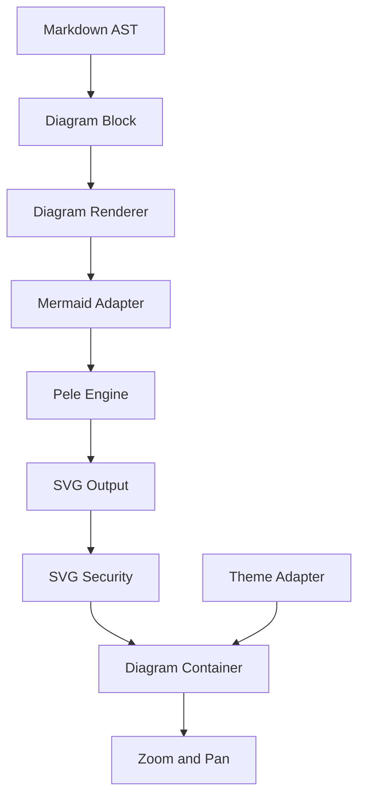
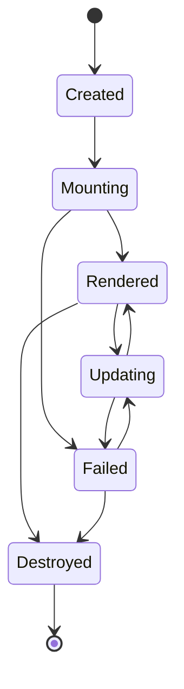

# ARC-003：Readora 图形渲染引擎架构设计

| 属性 | 内容 |
|---|---|
| 文档编号 | ARC-003 |
| 文档名称 | 图形渲染引擎架构设计 |
| 文档版本 | 1.1.0 |
| 文档状态 | Final |
| 所属产品 | Readora |
| 关联文档 | PRD-001、PRD-002、PRD-003、ARC-001、ARC-002 |
| 核心引擎 | Obsidian Pele |
| 输入格式 | Mermaid |
| 输出格式 | SVG |
| 运行环境 | VS Code Webview |

---

## 1. 设计目标

### 1.1 核心目标

建立统一的 Mermaid 图形渲染子系统，为 Readora 提供高质量、响应式、主题一致的图形阅读体验。

系统需要支持：

1. Mermaid 代码块识别与传递。
2. Pele 引擎集成。
3. Mermaid 图表类型兼容管理。
4. SVG 渲染与安全处理。
5. 图表容器布局。
6. 图表缩放和拖动。
7. 图表主题同步。
8. 渲染错误隔离。
9. 图表生命周期管理。
10. 图表性能优化。

### 1.2 设计原则

| 原则 | 说明 |
|---|---|
| Engine Isolation | 隔离 Pele 实现 |
| Native Capability First | 优先使用 Pele 原生能力 |
| SVG First | 使用 SVG 作为输出格式 |
| Responsive | 适应阅读区域宽度 |
| Theme Consistency | 与阅读器主题一致 |
| Failure Isolation | 单个图表失败不影响文档 |
| Secure Rendering | 控制不可信图表输入 |
| Lazy Loading | 按需加载图表类型 |

### 1.3 非目标

本模块不负责：

- Markdown 语法解析。
- Markdown AST 构建。
- Mermaid 语法重新实现。
- 图表编辑器。
- 图表数据建模工具。
- 独立图表设计器。
- 在线图表服务。

---

## 2. 技术选型

### 2.1 核心技术

| 技术 | 用途 | 决策 |
|---|---|---|
| Pele | Mermaid 解析和 SVG 渲染 | 采用 |
| SVG | 图形输出 | 采用 |
| CSS Variables | 图形主题 | 采用 |
| TypeScript | Adapter 实现 | 采用 |
| Webview | 图形展示 | 采用 |

### 2.2 Pele 技术特征

Pele 的主要能力：

- Mermaid 文本转换为 SVG。
- 支持 Mermaid 12.1.0 内置图表类型。
- 同步渲染。
- 浏览器容器挂载。
- 自适应容器宽度。
- CSS Variables 主题控制。
- 按需加载图表类型。
- 图表缩放和拖动。
- 输入和输出安全限制。

Pele 使用自己的布局和视觉实现，并非 Mermaid 官方渲染器的直接替代实现。因此，本产品的目标是兼容 Mermaid 语法并提供稳定阅读体验，不承诺与 Mermaid 官方 SVG 像素级一致。

官方资料：

- GitHub：https://github.com/obsidianmd/pele
- API：https://pele.run/api

---

## 3. 总体架构

### 3.1 架构图



### 3.2 模块划分

| 模块 | 职责 |
|---|---|
| Diagram Renderer | 图表渲染协调 |
| Mermaid Adapter | Pele API 适配 |
| Diagram Capability Registry | 图表类型能力管理 |
| Diagram Container | 图表展示容器 |
| Diagram Interaction | 图表交互 |
| Diagram Theme Adapter | 主题转换 |
| Diagram Error Handler | 错误处理 |
| Diagram Cache | 图表结果缓存 |

### 3.3 运行边界

Pele 运行在 Webview 渲染环境中。

原因：

1. Pele 提供浏览器挂载能力。
2. 图表尺寸依赖容器宽度。
3. CSS Variables 可以直接继承阅读器主题。
4. 缩放和拖动需要 DOM 交互。
5. 可以避免 Host 与 Webview 之间传输大量 SVG 字符串。

Extension Host 不直接调用 Pele。

---

## 4. Mermaid Adapter

### 4.1 设计目标

通过 Adapter 隔离 Pele API，避免应用层直接依赖第三方引擎。

### 4.2 内部接口

```typescript
interface DiagramEngine {
  readonly id: string;

  supports(source: string): boolean;

  render(
    source: string,
    options?: DiagramRenderOptions
  ): Promise<DiagramRenderResult>;

  mount(
    container: HTMLElement,
    source: string,
    options?: DiagramMountOptions
  ): MountedDiagram;
}

interface DiagramRenderOptions {
  maxWidth?: number;
}

interface DiagramMountOptions {
  zoom?: boolean | "auto";
  onError?: (error: unknown) => void;
}

interface DiagramRenderResult {
  svg: string;
}

interface MountedDiagram {
  update(source: string): void;
  refresh(): void;
  destroy(): void;
  readonly error?: unknown;
}
```

说明：

- 上述接口属于产品内部契约。
- `render()` 可以包装为 Promise，便于与统一应用接口对接，但不意味着 Pele 自身是异步的。
- `mount()` 保留浏览器容器生命周期。
- 具体类型以所锁定的 Pele 版本为准。

### 4.3 Pele Adapter 实现

```typescript
import { mount, render } from "pele";

class PeleAdapter implements DiagramEngine {
  readonly id = "pele";

  supports(source: string): boolean {
    // 通过 Pele 对应版本的能力接口判断。
    return detectDiagramType(source) !== undefined;
  }

  async render(
    source: string
  ): Promise<DiagramRenderResult> {
    const result = render(source);
    return { svg: result.svg };
  }

  mount(
    container: HTMLElement,
    source: string,
    options?: DiagramMountOptions
  ): MountedDiagram {
    return mount(container, source, {
      zoom: options?.zoom ?? "auto",
      onError: options?.onError
    });
  }
}
```

注意：

1. `detectDiagramType` 是阅读器自己的分类辅助函数，不负责 Mermaid 语法解析。
2. 最终是否支持某种图表，应由 Pele 的实际能力检查结果决定。
3. 不要通过简单正则表达式作为唯一兼容性判断依据。
4. 如果 API 参数随 Pele 版本变化，只修改 Adapter。

---

## 5. Mermaid 类型兼容管理

### 5.1 兼容性原则

Pele 官方声明支持 Mermaid 12.1.0 的内置图表类型。

产品不再自行维护一份与引擎脱节的假定支持列表。

实际支持范围必须由：

- 固定版本的 Pele 包。
- Pele 提供的能力检查。
- 实际渲染测试。
- 已知问题清单。

共同确定。

### 5.2 类型分类

兼容性清单初始按以下类别组织：

| 类别 | 示例 |
|---|---|
| 流程图 | Flowchart |
| 时序图 | Sequence |
| 状态图 | State |
| 类图 | Class |
| 实体关系图 | ER |
| 甘特图 | Gantt |
| 饼图 | Pie |
| 思维导图 | Mindmap |
| 时间线 | Timeline |
| 用户旅程图 | Journey |
| Git 图 | Git Graph |
| 象限图 | Quadrant |
| 桑基图 | Sankey |
| 块图 | Block |
| 架构图 | Architecture |
| 看板 | Kanban |
| 雷达图 | Radar |
| Treemap | Treemap |
| C4 图 | C4 |
| Packet 图 | Packet |
| Requirement 图 | Requirement |
| XY 图 | XY Chart |

以上是兼容性测试分类，不构成对某个具体版本、语法变体或全部高级特性的独立验收承诺。

### 5.3 兼容性测试

每类图表至少验证：

- 基础语法。
- 常见配置。
- 中文文本。
- 长文本。
- 特殊字符。
- 大型节点数量。
- 非法语法。
- 容器宽度变化。
- Light / Dark 主题。

### 5.4 不支持类型

处理策略：

1. 显示原始 Mermaid 源码。
2. 显示不支持提示。
3. 保留错误诊断。
4. 不影响其他图表。

---

## 6. 渲染策略

### 6.1 渲染模式

| 模式 | API | 使用场景 |
|---|---|---|
| 静态渲染 | render() | 导出、静态 SVG |
| 容器渲染 | mount() | 阅读器正常展示 |
| 按需加载 | renderAsync() | 类型按需加载 |

默认阅读模式采用 `mount()`。

原因：

- 自适应容器宽度。
- 支持缩放。
- 支持拖动。
- 支持更新。
- 支持错误回调。
- 支持销毁。

### 6.2 图表生命周期



### 6.3 生命周期规则

**Created**

创建图表容器和必要状态。

**Mounting**

调用 Pele mount。

**Rendered**

图表已成功生成。

**Updating**

源代码或渲染配置发生变化。

**Failed**

当前图表无法正常绘制。

**Destroyed**

释放监听器和相关资源。

### 6.4 生命周期管理

每个图表实例必须与对应的 DOM 容器绑定。

容器销毁时：

- 调用 `destroy()`。
- 清理产品自己的事件监听器。
- 清理产品自己的临时状态。
- 取消不再需要的异步任务。

不得让图表实例长期引用已销毁的 DOM。

---

## 7. 图表布局与交互

### 7.1 容器布局

Diagram Container 负责：

- 最大宽度。
- 最小高度。
- 水平居中。
- 背景与边框。
- 图表工具栏。
- 溢出处理。
- 空白区域控制。

### 7.2 响应式布局

图表应适应阅读画布宽度。

布局策略：

| 场景 | 策略 |
|---|---|
| 图表小于容器 | 正常展示 |
| 图表大于容器 | 缩放适配 |
| 窄屏阅读 | 允许缩放 |
| 容器尺寸变化 | 自动刷新 |
| 隐藏后重新显示 | 必要时 refresh |

优先使用 Pele 自身的容器自适应能力，不重复开发 ResizeObserver 布局系统。

### 7.3 交互功能

| 功能 | 处理方式 |
|---|---|
| Zoom In | 调整缩放 |
| Zoom Out | 调整缩放 |
| Pan | 拖动 |
| Fit | 适配容器 |
| Reset | 恢复默认状态 |
| Fullscreen | 产品容器管理 |
| Export SVG | 导出 SVG |
| Copy Source | 复制 Mermaid 源码 |

优先使用 Pele 自带 Zoom 能力。

对于 Pele 未提供的功能，只在产品交互层补充。

实现归属注记（依据 AUD-001 偏差 D-5 登记）：

1. 拖动（F04-032）、滚轮缩放（F04-033）、双击缩放（F04-034）由 Pele `enableZoom` 隐式提供（引擎源码含 pointerdown / pointermove / wheel / dblclick 处理与 grab 光标），项目不实现第二套交互。
2. 阅读器自有工具栏只覆盖 zoom-in / zoom-out / fit / reset。
3. 引擎隐式提供的 P0 交互必须通过兼容性测试的交互事件断言固化（见 §12.2），不得因"由引擎提供"而长期处于无验证状态。

### 7.4 交互约束

- 普通页面滚动不能被无条件拦截。
- 只有明确的图表交互手势才允许控制图表。
- 支持键盘访问。
- 支持缩放状态重置。
- 图表交互不能破坏阅读位置。
- 不允许多个图表共享同一交互状态。

---

## 8. 主题系统集成

### 8.1 设计目标

图表主题必须与 Readora 的 Light / Dark 主题保持一致。

### 8.2 Token 映射

| Reader Token | Pele Token |
|---|---|
| --readora-color-canvas | --pele-bg |
| --readora-color-text-primary | --pele-fg |
| --readora-color-text-secondary | --pele-muted |
| --readora-color-border | --pele-border |
| --readora-color-surface | --pele-surface |
| --readora-color-surface-subtle | --pele-surface-alt |
| --readora-color-accent | --pele-accent |
| --readora-font-family-body | --pele-font |

Pele 还支持系列颜色变量：

- `--pele-series-1`
- `--pele-series-2`
- ...
- `--pele-series-8`

以及图表圆角和字体相关变量。

最终变量清单以选定版本的 Pele Theming 文档为准。

### 8.3 CSS 示例

```css
.diagram-container {
  --pele-bg: var(--readora-color-canvas);
  --pele-fg: var(--readora-color-text-primary);
  --pele-muted: var(--readora-color-text-secondary);
  --pele-border: var(--readora-color-border);
  --pele-surface: var(--readora-color-surface);
  --pele-surface-alt: var(--readora-color-surface-subtle);
  --pele-accent: var(--readora-color-accent);
  --pele-font: var(--readora-font-family-body);
}
```

Reader Token 命名遵循 PRD-003 §13.1 的 `--readora-{category}-{name}` 规范。主题同步通过 CSS 变量映射完成，不向 Pele 传入 `themeVariables`，不触发重解析与重布局（见 §8.4）。

### 8.4 主题切换

主题变化优先通过 CSS Variables 实现。

如果仅颜色和字体变化，不应无条件重新执行 Mermaid 解析和布局。

如果字体变化影响布局测量，应调用 `refresh()`。

---

## 9. SVG 安全

### 9.1 安全原则

虽然 Pele 提供输入转义、链接过滤、样式过滤和输入输出大小限制，但产品仍然必须建立自己的安全边界。

不能将第三方引擎的安全能力视为 Webview 的全部安全措施。

### 9.2 安全处理

- 限制 Mermaid 输入长度。
- 限制 SVG 输出大小。
- 禁止危险外部资源引用。
- 验证 SVG 元素和属性。
- 限制链接协议。
- 禁止事件处理属性。
- 禁止脚本执行。
- 通过 CSP 限制 Webview 资源。

实现基线：Mermaid 源码输入上限为 50,000 字符（`MAX_DIAGRAM_SOURCE_CHARACTERS`），超限报错误码 `readora.diagram.over-limit` 并展示错误卡片（F04-058，AUD-001 §4.3 F04 有用例锁定）。

### 9.3 Sanitizer 集成

Pele `mount()` 支持通过 `sanitize` 选项控制 SVG 插入前的处理。

产品必须评估并使用该接口。

建议：

```typescript
const diagram = mount(container, source, {
  zoom: "auto",
  sanitize: (svg) => {
    return sanitizeSvgToNode(svg);
  }
});
```

`sanitizeSvgToNode` 为产品安全模块提供的实现，不是 Pele 内置函数。

如果 Sanitizer 无法安全处理 SVG，则应显示错误状态，而不是回退到未经验证的 HTML 插入。

---

## 10. 错误处理

### 10.1 错误分类

| 类型 | 示例 | 处理 |
|---|---|---|
| Syntax Error | Mermaid 语法错误 | 显示局部错误 |
| Unsupported | 不支持的语法 | 显示源码 |
| Resource Error | 图表资源失败 | 降级 |
| Layout Error | 布局失败 | 保留错误信息 |
| Security Error | SVG 验证失败 | 阻止插入 |
| Runtime Error | 引擎运行异常 | 隔离图表 |

### 10.2 错误展示

图表失败时展示：

- 图表错误标识。
- 简短错误说明。
- 展开源码。
- 复制源码。
- 重试操作。

不得直接将异常堆栈显示给普通用户。

### 10.3 错误诊断

```typescript
interface DiagramDiagnostic {
  code: string;
  severity: "warning" | "error";
  message: string;
  source?: {
    line?: number;
    column?: number;
  };
}
```

---

## 11. 性能优化

### 11.1 基础策略

1. 图表按需渲染。
2. 大型图表延迟加载。
3. 使用 Pele 按需加载入口。
4. 缓存重复渲染结果。
5. 避免无意义的重复 mount。
6. 复用已有图表实例。
7. 容器销毁时及时释放资源。

### 11.2 按需加载

Pele 提供完整入口、core 入口和 lazy 入口。

第一阶段优先评估：

- 常用图表：预加载。
- 低频图表：按需加载。
- 罕见图表：首次使用时加载。

具体拆分依据实际打包体积和启动性能测试决定。

### 11.3 缓存键

```typescript
interface DiagramCacheKey {
  sourceHash: string;
  peleVersion: string;
  diagramOptionsHash: string;
  fontVersion: string;
}
```

缓存规则：

- 源码变化必须失效。
- 引擎版本变化必须失效。
- 影响布局的配置变化必须失效。
- 仅颜色变化优先不失效。
- 字体变化根据测量结果刷新。

### 11.4 性能测试指标

首版目标：

| 指标 | 目标 |
|---|---|
| 简单图表 | 交互等待尽量低于 100ms |
| 中型图表 | 交互等待尽量低于 300ms |
| 大型图表 | 避免阻塞整篇文档 |
| 主题切换 | 不重复执行不必要的解析 |
| 容器销毁 | 无持续监听和明显内存泄漏 |

以上是工程验收目标，不是 Pele 的性能保证，必须通过目标平台实测确认。

---

## 12. 测试策略

### 12.1 单元测试

- Mermaid 类型识别。
- Adapter。
- 能力注册。
- 缓存键。
- 主题映射。
- 错误转换。
- Sanitizer。

### 12.2 集成测试

- Mermaid 到 SVG。
- Pele mount 生命周期。
- update 和 refresh。
- 多图表同页。
- 主题切换。
- 图表容器销毁。
- 不支持语法。
- 非法源码。
- 引擎隐式交互事件回归（拖动、滚轮缩放、双击缩放）。

交互回归要求（依据 AUD-001 偏差 D-5）：兼容性测试必须包含 pointer / wheel / dblclick 交互事件断言，把引擎隐式提供的 P0 交互（F04-032～034）固化为升级回归防线；Pele 升级时必须复跑（IMP-001 §3.4 第 7 条要求关键依赖具备独立兼容性测试）。截至 V1.1.1 基线，兼容性测试仅覆盖渲染面，交互断言尚未补齐，属实现侧后续动作。

### 12.3 视觉测试

建立图表测试样例集：

- 流程图。
- 时序图。
- 类图。
- 状态图。
- ER 图。
- 甘特图。
- 思维导图。
- 时间线。
- 架构图。

重点验证：

- 中文文本。
- 字体一致性。
- 图表边界。
- 连线清晰度。
- 节点间距。
- 暗色主题。
- 窄屏表现。

### 12.4 验收标准

| 编号 | 验收项 | 标准 |
|---|---|---|
| DIA-AC-001 | Pele 集成 | Adapter 正常工作 |
| DIA-AC-002 | Mermaid 识别 | 正确识别图表块 |
| DIA-AC-003 | SVG 输出 | 正常展示 |
| DIA-AC-004 | 兼容性 | 建立版本化测试清单 |
| DIA-AC-005 | 响应式 | 随容器变化调整 |
| DIA-AC-006 | 缩放 | 支持缩放和拖动 |
| DIA-AC-007 | 主题 | 与阅读器主题同步 |
| DIA-AC-008 | 安全 | SVG 通过安全策略 |
| DIA-AC-009 | 错误隔离 | 单图表错误不影响文档 |
| DIA-AC-010 | 生命周期 | 实例正确销毁 |

---

## 13. 技术决策记录

### ADR-003-001：采用 Pele

**决策：** 使用 Obsidian Pele 作为 Mermaid 图形引擎。

原因：

- 专注 Mermaid 渲染。
- 直接生成 SVG。
- 提供浏览器挂载能力。
- 支持容器自适应。
- 提供主题变量。
- 提供缩放和拖动。

### ADR-003-002：采用 Adapter Pattern

**决策：** 不在业务模块中直接调用 Pele。

原因：

- 降低第三方依赖耦合。
- 控制版本升级影响。
- 为未来引擎替换保留边界。

### ADR-003-003：默认使用 mount()

**决策：** 阅读器正常展示采用 `mount()`。

原因：

- 图表需要适应阅读容器。
- 需要生命周期管理。
- 需要交互能力。
- 需要响应容器变化。

### ADR-003-004：不重写 Mermaid

**决策：** 不自行实现 Mermaid 解析器和布局引擎。

原因：

- 避免重复实现。
- 降低维护成本。
- 避免产生不同语法标准。
- 将研发资源集中在阅读体验。

---

## 14. 文档冻结范围

ARC-003 负责：

- Pele 集成。
- Mermaid 类型兼容。
- SVG 输出。
- 图表主题。
- 图表交互。
- 图表生命周期。
- 图表性能。
- 图表错误处理。

不负责：

- Markdown Parser。
- Markdown AST。
- React 整体组件体系。
- 阅读器全局主题 Token。
- VS Code 文件访问。
- 通用资源管理。

---

## 15. 修订记录

### 15.1 版本历史

| 文档版本 | 说明 |
|---|---|
| 1.0.0 | 初始图形引擎架构基线 |
| 1.1.0 | 文档治理修订：依据 AUD-001 偏差 D-5 登记交互归属与回归测试要求，补充输入上限实现基线，Token 命名对齐 PRD-003 §13.1，状态转为 Final（IMP-003 §10.5） |

### 15.2 1.1.0 修订内容

1. §7.3 注明拖动 / 滚轮 / 双击缩放由 Pele `enableZoom` 隐式提供，产品工具栏仅覆盖 zoom-in / out / fit / reset（D-5）。
2. §8.2、§8.3 Token 命名对齐 PRD-003 §13.1（`--readora-color-*`、`--readora-font-family-body`），并注明免重解析的主题同步机制。
3. §9.2 补充输入上限实现基线：50,000 字符、错误码 `readora.diagram.over-limit`（F04-058）。
4. §12.2 新增引擎隐式交互事件回归要求，Pele 升级必复跑（IMP-001 §3.4 第 7 条）。

**文档状态：Final。**