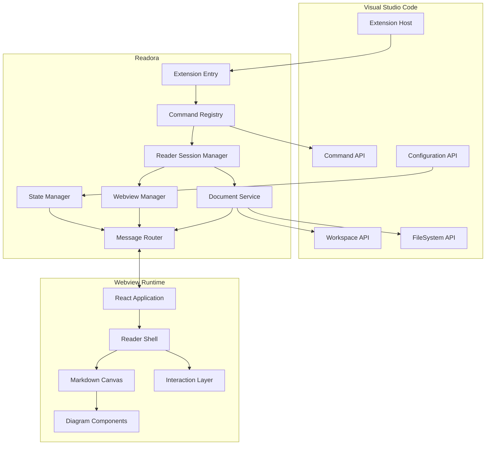
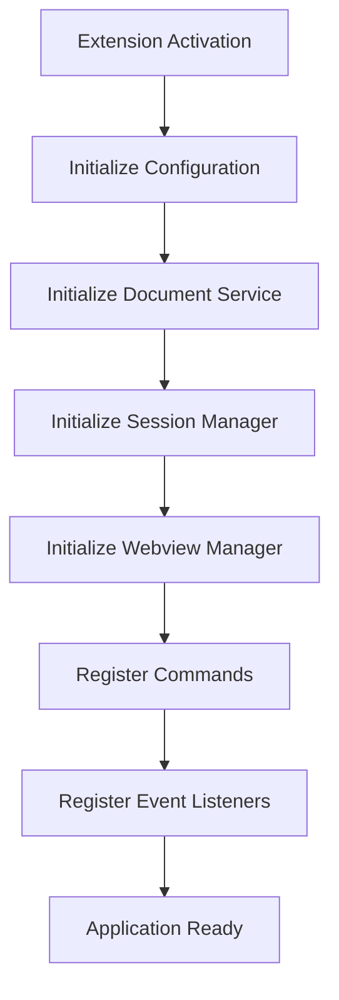
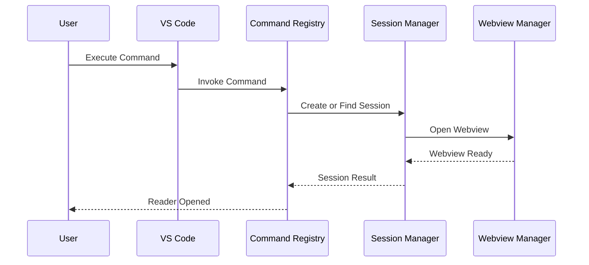
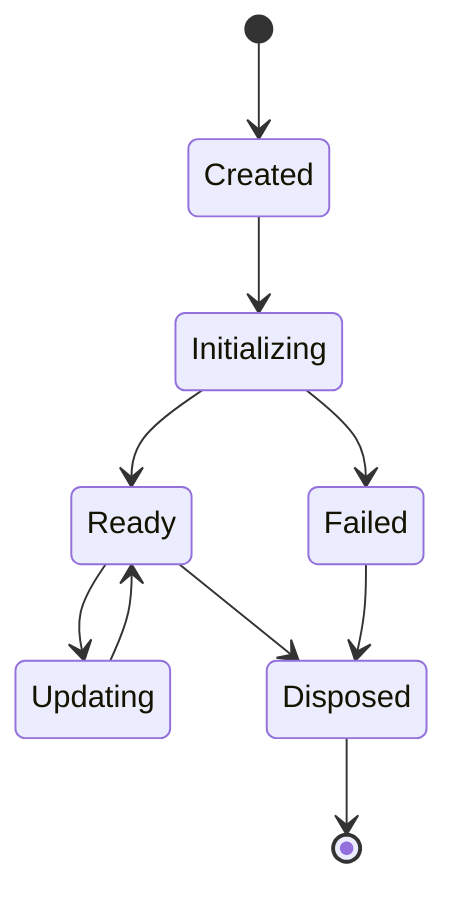
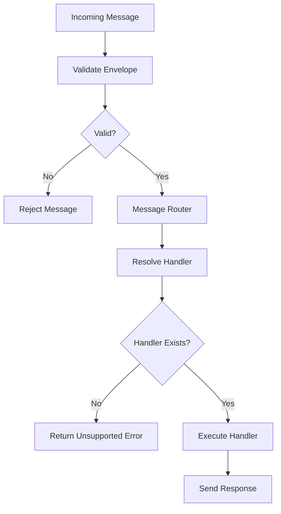
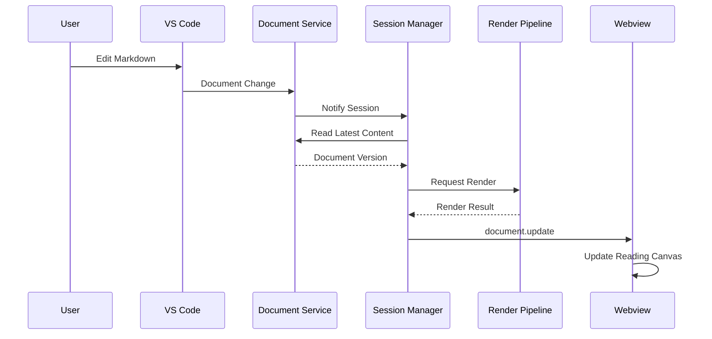
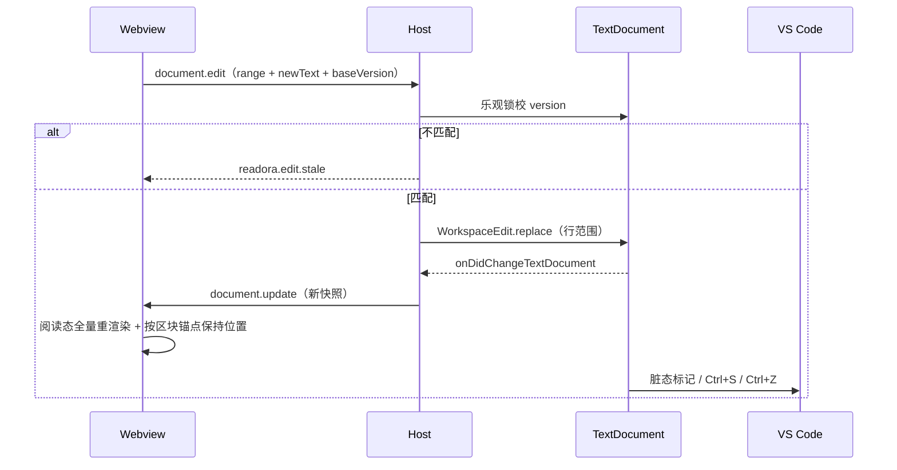
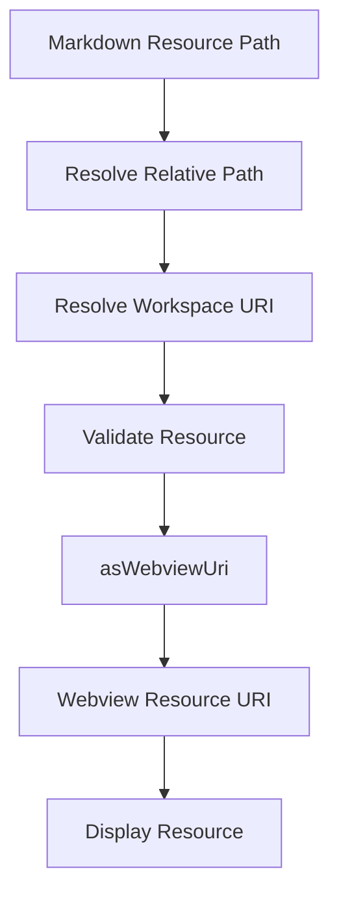
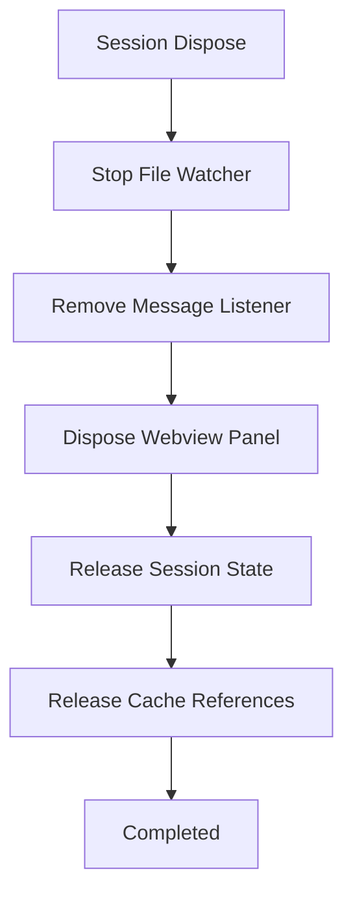

# ARC-004：Readora VS Code 扩展集成架构设计

| 属性 | 内容 |
|---|---|
| 文档编号 | ARC-004 |
| 文档名称 | VS Code 扩展集成架构设计 |
| 文档版本 | 1.3.0 |
| 文档状态 | Final |
| 所属产品 | Readora |
| 关联文档 | PRD-001、PRD-002、ARC-001、ARC-002、ARC-003、ARC-009（就地编辑） |
| 开发语言 | TypeScript |
| 运行平台 | Visual Studio Code |
| 核心 API | VS Code Extension API |
| UI 运行环境 | Webview |

---

## 1. 设计目标

### 1.1 核心目标

建立 Readora 与 VS Code 的集成架构，实现：

1. 扩展激活与生命周期管理。
2. 阅读器命令注册。
3. Markdown 文档读取。
4. Webview 创建和管理。
5. Extension Host 与 Webview 通信。
6. 文件变化监听和文档刷新。
7. 本地资源 URI 转换。
8. 阅读器状态恢复。
9. 多文档阅读会话管理。
10. Webview 安全配置。

### 1.2 设计原则

| 原则 | 说明 |
|---|---|
| VS Code Native | 遵循 VS Code 扩展生命周期 |
| Host Isolation | Host 与 Webview 职责隔离 |
| Message Based | 跨运行环境只通过消息通信 |
| Resource Controlled | 文件资源由 Host 管理 |
| Disposable | 所有监听和资源可释放 |
| Session Oriented | 按阅读会话管理状态 |
| Secure by Default | 默认启用安全限制 |

### 1.3 非目标

本模块不负责：

- Markdown 解析算法。
- Mermaid 图形布局。
- React 组件实现。
- 主题 Token 设计。
- 文档知识图谱。
- 云端同步。
- 独立文件管理器。

---

## 2. VS Code 扩展架构

### 2.1 运行环境

系统由两个独立运行环境构成。

**Extension Host**

运行 TypeScript 扩展代码，能够访问 VS Code Extension API。

主要负责：

- 扩展激活。
- 命令注册。
- 工作区文件访问。
- 文档读取。
- 文件监听。
- Webview 管理。
- 配置管理。
- 状态持久化。

**Webview**

运行阅读器前端应用。

主要负责：

- 阅读器界面。
- Markdown 内容展示。
- Mermaid 图形展示。
- 阅读交互。
- 面板布局。
- 搜索交互。
- 局部 UI 状态。

### 2.2 架构图



### 2.3 关键约束

1. Webview 不得直接导入 `vscode` 模块。
2. Webview 不得直接访问本地文件系统。
3. Host 不负责 DOM 操作。
4. 所有跨边界操作必须经过消息协议。
5. 文件 URI 不得直接作为 Webview 可访问路径。
6. Webview 被销毁后必须释放关联资源。

---

## 3. Extension Entry

### 3.1 激活入口

入口文件：

`apps/extension/src/extension.ts`（工程结构见 IMP-001 §4.1）

负责：

- 接收 VS Code 激活上下文。
- 初始化服务。
- 注册命令。
- 注册配置监听。
- 注册文件监听。
- 管理 Disposable。

示例：

```typescript
import * as vscode from "vscode";

export function activate(
  context: vscode.ExtensionContext
): void {
  const application = createReaderApplication(context);

  application.activate();
}

export function deactivate(): void {
  // Application lifecycle cleanup.
}
```

实际工程应确保所有注册的 Disposable 由扩展上下文或统一生命周期容器管理。

### 3.2 激活策略

采用按需激活。

推荐通过 `package.json` 的 `activationEvents` 和 `contributes.commands` 声明命令激活条件。

不需要在 VS Code 启动时无条件创建 Webview。

### 3.3 服务初始化

初始化顺序：



---

## 4. Command Registry

### 4.1 命令定义

正式命令命名以 BRAND-001 为准：

| 命令 ID | 功能 | 优先级 | 关联需求 |
|---|---|---|---|
| readora.openReader | 打开阅读器 | P0 | F10-001、F10-003 |
| readora.openToSide | 在侧边打开 | P0 | F10-003、F07-006 |
| readora.focusMode | 切换专注模式 | P0 | F07-001 |
| readora.toggleOutline | 切换目录 | P0 | F07-008 |
| readora.refresh | 刷新阅读器 | P0 | F10-009 |

说明：

1. 早期草案中的 `readora.open`、`readora.toggle`、`readora.resetLayout` 已废弃，不再注册。
2. `focusMode` / `toggleOutline` 对应的沉浸阅读与侧栏显隐在 PRD-001 中为 P0，故命令优先级为 P0。
3. `refresh` 在没有活动编辑器时回退到会话自身的文档。
4. 命令目标解析：资源管理器入口传入的 URI 由统一的命令目标解析逻辑处理，非 Markdown 资源走显式拒绝。

### 4.2 命令执行流程



### 4.3 命令处理要求

- 命令只负责接收参数和调用应用服务。
- 不允许命令处理函数直接承担 Markdown 解析。
- 不允许重复创建同一文档的阅读会话。
- 命令执行失败必须提供可理解的错误提示。
- 打开侧边阅读器时遵循 VS Code 原生编辑器布局。

### 4.4 贡献点与入口矩阵

本节依据 AUD-001 §13.4 的规范链归因补设：F10 入口需求此前只在 PRD-001 需求表出现，架构与任务层无对应条目，导致 F10-002（P0）缺口穿过 M2～M7 未被发现。入口可达性自此成为本节的显式设计内容。

入口矩阵（V1.1.0 起）：

| 入口 | 贡献点 | when 条件 | 命令 | 关联需求 |
|---|---|---|---|---|
| 命令面板 | contributes.commands | 无（全局可见） | openReader / openToSide / focusMode / toggleOutline / refresh | F10-001 |
| 编辑器右键菜单 | contributes.menus.editor/context | editorLangId == markdown | openReader / openToSide | F10-002 |
| 资源管理器右键菜单 | contributes.menus.explorer/context | resourceExtname 匹配 .md / .markdown | openReader / openToSide | F10-002 |
| 快捷键 | contributes.keybindings | 见 §4.5 | openReader 等 | F10-005 |

when 口径与 manifest 回归护栏：

1. 菜单条目只允许引用已注册命令。
2. 每条菜单必须携带明确的 when 条件，不得无 when 全局挂载。
3. when 条件必须覆盖扩展支持的文件类型表（.md / .markdown）。
4. 以上三条由 manifest 回归测试固化，manifest 变更必须复跑。

F10-004（Markdown 文件关联，P1）决策（M6 复核后更新）：

1. 贡献 `customEditors`，`priority` 取 **option**：文本编辑器仍是 `.md` / `.markdown` 的默认打开方式，readora 只是「打开方式」候选，最保守、不改变既有双击行为。
2. 采用 `CustomReadonlyEditorProvider`（只读）而非 `CustomTextEditorProvider`：readora 是阅读器不承担编辑/脏态/保存，只读形态免掉那一整套生命周期设计。宿主据此在编辑器上方给出**原生面包屑**与同级文件切换，顶栏自绘面包屑整条与 `document.list` 通道因此删除（避免两层冗余导航，见 §8.3 更正）。

   > **1.3.0 修订（F12 就地编辑）**：本条决策**维持不变**，但适用边界需要说清。
   > 新增就地编辑能力（ARC-009）时重新评估过是否要换 `CustomTextEditorProvider`，结论是不要：
   > 该形态的代价是接管 `saveCustomDocument` / `saveCustomDocumentAs` / `revertCustomDocument` / backup
   > 全套生命周期，而我们的写回目标就是宿主已经持有的那个 `TextDocument` 模型 —— 撤销栈、脏态
   > 标记、`Ctrl+S`、git 装饰、保存冲突提示都是宿主已经做得比我们可做的更好的东西。
   > 因此只读 provider + `WorkspaceEdit` 写回（§9.4）是正确组合，且与 M6 面包屑那条
   > 「用 VS Code 的，不用自己实现」保持同一条设计口径。
3. 右键菜单（F10-002）与命令面板的 `openReader` / `openToSide` 继续保留，内部改走 `vscode.openWith`（见 §7）。

### 4.5 快捷键与冲突规避

实际键位基线（V1.1.x，依据 AUD-001 §7 偏差 D-3 登记）：

| 功能 | macOS | Windows / Linux | when |
|---|---|---|---|
| 打开阅读器 | cmd+alt+r | ctrl+alt+r | 无（全局） |
| 专注模式 | cmd+alt+f | ctrl+alt+f | readora.readerActive |
| 切换目录 | cmd+alt+o | ctrl+alt+o | readora.readerActive |
| 内容宽度增减 | cmd+alt+← / → | ctrl+alt+← / → | readora.readerActive |
| 文档内搜索 | cmd+f | ctrl+f | Webview 内接管（见 ARC-007 §9） |
| 关闭浮层 | Escape | Escape | Webview 内接管 |

与 PRD-002 §14 的偏差说明（D-3）：

1. PRD-002 §14 建议的 `Ctrl/Cmd+Shift+M`（打开）、`Ctrl/Cmd+ +/−/0`（字号）、`Ctrl/Cmd+Shift+F`（专注）与实际键位不一致。
2. `Cmd+Shift+F` 与宿主全局搜索冲突，实现采用 `cmd+alt+f` 的规避理由成立。
3. 打开命令已具备全局键位；字号快捷键尚未提供，属后续补齐项。
4. PRD-002 §14 的键位表修订属后续文档治理轮次；在修订完成前，以本节为实现事实的登记处，不允许两套事实长期并存而不登记。

---

## 5. Document Service

### 5.1 职责

Document Service 是 Host 侧的文档访问入口。

负责：

- 获取文档 URI。
- 读取 Markdown 内容。
- 获取文件元数据。
- 监听文件变化。
- 检查文件是否存在。
- 管理文档版本。

### 5.2 文档数据结构

```typescript
interface ReaderDocument {
  uri: string;
  version: number;
  languageId: string;
  content: string;
  fileName: string;
  lastModified?: number;
}
```

### 5.3 文档读取接口

```typescript
interface DocumentService {
  read(uri: string): Promise<ReaderDocument>;

  exists(uri: string): Promise<boolean>;

  watch(
    uri: string,
    listener: (document: ReaderDocument) => void
  ): Disposable;
}
```

这里的 `Disposable` 应采用 VS Code 兼容的资源释放约定，实际实现可直接使用 `vscode.Disposable`。

### 5.4 文件访问原则

优先使用 VS Code 文件系统抽象：

- `vscode.workspace.fs.readFile`
- `vscode.workspace.fs.stat`
- `vscode.workspace.createFileSystemWatcher`

不得假设所有文档都位于本地磁盘。

这样可以为远程工作区和 VS Code 虚拟文件系统保留兼容空间。

---

## 6. Reader Session Manager

### 6.1 设计目标

以阅读会话为单位管理文档、Webview 和阅读状态。

一个阅读会话代表一个独立的阅读上下文。

### 6.2 Session 结构

```typescript
interface ReaderSession {
  id: string;
  documentUri: string;
  webviewPanel: vscode.WebviewPanel;
  documentVersion: number;
  state: ReaderSessionState;
  createdAt: number;
}

interface ReaderSessionState {
  scrollPosition?: number;
  activeHeading?: string;
  leftPanelVisible?: boolean;
  rightPanelVisible?: boolean;
  focusMode?: boolean;
}
```

### 6.3 会话管理规则

- 每个会话具有唯一 ID。
- 会话与文档 URI 关联。
- 同一文档默认复用已有会话。
- 用户明确选择独立打开时允许创建新会话。
- 会话销毁时释放文件监听和消息处理器。
- 会话状态不得与其他文档混用。

### 6.4 会话状态流转



### 6.5 多文档策略

第一阶段采用：

- 一个文档对应一个默认阅读会话。
- 不同文档拥有独立阅读状态。
- 同一文档重复打开时优先聚焦已有面板。
- 允许使用 VS Code 的分栏能力打开不同文档。

不在第一阶段实现复杂的标签页管理系统。

---

## 7. Webview Manager

### 7.1 职责

Webview Manager 负责：

- 创建 WebviewPanel。
- 配置 Webview 资源访问。
- 设置 HTML。
- 注入应用入口。
- 初始化消息监听。
- 恢复 Webview 状态。
- 销毁 Webview。

### 7.2 创建配置

示例：

```typescript
const panel = vscode.window.createWebviewPanel(
  "readora",
  "Readora",
  vscode.ViewColumn.Active,
  {
    enableScripts: true,
    retainContextWhenHidden: true,
    localResourceRoots: [
      vscode.Uri.joinPath(
        context.extensionUri,
        "dist",
        "webview"
      ),
      vscode.Uri.joinPath(
        context.extensionUri,
        "resources"
      )
    ]
  }
);
```

说明：

- `localResourceRoots` 只允许访问必要资源目录。
- 不应把整个工作区加入 `localResourceRoots`。
- `retainContextWhenHidden` 启用（1.1.0 修订，见 ADR-004-004）：配合 `state.save` / `state.restore` 保证会话内阅读状态保持，避免隐藏面板重新显示时的重建成本与状态丢失。
- 跨会话状态记忆不属于该配置的职责（见 §12）。

> **1.7.0 修订（M6 迁移到自定义编辑器）**：上面的 `createWebviewPanel` 直接建面板的写法
> 已被 `registerCustomEditorProvider`（`CustomReadonlyEditorProvider`）取代——面板由宿主在
> 用户以 readora「打开方式」选中某文档时创建，交给 `resolveCustomEditor(document, panel, token)`。
> 装配职责不变，只是入口搬进 provider：`openCustomDocument` 认领 URI 并管 dispose，
> `resolveCustomEditor` 先读快照（读失败即抛，宿主丢弃这次打开、不留面板），再把
> `panel.webview.options = { enableScripts: true, localResourceRoots }` 与 HTML 交 WebviewManager，
> 其中 `localResourceRoots` 取自 `panelResourceRoots(documentUri)`（在原有 dist/webview、resources
> 之外增补文档目录与所属 workspace folder）。`retainContextWhenHidden` 改由注册项的
> `webviewOptions` 提供；`openReader` / `openToSide` / `document.navigate` 绝对通道统一走
> `vscode.openWith(uri, viewType, { viewColumn })`。切换为编辑器形态后，宿主原生面包屑接管
> 文档路径链与同级切换；顶栏再留一条即两层冗余导航，故 Webview 顶栏面包屑**整条删除**（PRD-003 §10.5）。

### 7.3 Webview HTML

Webview 页面由 Host 注入。

基本结构：

```html
<!DOCTYPE html>
<html lang="en">
<head>
  <meta charset="UTF-8" />
  <meta
    name="viewport"
    content="width=device-width, initial-scale=1.0"
  />
  <meta
    http-equiv="Content-Security-Policy"
    content="default-src 'none';"
  />
  <title>Readora</title>
</head>
<body>
  <div id="root"></div>
  <script nonce="{{nonce}}" src="{{scriptUri}}"></script>
</body>
</html>
```

实际实现必须通过 VS Code 生成的 Webview URI 替换资源地址，并使用动态 nonce 和经过验证的 CSP 配置。

不得直接拼接用户输入生成 HTML。

---

## 8. Host 与 Webview 消息协议

### 8.1 设计目标

建立统一消息通信机制。

通信采用：

- Host → Webview：`webview.postMessage()`
- Webview → Host：`acquireVsCodeApi().postMessage()`
- Host 接收：`onDidReceiveMessage`

### 8.2 消息结构

```typescript
interface MessageEnvelope<T = unknown> {
  id: string;
  type: string;
  version: 1;
  payload: T;
}

interface MessageResponse<T = unknown> {
  id: string;
  success: boolean;
  payload?: T;
  error?: {
    code: string;
    message: string;
  };
}
```

### 8.3 消息分类

| 消息类型 | 方向 | 用途 |
|---|---|---|
| reader.ready | View → Host | 页面初始化完成 |
| document.load | Host → View | 初始化文档 |
| document.update | Host → View | 文档内容更新 |
| document.open | View → Host | 打开目标文档 |
| document.navigate | View → Host | 跳转文档 |
| resource.resolve | View → Host | 资源请求 |
| theme.update | Host → View | 主题更新 |
| config.update | Host → View | 配置更新 |
| state.save | View → Host | 保存阅读状态 |
| state.restore | Host → View | 恢复阅读状态 |
| reader.error | View → Host | 页面错误通知 |
| reader.viewState | Host → View | 视图状态下发（focusMode / 左右栏可见性） |
| config.patch | View → Host | 阅读偏好写回（字号 / 行高 / 字族 / 主题） |
| metrics.report | View → Host | 渲染指标上报（F11-014） |
| export.request | View → Host | 导出请求（顶栏菜单与三条命令汇合的唯一入口） |
| export.capture | Host → View | 向 View 索取当前帧（只在保存对话框确认之后发出） |
| export.data | View → Host | 正文序列化结果，交 Host 组装与写盘 |
| document.edit | View → Host | 区块源行范围写回（就地编辑，ARC-009） |

本表原列 11 条，与实现的消息注册表（`packages/contracts` 的 `MESSAGE_TYPES`）
已不一致，本次补齐到 18 条。补设的各条各有推导依据，它们不是实现自行发明的通道：

1. `reader.viewState`（M4）：§6.2 把 focusMode / leftPanelVisible / rightPanelVisible
   归入 ReaderSessionState，§4.1 又要求 focusMode / toggleOutline 两条 P0 命令，而原表
   没有任何把命令切换送达 Webview 的条目。
2. `config.patch` 与 `metrics.report`（M6）：前者是设置弹层写回偏好的唯一出路（PRD-003
   §10.5），后者承载 F11-014 的指标（复用 `reader.error` 会把正常指标记成错误）。
3. `export.*` 三条（M11）：渲染只跑在 View（IMP-001 §4.2），Host 既不能重跑一遍管线
   （DOMPurify 需要 DOM，且会造出两套渲染口径）也无法主动读页面 DOM（VS Code Webview
   API 没有脚本求值入口），因此导出必然是一来一回。方向刻意为 request/data 进、capture
   出：保存对话框是唯一授权边界，Host 只有在用户选定路径之后才向 View 取帧 —— 取消对话框
   时整条链路不产生任何 View 侧开销，也不写任何一个字节。

> **面包屑口径更正（M6 复核）**：曾计划补设 `document.list` 通道，让自绘面包屑的目录段
> 变成可点按钮以切换同目录文档。该方案已放弃——readora 改为自定义编辑器
> （`registerCustomEditorProvider`，见 §4.2），文档路径链与同级文件切换由 **VS Code 原生
> 面包屑**提供，无需自建列目录通道，也就无需承担「枚举目录」的安全面。原生那条出现后顶栏
> 再留任何一段都是两层冗余导航，故 **Webview 顶栏面包屑整条删除**（PRD-003 §10.5），消息总数回到 17 条。
> 该数字是 **1.2.0 时点**的叙述，不随本表增长；当前总数以上表为准（1.3.0 为 18 条）。

> **`document.edit` 为何只要一条消息（1.3.0）**：它不是「又一个单向通知」，而是
> **请求型**通道：§8.4 已有的信封 id 关联与统一错误响应（§8.5）恰好就是写回
> 需要的应答面（成功返回新 version / 拒收返回错误码），因此不需另设确认或失败通道。
> 也**不需要**一条新的“刷新”消息：`WorkspaceEdit` 改的是宿主 `TextDocument`，§9.1 已在监听的
> `onDidChangeTextDocument` 会自然把新快照推回 View（见 §9.4）—— 编辑模式复用自动刷新，不新增刷新机制。

### 8.4 消息路由



### 8.5 消息处理约束

1. 消息类型必须在注册表中定义。
2. 消息 payload 必须经过 Schema 校验。
3. 不接受任意函数名或动态执行命令。
4. 请求需要关联 ID。
5. 处理失败必须返回统一错误结构。
6. 消息处理器不得直接操作 UI DOM。
7. Host 侧必须校验目标 URI 和操作权限。
8. `export.data` 的载荷只用于写用户选定的路径，不参与任何授权判断：写盘位置由
   `window.showSaveDialog` 单独决定，正文内容不构成对路径、格式或目标目录的影响因子。
9. `document.edit` 的 `range` 与 `newText` 均不得直接信任：行范围必须先过模型边界校验
   （`endLine < lineCount`），且必须先用 `baseVersion` 做乐观锁。本条与第 7 条不重复 ——
   第 7 条管「能不能写这个文件」，本条管「能不能按对方给的坐标写」。错误码分工见 §9.4。

### 8.6 消息 API 封装

Webview 侧：

```typescript
interface VsCodeApi {
  postMessage(message: MessageEnvelope): void;

  getState<T>(): T | undefined;

  setState<T>(state: T): T;
}
```

VS Code API 只能在初始化阶段获取一次，并由 Webview 内部通信模块统一封装。

### 8.7 初始文档投递时序

`document.load` 必须在 `reader.ready` 之后投递（依据 AUD-001 §13.5 首屏空白缺陷的根因修订）：

1. 赋值 `webview.html` 后，Webview 的消息监听器要到 bundle 加载完成、React 挂载后才注册，此间发送的消息会被丢弃。
2. `postMessage` 返回 true 不代表消息已被 Webview 接收；投递确认必须依赖 `reader.ready` 回执。
3. Host 将文档快照暂存（PendingDeliveries），收到 `reader.ready` 时才投递；暂存状态不依赖 `vscode` 模块，可独立单测。
4. 超限文档的载荷预校验在创建面板之前完成，保持早报，不留下空白面板。
5. Webview 重建（如隐藏后恢复）时同样适用本时序。

回归护栏：「建面板时不得发送 `document.load`，必须等 `reader.ready`」的时序断言，以及 `document.open` 交给 OS、`resource.resolve` 读磁盘两条权限边界，由 vscode stub 集成测试锁定；护栏按变异检查标准验收（AUD-001 §13.6）。

---

## 9. 文件变化与实时更新

### 9.1 监听机制

使用 VS Code 文件系统事件。

对于工作区内文件，优先使用 `createFileSystemWatcher`。

对于 VS Code 已打开的文档，还需要结合 `workspace.onDidChangeTextDocument` 处理未保存的编辑内容。

实现偏差注记（AUD-001 D-2 / DEFER-05）：截至 V1.1.1 基线，仅实现 `onDidChangeTextDocument` 与 `onDidSaveTextDocument`，覆盖编辑器内打开的文档；`createFileSystemWatcher` 与文件级防抖未实现，外部改动（git pull、外部编辑器修改）不会触发刷新，构成 F06-008 的 P0 缺口。本节设计要求维持有效，待 V1.0.x / V1.1.x 补齐 watcher、防抖与「外部改动触发刷新」用例；或走需求变更流程正式降级。

### 9.2 更新流程



### 9.3 更新约束

- 文件变化必须进行防抖处理。
- 处理过程中使用文档版本防止旧结果覆盖新结果。
- 仅处理当前有效阅读会话。
- 更新内容时尽可能保留滚动位置。
- 文件删除时显示文档不可用状态。
- 未保存文档优先使用 VS Code TextDocument 当前内容。

### 9.4 编辑写回（就地编辑，1.3.0 新增）

ARC-009 的写回不另开一条同步链路，而是接在本节已有机制的**上游**：



五条约束：

1. **Provider 形态不变**：仍用 `CustomReadonlyEditorProvider`。写回目标是宿主已有的 `TextDocument` 模型，撤销 / 脏态 / 保存归宿主，不切 `CustomTextEditorProvider`（见 §4.4 决策修订与 ADR-004-005）。
2. **乐观锁是强制的**：`baseVersion` 不等于当前模型 `version` 即拒收。两个窗口（Readora + 内置文本编辑器）同时改同一文件时，迟到的那一方必须被挡下而不是默默覆盖。
3. **不写盘**：`WorkspaceEdit` 只改模型。落盘始经宿主的 `Ctrl+S`，因此编辑模式不新增任何「扩展替用户写文件」的路径（与 ARC-008 §14.4 导出写盘的授权边界同口径）。
4. **不防抖**：写回是低频、用户显式提交的动作（blur / `Ctrl+Enter`），与 §9.3 第一条说的「文件变化防抖」不是同一回事 —— 后者防的是高频变更事件风暴。
5. **拒收不得丢输入**：`readora.edit.stale` 时 View 必须保留用户已输入的文本并进入 conflict 态（ARC-009 §5.4）。静默丢弃用户输入是不可接受的失败模式。

---

## 10. 资源 URI 转换

### 10.1 设计目标

Webview 不能直接使用普通本地文件路径访问图片、字体等资源。

必须由 Host 将资源 URI 转换为 Webview 可访问 URI。

### 10.2 转换流程



### 10.3 资源处理规则

- 相对路径基于当前 Markdown 文档所在目录解析。
- 工作区资源通过 VS Code URI API 解析。
- 远程工作区遵循 VS Code 文件系统抽象。
- 不允许通过路径拼接绕过访问范围。
- 外部网络资源遵循单独的安全策略。
- 资源加载失败显示占位状态。

### 10.4 资源访问接口

```typescript
interface ResourceService {
  resolve(
    documentUri: string,
    resourcePath: string
  ): Promise<string | undefined>;
}
```

该接口返回经过验证的 Webview 可访问 URI。

---

## 11. 配置管理

### 11.1 配置来源

配置分为：

1. VS Code 全局配置。
2. 工作区配置。
3. 当前阅读会话配置。
4. Webview 临时 UI 状态。

优先级：

```text
Session Override
    ↓
Workspace Configuration
    ↓
User Configuration
    ↓
Product Default
```

### 11.2 首批配置项

| 配置项 | 类型 | 默认值 |
|---|---|---|
| readora.theme | string | auto |
| readora.fontSize | number | 16 |
| readora.lineHeight | number | 1.75 |
| readora.contentWidth | number | 820 |
| readora.showOutline | boolean | true |
| readora.showProperties | boolean | false |
| readora.openToSide | boolean | false |

> **配置键命名约束**（0.11.x 缺陷复盘，务必先读再动手）：宿主会把 settings.json 的点号键展开成一棵树，
> 树上已经有字符串叶 `readora.theme` 时，子键 `readora.theme.preset` 会被整句 `Ignoring …` 静默丢弃：
> 写盘照样落进文件，`getConfiguration().get()` 却永远读回默认值，表现为「Reader Settings 点 High contrast 没反应」。
> 因此预设落扁平键 `readora.themePreset`；层级命名只可用在没有同名叶的前缀上（`readora.resources.*`、`readora.export.*` 成立）。
> 护栏：`apps/extension/src/__tests__/manifest.spec.ts` 的「配置键不得互为前缀」，`__stubs__/vscode.ts` 按宿主同一规则建模点号展开。

### 11.3 配置变化

Host 监听配置变化并通知 Webview。

对于仅影响展示的配置，优先更新 CSS Variables 和 UI 状态，不重新读取文件或重新解析 Markdown。

---

## 12. 状态恢复

### 12.1 状态类型

| 状态 | 保存位置 |
|---|---|
| 滚动位置 | Webview State |
| 当前章节 | Webview State |
| 面板显示状态 | Webview State |
| 专注模式 | Webview State |
| 文档 URI | Host Session |
| 会话关联信息 | Host Session |

### 12.2 恢复策略

Webview 被销毁后重新创建：

1. Host 恢复会话标识。
2. Host 重新读取文档。
3. Webview 初始化。
4. Host 发送文档内容。
5. Webview 恢复阅读状态。

### 12.3 状态约束

- 状态与文档 URI 绑定。
- 文档切换时不能复用其他文档滚动位置。
- 状态数据必须设置合理大小限制。
- 不持久化完整 Markdown 内容。
- 不能把敏感文件内容写入 Webview State。

范围注记：会话级状态恢复已实现（`retainContextWhenHidden` + `state.save` / `state.restore`，AUD-001 §4.4 F05-010）；跨会话阅读位置记忆（F05-008，P1）未实现，Host 侧不使用 `workspaceState` / `globalState` 持久化。

---

## 13. 生命周期和资源释放

### 13.1 Disposable 管理

需要管理的资源：

- 命令注册。
- 文件监听。
- 配置监听。
- Webview 消息监听。
- WebviewPanel。
- 文档订阅。
- 定时任务。
- 会话对象。

### 13.2 销毁流程



### 13.3 生命周期约束

- 每个资源必须有明确所有者。
- 创建资源时同步登记释放操作。
- 不允许重复释放导致异常。
- Webview 销毁后不得继续向其发送消息。
- 扩展停用时释放全部活动会话。

---

## 14. 安全要求

### 14.1 Webview 安全

- 默认启用严格 CSP。
- 使用动态 nonce。
- 限制 `localResourceRoots`。
- 禁止不必要的外部脚本。
- 限制图片和字体来源。
- 不在 HTML 中注入未经验证的用户内容。

### 14.2 消息安全

- 验证消息结构。
- 验证消息类型。
- 验证文档 URI。
- 校验文件访问权限。
- 禁止任意命令执行。
- 限制消息大小和频率。

### 14.3 文件访问安全

- 不允许任意路径读取。
- 相对路径必须正确解析。
- 资源路径必须经过 URI 校验。
- 外部链接由受控跳转处理。
- 不允许通过资源请求访问任意本地文件。

完整 HTML、SVG 和资源安全策略由 ARC-008 统一定义。

---

## 15. 测试策略

### 15.1 单元测试

- 命令处理器。
- Document Service。
- Session Manager。
- Message Router。
- URI Resolver。
- 配置映射。
- 状态恢复。

### 15.2 集成测试

- 扩展激活。
- 打开阅读器。
- 多文档切换。
- 侧边打开。
- 文件变化更新。
- Webview 销毁。
- Webview 恢复。
- 图片资源加载。
- 工作区配置变化。

### 15.3 平台测试

测试环境：

- Windows。
- macOS。
- Linux。

重点验证：

- 路径差异。
- 文件 URI。
- 资源加载。
- Webview 渲染。
- VS Code 版本兼容性。

### 15.4 验收标准

| 编号 | 验收项 | 标准 |
|---|---|---|
| VSC-AC-001 | 扩展激活 | 正常激活 |
| VSC-AC-002 | 命令注册 | 所有 P0 命令可用 |
| VSC-AC-003 | 文档读取 | 正确读取 Markdown |
| VSC-AC-004 | Webview 创建 | 正常展示阅读器 |
| VSC-AC-005 | 消息通信 | 协议稳定 |
| VSC-AC-006 | 多文档会话 | 状态相互隔离 |
| VSC-AC-007 | 文件监听 | 变更后正确更新 |
| VSC-AC-008 | URI 转换 | 图片等资源正常加载 |
| VSC-AC-009 | 状态恢复 | 阅读位置可恢复 |
| VSC-AC-010 | 资源释放 | 不存在明显资源泄漏 |

---

## 16. 技术决策记录

### ADR-004-001：使用 WebviewPanel

**决策：** 使用 VS Code WebviewPanel 承载阅读器。

原因：

- 支持独立阅读界面。
- 支持侧边打开。
- 支持自定义 HTML。
- 支持 React 应用。
- 支持消息通信。

### ADR-004-002：Host 管理文件访问

**决策：** 文件访问统一由 Extension Host 完成。

原因：

- 符合 VS Code 安全模型。
- 支持远程工作区和文件系统抽象。
- 避免 Webview 获取过多文件权限。

### ADR-004-003：消息协议统一管理

**决策：** 建立集中式 Message Router。

原因：

- 降低跨环境耦合。
- 便于测试。
- 便于协议版本演进。
- 统一处理错误和校验。

### ADR-004-004：保留隐藏 Webview 上下文（1.1.0 修订）

**决策：** 启用 `retainContextWhenHidden: true`（首版决策为 false，1.1.0 修订）。

原因：

- 会话内阅读状态（滚动位置、面板、专注模式）直接保持，避免隐藏重建带来的恢复漂移。
- 与 `state.save` / `state.restore` 共同构成会话级状态的两层保障（AUD-001 §4.4 F05-010 已实现）。
- 内存成本通过会话数量与生命周期释放控制（§13）；跨会话记忆仍不实现（F05-008，P1）。

### ADR-004-005：就地编辑用 WorkspaceEdit 写回宿主模型（1.3.0）

**决策：** 编辑写回走 `vscode.workspace.applyEdit` 作用在 `TextDocument` 上，provider 保
持 `CustomReadonlyEditorProvider`；不引入 `CustomTextEditorProvider`，不自建文档模型与撤销栈。

原因：

- 撤销栈、脏态、保存、git 装饰、保存冲突提示都是宿主已有能力，自建是净亏（与 §4.4 只选 option、M6 选原生面包屑同一条取舍逻辑）。
- 避开 backup / revert / saveAs 整套自定义编辑器生命周期，不改变已交付的只读形态。外部写盘（磁盘变化）能力仍只属于未来的 watcher（§9.1 偏差注记），编辑写回不越界、不新增落盘路径。
- `TextDocument` 已经是自动刷新链路的现有源头（§9.3 最后一条），写回模型等于直接复用整条已验证的同步链路，不新增第二份「当前正文」真相。
- **代价**：编辑面板的撤销历史与文本编辑器共享（一次区块提交 = 一个撤销步骤），粒度不由我们定。这是有意接受的 —— 换来的是 `Ctrl+Z` 在两个视图里行为一致。

---

## 17. 文档冻结范围

ARC-004 负责：

- Extension Entry。
- 命令注册。
- Document Service。
- Session Manager。
- Webview Manager。
- Host / Webview 消息通信。
- 文件变化监听。
- URI 转换。
- 配置读取。
- 状态恢复。
- 生命周期管理。
- **编辑写回的 Host 侧机制**（§9.4：乐观锁、范围合法性、`WorkspaceEdit` 应用）。1.3.0 新增；
  但**编辑语义本身（哪些区块可编、如何映射回源）归 ARC-009**，本篇只管通道。

不负责：

- Markdown 解析。
- Pele 内部渲染。
- React 组件体系。
- 全局主题设计。
- 完整资源安全策略。

---

## 18. 修订记录

### 18.1 版本历史

| 文档版本 | 说明 |
|---|---|
| 1.0.0 | 初始集成架构基线 |
| 1.1.0 | 文档治理修订：依据 AUD-001（含 §13 处置跟踪）与 BRAND-001 补全入口设计、登记实现偏差、修订与实现不符的决策，状态转为 Final（IMP-003 §10.5） |
| 1.2.0 | M11 导出链路：§8.3 消息表补齐到与实现一致的 17 条并逐条登记补设依据，§8.5 新增第 8 条写盘授权约束 |
| 1.3.0 | F12 就地编辑集成：§8.3 新增 `document.edit`（17 → 18 条）、§8.5 新增第 9 条写回校验约束、新增 §9.4 编辑写回时序与五条约束、§4.4 provider 决策加 1.3.0 注记、新增 ADR-004-005。关键结论：**`CustomReadonlyEditorProvider` 选型不变** |

### 18.2 1.1.0 修订内容

1. §3.1 入口路径对齐 IMP-001 §4.1 工程结构（`apps/extension/src/extension.ts`）。
2. §4.1 命令表对齐 BRAND-001 正式命名，5 命令全部 P0，补充关联需求与命令目标解析要求。
3. 新增 §4.4 贡献点与入口矩阵（AUD-001 §13.4 建议 1）：命令面板 / 编辑器右键 / 资源管理器右键 / 快捷键，when 口径与 manifest 回归护栏，F10-004 首版决策。
4. 新增 §4.5 快捷键与冲突规避：登记实际键位基线与偏差 D-3。
5. §7.2 与 ADR-004-004 修订为 `retainContextWhenHidden: true`（会话级状态保持已实现的审计证据）。
6. 新增 §8.7 初始文档投递时序：`reader.ready` 门控、PendingDeliveries 暂存、超限预校验前置（AUD-001 §13.5 / §13.6）。
7. §9.1 登记偏差 D-2 / DEFER-05：FileSystemWatcher 与文件级防抖未实现（F06-008 P0 缺口），设计要求维持有效。
8. §12.3 注明会话级恢复已实现、跨会话记忆（F05-008）未实现的范围边界。

### 18.3 1.2.0 修订内容

1. §8.3 消息分类表由 11 条补齐到 17 条：新增 `reader.viewState`、`config.patch`、
   `metrics.report` 三条已实现但未入表的通道，与 M11 的 `export.request` /
   `export.capture` / `export.data`。表下附三条推导说明，使「规范缺口」可被核对而不是
   默认接受。
2. §8.5 消息处理约束新增第 8 条：`export.data` 载荷不参与授权判断。本轮新增的威胁面是
   「Webview 触发 Host 写文件」，该条把唯一授权边界固定在保存对话框上，与 ARC-008
   「导出与写盘」一节同源。

### 18.4 1.3.0 修订内容

1. §8.3 新增 `document.edit`（View → Host，请求型），17 条 → 18 条；并说明它为何只需
   一条消息（复用 §8.4 的 id 关联与 §8.5 的统一错误响应），以及为何不需要新的刷新
   通道（写回改的是 `TextDocument`，§9.1 已在监听的 `onDidChangeTextDocument` 会把新快照推回）。
2. 新增 §9.4「编辑写回」：时序图 + 五条约束（provider 形态不变、乐观锁强制、不写盘、
   不防抖、拒收不得丢输入）。关键判断：写回接在 §9.1 既有监听机制的**上游**，不另开同步链路。
3. §8.5 新增第 9 条：写回的 `range` / `newText` 不得直接信任。与第 7 条明确分工 ——
   第 7 条管「能不能写这个文件」，第 9 条管「能不能按对方给的坐标写」。
4. §4.4 F10-004 决策第 2 条加 1.3.0 注记：`CustomReadonlyEditorProvider` 选型**维持不变**，
   并说清它与新增编辑能力的关系（只读 provider + `WorkspaceEdit`）。
5. 新增 ADR-004-005，登记这一选型、四条理由与已知的代价（撤销粒度归宿主）。
6. 产品定位从「纯阅读器」扩展为「阅读器 + 就地编辑」，但边界受 PRD-001 §2.2 的澄清约束：
   「不建独立 Markdown 编辑器」这条非目标仍然有效。完整设计见 ARC-009。
7. §17 负责清单新增「编辑写回的 Host 侧机制」，并同时划清与 ARC-009 的边界：本篇管
   通道，ARC-009 管编辑语义。
8. §8.3 的 M6 复核注记（「消息总数回到 17 条」）加**时点限定**：该数字是 1.2.0 的叙述，
   不随本表增长。历史修订记录不回溯修改，以免读者把旧时点数字当成当前口径。

**文档状态：Final。**