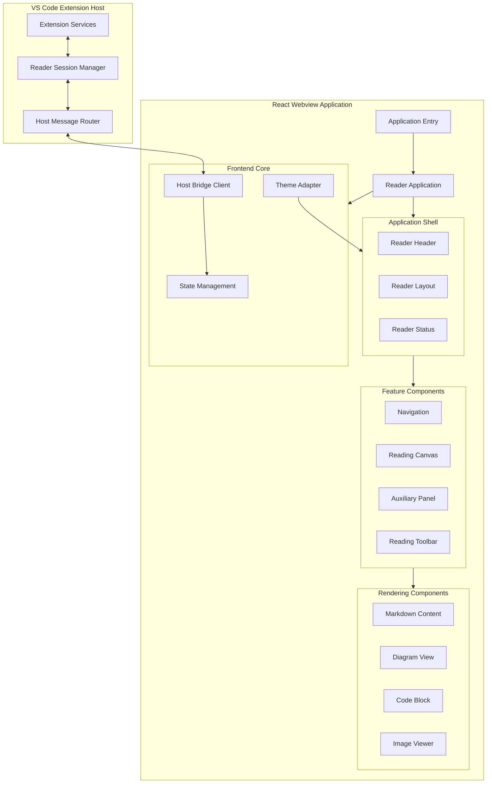
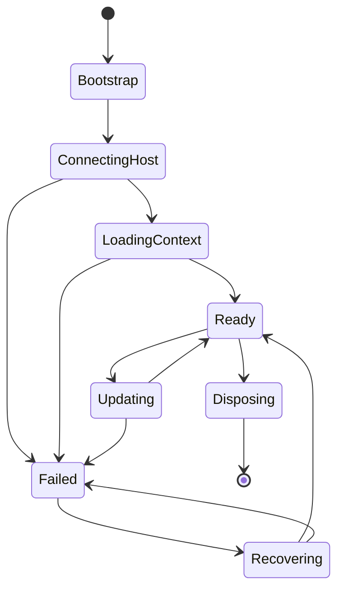
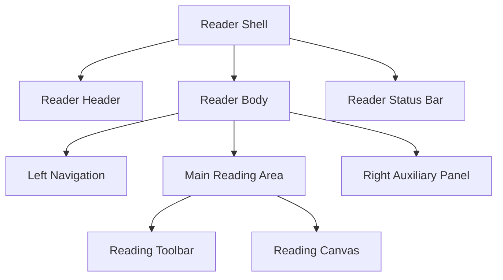
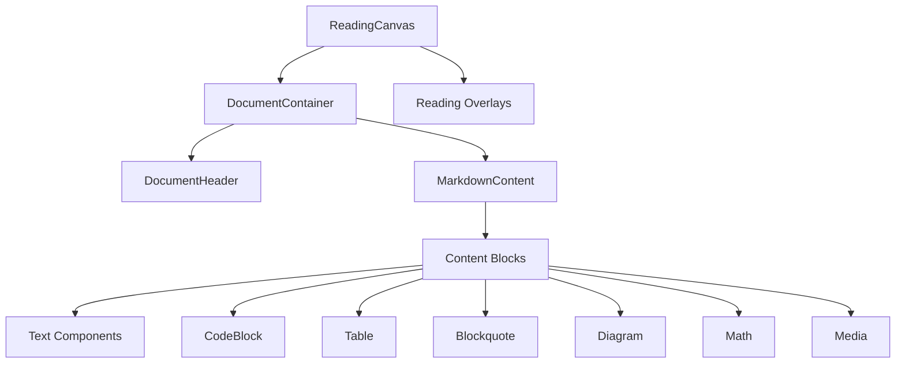
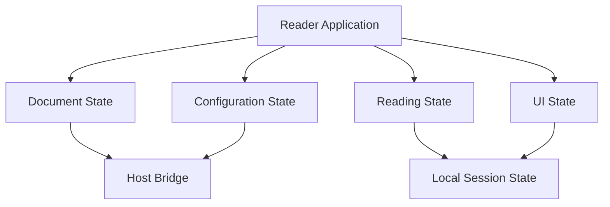
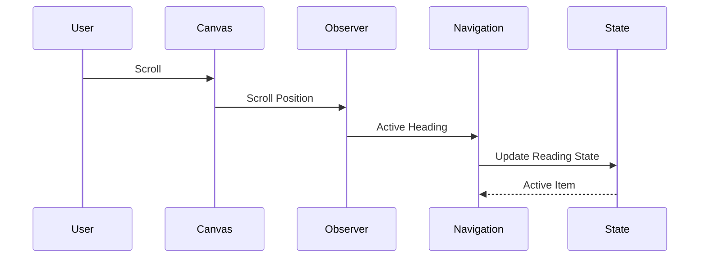
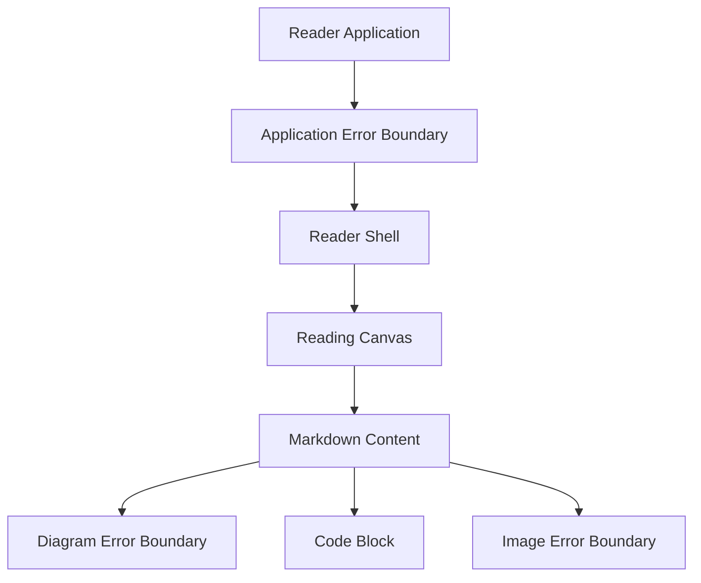

# ARC-005：Readora 前端应用架构设计

| 属性 | 内容 |
|---|---|
| 文档编号 | ARC-005 |
| 文档名称 | Readora 前端应用架构设计 |
| 文档版本 | 1.2.0 |
| 文档状态 | Final |
| 产品名称 | Readora |
| 适用范围 | React Webview Application |
| 上游文档 | ARC-001、ARC-002、ARC-003、ARC-004 |
| 关联规范 | PRD-001、PRD-002、PRD-003 |

---

## 1. 文档目标

定义 Readora 在 VS Code Webview 环境中的前端应用架构，明确：

1. React 应用的模块组织方式。
2. 页面布局和组件职责边界。
3. Feature 与 Shared 的组织原则。
4. 前端状态分类和管理策略。
5. Host Bridge 通信接口。
6. Markdown 渲染结果的展示机制。
7. 组件生命周期、异常处理和性能约束。
8. 前端测试与验收标准。

本篇只定义前端应用结构，不重新定义 Markdown 解析、图形渲染、主题计算和 VS Code Extension Host 的内部实现。

## 2. 架构设计原则

| 原则 | 说明 |
|---|---|
| Component First | 以组件作为 UI 能力的基本组织单位 |
| Feature Oriented | 按业务功能组织前端模块 |
| Separation of Concerns | 展示、状态、通信和业务逻辑分离 |
| Lightweight State | 优先采用 React 原生状态能力 |
| Host Boundary | VS Code 能力统一通过 Host Bridge 访问 |
| Rendering Isolation | Markdown 内容渲染与阅读器 UI 分离 |
| Design Token Driven | 使用统一 Design Tokens 驱动视觉表现 |
| Progressive Complexity | 按实际需求增加架构复杂度 |

### 2.1 技术选型

| 技术 | 用途 | 约束 |
|---|---|---|
| TypeScript | 类型系统 | 严格模式 |
| React | UI 组件框架 | 函数组件与 Hooks |
| Vite | 前端构建 | 产物适配 VS Code Webview |
| CSS | 样式系统 | CSS Variables |
| Tailwind CSS | 样式 utility 层 | 构建期编译（`@tailwindcss/vite`），主题色映射 `--readora-*` Token，见 §11.3 |
| React Context | 跨组件共享状态 | 仅用于低频全局状态 |
| React Hooks | 局部与功能状态 | 优先使用原生能力 |
| Vitest | 单元测试 | 业务逻辑与组件测试 |
| Testing Library | 组件测试 | 从用户行为角度验证 |

不在当前阶段引入 Redux、MobX 等重量级状态管理框架。

## 3. 前端应用总体架构

### 3.1 运行结构

React 应用运行在 VS Code Webview 中，不直接访问 Node.js、文件系统或 VS Code Extension API。



### 3.2 分层定义

| 层级 | 主要职责 |
|---|---|
| Application Layer | 应用启动、初始化、生命周期管理 |
| Shell Layer | 页面框架、区域布局、全局工具栏 |
| Feature Layer | 导航、阅读、搜索、辅助面板等功能 |
| Component Layer | 可复用的视觉和交互组件 |
| Core Layer | 状态、通信、配置、错误处理 |
| Adapter Layer | Host、Rendering、Theme 等外部能力适配 |

各层之间通过明确接口协作，禁止组件直接依赖 Extension Host 内部实现。

## 4. 应用入口与生命周期

### 4.1 入口结构

应用入口负责初始化 React、建立 Host Bridge、接收初始上下文并挂载 Reader Application。

建议入口：

```text
src/
├── main.tsx
├── App.tsx
└── app/
    ├── bootstrap/
    │   ├── initialize.ts
    │   └── initial-context.ts
    ├── providers/
    │   ├── AppProvider.tsx
    │   ├── ThemeProvider.tsx
    │   └── ReaderProvider.tsx
    └── lifecycle/
        └── application-lifecycle.ts
```

### 4.2 生命周期



| 阶段 | 职责 |
|---|---|
| Bootstrap | 初始化应用基础环境 |
| ConnectingHost | 建立 Host Bridge |
| LoadingContext | 获取初始文档与配置 |
| Ready | 进入正常阅读状态 |
| Updating | 处理文档或配置更新 |
| Failed | 处理不可恢复或待恢复异常 |
| Recovering | 尝试恢复应用状态 |
| Disposing | 清理事件订阅和运行资源 |

### 4.3 初始化约束

- Host Bridge 初始化必须早于依赖 Host 的 Feature。
- 初始文档上下文未完成前，不展示不完整的阅读内容。
- 初始化失败应提供可理解的错误状态。
- 初始化流程应支持重复调用保护。
- 组件卸载时必须清理事件监听与订阅。

## 5. Reader Shell

### 5.1 页面结构

Reader Shell 是应用的基础布局容器。



### 5.2 区域职责

| 区域 | 组件 | 职责 |
|---|---|---|
| 顶部 | ReaderHeader | 文档标题、文件信息、全局操作 |
| 左侧 | NavigationSidebar | Outline、文档导航 |
| 中央 | ReadingArea | 阅读主体 |
| 中央顶部 | ReadingToolbar | 阅读操作与显示控制 |
| 中央主体 | ReadingCanvas | Markdown 内容展示 |
| 右侧 | AuxiliaryPanel | Properties、Backlinks 等 |
| 底部 | ReaderStatusBar | 文档状态、阅读信息（V1.1.x 规划，见下方注记） |

范围注记（依据 AUD-001 偏差 D-4）：ReaderStatusBar 属 V1.1.x 规划（F10-006 状态栏集成为 P2、F02-009 阅读进度为 P1），截至 V1.1.1 基线未实现；§5.1 骨架图与 §16 目录中的对应位置为规划预留。其余区域已交付（AUD-001 §4.3 F07）。

### 5.3 布局要求

- 左右侧栏支持独立显示和隐藏。
- 中央阅读区域始终拥有最高布局优先级。
- 侧栏宽度允许用户调整。
- 阅读内容宽度独立于 Webview 总宽度。
- 窄窗口下采用自适应布局。
- 布局状态不得与文档内容状态耦合。

### 5.4 组件接口示例

```typescript
interface ReaderShellProps {
  children: React.ReactNode;
  leftSidebar?: React.ReactNode;
  rightSidebar?: React.ReactNode;
  toolbar?: React.ReactNode;
  statusBar?: React.ReactNode;
}
```

Reader Shell 不负责 Markdown 解析，也不直接处理 VS Code 消息协议。

## 6. Feature 模块设计

### 6.1 模块划分

| Feature | 职责 | 优先级 |
|---|---|---|
| document | 文档上下文和文档信息 | P0 |
| navigation | Outline 与文档导航 | P0 |
| reading | 阅读画布与阅读交互 | P0 |
| diagram | 图表展示和交互 | P0 |
| code | 代码块展示与复制 | P0 |
| asset | 图片和资源展示 | P0 |
| search | 文档内搜索 | P0（M7 交付，DEFER-01 已关闭） |
| backlinks | 反向链接展示 | P1 |
| properties | 文档属性展示 | P1 |
| settings | 阅读偏好设置 | P1 |

Feature 模块只实现自身业务能力，不重复实现公共组件或基础设施。

### 6.2 Feature 目录结构

```text
src/features/
├── document/
│   ├── components/
│   ├── hooks/
│   ├── services/
│   ├── types/
│   └── index.ts
├── navigation/
│   ├── components/
│   ├── hooks/
│   ├── services/
│   ├── types/
│   └── index.ts
├── reading/
│   ├── components/
│   ├── hooks/
│   ├── services/
│   ├── types/
│   └── index.ts
├── diagram/
├── code/
├── asset/
├── search/
├── backlinks/
├── properties/
└── settings/
```

### 6.3 模块依赖约束

1. Feature 可以依赖 Shared。
2. Feature 可以依赖 Core 提供的公共接口。
3. Feature 不应直接访问其他 Feature 的内部文件。
4. Feature 之间通过公开接口或应用级组合进行协作。
5. Core 不允许反向依赖 Feature。
6. 页面组合由 Application 或 Shell 完成。

## 7. 阅读画布组件架构

### 7.1 组件结构



### 7.2 主要组件

| 组件 | 职责 |
|---|---|
| ReadingCanvas | 阅读画布容器 |
| DocumentContainer | 文档内容容器 |
| DocumentHeader | 文档标题与元信息 |
| MarkdownContent | Markdown 内容入口 |
| CodeBlock | 代码块展示 |
| DiagramView | 图表展示 |
| MathView | 数学公式展示 |
| ImageView | 图片展示 |
| TableView | 表格展示 |
| BlockquoteView | 引用块展示 |
| ReadingOverlay | 阅读辅助浮层 |

### 7.3 渲染数据接口

前端只消费 ARC-002 定义的渲染结果，不自行重复执行 Markdown 解析。

```typescript
interface RenderDocument {
  documentId: string;
  version: number;
  html: string;
  outline: OutlineItem[];
  metadata: DocumentMetadata;
  diagnostics: RenderDiagnostic[];
}

interface OutlineItem {
  id: string;
  text: string;
  level: number;
  position?: number;
}

interface DocumentMetadata {
  title?: string;
  tags?: string[];
  properties?: Record<string, unknown>;
}

interface RenderDiagnostic {
  code: string;
  message: string;
  severity: "info" | "warning" | "error";
}
```

实际字段以 ARC-002 最终接口定义为准；本接口用于明确前端消费边界，不构成另一套独立渲染协议。

### 7.4 HTML 安全边界

Markdown 渲染结果中的 HTML 不得绕过安全处理。

约束：

- 只接受 Host 侧渲染管线输出的受信任结果。
- 不允许直接展示未经 Sanitizer 处理的 Markdown 原始 HTML。
- 不允许 Markdown 内容执行任意脚本。
- 不允许通过内容注入访问 Webview 私有能力。
- SVG 和图表内容遵循 ARC-003 的安全约束。
- Webview CSP 作为纵深防御措施。

## 8. Host Bridge 前端通信层

### 8.1 设计原则

前端不直接调用 VS Code API，而是通过 Host Bridge Client 与 Extension Host 通信。

通信协议遵循 ARC-004。

### 8.2 模块结构

```text
src/core/bridge/
├── host-bridge.ts
├── message-client.ts
├── message-router.ts
├── message-types.ts
├── message-validator.ts
└── errors.ts
```

### 8.3 接口定义

```typescript
interface HostBridge {
  request<TRequest, TResponse>(
    type: string,
    payload: TRequest
  ): Promise<TResponse>;

  subscribe<T>(
    type: string,
    handler: (payload: T) => void
  ): () => void;

  dispose(): void;
}
```

### 8.4 消息分类

| 消息类型 | 方向 | 示例 |
|---|---|---|
| reader.ready | Webview → Host | 页面初始化完成 |
| document.load | Host → Webview | 初始文档加载 |
| document.update | Host → Webview | 文档内容更新 |
| document.open | Webview → Host | 打开目标文档 |
| document.navigate | Webview → Host | 跳转文档 |
| resource.resolve | Webview → Host | 资源解析请求 |
| theme.update | Host → Webview | 主题变化 |
| config.update | Host → Webview | 配置变化 |
| state.save | Webview → Host | 保存阅读状态 |
| state.restore | Host → Webview | 恢复阅读状态 |
| reader.error | Webview → Host | 页面错误通知 |

实际消息名称、Envelope、请求响应关联 ID 和 Schema 以 ARC-004 §8.3 为准（1.1.0 已对齐：原示例中的 `document.request` / `navigation.change` / `configuration.update` / `asset.resolve` / `host.error` 为早期草案命名，不再使用）。

### 8.5 通信约束

- 所有消息必须通过统一客户端。
- 所有消息必须进行类型校验。
- 请求应支持超时和错误处理。
- 订阅必须提供取消订阅函数。
- 组件不得直接调用底层 `postMessage`。
- 过期文档版本的响应不得覆盖较新版本。
- 不允许通过消息传递任意可执行代码。

## 9. 前端状态管理

### 9.1 状态分类

前端状态分为四类：

| 状态类型 | 内容 | 生命周期 |
|---|---|---|
| Document State | 文档内容、标题、元信息、Outline | 文档会话 |
| Reading State | 滚动位置、活动标题、阅读进度 | 文档会话 |
| UI State | 侧栏、面板、弹窗、工具栏状态 | Webview 会话 |
| Configuration State | 字体、字号、阅读宽度等偏好 | 配置生命周期 |

### 9.2 状态边界



### 9.3 状态管理策略

| 场景 | 推荐方案 |
|---|---|
| 组件内部状态 | useState |
| 复杂局部状态转换 | useReducer |
| 跨组件共享低频状态 | React Context |
| 文档状态 | Document Context / Reducer |
| 阅读状态 | Reading Context / Reducer |
| UI 临时状态 | 局部组件状态 |
| Host 数据 | Host Bridge 数据适配层 |

### 9.4 状态管理约束

- 不为每一个状态建立全局 Store。
- 不把所有状态集中到一个 Context。
- 高频滚动事件不得直接触发全局 Context 更新。
- 大型渲染结果避免在无关组件间反复传递。
- 文档状态和 UI 状态必须分离。
- Host 数据与前端临时交互状态必须分离。

### 9.5 文档版本一致性

每次渲染结果都应携带文档版本。

```typescript
interface DocumentState {
  documentId: string;
  version: number;
  renderResult: RenderDocument | null;
  status: "loading" | "ready" | "updating" | "error";
}
```

仅接受当前文档会话中有效的版本，避免异步响应乱序导致内容回退。

## 10. 导航与阅读交互

### 10.1 Outline

Outline 数据来源于 ARC-002 的渲染结果。

组件职责：

- 展示标题层级。
- 支持标题折叠。
- 支持点击跳转。
- 根据阅读位置同步活动标题。
- 支持长文档滚动定位。

Outline 不重新解析 Markdown 标题。

### 10.2 阅读位置同步



采用 IntersectionObserver 等浏览器能力检测可见标题，避免为每个滚动事件执行大量 DOM 查询。

### 10.3 阅读状态

```typescript
interface ReadingPosition {
  documentId: string;
  scrollTop: number;
  activeHeadingId?: string;
  updatedAt: number;
}
```

阅读位置恢复策略由 Host Session 与前端 Reading State 协同完成，具体持久化归属遵循 ARC-004。

## 11. 样式与 Design Token 集成

### 11.1 样式组织

```text
src/styles/
├── reset.css
├── tokens.css
├── typography.css
├── layout.css
├── utilities.css
└── global.css
```

组件样式与组件共同维护，避免形成无法追踪的全局样式集合。

### 11.2 Token 消费原则

- 使用 PRD-003 定义的语义 Token。
- 不在业务组件中散布固定颜色值。
- 不在业务组件中重复定义字号和间距体系。
- 不直接依赖某个具体主题名称。
- VS Code 主题变量和产品主题变量之间通过 Theme Adapter 适配。

示例：

```css
.readora-canvas {
  color: var(--readora-color-text-primary);
  background: var(--readora-color-canvas);
  font-size: var(--readora-font-size);
  line-height: 1.75;
}

.readora-panel {
  background: var(--readora-color-surface);
  border: 1px solid var(--readora-color-border);
  border-radius: var(--readora-radius-lg);
}
```

Token 命名遵循 PRD-003 §13.1 的 `--readora-{category}-{name}` 规范；正文缩放由 `--readora-font-size` 单一变量驱动（PRD-003 §11.4）。行高默认值与 `readora.lineHeight` 配置基线一致（ARC-004 §11.2）。

主题生成、映射、切换和 Token 完整定义归 ARC-006。

### 11.3 Tailwind Utility 层（1.2.0 选型变更）

依据 IMP-001 §21 登记的选型变更（用户决策），引入构建期 Tailwind CSS v4 作为样式 utility 层，与 `docs/stitch_/` 原型的 utility 表达方式对齐。定位：**utility 是 Token 的消费层，不是视觉值的第二来源**；Design Tokens 契约（ARC-006）不变。

**集成方式**

- 依赖 `tailwindcss` 与 `@tailwindcss/vite`（同版本，4.2.x，Vite 8 兼容自 4.2.2 起，IMP-001 §3.3），在 `apps/webview/vite.config.ts` 注册插件，构建期编译为静态 CSS。
- 禁止原型使用的 `cdn.tailwindcss.com` 运行时方案（外部网络 + 运行时编译，违反 ARC-008 §11 CSP 与 VSIX 离线要求）。

**Token 映射契约**

主题色 utility 一律经 `@theme inline` 映射引用语义 Token，不写死色值：

```css
/* styles/tailwind.css —— utility 层入口 */
@import "tailwindcss/theme.css" layer(theme);
@import "tailwindcss/utilities.css" layer(utilities);

@theme inline {
  --color-canvas: var(--readora-color-canvas);
  --color-surface: var(--readora-color-surface);
  --color-surface-subtle: var(--readora-color-surface-subtle);
  --color-surface-raised: var(--readora-color-surface-raised);
  --color-text-primary: var(--readora-color-text-primary);
  --color-text-secondary: var(--readora-color-text-secondary);
  --color-text-muted: var(--readora-color-text-muted);
  --color-border: var(--readora-color-border);
  --color-accent: var(--readora-color-accent);
  --color-accent-text: var(--readora-color-accent-text);
}
```

约束：

- 只导入 theme 与 utilities 层，不启用 preflight；基础重置沿用既有 `reset.css`，避免双重 reset 冲突。
- 映射清单必须覆盖 `design-tokens.spec.ts` 必需语义 Token 清单，扩充语义 Token 时同步扩充映射与护栏断言。
- 禁止 `bg-[#10141a]` 一类任意色值；禁止照搬原型 tailwind.config 的 M3 命名色值（PRD-003 附录 A）。
- 不使用 `dark:` 变体与 `darkMode: "class"`：主题切换由 `[data-readora-theme]` + CSS Variables 注入完成（ARC-006 §8.1），utility 引用的是变量，运行时换主题无需重新编译。
- 字号缩放仍由 `--readora-font-size` 单一变量驱动，不在 utility 层另建字号体系。

**导入顺序与迁移策略**

样式导入顺序：KaTeX 样式（最前，IMP-001 §10.2 不变量）→ `tokens.css` → utility 层入口 → 既有 typography / layout / components / global CSS。既有 CSS 排在 utility 之后，可覆盖 utility，保证迁移期行为稳定。

迁移采用渐进策略：新组件优先使用 utility，既有组件 CSS 继续有效，不做一次性批量重写；Markdown 内容样式（`markdown.css`）与引擎相关覆盖（KaTeX、Pele）保持既有 CSS 形态，不 utility 化。

**护栏（实现侧后续动作）**

utility 护栏测试断言：`@theme` 映射逐名引用 `var(--readora-color-`、构建产物不含硬编码主题色、必需语义 Token 全覆盖；随 `design-tokens.spec.ts` 一并回归。截至本次修订，实现侧迁移尚未开始，属后续工程任务。

## 12. 公共组件体系

### 12.1 组件分类

```text
src/shared/
├── components/
│   ├── Button/
│   ├── IconButton/
│   ├── Tooltip/
│   ├── Dropdown/
│   ├── Dialog/
│   ├── Popover/
│   ├── Separator/
│   ├── ScrollArea/
│   └── EmptyState/
├── hooks/
├── types/
└── utils/
```

### 12.2 公共组件要求

- 组件职责单一。
- 优先支持键盘交互。
- 支持明确的禁用状态。
- 交互状态有一致的视觉反馈。
- 不包含具体业务数据获取逻辑。
- 不直接依赖 Host Bridge。
- 不绑定某个 Feature 的内部状态。

公共组件应以阅读器实际需要为边界，不追求建设完整通用 UI 组件库。

## 13. 错误处理

### 13.1 错误分类

| 错误类型 | 处理方式 |
|---|---|
| Application Error | 应用级错误页面 |
| Rendering Error | 局部内容错误提示 |
| Diagram Error | 单图表错误隔离 |
| Asset Error | 资源占位与错误提示 |
| Host Communication Error | 通信失败提示与恢复 |
| Component Error | Error Boundary 隔离 |

### 13.2 错误隔离



单个图表或图片加载失败，不应导致整个阅读器崩溃。

### 13.3 恢复策略

- 可恢复异常提供重试操作。
- 不可恢复异常显示明确原因。
- 错误信息不得暴露敏感文件路径或内部实现细节。
- 错误日志与用户可见错误信息分离。

## 14. 性能设计

### 14.1 性能约束

| 项目 | 设计要求 |
|---|---|
| 初始挂载 | 避免不必要的组件初始化 |
| 长文档 | 避免频繁全量 React 更新 |
| 图表 | 按需初始化和销毁 |
| 图片 | 使用懒加载 |
| Outline | 避免高频全量重绘 |
| 滚动 | 使用节流或浏览器观察机制 |
| 状态更新 | 限制 Context 更新范围 |
| 大型内容 | 避免重复序列化和复制 |

### 14.2 渲染性能策略

#### 14.2.1 组件记忆化

使用 React.memo 优化有明确收益的组件。

#### 14.2.2 计算与引用稳定

使用 useMemo 和 useCallback 解决实际的重复计算或引用变化问题。

#### 14.2.3 图表组件独立

图表组件与 Markdown 内容组件保持独立。

#### 14.2.4 图片懒加载

对图片采用浏览器原生懒加载。

#### 14.2.5 超长文档虚拟化评估

对超长文档先通过性能测试决定是否需要虚拟化。

#### 14.2.6 虚拟滚动框架约束

不在首期引入复杂的虚拟滚动框架。

性能优化必须通过基准测试验证，不以 Hooks 数量或抽象层数量作为优化指标。

小节编号说明：1.1.0 将原扁平列表改为小节，使实现侧对「§14.2 第 4 项（图片懒加载）」的引用（如 image-layer / image-preview 测试注释中的 `ARC-005 §14.2.4`）具备可解析的目标（AUD-001 §6.3 悬空引用修复）。

## 15. 可访问性

前端交互组件遵循 WCAG 2.2 AA 的相关要求。

重点包括：

- 所有主要操作支持键盘访问。
- 交互元素具备可识别焦点状态。
- 图标按钮提供可访问名称。
- 文本与背景满足对比度要求。
- 弹窗具备正确的焦点管理。
- 标题层级保持语义合理。
- 图表提供必要的文本说明或源码查看能力。

## 16. 前端项目目录

建议最终目录（位于 `apps/webview/src/` 之下，工程结构见 IMP-001 §4.1）：

```text
src/
├── main.tsx
├── App.tsx
│
├── app/
│   ├── bootstrap/
│   ├── providers/
│   └── lifecycle/
│
├── core/
│   ├── bridge/
│   ├── state/
│   ├── errors/
│   ├── config/
│   └── adapters/
│
├── shell/
│   ├── ReaderShell/
│   ├── ReaderHeader/
│   ├── ReaderLayout/
│   └── ReaderStatusBar/   # V1.1.x 规划预留（D-4，见 §5.2）
│
├── features/
│   ├── document/
│   ├── navigation/
│   ├── reading/
│   ├── diagram/
│   ├── code/
│   ├── asset/
│   ├── search/
│   ├── backlinks/
│   ├── properties/
│   └── settings/
│
├── shared/
│   ├── components/
│   ├── hooks/
│   ├── types/
│   └── utils/
│
├── styles/
│   ├── reset.css
│   ├── tokens.css
│   ├── typography.css
│   ├── layout.css
│   └── global.css
│
└── test/
    ├── fixtures/
    ├── mocks/
    └── setup.ts
```

目录结构允许随着实际实现调整，但必须维持模块职责和依赖边界。

## 17. 测试策略

| 测试类型 | 测试范围 |
|---|---|
| Unit Test | Hooks、状态转换、工具函数 |
| Component Test | Shell、导航、阅读组件 |
| Integration Test | Host Bridge、文档更新 |
| Rendering Test | Markdown 渲染结果展示 |
| Interaction Test | 滚动、跳转、面板切换 |
| Accessibility Test | 键盘操作、焦点、语义 |
| Performance Test | 长文档、图表、滚动性能 |
| E2E Test | VS Code Webview 完整阅读流程 |

### 17.1 核心验收场景

1. 打开 Markdown 文档后能够正确展示内容。
2. Outline 能够正确展示标题层级。
3. 点击 Outline 能定位对应标题。
4. 文档更新后能够展示最新渲染结果。
5. 旧版本渲染结果不会覆盖新版本。
6. Mermaid 图表能够正确展示并保持独立错误隔离。
7. 图片加载失败不会影响其他内容。
8. 左右侧栏能够独立开关。
9. 主题变化能够正确更新视觉表现。
10. Webview 隐藏、恢复和销毁时能够正确管理资源。
11. Host 通信失败时能够展示可恢复状态。
12. 键盘操作能够完成主要阅读交互。

## 18. 架构决策记录

| 编号 | 决策 | 原因 |
|---|---|---|
| ADR-005-01 | 采用 React 函数组件 | 简化组件模型 |
| ADR-005-02 | 按 Feature 组织业务代码 | 保持功能边界清晰 |
| ADR-005-03 | 优先使用 React 原生状态能力 | 避免过度引入状态框架 |
| ADR-005-04 | Host 通信统一通过 Bridge | 隔离运行环境 |
| ADR-005-05 | Markdown 内容采用渲染结果展示 | 避免重复解析 |
| ADR-005-06 | 主题通过 Design Tokens 消费 | 保持视觉系统一致 |
| ADR-005-07 | 图表采用独立组件边界 | 实现错误和生命周期隔离 |
| ADR-005-08 | 暂不引入虚拟滚动 | 以实际性能测试决定是否需要 |
| ADR-005-09 | 引入构建期 Tailwind 作为 utility 层（1.2.0） | 对齐 stitch_ 原型的 utility 表达；主题值仍收敛于 Design Tokens，构建期编译满足 CSP 与离线约束（IMP-001 §21 选型变更） |

## 19. 本篇范围边界

本篇不再扩展以下内容：

| 内容 | 归属文档 |
|---|---|
| Markdown 解析和 AST | ARC-002 |
| Mermaid 引擎和 Pele Adapter | ARC-003 |
| Extension Host 与 Webview 通信协议 | ARC-004 |
| 主题生成、映射与切换 | ARC-006 |
| Outline 数据生成和导航规则 | ARC-007 |
| 资源解析、安全和缓存策略 | ARC-008 |

## 20. 验收标准

ARC-005 完成验收需要满足：

- [x] React Webview 应用结构明确。
- [x] Application、Shell、Feature、Shared 分层明确。
- [x] 组件职责和依赖关系明确。
- [x] Host Bridge 统一通信入口明确。
- [x] 文档状态、阅读状态、UI 状态相互隔离。
- [x] Markdown 渲染结果消费边界明确。
- [x] 图表、图片和代码块具备独立组件边界。
- [x] Design Tokens 消费方式明确。
- [x] 生命周期和错误隔离策略明确。
- [x] 测试与性能验收标准明确。

回填说明（1.1.0）：以上为文档级「设计明确性」验收项，依据 AUD-001 §6.1（结构完整）、§7（ARC-005 抽查）与 §4.3 F07（布局实现证据）回填。实现级保留意见：

1. ReaderStatusBar 未实现（D-4），见 §5.2 范围注记；不影响设计明确性判定。
2. E2E（Playwright）未配置（DEFER-06）；§17 的 E2E Test 行为设计要求，实现级验收待闭合。

---

## 21. 修订记录

### 21.1 版本历史

| 文档版本 | 说明 |
|---|---|
| 1.0.0 | 初始前端应用架构基线 |
| 1.1.0 | 文档治理修订：依据 AUD-001 登记 D-4 降级标注、修正优先级与 Token 命名、修复悬空小节引用、回填验收清单，状态转为 Final（IMP-003 §10.5） |
| 1.2.0 | 选型变更：引入构建期 Tailwind utility 层（IMP-001 §21），新增 §11.3 与 ADR-005-09；Design Tokens 契约不变 |

### 21.2 1.1.0 修订内容

1. §5.2、§16 ReaderStatusBar 标注为 V1.1.x 规划（D-4；F10-006 P2、F02-009 P1）。
2. §6.1 search Feature 优先级 P1 → P0（PRD-001 F05-001～003 为 P0，M7 已交付，DEFER-01 关闭）。
3. §11.2 CSS 示例对齐 PRD-003 §13.1 Token 命名（`--readora-*`），废弃 `--reader-*` 前缀（BRAND-001）；字号变量采用 `--readora-font-size`。
4. §14.2 扁平列表改为小节 14.2.1～14.2.6，修复实现侧 `ARC-005 §14.2.4` 悬空引用（AUD-001 §6.3）。
5. §16 目录注明工程根路径（apps/webview/src）。
6. §20 验收清单回填，附实现级保留意见（D-4、DEFER-06）。
7. §8.4 消息示例表对齐 ARC-004 §8.3 权威协议（补 `reader.ready` / `state.save` / `state.restore`，废弃 `document.request` / `navigation.change` / `configuration.update` / `asset.resolve` / `host.error` 草案命名）。

### 21.3 1.2.0 修订内容

1. §2.1 技术选型新增 Tailwind CSS（构建期编译，主题色映射 `--readora-*` Token）。
2. 新增 §11.3 Tailwind Utility 层：集成方式（`@tailwindcss/vite`）、`@theme inline` 映射契约、禁用 preflight / `dark:` 变体 / 任意色值、导入顺序与渐进迁移策略、护栏测试要求。
3. §18 新增 ADR-005-09（引入构建期 Tailwind 的决策与理由）。
4. 依据：IMP-001 §21 选型变更登记、PRD-003 附录 A 裁决变更；实现侧迁移属后续工程任务，迁移完成前既有 CSS 方案继续有效。

---

**文档结束**

版本：1.2.0  
状态：Final  
下一篇：ARC-006《Readora 主题系统架构设计》