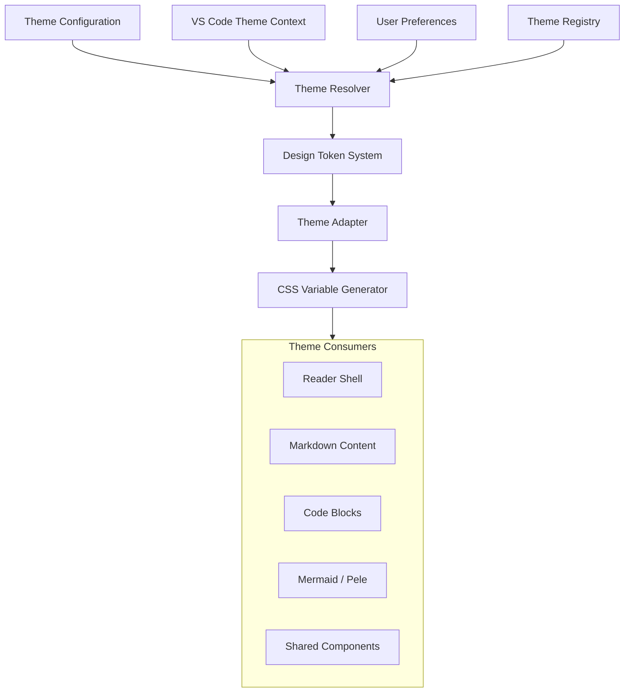
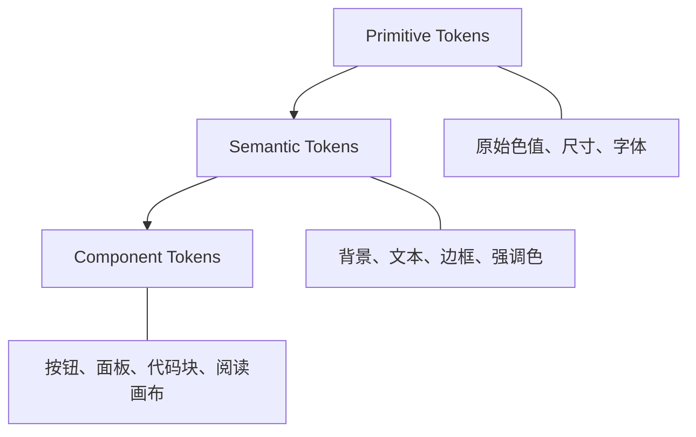
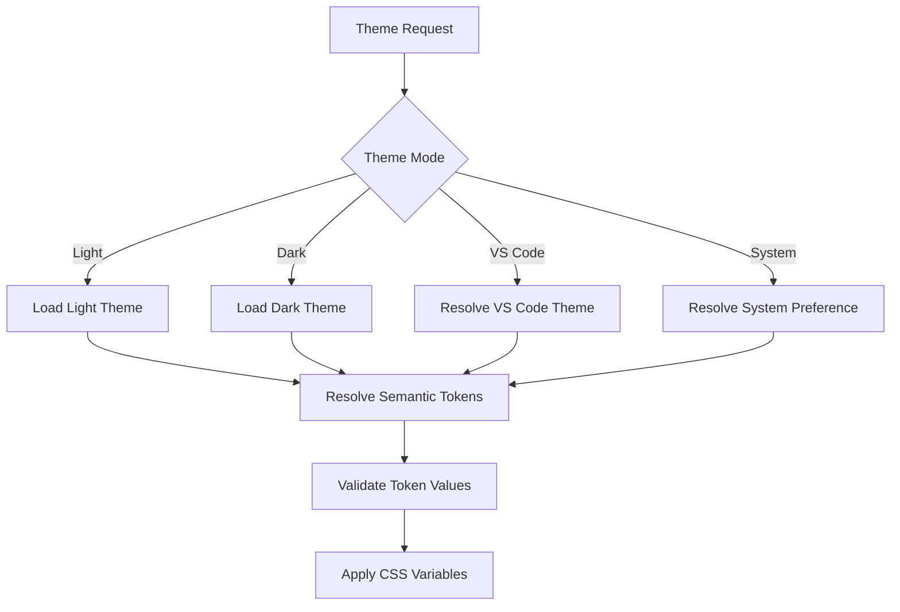
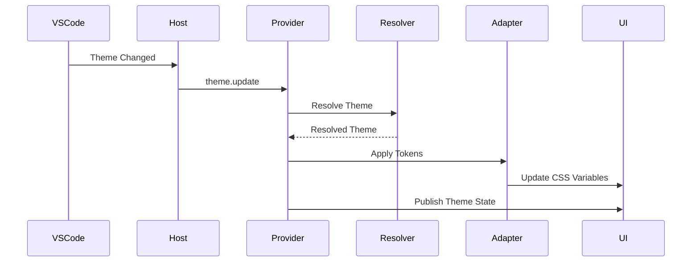

# ARC-006：Readora 主题系统架构设计

| 属性 | 内容 |
|---|---|
| 文档编号 | ARC-006 |
| 文档名称 | Readora 主题系统架构设计 |
| 文档版本 | 1.3.0 |
| 文档状态 | Final |
| 产品名称 | Readora |
| 适用范围 | React Webview Theme System |
| 上游文档 | PRD-003、ARC-001、ARC-004、ARC-005 |

---

## 1. 文档目标

建立统一的主题系统，为 Readora 提供一致、可扩展、可动态切换的视觉表现。

本篇明确：

1. 主题系统的架构与职责边界。
2. Design Token 分层模型。
3. Light、Dark 和 VS Code 主题适配机制。
4. 主题优先级与配置解析规则。
5. CSS Variables 的生成与注入机制。
6. Markdown 内容、代码块和 Mermaid 图表的主题联动。
7. 主题切换生命周期。
8. 主题系统测试与验收标准。

## 2. 设计原则

| 原则 | 说明 |
|---|---|
| Semantic First | 组件优先消费语义 Token |
| Consistent | 整个阅读器使用统一 Token 体系 |
| Theme Independent | 组件不直接依赖具体主题名称 |
| VS Code Native | 支持读取 VS Code 当前主题环境 |
| Runtime Switch | 支持运行时主题切换 |
| Predictable | 主题优先级和解析规则明确 |
| Minimal Override | 尽量减少局部颜色覆盖 |
| Accessible | 满足必要的对比度和可访问性要求 |

## 3. 主题系统总体架构

### 3.1 架构图



### 3.2 模块职责

| 模块 | 职责 |
|---|---|
| Theme Configuration | 保存主题配置 |
| Theme Registry | 管理内置主题定义 |
| Theme Resolver | 解析最终生效主题 |
| Design Token System | 维护 Token 结构 |
| Theme Adapter | 将主题转换为运行环境需要的变量 |
| CSS Variable Generator | 生成 CSS Custom Properties |
| Theme Provider | 将主题状态提供给 React 应用 |
| Theme Consumers | 消费主题变量 |

主题系统不负责定义组件业务逻辑，也不负责 Markdown 或 Mermaid 的具体解析。

## 4. Design Token 架构

### 4.1 Token 分层

采用三级 Token 结构：



| 层级 | 定义 | 示例 |
|---|---|---|
| Primitive | 原始设计值 | color.gray.900 |
| Semantic | 语义用途 | color.text.primary |
| Component | 组件专属用途 | reader.panel.background |

### 4.2 Primitive Tokens

Primitive Token 只表达设计值，不直接表达业务含义。

按主题分成两组，前缀固定为 `--readora-palette-`：

```css
:root {
  --readora-palette-light-canvas: #f8f9ff;
  --readora-palette-light-surface: #eff4ff;
  --readora-palette-light-surface-subtle: #e5eeff;
  --readora-palette-light-surface-raised: #dce9ff;
  --readora-palette-light-surface-sunken: #ffffff;
  --readora-palette-light-text-primary: #0b1c30;
  --readora-palette-light-text-secondary: #4a4455;
  --readora-palette-light-text-muted: #6b6478;
  --readora-palette-light-accent: #6d28d9;
  --readora-palette-light-accent-text: #5300b7;
}

[data-readora-theme="dark"] {
  --readora-palette-dark-canvas: #10141a;
  --readora-palette-dark-surface: #181c22;
  --readora-palette-dark-surface-subtle: #1c2026;
  --readora-palette-dark-surface-raised: #262a31;
  --readora-palette-dark-surface-sunken: #0a0e14;
  --readora-palette-dark-text-primary: #dfe2eb;
  --readora-palette-dark-text-secondary: #ccc3d8;
  --readora-palette-dark-text-muted: #958da1;
  --readora-palette-dark-accent: #7c3aed;
  --readora-palette-dark-accent-text: #d2bbff;
}
```

完整色板见 PRD-003 §4.2 / §4.3，原型名换算见 PRD-003 附录 A。

`--readora-palette-` 这个前缀是契约的一部分：`design-tokens.spec.ts` 断言 `--readora-color-canvas` 的值必须引用它。改前缀等于把"语义层不得直接写死颜色"这条规则从可验证变成不可验证。

Primitive Token 不应被业务组件直接引用。

### 4.3 Semantic Tokens

Semantic Token 是组件样式的主要消费接口。

核心分类（V1.2.0 起，命名前缀 `--readora-color-`）：

| 分类 | Token | 用途 |
|---|---|---|
| Background | canvas | 阅读器主背景 |
| Background | surface | 面板背景 |
| Background | surface-subtle | 次级区域背景 |
| Background | surface-raised | 悬停、选中底色 |
| Background | surface-sunken | 代码块、表格、数学块 |
| Background | glass | 浮动件背景（配 `backdrop-filter`） |
| Text | text-primary | 主要文本 |
| Text | text-secondary | 次要文本 |
| Text | text-muted | 辅助文本 |
| Border | border | 通用边框 |
| Border | border-strong | 控件与容器边界 |
| Accent | accent | 强调**填充**色 |
| Accent | accent-text | 正文可读的强调**文字**色 |
| Accent | accent-on | 填充之上的文字色 |
| Accent | accent-soft | 柔和强调背景 |
| Link | link | 链接 |
| Status | info | 信息提示 |
| Status | success | 成功状态 |
| Status | warning | 警告状态 |
| Status | danger | 错误状态 |
| Overlay | overlay | 遮罩 |

> 历史文档中出现的 `--reader-` 前缀已废弃，实际实现与 PRD-003 §13.1 一律使用 `--readora-`。

```css
:root {
  --readora-color-canvas: var(--readora-palette-light-canvas);
  --readora-color-surface: var(--readora-palette-light-surface);
  --readora-color-surface-subtle: var(--readora-palette-light-surface-subtle);
  --readora-color-text-primary: var(--readora-palette-light-text-primary);
  --readora-color-text-secondary: var(--readora-palette-light-text-secondary);
  --readora-color-text-muted: var(--readora-palette-light-text-muted);
  --readora-color-border: var(--readora-palette-light-border);
  --readora-color-accent: var(--readora-palette-light-accent);
}
```

`accent` 与 `accent-text` 必须是两个 token：前者是填充（暗色 `#7c3aed`），后者是文字（暗色 `#d2bbff`）。合并成一个值必然导致某一侧不过对比度——`#7c3aed` 作文字色落在 `#10141a` 上约 3.1:1。

### 4.4 Component Tokens

Component Token 用于控制具体组件的视觉属性。

```css
:root {
  --readora-panel-background: var(--readora-color-surface);
  --readora-panel-border: var(--readora-color-border);

  --readora-button-hover-bg: var(--readora-color-surface-raised);
  --readora-button-text: var(--readora-color-accent-on);

  --readora-code-background: var(--readora-color-surface-sunken);
  --readora-code-border: var(--readora-color-border-strong);

  --readora-table-header-bg: var(--readora-color-surface-sunken);
  --readora-table-stripe-bg: var(--readora-color-surface-subtle);

  --readora-outline-active-bg: var(--readora-color-accent-soft);
  --readora-outline-active-color: var(--readora-color-accent-text);

  --readora-diagram-background: var(--readora-color-surface);
  --readora-diagram-border: var(--readora-color-border-strong);
}
```

外壳尺寸类组件 token（V1.2.0 新增；0.x 起大纲进度块下线后
`--readora-progress-fill-start/end` 已移除，见 PRD-003 §10.7 / §13.1）：

```css
:root {
  --readora-topbar-height: 44px;
  --readora-statusbar-height: 24px;
  --readora-outline-width: 256px;
  --readora-hairline: 1px;
}
```

`--readora-shadow-pill` 是少数随主题取不同**形状**而非不同颜色的 token（PRD-003 §7.2），因此在暗色块单独覆盖。

组件 Token 只能引用 Semantic Token 或明确批准的 Primitive Token；`design-tokens.spec.ts` 对必需组件 token 清单逐名断言其值包含 `var(--readora-color-`。

## 5. 内置主题模型

### 5.1 主题类型

首期提供以下主题模式：

| 主题模式 | 说明 | 优先级 |
|---|---|---|
| Light | 产品浅色主题 | P0 |
| Dark | 产品深色主题 | P0 |
| VS Code | 适配 VS Code 当前主题 | P0 |
| System | 跟随运行环境主题偏好 | P0 |

说明：

- Light 和 Dark 是产品定义的主题。
- VS Code 模式主要映射 VS Code 提供的主题颜色变量。
- System 用于选择浅色或深色基础模式。
- 不在首期开发完整的用户自定义主题编辑器。

优先级澄清（1.1.0）：System 主题对应 PRD-001 F08-003，为 P0。IMP-003 §3.2 曾将「系统主题自动跟随」列为 MVP 可选增强，与 PRD-001 冲突；依据 AUD-001 §6.2 以 PRD 为准。实现已按 P0 交付（`auto` 模式 + `activeColorTheme` 解析，AUD-001 §4.3 F08）。

### 5.2 主题定义接口

```typescript
type ThemeMode =
  | "light"
  | "dark"
  | "vscode"
  | "system";

interface ThemeDefinition {
  id: string;
  name: string;
  type: "light" | "dark";
  tokens: Record<string, string>;
}

interface ThemePreferences {
  mode: ThemeMode;
  customThemeId?: string;
}
```

主题定义与主题偏好分离：

- ThemeDefinition 描述主题本身。
- ThemePreferences 描述用户选择。
- ThemeResolver 决定当前生效主题。

## 6. VS Code 主题适配

### 6.1 适配目标

Readora 应融入 VS Code 的整体视觉环境，避免出现明显的视觉割裂。

主要映射对象：

| VS Code 变量 | Reader Token |
|---|---|
| editor.background | canvas |
| editor.foreground | text-primary |
| panel.background | surface |
| panel.border | border |
| sideBar.background | surface-subtle |
| descriptionForeground | text-secondary |
| focusBorder | focus |
| textLink.foreground | link |
| errorForeground | danger |

以上映射应采用有默认值的渐进式适配，不能假设所有 VS Code 主题都提供完整变量。

### 6.2 CSS 适配

VS Code Webview 可以通过其注入的主题上下文变量提供颜色。

```css
body.vscode-light {
  --readora-color-canvas: var(--vscode-editor-background);
  --readora-color-text-primary: var(--vscode-editor-foreground);
}

body.vscode-dark {
  --readora-color-canvas: var(--vscode-editor-background);
  --readora-color-text-primary: var(--vscode-editor-foreground);
}

body.vscode-high-contrast,
body.vscode-high-contrast-light {
  --readora-color-border: var(--vscode-contrastBorder);
  --readora-color-focus: var(--vscode-focusBorder);
}
```

实际实现必须对可能缺失的变量提供 fallback。

### 6.3 适配策略

- VS Code 模式优先使用 VS Code 原生变量。
- 产品专属语义色允许使用产品 Token。
- 图表、代码块、正文应保持一致的整体对比度。
- 不得因适配 VS Code 而丢失产品阅读体验。
- 高对比度主题需要单独验证。

## 7. 主题解析与优先级

### 7.1 配置优先级

主题最终选择采用：

```text
Session Override
    ↓
Workspace Configuration
    ↓
User Configuration
    ↓
Product Default
```

当前文档仅定义主题配置项的优先级，不重复 ARC-004 的通用配置读取机制。

### 7.2 主题解析流程



### 7.3 解析接口

```typescript
interface ResolvedTheme {
  id: string;
  mode: "light" | "dark";
  source: "product" | "vscode" | "system";
  tokens: Record<string, string>;
}

interface ThemeResolver {
  resolve(
    preferences: ThemePreferences,
    vscodeTheme?: VSCodeThemeContext
  ): ResolvedTheme;
}
```

主题解析必须是确定性过程：相同输入应产生相同结果。

## 8. CSS Variables 注入

### 8.1 注入方式

主题解析完成后，由 Theme Adapter 将语义 Token 转换为 CSS Custom Properties。

```typescript
function applyTheme(
  root: HTMLElement,
  theme: ResolvedTheme
): void {
  for (const [name, value] of Object.entries(theme.tokens)) {
    root.style.setProperty(`--readora-${name}`, value);
  }

  root.dataset.readoraTheme = theme.id;
}
```

实现时必须校验 Token 名称和值，禁止把不可信输入直接拼接进 CSS。

命名与选择器契约（1.1.0）：变量前缀为 `--readora-`（PRD-003 §13.1），主题选择器为 `[data-readora-theme="dark"]`（见 §4.2 与 PRD-003 §13.2），不使用无前缀的 `data-theme`，避免与宿主页面同名属性冲突。

### 8.2 注入原则

- 统一挂载到 Webview 根节点。
- 主题切换不要求重新挂载整个 React 应用。
- 优先更新 CSS Variables。
- 避免为每个组件重复生成主题样式。
- 未定义 Token 使用安全默认值。
- 主题切换不得导致阅读位置丢失。

## 9. Markdown 内容主题适配

### 9.1 适配范围

| 内容类型 | 主题适配内容 |
|---|---|
| Heading | 标题文本和层级 |
| Paragraph | 正文颜色 |
| Link | 链接颜色与交互状态 |
| Blockquote | 引用背景和边框 |
| Table | 表头、分隔线和斑马纹 |
| Code | 代码块背景和文本 |
| Inline Code | 行内代码背景 |
| Math | 数学公式文本 |
| Image | 图片边框和背景 |
| Diagram | 图表主题 |

### 9.2 Mermaid / Pele 联动

图表主题由 Diagram Feature 负责适配。

主题变化时：

1. Theme System 发布新的主题状态。
2. Diagram Feature 接收主题变化。
3. Pele Adapter 更新图表主题变量。
4. 必要时刷新图表。
5. 不影响其他图表实例。

优先使用 CSS Variables 实现视觉更新，只有在引擎要求重新布局或重新生成 SVG 时才触发完整刷新。

具体渲染生命周期遵循 ARC-003。

## 10. React 集成

### 10.1 Theme Provider

```typescript
interface ThemeContextValue {
  theme: ResolvedTheme;
  preferences: ThemePreferences;
  setMode(mode: ThemeMode): void;
}
```

ThemeProvider 负责：

- 保存当前主题偏好。
- 订阅 Host 主题变化。
- 解析最终主题。
- 更新 CSS Variables。
- 向 React 组件提供当前主题状态。

### 10.2 组件消费方式

普通 UI 组件优先使用 CSS Variables，不应为了改变颜色而依赖 React 状态重新渲染。

```tsx
function ReaderPanel() {
  return (
    <section className="readora-panel">
      <h2 className="readora-panel__title">
        Document Properties
      </h2>
    </section>
  );
}
```

```css
.readora-panel {
  background: var(--readora-panel-background);
  border: 1px solid var(--readora-panel-border);
}

.readora-panel__title {
  color: var(--readora-color-text-primary);
}
```

React Context 仅用于确实需要读取主题元数据的组件，例如图表适配器或主题设置面板。

**Tailwind utility 消费（1.2.0 选型变更）**：引入构建期 Tailwind 后（IMP-001 §21、ARC-005 §11.3），utility 与组件 CSS 消费**同一套**语义 Token：`@theme inline` 将 utility 主题色映射为 `var(--readora-color-*)`，例如 `bg-surface` 最终解析到 `--readora-color-surface`。因此：

- 主题切换机制不变：仍由 `applyTheme` 注入 CSS Variables（§8.1），utility 引用的是变量，换主题无需重新编译或重新挂载。
- utility 层不持有主题值：`@theme` 中禁止写死色值，禁止引入独立于本篇 Token 体系的颜色定义。
- 不使用 `dark:` 变体：暗色覆盖仍由 `[data-readora-theme="dark"]` 选择器承担（§4.2），避免两套暗色机制并存。
- Token 必需清单扩充时，`@theme` 映射与 `design-tokens.spec.ts` 护栏同步扩充（ARC-005 §11.3）。

## 11. 主题切换生命周期



### 11.1 切换约束

- 主题切换不重新加载文档。
- 主题切换不重建 Reader Shell。
- 不重置滚动位置。
- 不影响当前导航状态。
- 不重复创建图表实例。
- 图表主题刷新失败不得阻断正文显示。

## 12. 可访问性与视觉质量

主题系统必须考虑：

1. 正文与背景对比度。
2. 次要文本的可读性。
3. 链接与普通文本的区分。
4. 焦点状态可见性。
5. 错误、警告和成功状态不能只依靠颜色区分。
6. Light、Dark 和 VS Code 高对比度主题的独立验证。

验收基准以 PRD-003 的 WCAG 2.2 AA 要求为准。

## 13. 测试策略

| 测试类型 | 测试内容 |
|---|---|
| Unit Test | Theme Resolver |
| Unit Test | Token Mapping |
| Unit Test | CSS Variable Generator |
| Integration Test | VS Code Theme Adapter |
| Integration Test | Host Theme Message |
| Component Test | Theme Provider |
| Visual Test | Light / Dark |
| Visual Test | VS Code Theme |
| Accessibility Test | 对比度与焦点状态 |
| Regression Test | 主题切换后的阅读状态 |

### 13.1 验收场景

- [x] Light 主题正确展示。
- [x] Dark 主题正确展示。
- [x] VS Code 模式能够读取当前主题变量。
- [x] System 模式能够解析系统偏好。
- [x] 主题优先级符合定义。
- [x] 主题变化能够实时更新。
- [x] 主题变化不丢失阅读位置。
- [x] Markdown 元素正确适配主题。
- [x] Mermaid / Pele 图表能够同步主题。
- [ ] 高对比度模式能够提供清晰的边界和焦点。
- [x] 缺失 Token 有安全默认值。
- [ ] 不可信 Token 不会进入 CSS 注入流程。

回填说明（1.1.0，依据 AUD-001）：已勾选项证据为 AUD-001 §7 对 ARC-006 的符合性结论（"✓ M5 落地并有 `design-tokens.spec.ts` 13 项回归"）、§4.3 F08 落点（`resolveTheme` 读 `activeColorTheme.kind` + `onDidChangeActiveColorTheme`、三级 Token、VS Code 主题适配与实时切换）、§12 主题同步机制（`--pele-*` CSS 变量映射免重解析）。高对比度专项验证与不可信 Token 注入拦截暂无独立审计证据，保留未勾选，待专项用例补齐后回填。

## 14. 架构决策记录

| 编号 | 决策 | 原因 |
|---|---|---|
| ADR-006-01 | 使用三级 Design Token | 区分设计值、语义与组件 |
| ADR-006-02 | CSS Variables 作为主题运行时接口 | 支持低成本动态切换 |
| ADR-006-03 | 提供 Light / Dark / VS Code | 覆盖主要阅读环境 |
| ADR-006-04 | Theme Resolver 独立 | 统一主题选择逻辑 |
| ADR-006-05 | 图表主题由 Diagram Feature 适配 | 保持图表模块边界 |
| ADR-006-06 | 暂不建设主题编辑器 | 控制首期复杂度 |
| ADR-006-07 | Tailwind utility 经 `@theme` 映射消费语义 Token（1.2.0） | utility 层不持有主题值，运行时切换机制不变（IMP-001 §21 选型变更） |

## 15. 本篇范围边界

| 内容 | 归属文档 |
|---|---|
| 色彩、字体和视觉设计值 | PRD-003 |
| React 应用和组件结构 | ARC-005 |
| VS Code 通信机制 | ARC-004 |
| Mermaid / Pele 渲染实现 | ARC-003 |
| 文档导航与 Outline | ARC-007 |
| 资源、安全和缓存 | ARC-008 |

## 16. 验收标准

ARC-006 完成验收需要满足：

- [x] 主题架构和模块职责明确。
- [x] Token 三级结构明确。
- [x] 主题模式和优先级明确。
- [x] VS Code 主题适配机制明确。
- [x] CSS Variables 注入机制明确。
- [x] Markdown 内容和图表主题联动明确。
- [x] 主题切换不影响阅读状态。
- [x] 可访问性和测试标准明确。

回填说明（1.1.0）：以上为文档级验收项，本篇 §3～§13 已逐项明确；实现侧符合性见 AUD-001 §7（ARC-006 ✓）与 §13.1 回填说明。

## 17. 修订记录

### 17.1 版本历史

| 版本 | 日期 | 说明 |
|---|---|---|
| 1.0.0 | 基线 | 初版，Draft |
| 1.1.0 | 本次修订 | 依据 AUD-001 审计结论与 PRD-001/PRD-003 规范对齐，状态转 Final |
| 1.2.0 | 选型变更 | 引入构建期 Tailwind utility 层（IMP-001 §21），§10.2 补 utility 消费契约，新增 ADR-006-07；主题注入机制与 Token 体系不变 |
| 1.3.0 | Token 清单收敛 | 大纲进度块下线（PRD-003 §10.7）后 `--readora-progress-fill-start/end` 再无消费方，从 §4 示例、`tokens.css` 与 `token-registry.ts` 一并移除；分层模型与注入机制不变 |

### 17.2 1.1.0 修订内容

1. §5.1：System 主题优先级由 P1 修正为 P0（F08-003），登记 IMP-003 §3.2 与 PRD-001 的优先级冲突及裁决依据（AUD-001 §6.2：以 PRD 为准，实现已按 P0 交付）。
2. §6.2、§8.1、§10.2：CSS 示例与注入逻辑统一迁移至 `--readora-` 前缀（PRD-003 §13.1），废弃 `--reader-` 旧命名。
3. §8.1：明确命名与选择器契约——变量前缀 `--readora-`、主题选择器 `[data-readora-theme="dark"]`，不使用无前缀 `data-theme`。
4. §13.1：按 AUD-001 证据回填 10/12 项；高对比度与不可信 Token 拦截两项保留未勾选并注明原因。
5. §16：文档级验收 8 项回填。
6. 元数据与文末状态同步为 1.1.0 / Final。

### 17.3 1.2.0 修订内容

1. §10.2：新增 Tailwind utility 消费契约——`@theme inline` 映射引用语义 Token、主题切换机制不变、utility 层不持有主题值、不使用 `dark:` 变体。
2. §14：新增 ADR-006-07。
3. 依据：IMP-001 §21 选型变更登记、PRD-003 附录 A 裁决变更、ARC-005 §11.3 utility 层架构；本篇 Token 分层、注入机制与选择器契约均不变。

### 17.4 1.3.0 修订内容

1. §4：外壳尺寸类 token 示例去掉 `--readora-progress-fill-start/end`，与 `tokens.css`、`token-registry.ts` 保持一致。
2. 触发条件：PRD-003 §10.7 大纲面板不再渲染进度条，这两个名字自此无任何消费方；保留只会留下「已登记但无处生效」的假 API 表面。
3. 语义层、组件层的分层规则与主题注入机制未变；`design-tokens.spec.ts` 的声明与引用完整性断言仍成立（删的是声明 + 消费两侧同时消失的名字）。

---

**文档结束**

版本：1.3.0
状态：Final
下一篇：ARC-007《Readora 文档导航架构设计》
