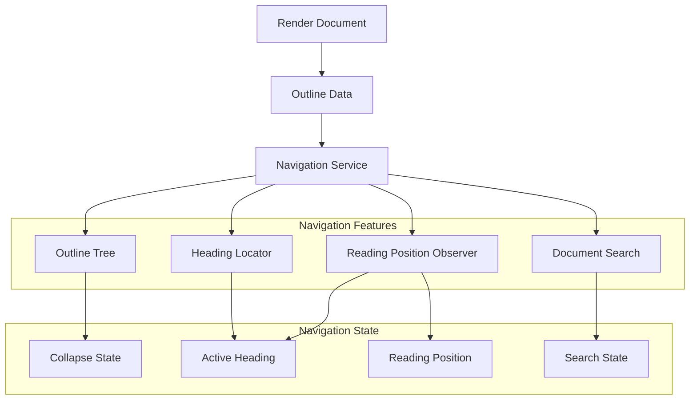
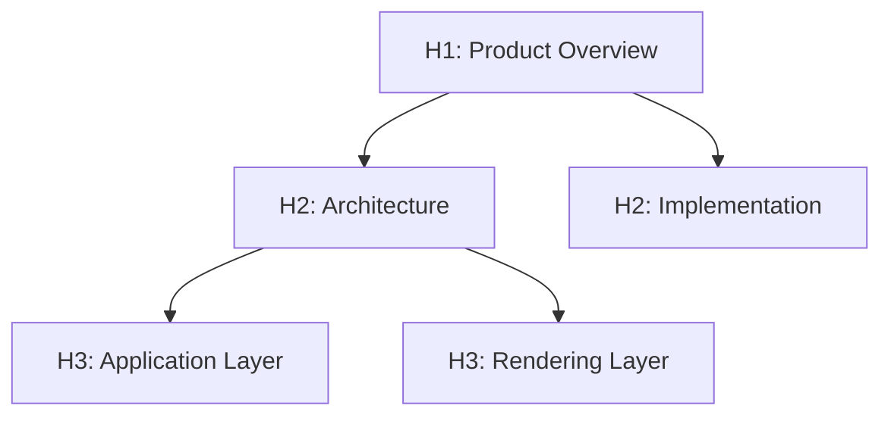
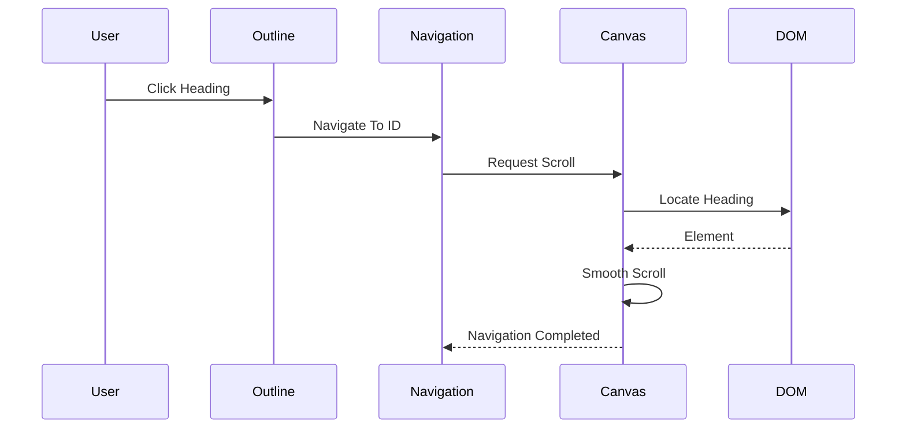
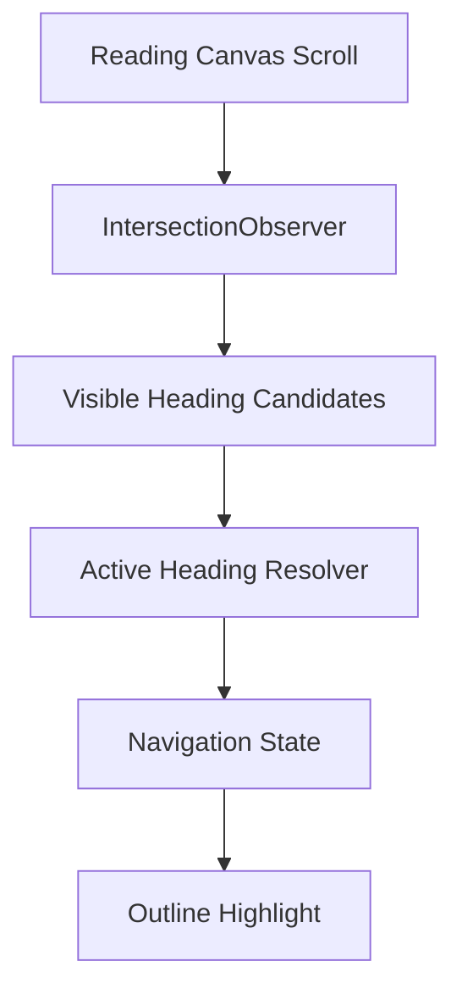
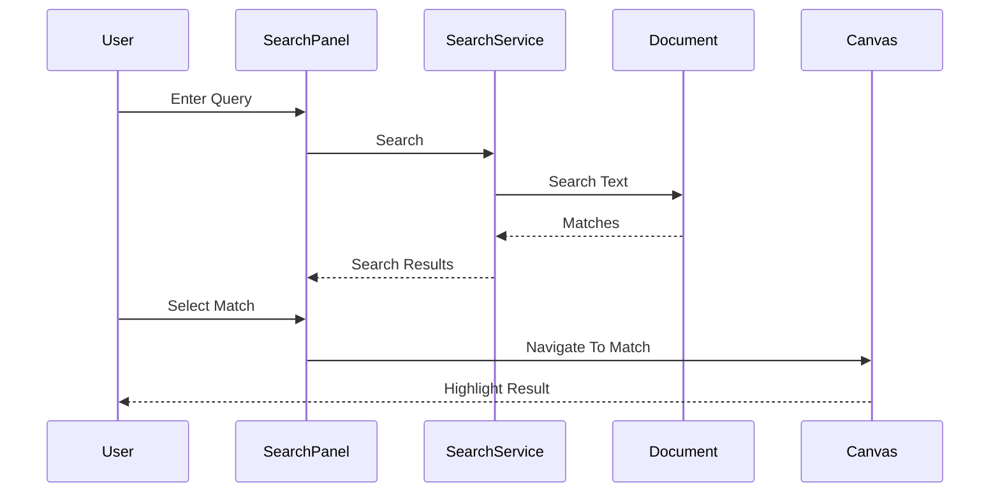

# ARC-007：Readora 文档导航架构设计

| 属性 | 内容 |
|---|---|
| 文档编号 | ARC-007 |
| 文档名称 | Readora 文档导航架构设计 |
| 文档版本 | 1.1.0 |
| 文档状态 | Final |
| 产品名称 | Readora |
| 适用范围 | Document Navigation |
| 上游文档 | PRD-001、PRD-002、ARC-002、ARC-004、ARC-005 |

---

## 1. 文档目标

定义 Readora 的文档导航能力，建立从 Markdown 内容结构到阅读位置之间的导航机制。

本篇主要解决：

1. Markdown 标题层级提取与 Outline 数据模型。
2. 标题锚点生成和定位。
3. Outline 展示与交互。
4. 阅读位置检测与同步。
5. 文档内搜索。
6. 导航状态管理。
7. 文档更新后的导航一致性。
8. 导航性能和测试要求。

## 2. 功能范围

### 2.1 功能清单

| 编号 | 功能 | 优先级 | 说明 |
|---|---|---|---|
| NAV-001 | Outline 生成 | P0 | 根据文档标题生成目录 |
| NAV-002 | 标题层级展示 | P0 | 展示 H1-H6 |
| NAV-003 | 标题定位 | P0 | 点击目录跳转 |
| NAV-004 | 活动标题同步 | P0 | 根据阅读位置更新目录状态 |
| NAV-005 | 标题折叠 | P0 | 控制目录层级显示 |
| NAV-006 | 阅读位置恢复 | P0 | 恢复上次阅读位置（会话级，见 §8 注记） |
| NAV-007 | 文档内搜索 | P0 | 搜索当前文档内容 |
| NAV-008 | 搜索结果定位 | P0 | 定位匹配内容 |
| NAV-009 | 导航状态持久化 | P1 | 保存必要的导航偏好 |

优先级与状态澄清（1.1.0）：NAV-007 / NAV-008 对应 PRD-001 F05 搜索需求（P0），已于 M7 交付并关闭 DEFER-01（AUD-001 §3、§8），原 P1 标注为顺延登记期的历史口径。NAV-006 的会话级恢复已交付（AUD-001 §3 M4）；跨会话记忆属 F05-008（P1），截至 V1.1.1 未实现，见 §8 实现边界注记。

### 2.2 非目标

当前阶段不实现：

- 完整知识图谱导航。
- 跨工作区全文搜索引擎。
- 独立文档管理系统。
- 双向链接关系数据库。
- 多文档关联图谱可视化。
- 类似 Obsidian 的完整知识管理功能。

这些能力超出当前阅读器的核心定位。

## 3. 导航系统总体架构

### 3.1 架构图



### 3.2 模块职责

| 模块 | 职责 |
|---|---|
| Outline Data Adapter | 消费渲染结果中的标题数据 |
| Navigation Service | 管理导航业务逻辑 |
| Outline Tree | 展示目录树 |
| Heading Locator | 执行标题定位 |
| Reading Position Observer | 检测阅读位置 |
| Document Search | 执行文档内搜索 |
| Navigation State | 管理导航相关状态 |

## 4. Outline 数据模型

### 4.1 数据来源

Outline 数据由 ARC-002 的 Markdown 渲染管线生成。

导航模块不重新解析 Markdown，不自行推断标题层级。

### 4.2 数据结构

```typescript
interface OutlineItem {
  id: string;
  text: string;
  level: number;
  position?: number;
}

interface OutlineModel {
  documentId: string;
  documentVersion: number;
  items: OutlineItem[];
}
```

### 4.3 数据约束

| 字段 | 约束 |
|---|---|
| id | 文档内唯一，可用于标题定位 |
| text | 标题展示文本 |
| level | 1-6 |
| position | 可选的源码位置 |
| documentId | 所属文档 |
| documentVersion | 对应渲染版本 |

### 4.4 层级关系

标题层级由 `level` 决定。



Outline Tree 可以根据标题级别构建层级结构，但必须保留原始标题顺序。

### 4.5 特殊标题处理

- 没有 H1 的文档允许直接从 H2 开始。
- 连续相同级别标题作为同级节点。
- 标题级别跳跃时，按照最近的有效上级标题构建树。
- 空标题不应导致导航构建失败。
- 重复标题必须生成不同的锚点 ID。
- Emoji 和非 ASCII 字符应保留在展示文本中。

## 5. 标题锚点与定位

### 5.1 锚点生成

锚点生成由 Markdown 渲染管线统一负责。

导航模块只消费最终 ID，不自行生成第二套锚点规则。

基本要求：

1. 同一文档内 ID 唯一。
2. 标题文本变化后能够更新对应锚点。
3. 重复标题不会发生定位冲突。
4. 非 ASCII 标题能够正确定位。
5. 文档重新渲染后，导航数据与 DOM 锚点保持一致。

### 5.2 定位流程



### 5.3 定位接口

```typescript
interface HeadingLocator {
  navigateTo(
    headingId: string,
    options?: {
      behavior?: ScrollBehavior;
      block?: ScrollLogicalPosition;
    }
  ): void;
}
```

默认采用平滑滚动，但当用户启用减少动态效果偏好时，应使用即时定位。

### 5.4 定位偏移

考虑阅读工具栏、文档标题栏等固定区域，定位时必须预留顶部空间。

```css
.readora-heading {
  scroll-margin-top: var(--readora-navigation-offset, 5rem);
}
```

## 6. Outline Tree 交互

### 6.1 展示要求

Outline Tree 应具备：

- 标题层级缩进。
- 活动标题高亮。
- 父级节点展开和折叠。
- 当前活动节点自动展开。
- 长目录滚动。
- 标题文本溢出处理。
- 无标题文档空状态。

### 6.2 折叠行为

折叠状态属于 UI 状态，不修改 Outline 原始数据。

```typescript
interface OutlineViewState {
  collapsedIds: Set<string>;
  activeHeadingId?: string;
}
```

约束：

- 折叠父节点时隐藏其后代节点。
- 不删除标题数据。
- 活动标题变化时，可以自动展开其祖先节点。
- 折叠状态按文档会话管理。

### 6.3 视觉状态

| 状态 | 表现 |
|---|---|
| Default | 普通标题文本 |
| Hover | 背景或文本强调 |
| Active | 强调色与活动指示 |
| Collapsed | 显示展开状态图标 |
| Disabled | 不适用或不可定位时使用弱化表现 |

## 7. 阅读位置同步

### 7.1 目标

当用户滚动阅读画布时，Outline 自动更新当前活动标题。

### 7.2 方案

采用 IntersectionObserver 观察标题元素，结合滚动容器和可视区域判断活动标题。



### 7.3 活动标题选择规则

1. 优先选择阅读区域顶部附近的有效标题。
2. 当多个标题同时可见时，选择最接近阅读基准线的标题。
3. 当滚动到文档顶部时，优先选择第一个有效标题。
4. 当滚动到文档底部时，允许最后一个标题成为活动标题。
5. 没有标题的文档不生成活动标题状态。

### 7.4 阅读基准线

阅读基准线用于稳定活动标题判断，避免标题在视口边缘频繁切换。

基准线位置应考虑：

- 阅读工具栏高度。
- 文档顶部间距。
- 用户阅读布局设置。

具体数值通过视觉和交互测试确定，不在导航逻辑中硬编码。

### 7.5 性能约束

- 不为每次滚动创建新的 Observer。
- Observer 应随文档生命周期建立和销毁。
- 避免每次滚动都重新计算整个 Outline。
- 活动标题没有变化时不触发状态更新。
- 长文档应限制同时观察的节点和不必要的 DOM 操作。

## 8. 阅读位置恢复

### 8.1 数据模型

```typescript
interface ReadingPosition {
  documentId: string;
  headingId?: string;
  scrollTop: number;
  updatedAt: number;
}
```

### 8.2 恢复策略

文档打开时：

1. 获取上次阅读位置。
2. 等待当前文档渲染完成。
3. 检查保存的 headingId 是否存在。
4. 存在时优先定位标题。
5. 不存在时回退到 scrollTop。
6. 两者均不可用时从文档顶部开始。

### 8.3 更新策略

- 滚动位置更新采用防抖或节流。
- 不应在每个滚动事件中发送 Host 消息。
- 文档关闭或会话销毁时执行必要的状态同步。
- 阅读位置持久化由 Host Session 协调，前端负责提供有效状态。

实现边界注记（1.1.0，依据 AUD-001）：会话级位置恢复已交付——`retainContextWhenHidden` 保位（§8.2 隐藏保位，AUD-001 §7）+ `state.save` / `state.restore`（ARC-004 §12.3），滚动保存防抖 800ms 与 `App.tsx` 实现对齐（AUD-001 §7）。跨会话（VS Code 重启后）恢复属 F05-008（P1），截至 V1.1.1 未实现（AUD-001 §4.4 F05-010、STORY-09-02「Done（限会话内）」）；本篇 §8.2 的恢复策略在会话范围内有效，跨会话持久化为后续版本的增强项，不改变本节设计。

### 8.4 文档变化处理

文档内容变化后：

- 原标题仍存在：保留标题定位。
- 标题被删除：回退到可用位置。
- 标题 ID 发生变化：通过稳定信息尝试恢复。
- 文档结构大幅变化：优先保持合理的滚动位置，而不是强制恢复旧标题。

## 9. 文档内搜索

### 9.1 功能范围

文档内搜索仅搜索当前打开的 Markdown 文档。

首期支持：

- 普通文本搜索。
- 大小写敏感切换。
- 上一个匹配项。
- 下一个匹配项。
- 匹配数量展示。
- 匹配结果高亮。
- 点击结果定位。
- Escape 关闭搜索浮层。

实现状态（1.1.0）：上述首期能力已于 M7 全部交付（AUD-001 §3、§8 DEFER-01 已关闭）：`apps/webview/src/search/{search-engine.ts, SearchPanel.tsx}` + 两个 spec，覆盖输入防抖 250ms、计数、上/下一个、大小写切换、高亮标记、Escape 关闭、文档版本失效（`SEARCH_HIT_VERSION_ATTRIBUTE`）。

暂不支持：

- 正则表达式高级搜索。
- 全工作区全文搜索。
- 跨文档搜索。
- 搜索索引数据库。

### 9.2 搜索数据模型

```typescript
interface SearchOptions {
  query: string;
  caseSensitive: boolean;
}

interface SearchMatch {
  id: string;
  text: string;
  position: number;
  headingId?: string;
}

interface SearchResult {
  documentId: string;
  documentVersion: number;
  matches: SearchMatch[];
  activeMatchIndex: number;
}
```

### 9.3 搜索流程



### 9.4 搜索实现约束

- 搜索范围必须限定在当前文档。
- 搜索结果必须携带文档版本。
- 文档更新后旧搜索结果失效。
- 高亮不得破坏原始 Markdown DOM 结构。
- 不允许将用户搜索内容直接拼接为 HTML。
- 搜索高亮不得影响代码复制和图表交互。
- 由渲染引擎生成的图形化子树不进入匹配范围：图表 SVG 与数学公式同理，前者的标签不是文档散文，后者的同一表达式会同时以 MathML、源码注记和屏幕字形三种形式出现，计入会重复计数，而向其字形容器插入高亮会破坏引擎自身的定位结构。公式渲染失败时降级为普通源码文本，不属于该子树，仍然可被搜索。

对于首期实现，优先采用 DOM Range 或受控文本节点匹配机制，不直接修改渲染 HTML 字符串。

## 10. 导航状态管理

### 10.1 状态分类

| 状态 | 内容 | 生命周期 |
|---|---|---|
| Outline Data | 标题列表 | 文档版本 |
| Active Heading | 当前活动标题 | 文档会话 |
| Collapse State | 目录折叠状态 | 文档会话 |
| Reading Position | 滚动位置 | 文档会话 |
| Search State | 搜索词和结果 | 搜索会话 |

### 10.2 状态结构

```typescript
interface NavigationState {
  activeHeadingId?: string;
  collapsedIds: Set<string>;
  readingPosition: ReadingPosition | null;
  search: {
    query: string;
    activeMatchIndex: number;
  };
}
```

### 10.3 状态约束

- Outline Data 属于文档渲染结果。
- Navigation State 不拥有 Markdown 内容。
- Search State 不应长期保存完整文档副本。
- 不将高频滚动状态放入应用级全局 Context。
- 文档切换时清理与旧文档相关的临时搜索状态。

## 11. 与其他模块的集成

| 模块 | 集成方式 |
|---|---|
| ARC-002 Markdown Rendering | 消费 Outline 和标题 ID |
| ARC-004 VS Code Integration | 阅读位置及文档会话协调 |
| ARC-005 Frontend Application | 提供导航组件和状态 |
| ARC-006 Theme System | 使用语义 Token 展示导航状态 |
| ARC-008 Asset & Security | 遵循资源和内容安全约束 |

导航模块不直接访问文件系统，不直接创建 VS Code Webview，也不重新实现 Markdown Parser。

## 12. 错误处理

| 场景 | 处理方式 |
|---|---|
| 无标题文档 | 展示空状态 |
| 标题 ID 不存在 | 取消定位或回退 |
| Outline 数据异常 | 隔离导航错误 |
| 文档版本不一致 | 丢弃过期数据 |
| 搜索无结果 | 展示无匹配结果 |
| 搜索过程中内容更新 | 取消或重新执行搜索 |
| Observer 初始化失败 | 降级为滚动位置检测 |

导航失败不得导致阅读画布不可用。

## 13. 性能要求

| 项目 | 要求 |
|---|---|
| Outline 构建 | 复用已有渲染结果 |
| 标题定位 | 直接按 ID 定位 |
| 活动标题同步 | 避免高频 React 更新 |
| 长目录 | 支持滚动和合理的渲染优化 |
| 文档搜索 | 避免阻塞主线程 |
| 搜索高亮 | 不重复构建整份文档 |
| 阅读位置保存 | 合并高频更新 |
| 文档更新 | 使旧版本导航数据失效 |

是否需要 Outline 虚拟化，应由实际长文档测试决定，首期不引入额外虚拟列表依赖。

## 14. 测试策略

| 测试类型 | 测试内容 |
|---|---|
| Unit Test | Outline 数据转换 |
| Unit Test | 标题层级处理 |
| Unit Test | 活动标题选择 |
| Unit Test | 阅读位置恢复 |
| Unit Test | 搜索匹配 |
| Component Test | Outline Tree |
| Integration Test | 标题定位 |
| Integration Test | 滚动与 Outline 同步 |
| Integration Test | 文档更新后的导航 |
| E2E Test | 完整阅读导航流程 |

### 14.1 验收场景

- [x] 能够正确生成 H1-H6 Outline。
- [x] 标题顺序与文档一致。
- [ ] 重复标题能够正确定位。
- [x] 点击 Outline 能定位正文标题。
- [x] 阅读滚动时活动标题正确更新。
- [x] 目录折叠和展开正常。
- [x] 当前活动标题的祖先节点能够正确展开。
- [x] 阅读位置能够恢复。
- [ ] 删除标题后能够合理回退。
- [x] 搜索能够定位匹配内容。
- [x] 文档更新后旧搜索结果失效。
- [ ] 导航异常不会影响正文阅读。
- [x] 长文档导航不会产生明显卡顿。

回填说明（1.1.0，依据 AUD-001）：Outline 各项证据为 §4.3 F02 落点（`extractOutline` / `slugifyHeading`、`OutlinePanel.tsx`、`useActiveHeading.ts`、`outline-panel.spec.tsx`，覆盖生成、层级、点击定位、活动标题、折叠展开、祖先展开）；阅读位置恢复限会话级（§3 M4、STORY-09-02「Done（限会话内）」，跨会话见 §8 注记）；搜索两项证据为 §8 DEFER-01 已关闭（覆盖 §9.1 全部首期能力）与 §7（命中结果带 `documentVersion` 并在文档更新时失效）；长文档卡顿项按 NOTE-02 口径勾选——性能验收口径为产品目标的 2 倍（AUD-001 §8、§9），按真实目标断言的基准待补。重复标题定位、删除标题回退、导航异常隔离三项暂无独立审计证据，保留未勾选。

## 15. 架构决策记录

| 编号 | 决策 | 原因 |
|---|---|---|
| ADR-007-01 | Outline 来源于 ARC-002 | 避免重复解析 |
| ADR-007-02 | 标题 ID 由渲染管线统一生成 | 保持定位一致性 |
| ADR-007-03 | IntersectionObserver 用于活动标题检测 | 减少滚动计算 |
| ADR-007-04 | 阅读位置由 Host Session 协调持久化 | 适应 Webview 生命周期 |
| ADR-007-05 | 搜索限定当前文档 | 控制首期范围 |
| ADR-007-06 | 暂不引入搜索索引数据库 | 避免不必要的基础设施 |

## 16. 本篇范围边界

| 内容 | 归属文档 |
|---|---|
| Markdown 标题解析 | ARC-002 |
| React 组件结构 | ARC-005 |
| 主题和视觉 Token | ARC-006 |
| Host 消息协议和 Session | ARC-004 |
| 图片、附件与资源安全 | ARC-008 |
| 跨文档知识链接 | PRD-001 后续规划范围，不属于本篇核心实现 |

## 17. 验收标准

ARC-007 完成验收需要满足：

- [x] Outline 数据模型明确。
- [x] 标题层级和锚点规则明确。
- [x] 标题定位机制明确。
- [x] 阅读位置同步机制明确。
- [x] 阅读位置恢复策略明确。
- [x] 文档内搜索范围和行为明确。
- [x] 导航状态生命周期明确。
- [x] 文档更新后的数据一致性明确。
- [x] 性能、错误处理和测试标准明确。

回填说明（1.1.0）：以上为文档级验收项，本篇 §4～§14 已逐项明确；实现侧符合性见 AUD-001 §7（ARC-007 ✓）与 §14.1 回填说明。

## 18. 修订记录

### 18.1 版本历史

| 版本 | 日期 | 说明 |
|---|---|---|
| 1.0.0 | 基线 | 初版，Draft |
| 1.1.0 | 本次修订 | 依据 AUD-001 审计结论与 PRD-001/PRD-003 规范对齐，状态转 Final |

### 18.2 1.1.0 修订内容

1. §2.1：NAV-007 / NAV-008 优先级由 P1 修正为 P0（对应 F05 搜索需求，M7 交付、DEFER-01 已关闭）；NAV-006 注明会话级边界。
2. §5.4：定位偏移 CSS 迁移至 `--readora-` 前缀（PRD-003 §13.1），类名同步为 `.readora-heading`。
3. §8.3：新增实现边界注记——会话级位置恢复已交付（保位 + `state.save` / `state.restore`、防抖 800ms），跨会话恢复属 F05-008（P1）未实现。
4. §9.1：功能清单补「Escape 关闭搜索浮层」，新增 M7 实现状态说明（防抖 250ms、`SEARCH_HIT_VERSION_ATTRIBUTE` 版本失效等）。
5. §14.1：按 AUD-001 证据回填 10/13 项（长文档卡顿项注明 NOTE-02 两倍口径）；重复标题定位、删除标题回退、导航异常隔离三项保留未勾选。
6. §17：文档级验收 9 项回填。
7. 元数据与文末状态同步为 1.1.0 / Final。

---

**文档结束**

版本：1.1.0
状态：Final
下一篇：ARC-008《Readora 资源与安全架构设计》
