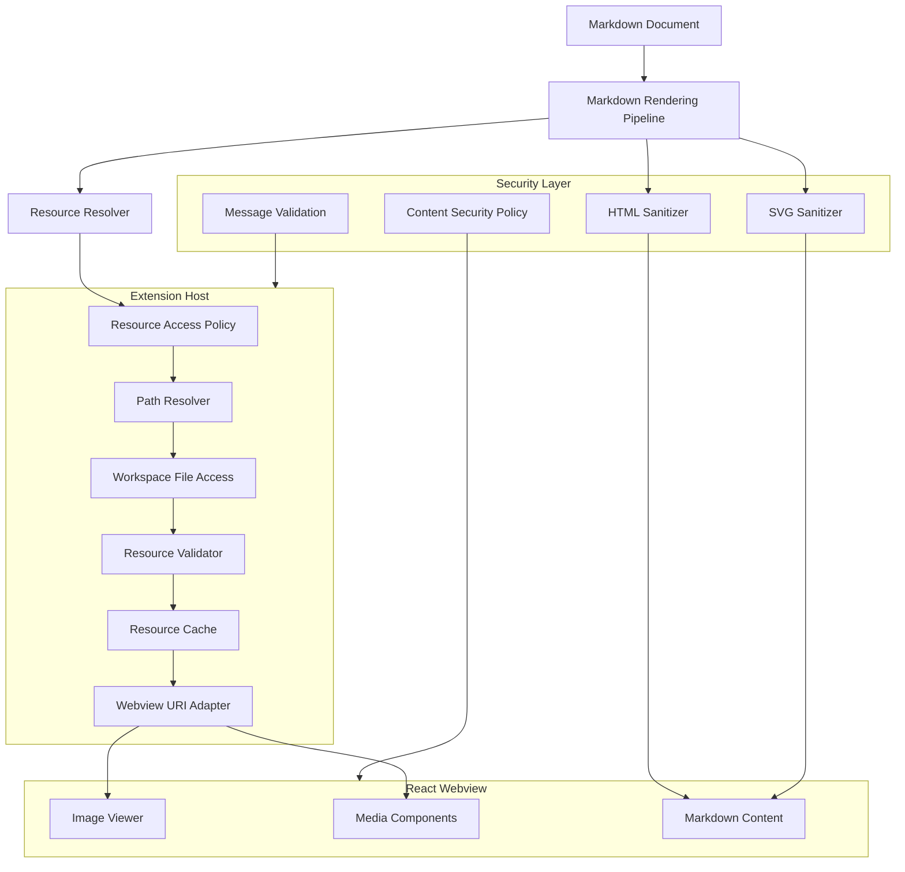
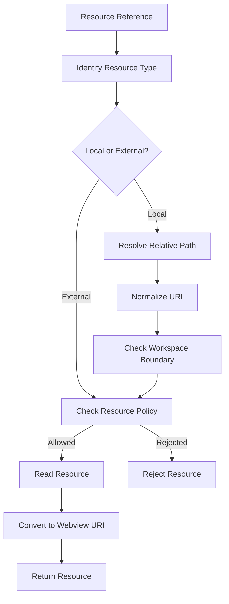
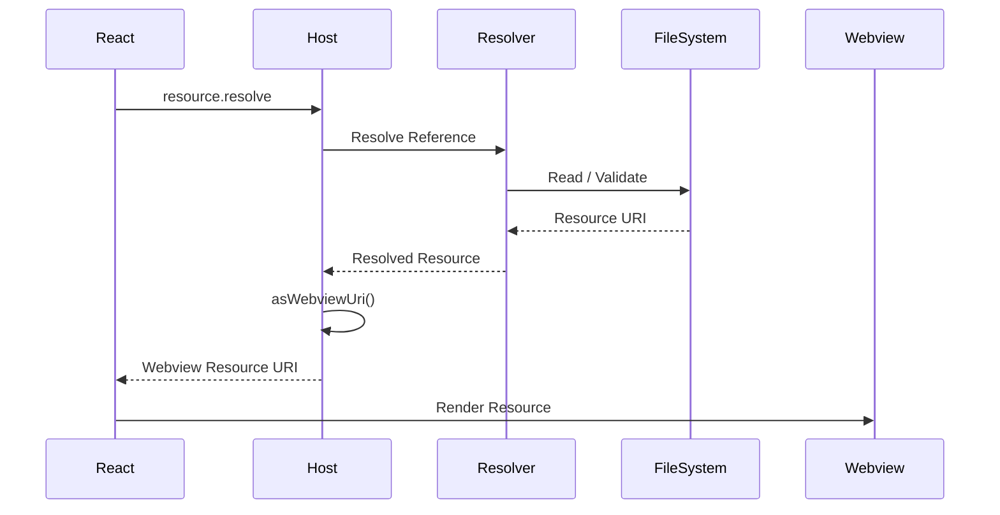
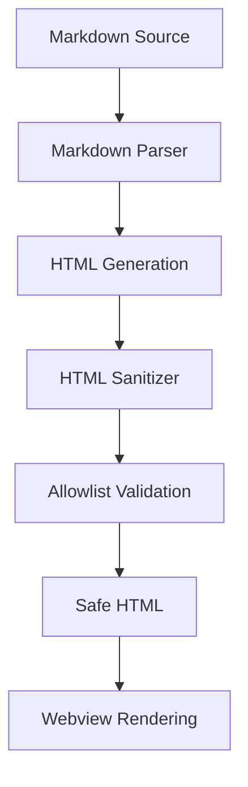
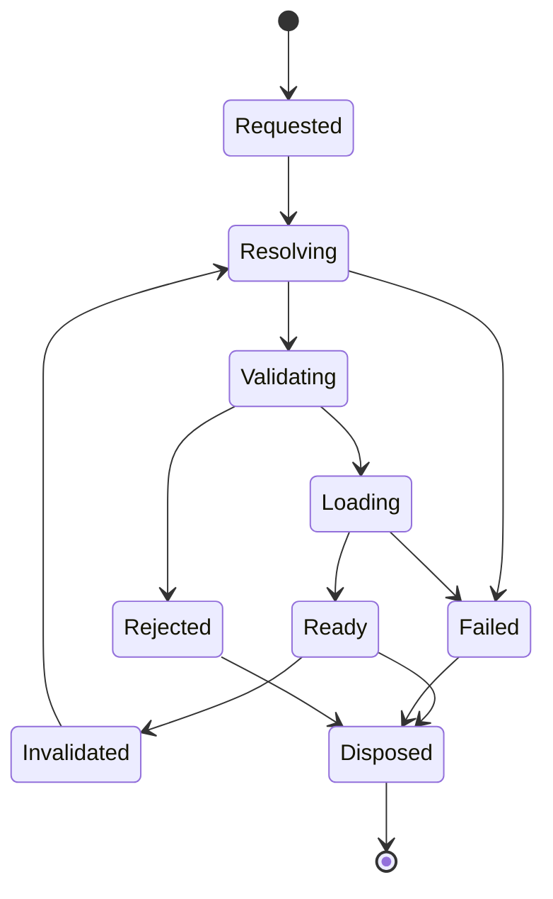
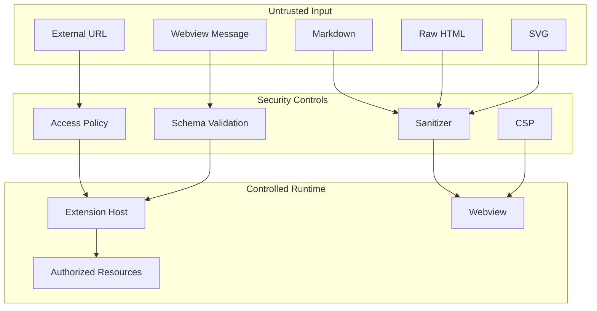

# ARC-008：Readora 资源与安全架构设计

| 属性 | 内容 |
|---|---|
| 文档编号 | ARC-008 |
| 文档名称 | Readora 资源与安全架构设计 |
| 文档版本 | 1.3.0 |
| 文档状态 | Final |
| 产品名称 | Readora |
| 适用范围 | Asset Management & Security |
| 上游文档 | PRD-001、PRD-002、ARC-001、ARC-002、ARC-003、ARC-004、ARC-005 |

---

## 1. 文档目标

建立 Readora 的统一资源管理与安全防护体系。

本篇主要解决：

1. Markdown 相对资源路径解析。
2. 本地图片和附件加载。
3. 外部资源访问策略。
4. Webview 资源 URI 转换。
5. 资源缓存与生命周期管理。
6. HTML、SVG 和 Markdown 内容安全。
7. Webview Content Security Policy。
8. 安全测试与验收标准。

设计目标是在保持本地 Markdown 阅读体验的同时，防止恶意文档、恶意资源和不可信内容访问宿主环境或执行任意代码。

## 2. 设计原则

| 原则 | 说明 |
|---|---|
| Least Privilege | 仅授予必要的资源访问权限 |
| Host Controlled | 本地资源访问由 Extension Host 管理 |
| Workspace Boundary | 默认限制资源访问范围 |
| Secure by Default | 默认拒绝不必要的外部资源访问 |
| Content Isolation | 内容展示与宿主能力隔离 |
| Explicit Trust | 对外部资源和危险操作实施明确策略 |
| Defense in Depth | 多层安全防护 |
| Resource Lifecycle | 统一管理资源加载、缓存和释放 |

## 3. 总体架构

### 3.1 架构图



### 3.2 模块职责

| 模块 | 职责 |
|---|---|
| Resource Resolver | 识别 Markdown 中的资源引用 |
| Resource Access Policy | 判断资源是否允许访问 |
| Path Resolver | 解析相对路径与绝对路径 |
| Workspace File Access | 通过 VS Code 文件 API 访问文件 |
| Resource Validator | 校验资源类型、大小及访问范围 |
| Webview URI Adapter | 转换为 Webview 可访问 URI |
| Resource Cache | 管理资源缓存 |
| HTML Sanitizer | 清理不安全 HTML |
| SVG Sanitizer | 清理不安全 SVG |
| CSP Manager | 生成 Webview 内容安全策略 |
| Message Validator | 校验 Webview 消息 |

## 4. 资源分类

### 4.1 资源类型

| 类型 | 示例 | 处理策略 |
|---|---|---|
| Local Image | PNG、JPG、WebP | Host 解析后加载 |
| Local Attachment | PDF 等附件 | 按支持能力提供访问 |
| SVG Image | SVG 文件 | 必须经过安全校验 |
| External Image | HTTPS 图片 | 默认受策略控制 |
| External Link | HTTP/HTTPS 链接 | 用户主动打开 |
| Data URI | Base64 内嵌资源 | 严格限制类型和大小 |
| Embedded Media | 音视频资源 | 按明确支持范围处理 |

### 4.2 首期支持范围

P0：

- PNG
- JPG / JPEG
- GIF
- WebP
- SVG（安全校验后）
- 本地相对路径图片
- Markdown 外部链接

P1：

- PDF 附件访问
- 外部 HTTPS 图片
- 更多媒体资源类型

首期不实现通用文件预览器，不把 Readora 扩展为文件管理工具。

## 5. 本地资源解析

### 5.1 路径解析原则

Markdown 中的相对资源路径以当前 Markdown 文档所在目录作为解析基准。

例如：

```text
workspace/
├── docs/
│   ├── architecture.md
│   └── images/
│       └── architecture.png
└── assets/
    └── logo.png
```

`architecture.md` 中：

```markdown


```

资源解析器应得到对应的本地文件 URI。

### 5.2 路径解析流程



### 5.3 资源路径处理要求

- 使用 URI 处理路径，不直接通过字符串拼接构造文件路径。
- 相对路径必须基于当前文档 URI 解析。
- 处理空格、Unicode 和 URL 编码。
- 识别并拒绝非法路径。
- 默认拒绝超出授权范围的资源。
- 不允许通过路径穿越访问未授权文件。
- 对符号链接和真实路径进行边界检查。
- 不允许 Webview 自行构造本地文件访问路径。

### 5.4 资源解析接口

```typescript
interface ResourceReference {
  documentUri: string;
  resourcePath: string;
  resourceType?: string;
}

interface ResolvedResource {
  resourceId: string;
  uri: string;
  mimeType: string;
  source: "local" | "remote";
}

interface ResourceResolver {
  resolve(
    reference: ResourceReference
  ): Promise<ResolvedResource>;
}
```

以上是模块内部接口示例，Host 与 Webview 之间的实际消息 Envelope 遵循 ARC-004。

## 6. 资源访问策略

### 6.1 默认访问边界

默认允许：

- 当前 Markdown 文档目录中的资源。
- 当前工作区中经授权的资源。
- 用户明确选择并授权的外部资源。

默认拒绝：

- 任意系统目录文件。
- 用户配置目录中的敏感文件。
- 未授权的工作区外资源。
- 不符合策略的网络资源。
- 可执行内容作为活动页面加载。

### 6.2 访问策略模型

```typescript
interface ResourcePolicy {
  allowWorkspaceResources: boolean;
  allowExternalImages: boolean;
  allowDataImages: boolean;
  allowSvg: boolean;
  maxResourceSize: number;
  allowedMimeTypes: string[];
}
```

配置值应由产品默认策略和用户设置共同决定，不能由 Markdown 文档自行覆盖。

### 6.3 路径边界校验

资源访问不能仅依赖路径字符串前缀判断。

应考虑：

- URI 规范化。
- 路径分隔符差异。
- `..` 路径穿越。
- URL 编码后的特殊字符。
- 符号链接。
- 大小写敏感性差异。
- 不同操作系统的路径语义。

通过 VS Code 文件系统 API 访问资源，避免 Webview 获得直接文件系统权限。

对于符号链接，应根据授权策略检查最终解析目标，防止通过工作区内的链接访问工作区外的未授权内容。

实现注记（1.1.0，依据 AUD-001）：本节要求已按三重防御落地（AUD-001 §7 ARC-008 ✓、§4.3 F06）——渲染期惰性标记（`images.ts` 的 `data-readora-image-src`，不预解析为可加载 URI）+ Host 侧策略判定（`resource-policy.ts` / `resource-resolver.ts` / `resource-service.ts`）+ Webview 水合时复判；路径穿越与符号链接逃逸有专项 spec 锁定（STORY-08-01～03 Done）。图片缺失时展示 `missing-base` 降级提示（`image-layer.ts`）。

实现注记（1.5.0 曾引入、1.7.0 撤销）：1.5.0 为自绘面包屑的目录段切换补设过 `document.list` 目录列举通道（`resource-service.listMarkdown` 对 `directoryUri` 施加四条硬约束：`file:` scheme、目标目录必须是会话文档目录本身或其祖先、落在 workspace folder 内、`allowWorkspaceResources` 为真，否则 `RESOURCE_DENIED`）。**该通道连同 `listMarkdown`、`ports.readDirectory` 已于 1.7.0 整体删除**：readora 迁移到自定义编辑器形态后，同级文件切换由 VS Code 原生面包屑在 Host 侧完成，Webview 不再需要列目录能力，本节约面因此缩小——资源面只剩 `resource.resolve` 单篇引用解析，不再有「枚举目录」这一潜在越权入口（见 ARC-004 §8.3 更正）。

## 7. Webview 资源 URI 转换

### 7.1 转换原则

Extension Host 不应将本地磁盘绝对路径直接传给 Webview。

应使用 VS Code 提供的：

`webview.asWebviewUri(uri)`

转换为 Webview 可访问 URI。

### 7.2 资源转换流程



### 7.3 转换约束

- 资源 URI 必须由 Host 生成。
- `localResourceRoots` 只开放必要的资源根目录。
- 不开放整个用户文件系统。
- 不将本地路径泄露到普通前端状态。
- 不允许将未验证的 URI 直接用于资源加载。
- 资源加载失败时返回可识别的错误状态。

### 7.4 资源访问方式

图片资源优先通过 Webview URI 直接加载，不要求每张图片都经过 React Base64 编码。

这样可以避免：

- 大量 Base64 字符串复制。
- 不必要的内存占用。
- 图片数据在消息通道中的重复传输。

## 8. 外部资源管理

### 8.1 外部图片策略

外部图片可能产生：

- 用户 IP 和访问行为泄露。
- 第三方追踪。
- 网络请求阻塞。
- 恶意内容加载。
- 不可预测的资源变化。

因此：

- 默认不自动加载未授权的远程图片。
- 提供明确的外部资源加载策略。
- 仅允许符合策略的 HTTPS URL。
- 不允许通过不可信重定向绕过访问策略。
- 不允许将外部资源加载权限扩展为任意网络请求能力。

### 8.2 外部链接策略

Markdown 链接与图片资源采用不同策略。

普通 HTTP/HTTPS 链接由用户主动点击后交给 Extension Host 处理，Host 使用 VS Code 的外部链接打开能力。

不得由 Markdown 内容直接调用任意 Webview 内部接口。

### 8.3 协议限制

默认允许：

- `https:`
- `http:`（仅在用户主动打开普通链接时）

默认拒绝：

- `javascript:`
- `data:`（普通链接场景）
- `file:`
- `command:`
- `vscode:`
- 未明确批准的自定义协议

所有 URL 必须在使用前完成协议校验。

## 9. HTML 安全

### 9.1 安全目标

Markdown 中可能包含原始 HTML。

例如：

```html
<script>alert("unsafe")</script>


<a href="javascript:alert('unsafe')">Click</a>
```

这些内容不得在 Webview 中以可执行方式运行。

### 9.2 安全处理流程



### 9.3 Sanitizer 约束

必须：

- 使用经过维护和安全评估的 Sanitizer。
- 采用元素与属性白名单。
- 清理事件处理属性。
- 限制危险 URL 协议。
- 阻止脚本执行。
- 阻止危险嵌入内容。
- 保留必要的 Markdown 语义标签。
- 不允许原始 HTML 绕过安全处理。

不应依赖简单正则表达式作为主要 HTML 安全方案。

### 9.4 DOM 渲染约束

React 组件如果使用 `dangerouslySetInnerHTML`，只能接收经过完整安全处理的 HTML。

安全处理必须位于渲染入口之前，而不是依赖组件自身防御。

## 10. SVG 安全

### 10.1 风险

SVG 不只是图片格式，还可以包含复杂的 XML 结构和活动内容。

主要风险包括：

- 脚本元素。
- 事件处理属性。
- 外部资源引用。
- 危险 URL。
- 嵌入式 HTML。
- 非预期的外部链接。

### 10.2 SVG 处理原则

- SVG 必须经过专门的安全校验。
- 禁止脚本元素。
- 禁止事件处理属性。
- 禁止危险 URL 和外部资源引用。
- 禁止不必要的嵌入式 HTML。
- 限制 SVG 文件大小。
- 不允许未经校验的 SVG 作为活动文档加载。

### 10.3 Mermaid / Pele 集成

Mermaid 图表输出由 ARC-003 定义的 Diagram Rendering Pipeline 负责。

安全要求：

1. Mermaid 源码不作为可执行代码运行。
2. SVG 输出必须经过 Sanitizer。
3. Pele 的 Sanitizer 能力与产品安全策略协同。
4. 不允许因为图表已经由 Pele 生成，就跳过产品安全校验。
5. 图表安全处理失败时，只显示该图表的错误状态。

不重复实现 Pele 内部的 Mermaid 解析和图形布局。

## 11. Content Security Policy

### 11.1 设计目标

Webview 必须使用严格的 CSP 限制可执行内容和资源来源。

建议策略结构：

```text
default-src 'none';
img-src ${webview.cspSource} https:;
style-src ${webview.cspSource} 'nonce-${nonce}';
script-src 'nonce-${nonce}';
font-src ${webview.cspSource};
connect-src 'none';
object-src 'none';
frame-src 'none';
base-uri 'none';
form-action 'none';
```

以上为策略结构示例，最终指令必须结合 VS Code Webview 运行方式和实际资源加载方式验证。

如果默认禁止远程图片，应从 `img-src` 中移除 `https:`，不能仅依靠业务层控制。

### 11.2 CSP 要求

- 每个 Webview 会话生成独立 nonce。
- 不允许使用 `unsafe-eval`。
- 避免使用 `unsafe-inline`。
- 不允许任意 iframe。
- 不允许任意对象嵌入。
- 不允许不必要的网络连接。
- 所有脚本必须符合 nonce 策略。
- CSS 和字体仅允许来自授权来源。

样式工具链兼容性注记（1.2.0，依据 IMP-001 §21 选型变更）：引入的 Tailwind CSS 必须经 `@tailwindcss/vite` 在**构建期**编译为静态 CSS，产物作为本地样式资源经 `webview.cspSource` 授权加载，不引入运行时编译、`eval` 或外部请求，与本节 CSP 基线兼容。原型（`docs/stitch_/`）使用的 `cdn.tailwindcss.com` 运行时方案依赖外部脚本与运行时编译，**明确禁止**进入实现（ARC-005 §11.3）。

### 11.3 CSP 与资源策略

CSP 是浏览器层面的纵深防御，不能替代 Resource Access Policy。

即使 CSP 允许某类 URI，资源解析器仍然必须进行访问控制。

## 12. 缓存设计

### 12.1 缓存目标

减少重复文件读取和资源转换开销，提升长文档阅读体验。

### 12.2 缓存分类

| 缓存 | 内容 | 生命周期 |
|---|---|---|
| Resource Metadata Cache | MIME、大小、修改时间 | 文档会话或短期 |
| Resource URI Cache | Webview URI 映射 | Webview 会话 |
| Render Cache | Markdown 渲染结果 | 文档版本 |
| Diagram Cache | 图表渲染结果 | 图表生命周期 |

### 12.3 缓存键

资源缓存键应综合考虑：

- 规范化资源 URI。
- 文件修改时间或版本。
- 资源处理策略版本。
- 必要时的内容摘要。

同一路径下文件内容发生变化时，不得继续使用过期缓存。

### 12.4 缓存策略

- 优先使用有界 LRU 缓存。
- 控制缓存最大容量。
- 避免缓存大型原始文件副本。
- 资源更新时使对应缓存失效。
- Webview 销毁时清理会话级缓存。
- 不持久化未经授权的外部资源内容。

### 12.5 缓存接口

```typescript
interface ResourceCache<T> {
  get(key: string): T | undefined;

  set(key: string, value: T): void;

  invalidate(key: string): void;

  clear(): void;
}
```

首期不引入独立缓存服务器或数据库。

## 13. 资源生命周期

### 13.1 生命周期状态



### 13.2 生命周期管理要求

- 资源请求应支持取消。
- 资源失败不得阻塞其他资源加载。
- 文件更新后失效相关缓存。
- Webview 会话结束后释放会话资源。
- 图表实例的销毁遵循 ARC-003。
- 不允许持续积累已失效资源引用。

## 14. 安全威胁模型

### 14.1 威胁清单

| 威胁 | 风险 | 防护措施 |
|---|---|---|
| XSS | 任意脚本执行 | HTML Sanitizer、CSP |
| SVG Injection | SVG 活动内容 | SVG Sanitizer |
| Path Traversal | 越权访问文件 | URI 规范化、路径边界校验 |
| Malicious Remote Image | 隐私泄露、追踪 | 默认限制远程图片 |
| Message Injection | 伪造 Host 消息 | Schema 校验、消息关联 |
| Resource Exhaustion | 内存和 CPU 消耗 | 大小限制、缓存上限、取消机制 |
| Unsafe Protocol | 危险协议调用 | URL 协议白名单 |
| Symlink Escape | 绕过工作区边界 | 最终目标路径校验 |
| CSP Bypass | 执行未授权内容 | Nonce、严格来源限制 |
| Stale Cache | 展示旧资源 | 版本和修改时间失效机制 |
| Webview-triggered File Write | 页面侧驱动 Host 落盘 | 唯一授权边界是保存对话框，取消即零写盘（§14.4） |

### 14.2 安全边界



### 14.3 安全约束

- Markdown 内容始终视为不可信输入。
- 文件路径始终视为不可信输入。
- Webview 消息始终视为不可信输入。
- 外部 URL 始终视为不可信输入。
- SVG 内容始终视为不可信输入。
- 不允许不可信内容获得 Extension Host 的执行能力。
- 不允许通过消息协议绕过资源访问策略。

### 14.4 导出与写盘

导出（M11）带来的新面只有一句话：**Webview 里的内容触发 Host 写一个本机文件**。
此前的全部通道都是「读」或「内存里改」，这一条第一次把内容送到磁盘上。

**唯一授权边界**

- `window.showSaveDialog` 是唯一能决定写盘位置的东西。正文内容、`format`、
  `documentUri` 都不参与路径计算：默认文件名取自当前 md 的同名同目录，但默认值
  可被用户在对话框里改成任何位置，那仍是合法交付。
- 取消对话框 = 零写盘、零临时件、零 Chrome 进程，也不向 View 取帧。
  因此「用户没点保存」这个状态在代码里不是一个需要回滚的副作用，而是一个从未开始的分支。
- `export.data` 里的 `bodyHtml` / `rootStyleText` 只被用于写用户选定那个路径，
  不构成对路径、格式或目标目录的影响因子（ARC-004 §8.5 第 8 条）。
- 陈旧护栏：`documentUri` 与 `version` 双校验不过就整帧丢弃。一个晚到的帧不能
  覆盖另一个文档或另一个会话的内容。

**内容从哪来（不重新净化，也不重复渲染）**

导出源是屏幕上已经过 DOMPurify（HTML）与 `sanitizeSvgToNode`（SVG）净化的 DOM，
因此 Host 不重跑渲染管线（那会造出与屏幕不一致的第二套口径）。序列化层只做
「删节点 / 删属性 / 剥包裹」三类操作，不新增文本节点；交付物里的每个字节要么来自
屏上已存有的节点，要么来自 Host 内联层。

**内联读取复用同一套资源策略**

- 图片走 `ResourceService.readInline`：与屏上同一套判定、同一个 `maxImageSizeMb`。
  不存在「屏上被拦、文件里补上」的通道；被策略拦住的远程图（`blocked`）与读不到的图
  （`missing`）不补 `src`，导出件里仍是占位卡。
- 图片引用原文交给策略层，**导出层不拼任何路径**；路径归一与越界判定全在 §6 那一套里。
- 样式表里的每个 `url()` 必须能解析为归档内同名资产，否则整体报错（fail-closed）：
  交付物要么是完全自包含，要么不存在 —— 没有「半内联」这个中间态。
- 总体积上限 `EXPORT_MAX_TOTAL_BYTES`（64 MiB）超限即失败，既不截断也不旁置目录。

**导出件自己的 CSP**

交付物是一份会在浏览器里打开的静态文件，它带一套与面板不同、但更严格的策略：

```
default-src 'none'; script-src 'none'; img-src data:; font-src data:;
style-src 'unsafe-inline'; connect-src 'none'; frame-src 'none';
```

- 没有 `script-src` 例外，产物永不带 `<script>`；`style-src 'unsafe-inline'` 是单文件
  形态的必要条件（样式与根变量都以 inline 存在），不构成执行能力。
- 无 nonce、无外链样式、无 `<link>`：自包含不是承诺而是可测读数（安全用例直接断言
  浏览器一个额外请求都没发出）。
- `img-src data:` 封住外联：即使有人把手写远程图送进了正文，打开文件也不会发生追踪请求。
- 自定义 CSS 与面板走同一个 `sanitizeInjectedCss` 出口：含 `<` 则整段丢弃，
  `</style>` breakout 不靠转义堵住，靠「不输出这一段」堵住。

**外部进程**

- PDF / PNG 由本机 Chrome CLI 的 headless 模式完成，`child_process.spawn` 不经 shell，
  参数以数组传递，因此选定的文件路径不构成命令注入面；不加 `--no-sandbox`。
- 临时 HTML 只写 `os.tmpdir()`，`finally` 必删：它带着已内联的字体与图片，留着既占地方
  也泄露内容。
- 两个定时器都是硬上限：取帧 10 s（`EXPORT_CAPTURE_TIMEOUT_MS`）、浏览器 30 s
  （`EXPORT_BROWSER_TIMEOUT_MS`，超时 kill 并把 stderr 尾部送进输出通道）。
  同一会话同时只允许一个在途导出，后来者直接提示而不排队。

## 15. 项目模块结构

建议目录：

```text
src/
├── core/
│   └── security/
│       ├── policy/
│       ├── validation/
│       ├── url/
│       └── errors/
│
├── features/
│   └── asset/
│       ├── components/
│       ├── hooks/
│       ├── services/
│       ├── types/
│       └── index.ts
│
└── extension/
    ├── security/
    │   ├── csp/
    │   ├── sanitizer/
    │   └── validation/
    │
    └── resources/
        ├── resolver/
        ├── path/
        ├── cache/
        ├── validator/
        └── webview-uri/
```

实际目录应根据 ARC-001 的 Extension Host 和 Webview 代码边界组织，不要求机械复制以上示例。

## 16. 测试策略

| 测试类型 | 测试内容 |
|---|---|
| Unit Test | URI 规范化 |
| Unit Test | 路径边界校验 |
| Unit Test | MIME 类型判断 |
| Unit Test | Resource Policy |
| Unit Test | Cache Invalidation |
| Security Test | HTML XSS |
| Security Test | SVG Injection |
| Security Test | Path Traversal |
| Security Test | URL Protocol |
| Integration Test | Webview URI 转换 |
| Integration Test | CSP 加载 |
| Integration Test | 文件变更与缓存失效 |
| E2E Test | 本地图片和外部链接 |

### 16.1 安全测试用例

至少覆盖：

1. `<script>` 注入。
2. `onerror` 等事件属性注入。
3. `javascript:` URL。
4. SVG 脚本和外部引用。
5. `../` 路径穿越。
6. URL 编码路径穿越。
7. 符号链接越权访问。
8. 超大图片和异常资源。
9. 非法 MIME 类型。
10. 伪造 Host 消息。
11. CSP 未授权脚本执行。
12. 外部资源重定向。
13. 导出交付物里的脚本入口与本机地址泄露（`vscode-webview://` / `file://` / `javascript:`）。
14. 导出件的 CSP 在真实浏览器里是否拦得住注入样本（含零额外请求数）。
15. `</style>` breakout、字体读不全时的 fail-closed、越界资产引用拒收。

## 17. 架构决策记录

| 编号 | 决策 | 原因 |
|---|---|---|
| ADR-008-01 | 本地资源由 Extension Host 管理 | 隔离文件系统能力 |
| ADR-008-02 | 使用 asWebviewUri 转换资源 | 符合 VS Code Webview 安全模型 |
| ADR-008-03 | 默认限制外部图片 | 降低隐私与安全风险 |
| ADR-008-04 | HTML 使用 Sanitizer | 防止内容注入 |
| ADR-008-05 | SVG 单独实施安全处理 | SVG 具有额外活动内容风险 |
| ADR-008-06 | 使用严格 CSP | 限制脚本和资源来源 |
| ADR-008-07 | 使用有界缓存 | 控制资源内存占用 |
| ADR-008-08 | 不开放任意本地文件访问 | 遵循最小权限原则 |
| ADR-008-09 | 导出正文由 Webview 序列化、写盘由保存对话框授权 | 渲染只在 View 发生，Host 重跑会造出两套口径；对话框是唯一的写盘授权边界 |

## 18. 本篇范围边界

| 内容 | 归属文档 |
|---|---|
| Markdown 解析和 AST | ARC-002 |
| Mermaid / Pele 图表渲染 | ARC-003 |
| Webview 安全通信协议 | ARC-004 |
| React 资源展示组件 | ARC-005 |
| 主题和样式 Token | ARC-006 |
| Outline 与文档导航 | ARC-007 |
| 本地资源、安全策略和缓存 | ARC-008 |

## 19. 验收标准

ARC-008 完成验收需要满足：

- [x] 本地资源解析规则明确。
- [x] 相对路径解析机制明确。
- [x] 工作区资源访问边界明确。
- [x] Webview URI 转换机制明确。
- [x] 外部资源访问策略明确。
- [x] HTML 和 SVG 安全处理明确。
- [x] CSP 策略明确。
- [x] 资源缓存和失效机制明确。
- [x] 资源生命周期明确。
- [x] 安全威胁模型明确。
- [x] 安全测试用例明确。

回填说明（1.1.0）：以上为文档级验收项，本篇 §5～§16 已逐项明确；实现侧符合性见 AUD-001 §7（ARC-008 ✓：净化、授权根、`localImageUri` 能力位、路径与符号链接逃逸均有专项 spec）、§4.3 F06 / F11 落点与 §9（CSP / Sanitizer / SVG / URL Scheme / 路径边界 / Host 校验七项均有用例）。

## 20. 修订记录

### 20.1 版本历史

| 版本 | 日期 | 说明 |
|---|---|---|
| 1.0.0 | 基线 | 初版，Draft |
| 1.1.0 | 本次修订 | 依据 AUD-001 审计结论对齐实现注记与消息命名，状态转 Final |
| 1.2.0 | 选型变更同步 | §11.2 新增 Tailwind 构建期编译的 CSP 兼容性注记，明确禁止原型 CDN 运行时方案（IMP-001 §21）；安全边界与防护要求不变 |
| 1.3.0 | M11 导出链路 | 新增 §14.4「导出与写盘」与威胁清单第 10 项 Webview-triggered File Write；ADR-008-09 登记导出形态决策；§16.1 补三条导出用例。净化、资源策略与面板 CSP 基线未变 |

### 20.2 1.1.0 修订内容

1. §6.3：新增实现注记——三重防御（渲染期惰性标记 + Host 策略判定 + Webview 水合复判）与符号链接逃逸专项 spec（AUD-001 §7、§4.3 F06）。
2. §7.2：资源请求消息名由 `asset.resolve` 对齐为 ARC-004 §8.3 权威消息表的 `resource.resolve`。
3. §19：文档级验收 11 项回填，附实现侧证据引用。
4. 元数据与文末状态同步为 1.1.0 / Final；文末「架构文档系列全部完成」表述更新为修订完成口径。

### 20.3 1.2.0 修订内容

1. §11.2：新增样式工具链兼容性注记——构建期 Tailwind 产物为静态本地 CSS，与 CSP 基线兼容；原型 `cdn.tailwindcss.com` 运行时方案明确禁止。
2. 依据：IMP-001 §21 选型变更登记、ARC-005 §11.3 utility 层架构；本篇资源策略、净化与威胁模型均不变。

### 20.4 1.3.0 修订内容

1. §14.1 威胁清单新增 Webview-triggered File Write；§14.4 逐条给出该威胁的四道防线：
   写盘只能由 `showSaveDialog` 授权、正文源是已净化 DOM 所以不二次净化但也不新增文本、
   内联读取复用 `ResourceService` 同一套策略与 `maxImageSizeMb`、导出件自带一套比面板更严的
   CSP（产物永不带 `<script>`）。
2. §16.1 安全测试用例补第 13～15 项（`tests/security/export.spec.ts`）；ADR-008-09 登记
   「View 序列化 + 对话框授权」这一形态决策。
3. 未变更项：§5～§13 的净化、路径边界、资源策略、面板 CSP 基线均一字未改；导出层不引入
   新的白名单项，也不放宽任何现有判定。

---

**文档结束**

版本：1.3.0  
状态：Final  
架构文档系列：ARC-001 至 ARC-008 修订完成（1.1.0～1.3.0 / Final）。