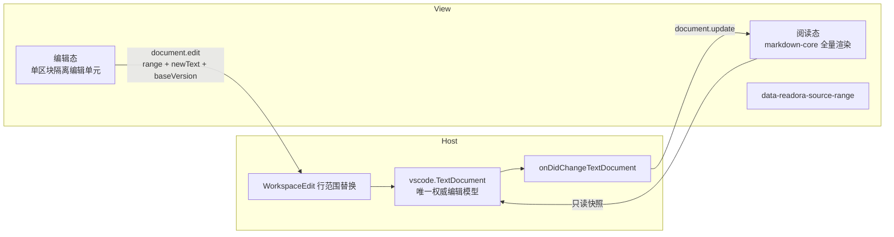

# ARC-009：Readora 编辑模式架构设计

| 属性 | 内容 |
|---|---|
| 文档编号 | ARC-009 |
| 文档名称 | 编辑模式架构设计 |
| 文档版本 | 1.4.0 |
| 文档状态 | Draft |
| 所属产品 | Readora |
| 关联文档 | PRD-001（F12）、ARC-002（§4 / §11 / §13）、ARC-004（§4.4 / §8 / §9）、ARC-005（§9）、ARC-008（§9 / §11） |
| 核心技术 | TypeScript、markdown-it AST 源位置、VS Code `WorkspaceEdit`、contenteditable、CodeMirror 6 |
| 适用范围 | 阅读视图内的就地编辑（Inline Editing） |
| 优先级 | P1（不阻塞任何已交付版本） |

---

## 1. 文档目标

本文档定义 Readora 从「只读阅读器」扩展出**就地编辑能力**的架构边界与契约。

需要解决：

1. 编辑入口与阅读态的隔离方式。
2. 渲染产物到 Markdown 源文件的**位置锚定**。
3. 编辑结果如何写回磁盘文件，且不失真、不越权。
4. 撤销、脏态、保存这些编辑生命周期由谁承担。
5. 各类内容（段落 / 标题 / 列表 / 表格 / 代码块 / 图表 / 公式 / frontmatter）的编辑语义。
6. 与既有渲染管线、搜索层、图表层、视觉基线的共存条件。

本文档**不**定义编辑器级别的完整所见即所得（块拖拽重排、样式面板、协作光标、实时渲染整页可输入），理由见 §3.2。

---

## 2. 前置事实：既有架构的四条硬约束

设计必须先承认现状，否则写到一半会推翻重来。以下四条是本次勘察的实测结论。

| # | 现状 | 证据 | 对编辑模式的后果 |
|---|---|---|---|
| C1 | 正文渲染是**全量重写**：`text` 变化即 `container.innerHTML = result.html`，并销毁重建 image / diagram / code 三个附加层 | `apps/webview/src/content/MarkdownContent.tsx` 的 innerHTML 写入点与随后的三次 `destroy()` | 任何时刻重写 DOM 都会丢掉光标、选区与 IME 组合态。编辑态**绝不能** living 在全量重写的容器里 |
| C2 | AST 带 `SourcePosition`（`positionOf` 取 `token.map`，`endLine` 已归一为块内最后一行、不含尾随空行），但**渲染出口不落地**，DOM 中没有任何源位置属性 | `packages/markdown-core/src/ast.ts`、`types.ts`；对照 `renderers/support.ts` 只输出 `data-align` / `data-readora-width` | 「点这段 → 改这段的源」这条锚链当前不存在，是编辑模式唯一的前置缺口 |
| C3 | 自定义编辑器实现的是 `CustomReadonlyEditorProvider`，无编辑模型、无脏态、无 `revert` / backup | `apps/extension/src/webview/custom-editor-provider.ts` | 需要决定写回路径；但宿主侧 `TextDocument` 模型本就存在（`onDidChangeTextDocument` 已在监听） |
| C4 | 协议 17 条消息（**立项时点实测值**；本篇 §5.1 新增 `document.edit` 后为 18 条），`document.update` 是 Host→View 单向快照，**没有 View→Host 的文本写回通道** | `packages/contracts/src/protocol.ts` | 需要新增消息；dispatcher 已有请求-应答与统一错误响应，拒收可复用 |

一条**可直接复用的资产**：CodeMirror 6（含 `@codemirror/lang-markdown`）已在 `apps/webview` 依赖树内，`code-editor-layer.ts` 已实现懒挂载、主题同步、失败单块降级，当前 `editable: false`。

---

## 3. 总体架构：双态分离

### 3.1 决策

**阅读态与编辑态是两条渲染路径，不是同一棵可编辑 DOM 的两种开关。**



- **阅读态**：完全沿用既有管线，一行不改。C1 的「全量重写」在读态是优点（简单、无陈旧），保持。
- **编辑态**：任一时刻**只有一个区块**处于可输入状态。用户点中某区块 → 该区块被一个隔离的编辑单元就地替换 → 提交 → 该次替换的源文本交回 Host → 宿主模型变更 → C4 现成的变更通知推回新快照 → 阅读态重新全量渲染。
- 光标只需要在**一个刚被用户主动激活、且自身不参与全量重写**的单元内保持。C1 的冲突因此消解，而不是被硬扛。

### 3.2 被否决的替代方案

| 替代 | 否决理由 |
|---|---|
| 把整页改成可增量 reconcile 的可编辑 DOM（ProseMirror / BlockNote 路线） | ① 必然要求 **AST → Markdown 全文序列化**，而序列化器会重写用户整个文件：转义风格、`{width=…}` 块属性写法、列表标记符号、未改动的正文全部被规范化掉 —— 这是对用户内容的破坏，不是体验问题。② 摧毁三项既有资产：搜索层依赖静态 `<pre>` 全文可搜（`code-editor-layer.ts` 头注明确写了 CodeMirror 只渲染视口内行、拿它的 DOM 搜索会漏命中）、图表/图片层的懒挂载与在途请求生命周期、10 档视觉基线。③ 撤销栈、脏态、文件监听三方冲突全部自建 |
| 切 `CustomTextEditorProvider` | 要接管 `saveCustomDocument` / `saveCustomDocumentAs` / `revertCustomDocument` / backup 全套生命周期。但写回目标就是宿主已有的 `TextDocument` 模型 —— 撤销栈、脏态标记、`Ctrl+S`、git 装饰、冲突提示**宿主已经做得比我们能做的更好**。这与 M6 面包屑那条决策同一口径：「用 VS Code 的，不用自己实现」 |
| 只做「并排打开源码编辑器」 | 工程量最小，但不是用户要的东西（不构成编辑模式）。作为 §12 的 E0 副产物自然存在，不单独设阶段 |

### 3.3 不变量

1. **源保真优先于所见即所得**：任何编辑只允许替换被编辑区块的源行范围，禁止全文序列化。没被点过的字节必须逐字节不变。
2. **静态产物是真相**：延续 `code-editor-layer.ts` 与 `diagram-layer.ts` 的设计线，markdown-core 的输出始终是权威，编辑层只做接管与降级，不反向持有内容。
3. **单活动单元**：同时最多一个编辑单元处于激活态。
4. **失败只降级一块**：任一区块无法锚定、无法编辑、写回失败，只影响该区块，不影响整篇渲染（与 code / diagram 层同口径）。
5. **无虚假 affordance**：不能真编辑的地方不摆编辑把手。与 PRD-003「没有实现就不给开关」、`section-metrics.ts`「position 缺失则不显示标签」同一条诚实性规则。

---

## 4. 源位置身份契约（前置依赖）

### 4.1 属性定义

渲染出口必须为**顶层区块**输出源行范围（发射点在管线顶层组装处逐子节点渲染那一段，不在块级渲染器里，详见下表「发射点」一行）：

```html
<p class="readora-paragraph" data-readora-source-range="12:15">…</p>
```

```ts
/** ARC-009 §4.1：区块 → 源行范围的 DOM 契约（packages/markdown-core/src/source-range.ts）。 */
export const SOURCE_RANGE_ATTRIBUTE = "data-readora-source-range";
export const SOURCE_RANGE_PATTERN = /^\d+:\d+$/u;

/**
 * 序列化形状：`"${startLine}:${endLine}"`，0 基闭区间，**相对文件**的行号。
 * 不可用（合成节点、形状非法、收缩后倒挂）返回 undefined —— 调用方据此不输出属性。
 */
export function sourceRangeValue(
  position: SourcePosition | undefined,
  lineOffset: number,
  isBlankLine?: (line: number) => boolean
): string | undefined;
```

这两个额外参数不是可选装饰，而是 §4.1 两条口径的落地形态，缺一即在写回时改错行：

- `lineOffset` 是 `FrontmatterOutcome.bodyLineOffset`，即提取层从文件开头整段切掉的行数；AST 的行号相对 body，锚点要相对文件。
- `isBlankLine` 用来把 `endLine` 收回到最后一行非空行；`positionOf` 的 `map[1] - 1` 挡不住「`map` 本身就包含区块后的分隔空行」这一类（列表实测）。收缩必须发生在加偏移**之前**。

约定：

| 项 | 规定 | 理由 |
|---|---|---|
| 行号基 | **0 基，且相对文件绝对行** | 基序与 `ast.ts` 的 `positionOf` 一致（直接来自 `token.map`），不在中途换基导致 off-by-one；但 `positionOf` 给的是相对 body 的行号，必须加回 frontmatter 偏移，否则带 frontmatter 的文档每个区块整体前移，写回改到隔壁那几行 |
| 区间 | 闭区间 `[startLine, endLine]`，`endLine` 一律是区块自身的最后一行非空行 | `positionOf` 已把 `map[1]` 减一，但列表这类块的 `map` 本身把区块后的分隔空行圈了进来（实测 `- a` / `- b` 后接空行再接 `---` 得 `[0, 3]`）。不收缩的话整段替换会吃掉分隔空行，下一个区块直接贴上来、连解析都会变 |
| 缺失时 | **不输出该属性**，而不是输出 `-1:-1` | 合成节点（`footnoteSection`、processors 造的 `tableRow`/`tableCell`）没有可靠范围；属性缺失即「此区块不可编辑」的唯一信号 |
| 归属层级 | 只标**顶层区块**（`document.children` 一层） | 编辑单元 = 顶层区块。行内节点的 `map` 继承自所属块，逐行标会得到一堆同一个范围的假精度 |
| 发射点 | 管线**顶层组装处**，不在块级渲染器内 | 段落渲染器同时服务顶层段落与嵌套段落，无法自辨层级；改成「往 `RendererContext` 塞顶层标记再抄进每个块级渲染器」既啰嗦又会漏标。整篇兜底（`failureResult()`）不标：管线都炸了没有可靠范围 |

### 4.2 嵌套容器的处理

列表项、引用块内部的段落**不单独标注**，它们随所属顶层区块（`list` / `blockquote`）整体进入编辑单元。于是：

- 编辑一个列表 = 编辑该列表的整段源（含全部嵌套层级）。
- 编辑一个引用块 = 编辑其整段源。

这不是妥协，而是**正确粒度**：Markdown 的缩进与标记连续性使「只改第 3 层第 2 项那一行」极易产出一个语法上不属于原结构的片段；整块替换在语义上总是可预期的。

### 4.3 Sanitizer 放行

**白名单不需要动**（本条为 E0 实测修正）。`packages/markdown-core/src/sanitizer.ts` 走的是 `ALLOW_DATA_ATTR: true`，DOMPurify 对匹配 `data-*` 的属性名直接早退放行，**连值都不校验**（其源码注："We don't need to check the value; it's always URI safe"）。往 `ALLOWED_ATTR` 里加一行 `data-readora-source-range` 既不是必要条件也不是充分条件 —— 想要值形状校验，只能自己写。

于是落地形态是清洗**之后**的一段后置剥离遍历：`stripMalformedSourceRanges` 扫所有带该属性的元素，值不匹配 `SOURCE_RANGE_PATTERN` 或区间倒挂（`15:12`）就 `removeAttribute`，并记一条 `readora.render.source-range-stripped`（warning）。

这段遍历不是在堵文档侧的注入路径：parser 以 `html: false` 运行，文档自带的 HTML 在 `htmlBlockRenderer` 那一层就被整体转义成可见文本，不存在写入自定义属性的通道。它是防**自身编程错误**的纵深防御 —— 属性值由本包拼接，`NaN:NaN` 这类错误一旦被下游当成合法范围，后果是按错的行改文件。项目反复把「静默失效」列为头号敌人，因此宁可可取证也不静默退化成「该区块不可编辑」。

安全面评估：该属性是**只读元数据**，不产生任何可执行效果，不进 URL、不进样式、被 `JSON.stringify` 进导出物也只是多几个字节。风险等同于既有的 `data-readora-width`。导出物（`export-document.ts`）保留该属性无副作用，但 HTML 导出**可以选择性剥离**（§12 E0 不做，避免与视觉/导出基线同时变动）。

### 4.4 门禁

实际门禁 6 条（初版写 4 条，E0 落地时按可执行性扩），完整清单与理由见 ARC-002 §12.3，测试在 `packages/markdown-core/src/__tests__/source-range.spec.ts`（33 个用例）：

1. 锚点指回的源就是该区块的渲染源 —— 按范围切出的源**单独再渲染一次**，产物与在文中的片段逐字节相同（幂等式，不手写期望行号）。
2. 范围按文档顺序严格递增、两两不相交，相邻区块之间的间隙只能是空行。
3. 行号是文件绝对行号：带 / 不带 frontmatter 的同一文档，各区块行号差正好是被剥掉的行数。
4. 只标顶层：被标元素的后代无同名属性、合成脚注区不带属性、顶层元素数等于锚点数；`position` 缺失或非法时不输出属性。
5. Sanitizer 按值形状剥离并给出 warning 诊断，合法值保留且正常渲染零命中。
6. 只**增加**属性：去掉它后产物不剩锚点字节，既有结构与 class 命中数不变。

最后一条是回归护栏：E0 只**增加**属性，不得让既有断言 HTML 结构的测试集体转绿为红。实测口径见 §12 E0 交付判据与 ARC-002 §17.5 第 5 条 —— 结构确实未变，但有 4 处精确串断言把属性集末尾的 `>` 一起钉住了，随本轮放宽为「标签 + class」。

---

## 5. 写回通道：`document.edit`

### 5.1 契约

新增 **1 条**消息，协议 17 → 18。方向 `view-to-host`，**请求**（需要成功/失败应答）。E1 已按此落地，实现侧的权威定义在 `packages/contracts`（`DocumentEditPayloadSchema` / `DocumentEditResultSchema`，且后者已进 `RESPONSE_PAYLOAD_SCHEMAS` 出口复判）。

```ts
export interface DocumentEditPayload {
  /** 必须是当前会话的 documentUri；不符即拒。 */
  documentUri: string;
  /** 0 基闭区间，来自 data-readora-source-range 原样回传。 */
  range: { startLine: number; endLine: number };
  /** 该区块的新 Markdown 源，不含尾随换行。 */
  newText: string;
  /** 发起编辑时 View 持有的 documentVersion，用于乐观锁。 */
  baseVersion: number;
}

export interface DocumentEditResult {
  /** 写回后的新快照版本；View 据此判定后续 update 是否为自己的回声。 */
  version: number;
}
```

Schema 约束（`packages/contracts/src/schemas.ts`，与既有 strict 口径一致，拒绝未知字段）。**1.2.0 把「形状」与「语义」两侧的归属拆开写清**，因为这不是可以随手合并的一张表：

| 字段 | 形状约束（Schema，失败 → `readora.payload.invalid`） |
|---|---|
| `documentUri` | 非空字符串，长度 ≤ 既有 URI 上限 |
| `range.startLine` / `endLine` | 各自整数且 `>= 0` |
| `newText` | 字符串，长度 ≤ `DOCUMENT_TEXT_MAX_LENGTH`（**只有上限没有下限**：删空一个区块是合法编辑；不开第二套上限常量） |
| `baseVersion` | 整数，`>= 0` |

| 判断 | 归属 | 失败码 |
|---|---|---|
| `endLine >= startLine`（倒挂） | **Host**，§5.2 第 6 步 | `readora.edit.rangeInvalid` |
| `endLine < 文档行数`（越界） | **Host**，§5.2 第 6 步 | `readora.edit.rangeInvalid` |
| `documentUri` 是否等于会话文档 | **Host**，§5.2 第 2 步 | `readora.target.invalid` |

分工的理由：形状错误说明 **View 有 bug**（发错了字段），语义错误说明**源结构已变、用户手里的把手作废** —— E2 的 `conflict` 态要按后者分支。`parsePayload` 失败只能回 `readora.payload.invalid`，所以把 `endLine >= startLine` 塞进 Schema 会把第二种情况退化成一个用户和界面都无法据此行事的码。倒挂约束因此**故意不进 Schema**，并由 `protocol.spec.ts` 的一条用例把「Schema 放行倒挂范围」钉成显式契约，防止后人「顺手补个 `.refine`」。

### 5.2 Host 侧处理

E1 落地形态：判断全部在 `apps/extension/src/edit/edit-service.ts`（**不 import vscode**，宿主能力经端口注入，因此整条阶梯可单测），宿主侧转译在 `edit/vscode-port.ts`（与 `export/vscode-ports.ts` 同处理，不进覆盖率）。端口集合里**没有** `postMessage` / `pushUpdate` / `save` —— 「不新增刷新机制」「不隐式写盘」由类型结构保证，不靠注释承诺。

```
1. sessionId → 会话；会话不在或无面板       → ReaderError(RESOURCE_DENIED)
2. payload.documentUri ≠ 会话文档（字符串全等，不归一化）
                                          → ReaderError(TARGET_INVALID)
3. scheme ≠ "file"                        → ReaderError(TARGET_INVALID)
4. 取模型：textDocuments 命中，否则 openTextDocument；打不开
                                          → ReaderError(DOCUMENT_UNREADABLE)
5. 乐观锁：baseVersion ≠ 快照空间的版本      → ReaderError(EDIT_STALE)
6. endLine < startLine 或 endLine ≥ lineCount（不钳位、不截断）
                                          → ReaderError(EDIT_RANGE_INVALID)
7. WorkspaceEdit.replace(...) + await applyEdit(we)
   抛异常 / 返回 false / 应用前模型丢了     → ReaderError(EDIT_APPLY_FAILED)
8. 再取一次模型 → 返回 { version: 替换后的快照版本 }
```

阶梯顺序不可调：前四步都在读模型之前（「你是谁、能不能改这一篇」先于「改哪几行」），而**陈旧判定必须先于范围合法性** —— 版本已经对不上时行数本身就不可信，报 `rangeInvalid` 会把用户引向「重开编辑器」而不是「重新同步」。任一步不过即抛，第 7 步一次都不调（§3.3 不变量：**绝不留部分效果**）。

**第 5 步比的是快照空间的版本，不是 `model.version`**（1.2.0 纠正）。原文写的 `model.version ≠ baseVersion` 会误杀首次编辑：投递给 View 的 `version` 出自 `DocumentService.readSnapshot`，对「没在文本编辑器里打开」的文档报 **`0`**，而写回路径必须 `openTextDocument`，宿主给的新模型是 **`1`**。照字面实现，每一个「只在阅读器里打开的文档」第一次写回都被判陈旧。因此把 `open?.version ?? 0` 从 `readSnapshot` 里抽成单一权威 `snapshotVersionOf`，快照侧与写回侧同源，且写回侧**先读快照版本、再决定要不要 `openTextDocument`**（反了就拿到被自己逼出来的那个 `1`）。取证：`document-edit-wiring.spec.ts` 第一条「无 TextDocument 时首次写回必须成功」。

**第 7 步的替换终点是「第 `endLine` 行的行末」，不是 `Position(endLine + 1, 0)`**（1.2.0 纠正，原文写的 `range(model.line(s), model.line(e+1))`）。后者看着只多一行，实际多吃一个换行符：区块最后一行的行尾换行不在替换范围内，而契约规定 `newText` **不含尾随换行**，于是区块后那个分隔空行的换行被拼过来当新内容的行尾 —— 区块之间的空行隔一个少一个，下一个区块直接贴上来、连解析都会变（与 §4.1 对锚点收缩警告过的同一类事故）。取行末后新内容恰好占住原区块的字符区间，区块自己的行尾换行原地保留。

第 8 步「再问一次」而不是自己算新版本号：宿主可能因合并、撤销栈、只读夹取给出与我们预期不同的 version。端口不藏副作用，也不猜副作用的结果。这也是首笔写回版本从 `0` 跳到 **`2`** 的原因（`openTextDocument` 吃一次 `+1`，`applyEdit` 再吃一次）—— 两个数字同属快照空间，且严格大于 View 手里那一帧。

关键点：**第 7 步之后不需要主动推送快照**。宿主模型变更会触发既有的 `onDidChangeTextDocument` → 会话 → `document.update`，这是自动刷新已经跑通的同一条链（ARC-004 §9.2）。编辑模式不新增刷新机制。

`WorkspaceEdit` 作用在 `TextDocument` 模型上而非磁盘文件，因此：撤销栈归宿主、脏态标记自动亮起、`Ctrl+S` 是宿主行为、未保存内容不会被外部写覆盖。这一整串能力是零成本获得的，也是 §3.2 第二条否决理由的依据。

### 5.3 新增错误码

```ts
// packages/contracts/src/envelope.ts
EDIT_STALE: "readora.edit.stale",
EDIT_RANGE_INVALID: "readora.edit.rangeInvalid",
EDIT_APPLY_FAILED: "readora.edit.applyFailed",
```

三码必须可区分：`stale` 的用户动作是「重新同步后再改」，`rangeInvalid` 是「源已结构性变化、把手作废」，`applyFailed` 是「宿主拒绝改（文件被锁/只读）」。与既有的 `RESOURCE_DENIED` vs `RESOURCE_NOT_FOUND` 分工同一条理由。

### 5.4 陈旧写回的 View 侧行为

`document.edit` 被拒时**不弹窗打断**：保留用户刚输入的文本在单元里、标 `conflict` 状态、把最新快照渲染到该单元之外，并给出「源码已在别处变更 · 重新编辑 / 强制替换」两个动作。静默丢弃用户输入是不可接受的失败模式。

**E2 落地的仲裁规则**（上面那句只说「渲染到该单元之外」，没说全量 `innerHTML` 重写怎么让路）：

1. 提交被拒（`EDIT_STALE` / `EDIT_RANGE_INVALID` / `EDIT_APPLY_FAILED`）→ 单元转 `conflict`，**DOM 一律不动**（输入还在原地），并把 `{documentUri, rangeKey, text, mode, reason}` 记进接管层的 `parked` 表；卡片（`.readora-edit-conflict`，`role="status"`）插在单元之后，`<pre class="readora-edit-conflict-text">` 里再放一份同样的文本供手选复制。
2. 之后到达的 `document.update`：若 `version` 等于本次提交期望的回声版本 → 正常回声，`parked` 里同 `rangeKey` 的条目作废（源里已经有这份内容，不再算分歧）；否则按「重写前摘节点 → 重写 → 插回同 `rangeKey`」保住输入，`rangeKey` 在新快照里不存在则接到正文末尾。**不做**「抑制重写」。
3. `documentUri` 变了 → 丢弃 `parked`：用户主动切走不是静默丢输入。
4. 卡片动作按错误码分派，**三枚文案不合成一句**（§5.3）：`stale` 给「以最新源重新编辑」+「强制替换」（以当前快照版本重发原 `rangeKey` + 原输入）+「放弃」；`rangeInvalid` / `applyFailed` 只给「以最新源重新编辑」+「放弃」并说明原因（把手作废 / 文件只读或被锁）。Escape = 放弃并清卡片。

**一条实测推翻了「只有一个活动单元时不会重挂」这种写法**（`edit-layer.ts` 的 `onKeyDown`）：把手的键盘激活监听在容器上，而提交由区块自己的监听发起 —— 浏览器在同一个 `keydown` 的两个监听之间让出一个微任务检查点，被拒的 `park` 正好落在那个空档，于是**同一个 `Ctrl+Enter` 事件**会在 `park` 之后继续冒泡并触发一次重新激活。重挂要按 §6.2 的判据重算形态，而那一刻块里是未提交的输入，判据必然不成立 → 落到形态 B → 把源文本盖回块里，**草稿就这么被抹掉了**（`tests/e2e/edit.spec.ts` 的「被拒 stale」第一条就是这么红的）。护栏两条：修饰键组合（`Ctrl` / `Meta` / `Alt`）不参与把手激活，且把手激活**只从 `idle` 态发生**。取证：`edit-layer.spec.ts`「重挂只从 idle 态发生」「Ctrl+Enter 不触发把手激活」两条。

---

## 6. 编辑单元与各内容类型的编辑语义

### 6.1 编辑单元接口

```ts
export interface EditUnit {
  /** 由区块 DOM + 源范围创建；挂载即接管该区块。 */
  mount(block: HTMLElement, range: SourceRange): void;
  /** 当前输入的 Markdown 源。 */
  text(): string;
  /** 提交：返回待写回的源，单元进入 idle（不自行改正文 DOM）。 */
  commit(): string;
  /** 取消：交回原静态产物，正文未被触碰。 */
  cancel(): void;
  destroy(): void;
}

export interface EditLayer {
  scan(container: Element): void;
  /** 无该区块的编辑器实现时返回 null → 该区块不可编辑（不摆把手）。 */
  unitFor(nodeType: string): EditUnit | null;
  readonly activeUnit: EditUnit | null;
  destroy(): void;
}
```

与 image / diagram / code 三层同一形态：懒挂载、状态写在 `data-readora-edit-state`（`idle` / `active` / `conflict` / `failed`）、样式与测试共用一个口径、正文重写即销毁。

**E2 的落地形态**（`apps/webview/src/content/edit/`）与上面这张草图有三处差别，都是接线方式而非能力差别：

1. `edit-unit.ts` 导出的是 `createEditUnit(options)` 而不是一个 `mount/block` 接口；单元**不发请求**，提交意图经 `onSubmit(unit)` 交回接管层，`commit()` 这个「返回待写回的源」的责任由 `EditUnit#newText()` 承担（形态 A 补前缀 / 形态 B 原样）。
2. `edit-layer.ts` 的 `createEditLayer({ port, source, onResume })` 取代 `unitFor(nodeType)`：认领判据是「顶层 + 命中四类标签名 + 有合法 `rangeKey`」三条缺一不认领（§15-5）。
3. 与桥的接口是一个**端口**而不是一个实例，取值时机为提交那一刻现读，绝不缓存 —— 缓存下来的那两份正是冲突的来源：

```ts
export interface EditPort {
  submit(request: EditSubmitRequest): Promise<DocumentEditResult>;
  documentUri(): string;
  version(): number;
}
```

状态属性照本节原约定落在 `data-readora-edit-state`（`idle` / `active` / `conflict`），另加一枚 `data-readora-edit="text|source"` 记录本单元挂在哪一形态上（§6.2.1 的判据结果）：两套提交逻辑据此分支，测试据此断言，导出侧据此剔除。

### 6.2 编辑语义矩阵

| 区块类型 | 编辑控件 | 是否所见即所得 | 决策依据 |
|---|---|---|---|
| `paragraph` | 该区块就地 `contenteditable`，展示渲染后文本 | **条件式**（§6.2.1） | 判据成立才是「改字」，否则回落源码形态 —— 无条件写「是」等于 DOM→源反解析 |
| `heading` | 同上 | **条件式**（§6.2.1） | 同上；`#` 前缀由 marker 复用还原，级别由**浮动工具条上的** H1–H6 选择器改（E3 已交付，见 §6.3.5 —— 原文写「把手上的选择器」与 §7.1 的把手形态冲突） |
| `list` / `listItem` | 就地 `contenteditable` 的整段列表 | **条件式**（§6.2.1） | 见 §4.2 整块粒度；嵌套列表 / 任务列表天然回落形态 B |
| `blockquote` | 就地 `contenteditable` | **条件式**（§6.2.1） | 写回时逐行按原串补 `>` 前缀（`> ` 与 `>` 两种写法都保留原样） |
| `codeBlock` | **现有 CodeMirror 实例翻 `editable: true`** | 不适用（源码即内容） | 零新增依赖；`code-editor-layer.ts` 已备好实例生命周期 |
| `table` | 单元格级文本输入 + 增删行列把手 | **半** | GFM 表格的列宽 `---` 对齐不由我们维护，见 §13 R3 |
| `mathBlock` / `mathInline` | 展围栏内 LaTeX 源码的等宽输入 | **否**（明确显示为源码） | KaTeX 输出不是可逆编辑面，做假 WYSIWYG 等于骗人 |
| `diagramBlock` | 展 mermaid 围栏源码的等宽输入（CodeMirror，无 mermaid 语法包则纯文本） | **否** | 同上；渲染产物与源不同构 |
| `wikiLink` | 随所属段落走行内编辑 | **是** | `[[…]]` 是文本，不是控件 |
| `footnoteDefinition` | 随正文段落编辑 | **是** | — |
| `footnoteSection`（合成节点） | **不可编辑** | — | 无 `position`，§4.1 缺属性即无把手 |
| `frontmatter` | 属性卡片逐键编辑（值按 `FrontmatterValueKind` 选输入形态） | **是** | 已有结构化解析（`frontmatter.ts`），行范围取 frontmatter 块自身 |
| `htmlBlock` | 展原始 HTML 源码的等宽输入 | **否** | `html: false` 策略下它本来就按转义文本展示，不存在渲染态可编辑 |
| `thematicBreak` | 仅删除把手，无内容编辑 | — | 无正文 |

**「否」这一列是刻意的。** 图表与公式做不成真所见即所得 —— 把 mermaid 图渲染成 SVG 再让用户拖节点，写回的源和原图必然不再同构。诚实的做法是明确显示「这是源码」，与 PRD-003 的诚实性规则一致。

#### 6.2.1 E2 的条件式 WYSIWYG 判据

上表前四行原本无条件写「是」，实现时不成立：把渲染文本直接提交就是一次 DOM→源的反解析（`**粗**` 会被抹平、`` `x` `` 掉反引号），与 §9.4「不做 Markdown 反解析」直接互斥。E2 因此只有一条判据，**不写任何类型特判分支**：

```
readEditableText(block, type) === parseBlockSource(source, type).lines.join("\n")
```

`source` 由 View 用已持有的 `payload.text` 按 `rangeKey` 的行区间切出（`lines.slice(s, e + 1)`，与 E0 的 0 基闭区间、文件绝对行、`endLine` 已收缩尾随空行同口径）。相等 → **形态 A（改字）**：初值是渲染文本，提交时按 `markers` 逐行补回前缀；不相等 → **形态 B（改源）**：初值是源文本原样（含 `#` / `>` / `-`），提交原样写回不补前缀。

`readEditableText` 与挂起恢复用的 `writeEditableText` 是同一套四条分支的正反两向（`paragraph` / `heading` 遍历子节点、`<br>` 与块级边界算换行；`blockquote` 只认直接子 `p` 且其间插一条空行；`list` 直接子 `li` 各算一行且用 `textContent`）。**不用 `innerText`**：jsdom 不实现它，用了这套逻辑就只能去浏览器里跑；手写的遍历在 jsdom 与 Chromium 上是同一份代码、同一条断言。

判定天然回落形态 B 的情形（各有用例而不是特判）：行内标记、反斜杠转义、setext 标题、任务列表（`textContent` 混进 `☐`）、嵌套列表、含链接/代码/图片的行内组合。**而形态 A 自己的提交也会造成回落**：在一次改字里插进去的 `**` 下一轮渲染会被抹掉，于是判据不再相等 —— 「加粗提交后同一块回落改源形态、标记现形」已浏览器实测确认并登记于 §16.6 第 7 条（这是「不做 DOM→源反解析」的预期后果，不是缺陷）。**两处实测与立项预测相反**：`>无空格` 的引用落**形态 A**（直接子 `p` 那条路径只读文本不读前缀，前缀原串留在 `markers` 里，没信息丢失，没理由让用户去改源）；Chromium 在 contenteditable 里**直接吞掉行尾那个多余空格**（DOM 里不留任何不可见字符，已按码点实测），所以往区块末尾追加带前导空格的串并不是逐字节往返 —— 写回侧只保证「DOM 里有的字符一个不丢不多加」，另加两条归一：U+00A0 → 空格、U+200B 剔除，尾部那个只为光标落点而存在的 `<br>` 不算内容。

marker 复用（形态 A 提交）：行数不变 → 第 i 行复用 `markers[i]` 原串（缩进、`-`/`*`/`+`、`>` 的字面差异全保留）；行数变多 → 新增行复用**最后一行**的 marker，`ol` 例外：复用数字部分并递增；行数变少 → 多余 marker 丢弃。**不重排既有编号**（GFM 只认首行编号 + `start`，重写会让没动过的行改字节，与 §15-3 相冲）。

### 6.3 行内格式化（E3 已交付）

编辑单元激活期间，活动单元上方浮出工具条，提供 **加粗 / 斜体 / 删除线 / 行内代码 / 链接 / 脚注引用** 六个动作，heading 单元额外带 **H1–H6** 六枚级别按钮。实现方式为**对选区做源文本包裹**，不是改 DOM class：

```
加粗：选中 "foo" → "**foo**"
已有 ** 包裹 → 解除包裹
链接：选中 → "[foo](url)"，url 由输入框取
```

由此导出的一条硬规则：**格式化操作永远作用在编辑单元的文本模型上，选区偏移按「渲染文本 ↔ 源文本」映射换算**。精确性不足时宁可让操作降级为「在光标处插入字面标记」，也不能写出损坏的 Markdown。下面七小节是这条规则在 E3 落地后的具体形态，其中 §6.3.4 与 §6.3.6 修正了 1.3.0 之前写在本文里的说法。

#### 6.3.1 映射不依赖行内源锚点

E0 只给顶层区块标行范围（`decorateFragment` 只遍历 `document.children`），行内没有任何锚点，本轮**也没有新增** —— 两种形态下这个映射本来就唯一确定：

- **形态 B**（`data-readora-edit="source"`）：进入编辑时块内内容已被换成单个 `createTextNode(source)`，DOM 偏移就是源偏移，只差换行的表示（Chromium 敲回车留 `<br>`，按 `paragraph` 平铺还原）；
- **形态 A**（`="text"`）：§6.2.1 的判据成立意味着「逐行去掉 marker 之后的 DOM 文本」与源文本**逐字符相同**，于是在渲染文本同偏移插 `**`、与在源行同偏移插 `**`，经 `composeNewText`（只补 `markers[i]`）之后字节全等。

这条等价性是本轮的地基，已先写成纯字符串证明再动手：`source-text.spec.ts` 九例（四类区块 + 缩进列表 + `>` 无空格引用 + 解包反向）。**不新增行内锚点的代价**也记在这里 —— 证明依赖判据与 marker 复用两处规则，那两处任一改动会让这九例先红，而不是让写回的源静默损坏。

`selection-map.ts` 的 `charOffsetOf` / `pointAtOffset` **必须与 `readEditableText` 同一条遍历**（`<br>` 与块级边界算换行、`blockquote` 直接子 `p` 之间那条 `"\n\n"`、`list` 的直接子 `li`、U+00A0→空格 与 U+200B 剔除、尾部 `<br>` 不计）。两条路径分叉会造成「判据与提交读路径 A、选区读路径 B」的错位，`selection-map.spec.ts` 用一条交叉断言钉住（遍历块内每个文本节点的每个偏移，映射出的下标必须等于前缀串长度），另有一条断言让自由函数与 `createSelectionMapper` 门面走同一条路。

#### 6.3.2 跨行选区一律逐行包裹

`- **一\n- 二**` 会终结列表项、`**a\n\nb**` 跨空段会造出一个不是 emphasis 的东西 —— 所以不做跨行配对，规则四条：

1. 选区按**文本行**切开，每行各包一对（`- 一\n- 二` → `- **一**\n- **二**`）；
2. **空行段跳过**（该段 `trim()` 后长度 0 就不包 —— 两行引用之间那条裸 `>` 是典型例）；
3. **形态 B 插在行首 marker 之后**，marker 长度取 `markerLengthOf`（`source-text.ts` 内部 `matchMarker` 的对外形态，全仓只有这一处定义）；形态 A 一律插在行首；
4. 跨行包裹**不算失败**，但要在 `.readora-inline-note` 说明「按行分别加粗」（`EDIT_MULTILINE_WRAP_NOTE`，与 §9.5 超阈值提示同一个 `showInlineNote` 通道，单行不提示）。

代价如实登记：跨行的语义从「一个 emphasis 覆盖两行」变成「两个 emphasis 各覆盖一行」，渲染上可能有可见差异，但**源永远平衡**。

写回 DOM 时也**逐行逐条写，不拼平整块**：`applyInlineAction` 交出的是一串按输入下标升序的 `{from, to, insert}`，接管层**从后往前**一条条 `applyTextSplice`（正着写则后面那些下标会被前一条的位移作废）。整块拼平对 `list` 而言不是优化而是错实现 —— 它会跨过 `<li>` 边界把结构拆掉，拆完再按 `list` 读回是空串，那是一次空提交。

#### 6.3.3 三态出口：applied / degraded / blocked

| 出口 | 触发 | 行为 |
|---|---|---|
| `applied` | 两端都映射得出下标且长度非 0 | 包裹或解包，回传新选区下标（供还原选区与「再点一次即解包」） |
| `degraded` | 任一端映射不出来（选区落在遍历未覆盖的节点、或节点已 `isConnected === false`），或选区为空 | **不动结构**，只在能映射的那一端插一对字面标记，光标落在两个标记之间，另给一行 `.readora-inline-note` |
| `blocked` | `inside-code` / `empty` | 什么都不做（前者必须给提示，否则用户以为按钮坏了） |

**代码段内屏蔽**用的是保守判据：`insideCodeSpan` 只数**本行之内**未转义反引号的奇偶（不解析 fence、不管多反引号定界），保守的方向是「不插」—— 宁可少做一个加粗，也不往文件里写一对不会生效的 `**`。`bold`/`italic`/`strike`/`link` 落在已有 code span 内即 `blocked`，工具条把这四枚置 `disabled`；`code` 按钮自己走解包，因此**不受** `insideCode` 约束（否则解包路径永远点不到），但它自己也要防嵌套（已在 code span 内再插一对反引号是错的写法）。

选区跨出本单元则**夹回单元内**，夹完长度 0 就什么都不做。解包只认两种形状（标记正好在选区外侧、选区整段就是 `**foo**`），**部分重叠一律按 wrap 处理** —— 拆一半会留下孤立的 `**`。链接的解包只认「整段就是一个 `[label](url)`」这一种形状，URL 为空串一律 `blocked: "empty"`（插一对空的 `[]()` 是损坏语法）。空选区不报错，退化成分开的一对标记 + 光标居中（编辑器通行行为）。

#### 6.3.4 工具条挂在 `ownerDocument.body`

不是挂在正文子树里。四条理由，前两条是安全性的：

1. `export-document.ts` 序列化的是正文容器的 `cloneNode(true).innerHTML` → 挂 body 的工具条**结构上**就进不了交付物，不需要新增一条剥离规则（E2 的冲突卡片挂在正文里，所以它必须显式 `remove()`）；
2. `search-engine.ts` 的 `ATTACHED_EXCLUDED_SELECTOR` 只在正文子树内生效 → 同理不需要新增排除项；
3. 正文容器在滚动上下文里，`position: fixed` + `Range#getBoundingClientRect()` 只认视口坐标，不必给容器加定位上下文；
4. 工具条内的 `<input>`（链接 URL）与按钮的 `keydown` 冒泡不到容器，容器上那套 `Enter` / `Space` / `E` 委托天然不会被输入框误触发。

代价是自己认下的**生命周期五条**：单元销毁、正文重写（`detachForRewrite`）、挂起、换文档、`destroy()` —— 五种场合都要收起，且「`document.body` 上零残留」是可断言的（`format-toolbar.spec.ts` 逐条断言，收起是从 body 摘节点）。定位是纯函数 `placeToolbar(box, viewport)`：默认浮在选区**上方** 8px，上方放不下（贴顶）翻到下方，左右一律夹进视口；参数收 `{top, bottom, left}` 而不是 `DOMRect`，因为 jsdom 的 `getBoundingClientRect()` 全是 0，收字面量才能让边界逻辑在单测里被真断言到（真像素在 e2e ① 与 playwright-cli 取证里各断言一次）。

**出现条件以实测为准**：`syncToolbar()` 在**有活动单元**时就显示工具条，**不以「已选中一段」为前提** —— 无选区（或两端映射不出下标）时它照样浮在单元上方，只是四枚包裹类按钮 `disabled`、脚注仍可点（§6.3.6），`Ctrl+Enter` / `Escape` 也接得住。E3 拟稿时写过「只在活动单元**有选区**时出现」，未采那个口径的理由：置灰的按钮 + 一行 `.readora-inline-note` 能让用户看出下一步做什么，而「选不上就没有浮层」只会让人以为功能坏了。PRD-002 §4.3 的 UX-009 按本段口径登记。

`role="toolbar"` + `aria-label="Formatting"` + roving tabindex（`ArrowLeft` / `ArrowRight` / `Home` / `End`，照 `ExportMenu` 的既有键盘模型）；按钮可见内容是字面字形 `B` / `I` / `S` / `<>` / `[]` / `[^n]` / `H1`…`H6`，可访问名走 `aria-label`，**不新增 `Icon` 组件、不新增令牌与色值**。所有可聚焦件 `mousedown` 一律 `preventDefault()`。单测**不赌 jsdom 的 Selection 实现**：选区端点经新增的 `EditLayerOptions.selection?: () => FormatSelection | undefined | null` 注入口喂进来（默认实现是真 `readUnitSelection`，沿用 `EditPort.documentUri()` / `version()` 那套「取值器不缓存」的形状），真实选区链路只在 e2e 覆盖。

**一条 E2 未预见的浏览器事实**（它写坏过一次链接路径，登记于 §16.6 第 1 条）：Chromium 的文档选区属于当前焦点控件，URL 输入框 `focus()` 之后正文里那段选区就没了（实测 `selection.toString()` 返回空串）。因此「要包裹哪一段」必须在输入框**即将展开那一刻**就换算成下标存下（`ToolbarHandlers.onUrlOpen()` → 接管层的 `pendingLink`），提交时用那份下标而不是回头读选区；输入框收起（提交 / `Escape` / 工具条 hide 三条路径）时 `blur()` 交回焦点，还原选区前先 `block.focus()` 再 `addRange`（否则连 `Ctrl+Enter` 都接不住）。1.3.0 之前那句「单元不销毁、**选区不丢**」按实测修正为：**单元不销毁、包裹对象不丢 —— 丢的正是文档选区本身，靠下标快照补回**。

#### 6.3.5 H1–H6 级别选择器落在工具条，不落把手

§6.2 heading 行原写「级别由**把手上**的选择器改」，与 E2 已定的把手形态（只有属性 + 伪类、「不新增每块按钮节点」）冲突，而且级别改动是一次源写回、脱离活动单元就没有提交通路。定为：**六枚按钮只在活动单元是 heading 时出现在工具条内**，当前级别用 `aria-pressed` 标出（且那枚同时 `disabled` —— 点自己等于没点）。两条实现路径差别很大：

- **形态 A**：只改 `markers[0]`（`withHeadingLevel(marker, level)`，保留 `#` 之后的**原空白组**与行首缩进，于是 `##␣␣标题` 改级别后还是两个空格），**DOM 一个字符都不动**。因此 `unit.dirty()` 原先「只比文本」会漏判 —— 已扩成「文本变了 **或** marker 签名变了」，取证是那条「只改级别不改文本仍发出提交、`newText` 首行是 `###`」的单测。**这是本轮最容易漏的一个缺陷**（漏了它用户点完级别、`Ctrl+Enter`，什么都没发生）。
- **形态 B**：对首行做文本空间拼接。解析不出 ATX marker（setext 的 `====`、`#` 后无空格的 `#Title`）时**六枚按钮 `disabled`** + 一行 `.readora-inline-note` 说明原因，**不猜** —— 那种形态下改前缀会写出一行不再是标题的文本。

#### 6.3.6 脚注引用只插标记，不写定义行

`[^n]` 的定义必须是独立顶层区块，而一次 `document.edit` 只带一个行范围（§5.1）—— 补定义就得发两条写回，而 `expectedEcho` 目前是 `{version, rangeKey}` 单值，改造它属于协议外的心智负担。定为**只插引用**：`n` = 文档里已用**数字**标签最大值 +1（纯函数 `nextFootnoteLabel(documentText)` 从 `options.source()` 现算，**引用与定义共用同一套号段**，只数引用会撞号；命名标签 `[^note]` 不参与取号，它可与数字号段共存；无数字标签时从 1 起），并给一行 `.readora-inline-note` 提示定义行需另起一段。这是相对 1.3.0 原文的**口径收窄**：原文把六个按钮并列，未交代定义从哪来。

脚注是纯插入、光标处就能插，因此它是唯一一枚**不受 `canWrap` 约束**的按钮（双击后无选区的形态下它仍可点）。附带一条既有事实：脚注定义区是合成节点、无 `data-readora-source-range`，按 §6.2 最后一行**本来就不可认领**，所以「模型里不多出一行」是这条收窄的直接证据（e2e ⑧ 断言的是行数不变）。

#### 6.3.7 `E` 键入口与 Escape 语义

§7.1 的第三入口在键位登记进 ARC-004 §4.5 之后交付：容器 `onKeyDown` 里与 `Enter` / `Space` **同一条路径**加一个分支 —— `event.key.toLowerCase() === "e"`、无 ctrl/meta/alt、`event.target.closest("[data-readora-editable]")` 命中且 `data-readora-edit-state === "idle"`。**idle-only 那道护栏是 E2 踩过 Chromium 微任务坑留下的，新键复用而不是另写判据**；它同时保证活动单元里敲字母 `e` 只是打进去一个字（e2e ⑦ 的浏览器版取证：`innerHTML` 只多一个 `E` 且只发一条消息）。`editMode` / `available` / `suspended` 三个前置一起把关（`activateByRangeKey` 内已含）。键位**不进 `contributes.keybindings`**，理由见 ARC-004 §4.5。

`Escape` 语义**不变**：仍是一次就取消编辑，工具条随单元一起收起，**不做**「第一次 Escape 只收工具条」；工具条按钮获焦时按 Escape 由工具条自己的 `keydown` 转交同一条取消路径。这条是硬约束 —— Chromium 双击会选中一个词，一旦「有选区就弹工具条」改动了失焦/取消时序，E2 的 `tests/e2e/edit.spec.ts` ⑦（Escape 后正文回到静态产物且零消息）就会红。**E2 九条用例一字不改是本阶段的越界检测器**，实测零改动通过。

---

## 7. 编辑态入口与状态

### 7.1 三个入口

| 入口 | 行为 |
|---|---|
| 顶栏 `Edit` 开关 | 切换 `editMode`；开启后认领的区块拿把手，hover / focus 显形角标 |
| **双击**任意可编辑区块 | 直接激活该区块编辑单元。**E2 收窄**：双击入口与把手同生同灭，`editMode=off` 时双击不激活任何东西（原文「无需先开总开关」与 §7.2「默认只读」摆在一起会让用户在不自知的情况下改了文件） |
| 区块聚焦后按 `E` | **E3 已交付**（此前 1.3.0 写「本轮未做」，因为键位登记是它的前置条件）。容器委托 + **仅 `idle` 态响应**的护栏，与 `Enter` / `Space` 同一条激活路径；登记见 ARC-004 §4.5 与本篇 §6.3.7。键盘可达在 E2 已由 `Enter` / `Space` 兑现（把手块带 `tabindex="0"`），`E` 是补上的第三个入口而不是替代 |

**E2 落地的把手形态**：`editMode` 开启时给认领的区块写 `tabindex="0"` + `data-readora-editable="<type>"` + `data-readora-edit-state="idle"`，CSS 在 `:hover` / `:focus-visible` 显形角标，`Enter` / `Space` 激活。**不新增每块按钮节点**（监听走容器事件委托，§8 最后一条）。H1–H6 级别选择器与浮动工具条属 E3（**E3 已交付**，落点是工具条而不是把手，理由见 §6.3.5）。

**只读性判据**：`editAvailable = isFileSchemeUri(payload.documentUri)`，假则顶栏 Edit 按钮 **`disabled` 而非隐藏**（隐藏会让功能看起来坏了）+ `title="Editing is available only for local files"`，把手与双击入口同时关。注明：这是 **UX 判据不是安全判据** —— 权威在 Host 阶梯第 3 步（§5.2），View 判错也不会多写一个字节。

### 7.2 状态归属

编辑模式开关是 **`App` 的本地 React state**（与 `searchOpen` / `exportOpen` 同一族），**不进 `ViewStatePayload`、不新增消息、不持久化**。

原文写的是「加进 `ViewStatePayload` 的 `editMode`，走既有 `reader.viewState` 通道」—— 那条通道方向是 **host→view**（`MESSAGE_DIRECTIONS["reader.viewState"]`，`host-bridge.ts` 的入站方向检查就按它挡），ARC-004 §8.3 没有 view→host 的视图状态通道。照字面实现只有两条路：新增第 19 条消息，或给 `ViewStatePayload` 加一个**没有任何 Host 写者的死字段**。两条都违反本轮的零协议变更口径，而后者还会造出一个「看着是会话状态、实则永不会被恢复」的陷阱。

原本担心的两件事按其他方式兑现：「不持久化、每次开面板默认只读」由默认值 `false` 天然满足（本地 state 不落盘）；「不会重演弹层改偏好但已开面板不生效的双通道陷阱」因为只剩一个通道（本地）而根本不成立 —— `App.tsx` 头注不变量 1 早就把这条事实写成「工具栏按钮改的是本地覆写」，Focus 模式就是同一形态的先例（走 `override`）。取证：`app-edit-mode.spec.tsx` 有一条专门断言「开顶栏开关**不产生任何 view→host 消息**」，把「不新增通道」钉成契约；`tests/e2e/edit.spec.ts` 靠「编辑中途下发一次 `reader.viewState`」验证本地开关不被宿主字段清掉。

### 7.3 与其他模式的互斥

| 组合 | 规则 | E2 实现落点 |
|---|---|---|
| 专注模式 × 编辑模式 | **互斥**。专注语义是「读」；进入专注自动退出编辑，反之亦然。顶栏只留一枚活动指示 | `App.tsx` 的两个 toggle 里互相清除（`focusMode` 走既有 `override`，`editMode` 走新 state，二者不进同一容器）；顶栏在专注模式下整段不渲染是既有行为，无需额外分支 |
| 搜索 × 编辑 | 搜索激活时**挂起**编辑：单元 pristine 则直接销毁；dirty 则走同一 `parked` 机制（`reason = "search"`），卡片只给「继续编辑」与放弃 | `App` 把 `searchOpen` 作为 `suspend` 信号往下传 → `EditLayer.setSuspended(on)`。**挂起比冲突多一步「还静态产物」**：否则导出取帧会把一段未落盘的草稿写进交付物（ARC-008 §16.1）。同时 `.readora-edit-conflict` 已加进 `search-engine.ts` 的 `ATTACHED_EXCLUDED_SELECTOR`（卡片里是未提交输入，不是文档内容） |
| Lightbox × 编辑 | 打开图片预览时编辑单元暂时失焦，不销毁 | 由 `focusout` 的 `relatedTarget` 判据兑现：落在 `.readora-lightbox` / `.readora-diagram--fullscreen` / `[role="dialog"]` 内都不算离开（§7.4） |
| 缩放 / 字号 × 编辑 | 正交，照常生效 | 无新增代码；把手是属性 + 伪类，不依赖尺寸 |

**「继续编辑」不擅自解除挂起。** 挂起信号属宿主（`searchOpen`），接管层只能向上发一次 `onResume` 请求（接线为 `App: () => setSearchOpen(false)`）；请求完若信号仍为真则把草稿压进 `resumePending`，等下一次 `setSuspended(false)` 补挂。导出那条是无条件一次性挂起，那么当场自己解。挂起的两个信号源（`suspendedBySignal` / `suspendedByCall`）取或得出生效态，否则导出那一次临时挂起会被搜索面板的一次开关顺带解开。

### 7.4 提交时机

`focusout`（点击单元外或切面板）与 `Ctrl+Enter` 提交；`Escape` 取消。四条必须存在的护栏（E2 已全部实现并有单测）：

- **IME**（§13 R4）：`compositionstart` / `compositionend` 期间屏蔽 `blur` 提交与 `Ctrl+Enter`。
- **`blur` 不等于离开**：`focusout` 只在 `relatedTarget` 落在单元之外**且**不在 Lightbox / 全屏图表 / `role="dialog"` 内时才算提交；`relatedTarget === null`（切面板）算提交。这条同时兜住 §7.3 的「Lightbox 打开时暂时失焦不销毁」。
- **Escape 优先权**：单元对 Escape `preventDefault()`，`useSearchShortcuts` 已有的 `event.defaultPrevented` 让路规则自动生效，不新加判据；另补一条 `search-panel` 侧回归防串。
- **未改过不发消息**：一次空提交会让 Host 的 `version` 前进，白排一次回声。

**退出时属性全摘净，不碰正文文本节点** —— 唯一例外是形态 A 被取消时必须把 `block.innerHTML` 写回进入时的快照（DOM 已被浏览器改过，不还就是脏正文）。这层接管层内唯一一处写 `innerHTML` 已与 `MarkdownContent` 头注的「唯一 innerHTML 写入点」互相登记。

粘贴（§9.3）：拦 `paste`，`preventDefault()` 后只用 `clipboardData.getData("text/plain")`，经 `Range#deleteContents()` + `insertNode(createTextNode(...))` 插入（**不用 `document.execCommand`**，jsdom 无实现）；`text/plain` 为空则走行内提示通道（§9.5）。富文本进不了正文，因为整条路径不读 `text/html`。

**不做 debounce 实时写回。** 每次击键都改宿主模型会让撤销栈碎成单字符（宿主 `applyEdit` 粒度即撤销粒度），并触发全量重渲染打断输入。提交粒度 = 用户的一次编辑意图 = 一个撤销步骤。

---

## 8. 与既有子系统的影响面

| 子系统 | 影响 | 处置 |
|---|---|---|
| 搜索（`search-engine.ts`） | 编辑单元接管期间，该区块的静态文本离开 DOM → 可搜文本源缺失；冲突卡片里的文本更是**未提交输入**而不是文档内容 | 搜索激活即挂起编辑（§7.3），挂起时已还静态产物，所以索引重建前正文必是静态产物。另外 `.readora-edit-conflict` 已加进 `ATTACHED_EXCLUDED_SELECTOR`（`button` 本就在排除集内）—— 卡片节点是 append 在正文里的，不进排除集就会把草稿搜成命中。取证：`search-engine.spec.ts`（卡片不进索引、高亮不落进卡片、`clearHighlights` 后正文原样） |
| 大纲 / 节字数 | 提交后源变化，`extractOutline` 结果随之变化 | 走既有 `document.update` 链路自然刷新，无需新增逻辑 |
| 阅读位置保持（`use-reading-progress`、`heading-locator`） | 全量重写会改变滚动位置 | 本轮不新增机制：提交后的回声仍走 `MarkdownContent` 既有的「按标题锚点 + 比例」恢复路径，而 heading 的 `data-readora-heading` 与 `data-readora-source-range` 在写回后仍然同口径存在（e2e ② 钉的就是这两件）。按「编辑区块自身」做锚点尚未实现，登记于 §16.5 |
| 图表 / 图片层 | 编辑单元的销毁与重建必须与三层同一时序 | `edit` 已注册进 `MarkdownContent` 的 `ContentLayers` 序列，**位置在 code 层之前**（`image → diagram → edit → code`），`destroy` 与卸载序列同步；`editMode` 切换走独立 effect 调 `setEditMode(next)` 不重建层，`editPort` 经 ref 传入不进依赖表。取证：`markdown-content-edit.spec.tsx` |
| 导出（M11） | 导出必须发生在静态产物上 | 两道：`export.capture` 处理里先调 `editRef.current?.suspend()` 再取帧（ARC-008 §16.1），`export-document.ts` 在克隆件上剔掉 `EDIT_DOM_ATTRIBUTES`（`data-readora-edit-state` / `data-readora-edit` / `data-readora-editable`）与 `.readora-edit-conflict` 节点、并把 conflict / source 块的内容还原回静态产物。取证：`export-document.spec.ts` + `app-edit-mode.spec.tsx`（导出前 `suspend` 被调到） |
| 视觉基线（10 档） | 顶栏多一枚 Edit 按钮 | 实测与立项预测相反：`visual:check` 的差异**只有** `screenshot/sha256` 十档，25 个选择器 × 10 档的 `rects` 零差异（`.readora-topbar` 是整宽条带、`.readora-toolbar-button` 量首枚按钮，加一枚不改这两者；顶栏高度 44px 由 `shell.spec.ts` 钉住）。因此 `visual:update` 合法且必要，刷新后 `visual:check` 十档全等 |
| CSP（`strict-csp.ts`） | `contenteditable` 是属性不是脚本，无需放宽 | 不加任何 CSP 例外。若将来引入编辑器库需重新评估 |
| 性能门槛（F11） | 编辑把手是 hover/focus 伪类，无监听器风暴 | 把手用**事件委托**（`interactions.ts` 已有同形态），不按区块绑监听；`perf-report` 门槛不变 |
| 导出 / 搜索 × 工具条（E3） | 工具条是一块浮在正文之上的 UI，里面还有一个 `<input>`（链接 URL）与十六枚按钮 | **不需要新增任何剥离规则或排除项** —— 因为它挂在 `ownerDocument.body` 而不是正文子树（§6.3.4）。这与 E2 的冲突卡片不同形：卡片 append 在正文里，所以上一轮必须显式剔属性 + `remove()` + 进搜索排除集。本轮是**结构性**进不去，不是靠代码剔干净；护栏在 `format-toolbar.spec.ts`（`hide` / `destroy` 后 `document.body` 上零残留）与 `markdown-content-edit.spec.tsx`（接管层重建路径不残留） |
| 滚动 / 缩放 × 工具条（E3） | 工具条锚的是选区矩形的**视口坐标**，而正文在滚动上下文里 | 滚动（**捕获阶段**才收得到，正文滚动容器不是 window）与 `resize` 都重取 `anchorRect` 后重新 `show`，而不是收起 —— 收起会让用户以为选区丢了。监听在 `attach` 里注册、`destroy` 里成对移除 |

---

## 9. 安全边界

1. **写回路径不可由 View 指定**：`document.edit` 只带 `documentUri`，Host 校验它等于会话文档 URI。View 不能编辑任何其它文件 —— 这比 `resource.resolve` 的单篇解析面更必须收紧，因为这是**写**操作。
2. **workspace 边界**：会话文档的授权根判定沿用 ARC-008 §6 的四条约束，不因编辑而放宽。`file:` scheme 之外一律 `TARGET_INVALID`。
3. **粘贴**：编辑单元只接受 `text/plain`（拦截 `paste` 取 `clipboardData.getData("text/plain")`）。富文本 HTML 粘贴等于把未过 Sanitizer 的输入接进正文，禁止。降级提示「仅支持粘贴纯文本」。**E2 实现**：插入走 `Range#deleteContents()` + `insertNode(document.createTextNode(...))`，不用 `document.execCommand("insertText")` —— jsdom 无实现，用了这一条护栏就只能去浏览器里验。取证：`edit-layer.spec.ts` 两条（只吃 text/plain 且不引入 HTML；无纯文本时只提示不插入）。
4. **不做 Markdown 反解析**：`newText` 是用户直接写的源文本，不经 DOM→MD 转换。因此不存在「粘贴的 HTML 被静默转成 Markdown」这条不可预测路径。
5. **超大区块**：`newText` 长度受 §5.1 Schema 上限约束；单区块源超过阈值（与 `diagram-core` 的 over-limit 同一量级判据）时不激活编辑，提示改用源码编辑器。**E2 落地为一个可命名的常量**：`apps/webview/src/content/edit/limits.ts` 的 `EDIT_BLOCK_MAX_SOURCE_LENGTH = 8_000`。它**不是**协议约束（Host 侧仍按 §5.1 整篇上限复判），也不可复用存量常量：`DOCUMENT_TEXT_MAX_LENGTH = 2_000_000` 是整篇文档的 Schema 护栏，`MAX_DIAGRAM_SOURCE_CHARACTERS` / `CSV_SOURCE_MAX_LENGTH = 50_000` 是「送进解析引擎」的闸门，都不是「人在一块 contenteditable 里改」的闸门；同一问题域只有 `MATH_SOURCE_MAX_LENGTH = 8_000`，所以取同一量。超阈时不激活，在原地处给一行 `.readora-inline-note`（复用 `interactions.ts` 的 `showInlineNote` 通道与类名，不新造提示节点）。
6. **只读文件**：宿主 `applyEdit` 对只读文档返回 false → `EDIT_APPLY_FAILED`，错误文案要区分「文件只读」与「未知失败」。
7. **行内格式化只写文本节点，不构成第二条 HTML 写入路径**（E3）。它是 §9.4「不做 Markdown 反解析」的**正向半边**：那边禁止「读 DOM 推出源」，这边保证「改 DOM 不引入 HTML」。唯一出口是 `edit-unit.ts` 的 `applyTextSplice(from, to, text)`，它走 `Range` + `createTextNode`（与 §9.3 的粘贴同一个手法，**不用 `execCommand`**），注进去的永远是字面字符（`**` / `~~` / `` ` `` / `[^2]`）而不是标签。因此它是文件头注那处 innerHTML 例外（取消时恢复快照）之外的**第二处接管层 DOM 写入例外**，且**性质不同**：写的是文本节点不是 HTML。反向护栏：工具条本体不碰正文 DOM（`format-toolbar.ts` 不认识 `Range`，动作全部交回 `runAction`），链接 URL 为空一律 `blocked`（不写损坏的 `[]()`）。

---

## 10. 需求映射

| 需求 | 本文档章节 |
|---|---|
| F12-001 编辑模式开关 | §7.1 §7.2 |
| F12-002 区块就地编辑 | §6.1 §6.2 |
| F12-003 行内格式化 | §6.3 |
| F12-004 源码保真写回 | §3.3 不变量 1、§5.2 |
| F12-005 撤销与脏态归宿主 | §5.2 |
| F12-006 图表公式源码编辑 | §6.2「否」列 |
| F12-007 Frontmatter 属性编辑 | §6.2 |
| F12-008 冲突写回保护 | §5.3 §5.4 |
| F12-009 编辑安全边界 | §9 |

---

## 11. 架构决策记录

| 编号 | 决策 | 结论 |
|---|---|---|
| ADR-009-01 | 编辑态形态 | 双态分离（单区块隔离编辑单元），不改整页 reconcile |
| ADR-009-02 | 写回粒度 | 源行范围整体替换，禁止全文序列化 |
| ADR-009-03 | 编辑模型归属 | 宿主 `TextDocument` + `WorkspaceEdit`；不切 `CustomTextEditorProvider` |
| ADR-009-04 | 位置锚定 | `data-readora-source-range`，0 基闭区间，仅顶层区块，缺失即不可编辑 |
| ADR-009-05 | 写回通道 | 新增 1 条请求型消息 `document.edit`，拒回复用既有 error response |
| ADR-009-06 | 提交时机 | blur / `Ctrl+Enter` 提交，`Escape` 取消；不做 debounce 实时写回 |
| ADR-009-07 | 开关状态归属 | **`App` 本地 React state**（与 `searchOpen` / `exportOpen` 同族）；非配置项、不持久化、**不进 `ViewStatePayload`**、不新增消息。1.4.0 按 E2 实测改写本行 —— 原文写「走 `reader.viewState` 通道」不可实现（那条通道方向是 host→view），见 §7.2 / §16.5 第 1 条 |
| ADR-009-08 | 非文本内容 | 图表 / 公式 / 原始 HTML 明确展源码，不做假 WYSIWYG |
| ADR-009-09 | 撤销栈 | 不自建，粒度 = 一次提交 = 一个宿主撤销步骤 |
| ADR-009-10 | 粘贴 | 仅 `text/plain` |
| ADR-009-11 | 行内格式化的作用空间 | **作用在文本空间而不是源空间**，选区偏移按 `readEditableText` 同一条遍历换算（不新增行内源锚点）；等价性由 §6.2.1 判据 + `composeNewText` 只补 `markers[i]` 两条既有事实保证，并先写成纯字符串证明。**跨行选区逐行包裹**（每行各一对、空行段跳过、形态 B 插在行首 marker 之后），语义从「一个 emphasis 覆盖两行」变成两个，换来的是**源永远平衡**（§6.3.1 / §6.3.2） |

---

## 12. 分阶段实施

每阶段独立可交付、独立可验证，且**前一阶段不依赖后一阶段的能力**。

| 阶段 | 内容 | 交付判据 |
|---|---|---|
| **E0 位置锚定** | `sourceRangeValue` + `decorateFragment` 在管线顶层组装处落地；frontmatter 行偏移补偿；Sanitizer 后置值形状剥离 + `source-range-stripped` 诊断；`source-range.spec.ts` 六条门禁 | ✅ 已交付（IMP-002 STORY-13-01）：门禁全绿；`visual:check` 10 档含截图与 `getComputedStyle` 采样全等；真机采集 16 / 16 顶层区块锚定、嵌套层零标。**偏差**：「既有 HTML 结构断言无需改动」不成立 —— 结构未变，但 4 处精确串断言钉到了属性集末尾的 `>`，已放宽为「标签 + class」（§4.4 末段） |
| **E1 写回链路** | `document.edit` 契约 + Schema + Host handler + 三枚错误码；单测覆盖乐观锁拒收 | ✅ 已交付（IMP-002 STORY-13-02）：协议 spec 覆盖第 18 条与三码；wiring 测试走通「View 发 edit → 模型变更 → update 回声」（`document-edit-wiring.spec.ts` 10 条）；阶梯逐码与「拒收且模型零变化」（`edit-service.spec.ts` 20 条）；不写盘三处出口全空。**偏差**：版本空间、倒挂约束归属、替换终点三处按实测改写（§5.1 / §5.2 / §16.4）；测试替身原本没有 `WorkspaceEdit` / `applyEdit` / 可用的变更事件，§12 本条判据在旧基建里根本无法断言，已补建模（TASK-13-02-06）。**本轮零 View 代码、零 UI，编辑模式在 E1 后仍完全不可用** —— 这是本节刻意切分的第二段，不是缺陷 |
| **E2 段落编辑** | `EditLayer` 本体 + paragraph / heading / blockquote / list 四类；顶栏开关 + 双击入口；提交/取消/冲突态 | ✅ 已交付（IMP-002 STORY-13-03 前半）：**编辑模式真正可用的第一个版本**。逐字节判据在 `tests/e2e/edit.spec.ts` ①（改字 → `document.edit` → 宿主模型按行更新，其余 23 行逐条 `toEqual` 原值）；四类区块与形态回落②③；认领表/不认领表④与 `edit-layer.spec.ts`（§15-5）；三枚错误码卡片与「强制替换」⑤（§5.3）；外部快照到达输入不丢⑥（§5.4）；Escape 放弃后 `innerHTML` 与静态产物全等且**零消息**⑦；清空区块的已知形态⑧；`untitled:` 禁用⑨（§7.2）。**偏差七条**已按实测回写 §5.4 / §6.2.1 / §7.1 / §7.2 / §7.3 / §9.5 并逐条登记于 §16.5 |
| **E3 行内格式化** | 浮动工具条 + 选区→源偏移映射（加粗/斜体/删除线/行内代码/链接）+ 脚注引用 + H1–H6 级别选择器 + `E` 键 | ✅ 已交付（IMP-002 TASK-13-03-05 + 新增 09/10）：**六个动作 + 六枚级别按钮全部可用**。包裹与解包幂等在 `inline-format.spec.ts`（36 条，纯字符串层穷举四类区块）；**偏移不足时降级插入字面标记而不损坏**在三层都有取证（§15-8）。端到端九条在 `tests/e2e/edit-inline.spec.ts`：① 真像素（工具条与选区词框 X 相交且在词上方）②端到端幂等 ③跨两 `<li>` 逐行 ④引用空行不包 ⑤链接 ⑥级别 ⑦`E` 键 ⑧脚注不多出一行 ⑨code span 内置灰。**五条偏差**登记于 §16.6。**零协议变更**：`packages/contracts` 与 `apps/extension` 一个字节未改，无新依赖，CSP 一行未放 |
| **E4 源码型区块** | codeBlock 翻 `editable:true`；diagram / math / htmlBlock 展源码输入 | 各类型「编辑后围栏标记与缩进未被破坏」的源保真断言 |
| **E5 结构化区块** | 表格单元格与增删行列；frontmatter 属性卡片逐键编辑 | 表格写回的管道行形状合法；frontmatter 值按 kind 序列化且不引入非法 YAML |
| **E6 收尾** | 编辑期性能报告、快捷键登记进 manifest、PRD-003 视觉规范补章、README 能力边界 | `pnpm verify` 与 `perf` 门槛通过 |

E0 与 E1 之间**没有功能可见性**：E0 只是给 DOM 加了一个没人读的属性。这是刻意切的 —— 锚定契约的正确性必须能在与编辑无关的前提下独立证明。

阶段→任务→版本的映射：E0–E6 拆为 **IMP-002 §22 的 EPIC-13**（STORY-13-01 = E0，13-02 = E1，13-03 = E2+E3，13-04 = E4～E6），交付位置挂在 **IMP-003 §8 的 V1.4.x**。三处阶段名称一致，不得一处改一半。

---

## 13. 风险登记

| # | 风险 | 影响 | 缓解 |
|---|---|---|---|
| R1 | `token.map` 对 tight 列表解包后的段落可能给出与预期不符的范围 | 写回替换错行 | E0 用「按范围取源文本 === 该块渲染前源」的正向断言逐夹具验证；不符的类型在 E2 先不开放编辑。**E0 实测**：顶层列表与 tight 列表项的范围本身正确，但列表块的 `map` 会把区块后的分隔空行圈进来（`[0, 3]` 里第 2 行是空行），已用 `endLine` 收缩修正；脚注区这类合成节点不标 |
| R2 | 用户提交的源存在语法错误（未闭合围栏、坏表格） | 重渲染后区块边界移动，把手范围失效 | 冲突态（`EDIT_STALE`）自然覆盖此情形；重渲染后按新快照重新 scan，不缓存旧范围 |
| R3 | GFM 表格分隔行 `---` 的列宽对齐不维护 | 观感变差，语义不变 | 明确记为已知限制（PRD-001 F12-006 验收不含格式美化）；不做自动对齐以免引入二阶不一致 |
| R4 | IME 组合期间提交（中文输入法选词未上屏） | 丢字 | `compositionstart` / `compositionend` 期间屏蔽 `blur` 提交与 `Ctrl+Enter`；e2e 用插入式假事件覆盖 |
| R5 | 编辑模式与宿主默认编辑器（`priority: option`）并存，同一文件两窗口 | 双模型冲突 | `WorkspaceEdit` 作用在同一 `TextDocument` 上，宿主保证一致；`baseVersion` 乐观锁挡住迟到写回 |
| R6 | PRD-001 §2.2 把「独立 Markdown 编辑器」列为非目标 | 文档与实现冲突 | 已在本轮同步修订：保留「不建独立编辑器」，另立 F12「就地编辑」并明确能力边界（§3.2） |
| R7 | 选区两端 ↔ 文本下标的映射不足（选区落在遍历未覆盖的节点、节点已 `isConnected === false`、选区跳进嵌套结构） | 包裹位置错 = 写出损坏的 Markdown | 三道护栏：① 映射不出来就**降级**为在可映射那一端插一对字面标记（`degraded`，§6.3.3），不猜位置；② 逐条替换写得下去才写，写不下去就地停在已完成的那几条（每条自己就是一对完整标记，**不会留孤立 `**`**）；③ 与 `readEditableText` 共用同一条遍历并由交叉断言钉住（§6.3.1）。保守的方向永远是「少做一个加粗」而不是「多写一个字节」 |

---

## 14. 本篇范围边界

本文档定义：双态分离架构、源位置契约、写回通道、编辑语义矩阵、安全边界、阶段划分。

本文档**不**定义：编辑态视觉规范（PRD-003 在 E6 补章）、除 `E` 以外的快捷键全集（ARC-004 §4.5：`E` 已在 E3 登记 —— §7.1 自己把「键位登记」设成了 `E` 键的前置条件，不登记就不能做这个键；其余键位仍属 E6）、协作与冲突合并（非目标）、块拖拽重排（非目标，见 §1）。

---

## 15. 验收标准

1. E0：任一顶层区块的 `data-readora-source-range` 取出的源文本，与该区块参与渲染的源逐字节一致；行号按**文件绝对行**计（含 frontmatter 偏移补偿），`endLine` 不含尾随空行。
2. E1：`baseVersion` 不匹配的写回被拒且返回 `readora.edit.stale`（比的是**快照空间的版本**，见 §5.2）；View 保留用户输入并进入 `conflict` 态。前半句已交付（E1），断言在 `apps/extension/src/__tests__/edit-service.spec.ts`（纯端口复现陈旧）与 `document-edit-wiring.spec.ts`（拿旧 `baseVersion` 再写一次）；**后半句已在 E2 落地**：`edit-layer.spec.ts`（三枚错误码各自的文案与动作集、保住输入的节点重写前后 `toBe` 同一引用）与 `tests/e2e/edit.spec.ts` ⑤⑥。
3. E2：编辑一段后提交，文件内**未编辑区块的字节完全不变**（逐行 diff 断言，不接受「大致相同」）。✅ 取证两层：纯字符串层在 `source-text.spec.ts`（「形态 A 提交结果 = 原文件按行替换、其余行逐字符不变」），端到端层在 `tests/e2e/edit.spec.ts` ①（改第 2 行后其余 23 行逐条 `toEqual` 原值，断言的权威是夹具里的宿主模型而不是屏上 DOM）。
4. E2：撤销一次 `Ctrl+Z` 回到编辑前；脏态标记由宿主显示；`Ctrl+S` 保存归宿主。**本轮无宿主可测，取证仍在 `document-edit-wiring.spec.ts`**（不写盘三处出口全空 + 回声只由 `onDidChangeTextDocument` 触发）：View 侧不存在任何本地撤销栈、也不发 `save`，所以上述三条全部是宿主行为。E2 只新增一条 View 侧保证：放弃（Escape）后正文回到静态产物且**不产生任何消息**（`edit.spec.ts` ⑦）。照 E1 §15-2 的写法显式交代，不当成已验证。
5. E2：`htmlBlock`、`footnoteSection` 等不可编辑类型不显示任何编辑 affordance。✅ 取证：`edit-layer.spec.ts`（表格 / `hr` / 代码 / 图表 / 公式 / 无 `rangeKey` 的合成节点均不认领，属性根本不出现在 DOM 上）+ `edit.spec.ts` ④（开关后共 8 枚把手，`table` / `hr` 上为 0）+ ⑨（非 `file:` 文档下把手与双击入口同时关）。
6. 全阶段：既有 745+ 单测、e2e、安全 spec、视觉基线零回归。✅ E2 后实测：webview 865 / extension 367+1skip / markdown-core 342 / contracts 47（后三条本轮零改动），`test:e2e` 三 project 绿，安全 project 顺带证明 CSP 一行未放；`visual:check` 十档全等且 `rects` 零差异（基线因顶栏新按钮刷过一次，见 §8 视觉基线行）。
   **E3 后实测**：webview **986**（+121，其中 3 份新 spec）/ extension 367+1skip / markdown-core 342 / contracts 47 / design-tokens 63 / diagram-core 119 **六条计数里除 webview 外零变化**（本轮不碰那五个包，改 markdown-core 即为越界）；`test:e2e` **146 passed**（三 project，137 → +9 全部是本轮新文件）；`visual:check` **十档全等且未跑 `visual:update`** —— 与 E2 相反，本轮没有任何阅读态元素变化（`dev/visual.tsx` 固定 `editMode={false}`，工具条只在编辑态存在），要刷基线就是越界信号。
7. 全阶段：`contenteditable` 不引入任何 CSP 放宽；粘贴富文本被拒。✅ 前者见上一行与 §8 CSP 行（零例外）；后者见 §9.3 的取证（整条粘贴路径不读 `text/html`）。
8. E3：行内格式化只作用在文本空间，**偏移不足时降级插入字面标记而不损坏源**。✅ 取证三层：纯函数层 `inline-format.spec.ts`（四类区块 × 包裹/解包幂等、跳空行段、形态 B 插 marker 之后、code span 内 `blocked`、链接与脚注取号、`withHeadingLevel` 保留原空白组）；等价前提层 `source-text.spec.ts` 九例（§6.3.1 那条纯字符串证明）；浏览器层 `tests/e2e/edit-inline.spec.ts` 九条（真选区 + 真像素 + 真 contenteditable + 真键盘）。**未编辑行逐字节不变**依旧是逐行 `toEqual` 而不是「大致相同」（`expectSource` 夹具），本轮九条全走这个夹具。

---

## 16. 修订记录

### 16.1 版本历史

| 版本 | 日期 | 说明 |
|---|---|---|
| 1.0.0 | 2026-11-20 | 初版：确立双态分离、源行范围写回、宿主模型承载编辑生命周期；定义 E0–E6 阶段 |
| 1.1.0 | 2026-11-20 | E0 落地后按实测回写 §4.1 / §4.3 / §4.4 / §12 / §13 R1 / §15：行号改为**文件绝对行**（新增 frontmatter 偏移补偿）、`endLine` 收缩尾随空行、发射点定在管线顶层组装、修正「Sanitizer 白名单必须放行」为「`ALLOW_DATA_ATTR` 已放行、需要的是后置值形状剥离」、门禁 4 条改为 6 条，并登记 E0 偏差。不改双态分离、不改写回契约、不改 E1–E6 划分 |
| 1.2.0 | 2026-11-20 | E1 落地后按实测回写 §5.1 / §5.2 / §12 / §15-2，并新增 §16.4 登记被推翻的四条口径。三处纠正全部发生在**实现侧语义**而不是能力边界：乐观锁改比快照空间的版本（否则首次写回必被误杀）、`endLine >= startLine` 从 Schema 移到 Host（否则错误码从 `rangeInvalid` 退化）、替换终点取行末而不是下一行行首（否则每改一个区块吃一个分隔空行）。**状态仍为 Draft**，理由见 §16.2 |
| 1.3.0 | 2026-11-20 | E2 落地后按实测回写 §5.4 / §6.1 / §6.2（新增 §6.2.1）/ §7.1 / §7.2 / §7.3 / §7.4 / §8 / §9.3 / §9.5 / §12 / §15，并新增 §16.5 登记本轮推翻与收窄的七条口径。最重要的一条是 §7.2：原计划的「`editMode` 走 `reader.viewState` 通道」不可实现（那条通道方向是 host→view），改为 `App` 本地 state 并零协议变更；其次 §6.2 的四个「是」改成条件式判据，因为无条件写「是」就是 §9.4 禁的 DOM→源反解析。**状态仍为 Draft**，理由收窄到「§6.2 其余行未经执行」 |
| 1.4.0 | 2026-11-23 | E3 行内格式化落地：§6.3 整节按七条决策改写（新增 §6.3.1–§6.3.7），§6.2 heading 行与 §7.1 的 `E` 键行改为已交付，§8 加两行（工具条的**结构性**隔离、滚动重定位），§9 加第 7 条（只写文本节点 ≠ 第二条 HTML 路径），§11 新增 ADR-009-11 并**补正 ADR-009-07**（1.3.0 漏改的一格，与 §7.2 直接矛盾），§13 加 R7（映射不足），§14 改「`E` 已在 E3 登记」，§15 加第 8 条，并新增 §16.6 登记本轮推翻与收窄的七条口径。两处推翻都是 e2e 实测逼出来的：焦点进 `<input>` 会清掉文档选区（§6.3.4），以及只改级别不改文本时 `dirty()` 会漏判（§6.3.5）。**状态仍为 Draft**，理由再收窄到「§6.2 只剩 E4/E5 行未经执行」 |

### 16.2 状态说明

本文为 **Draft**，**E3 交付后仍维持 Draft**，但理由比 1.2.0 那一份明显收窄了，而 1.4.0 又比 1.3.0 窄一格。

1.0.0 写的是「E0 与 E1 落地后按实测修订为 Final」，那两个前置里只有一半在 E1 结束时具备事实；E2 之后具备了更多：

- §13 R1（列表块范围与锚点收缩）—— E0 已回填，✅；
- **§6.2 矩阵里 E2 声称的那四行**（paragraph / heading / blockquote / list）—— ✅ 已真接起来并被 e2e + 单测执行过（含条件式判据的双向清单）；
- **§6.2 其余行（`codeBlock` / `table` / `mathBlock` / `diagramBlock` / `frontmatter` / `htmlBlock` / `thematicBreak`）与 §6.3 行内格式化** —— §6.3 在 1.4.0 已经过执行（单测 + e2e + 浏览器取证三层），剩下的只有分属 **E4 / E5** 的那几行。现在转 Final，等于发一份「Final」文档里面带一张只被执行过一半的语义矩阵 —— 比留 Draft 更不安全。

与 PRD-001 §10.4 文档表那句「已编写（Draft，E0 / E1 落地后转 Final）」的取舍：本轮不动 PRD-001 那一行，因为它是概览而不是状态权威（文档版本的单一来源是 ARC-009 自己的属性表），而它的「转 Final」条件本身就写得比本文 §16.2 的原承诺更粗。代价是 PRD-001 的表在 E1 之后读起来会比仓库实际乐观一句；这一句待 E2 转 Final 时一并兑现，登记于此以免被当成 oversight。

（1.3.0 补：E2 交付后本文仍为 Draft，上面那句「待 E2 转 Final」不作数，PRD-001 §10.4 那一行的处理推到 E6。）

（1.4.0 补：E3 同样不触发转 Final —— §6.2 只剩 E4 / E5 那几行未经执行，而它们要到代码块 / 表格 / frontmatter 真的能改了才有事实可写。转 Final 的时机推到 E5 交付后，PRD-001 §10.4 那一行仍按上面的登记推到 E6 一并处理。）

另一个不转 Final 的实证理由就在本轮：E1 只实现到「链路能被确定性拒收与确定性回声」，就已经推翻了三条写得很确定的口径（§16.4）。同一支笔在 §5–§6 其余部分写的东西，没有理由认为自己已经不会错。

### 16.3 1.1.0 修订内容

E0（IMP-002 STORY-13-01）实现时推翻了三条初版口径，均已按代码事实回写；保留推翻过程，是为了不让下一个人照着原文重做一遍错的：

1. **行号基**（§4.1）：原文只约束到「0 基、与 `positionOf` 一致」，而 `positionOf` 的行号是相对 body 的。管线解析的是剥掉 frontmatter 之后的正文，不补偿偏移就会让带 frontmatter 的文档整体错位（真机夹具 8 行 YAML 头，首个标题正确值 `9:9`，不补偿得 `1:1`）。新增 `FrontmatterOutcome.bodyLineOffset`，API 由 `sourceRangeAttribute(position)` 改为 `sourceRangeValue(position, lineOffset, isBlankLine?)`。
2. **Sanitizer**（§4.3）：原文「白名单必须放行并施加值形状校验」两头都不对。`ALLOW_DATA_ATTR` 对 `data-*` 的名字已早退放行且不查值，白名单一行都不用改；而值形状校验 DOMPurify 不会代劳，得自己写后置遍历。新增 `stripMalformedSourceRanges` 与诊断码 `readora.render.source-range-stripped`。
3. **尾随空行**（§4.1 / §13 R1）：原文断定 `map[1] - 1` 已经排除尾随空行，实测列表块的 `map` 本身包含分隔空行。新增 `endLine` 收缩（在加偏移之前执行）。
4. **门禁**（§4.4）：从 4 条扩到 6 条，并明记「只增加属性」这条护栏的实测偏差：结构不变，但有 4 处精确串断言需要放宽。
5. **阶段表**（§12）：E0 行标为已交付并附取证结果；E1–E6 未动，编辑模式在 E0 后仍然完全不可用 —— 这是 §12 「E0 与 E1 之间没有功能可见性」的预期结果，不是缺陷。

### 16.4 1.2.0 修订内容（E1 推翻的四条口径）

与 §16.3 同一条理由：推翻过程本身是信息，写下来才不会被下一个人当「原文看错」重新踩一遍。四条都是**只实现到链路层就能发现**的，没有一条依赖 E2 的编辑 UI。

1. **乐观锁的版本空间**（§5.2 第 5 步）：原文拿 `model.version` 与 `baseVersion` 相比。实测两个数字不同源：`readSnapshot` 对没在文本编辑器里打开的文档报 `0`（`open?.version ?? 0`），而写回路径必须 `openTextDocument`，宿主给的新模型是 `1` —— 照字面实现会把**每一个只在阅读器里打开的文档的第一笔写回**判为陈旧，而这类文档恰恰是编辑模式的主用场景。改判据为「与投递给 View 的那个数字同源」，并把 `?? 0` 这条规则抽成 `document-service.ts` 导出的 `snapshotVersionOf`（两侧共用，版本空间只有一处定义）。另需注意写回侧要**先读快照版本再决定要不要 `openTextDocument`**，顺序反了就读到了自己逼出来的那个 `1`。
2. **`endLine >= startLine` 不进 Schema**（§5.1）：原文把它列进 Schema 约束表。但 `parsePayload` 失败只能回 `readora.payload.invalid`，而倒挂范围的用户语义是「源结构已变、把手作废」（`EDIT_RANGE_INVALID`，E2 的 `conflict` 态要按它分支）。分工改为：**形状**（整数 / 非负 / 长度）在 Schema，**语义**（倒挂、越界）在 Host，并用一条契约用例钉住「Schema 必须放行倒挂范围」。
3. **替换终点不是 `Position(endLine + 1, 0)`**（§5.2 第 7 步）：原文写 `range(model.line(s), model.line(e+1))`，并隐含「`e+1` 行行首等于闭区间 `e` 行的行尾换行之前」—— 这是错的，`Position(e+1, 0)` 在第 `e` 行换行符**之后**。配合「`newText` 不含尾随换行」的契约，它把区块后的分隔空行一起吃掉：下一次写回时下一个区块直接贴上来，连 markdown 解析都会变（列表续行、引用嵌套都依赖那个空行）。改为 `Position(endLine, document.lineAt(endLine).text.length)`（第 `endLine` 行的行末），新内容恰好占住原区块的字符区间。
4. **测试基建测不到回声**（§12 E1 判据）：「integration 走通 View 发 edit → 模型变更 → update 回声」在旧替身里根本无法断言 —— `__stubs__/vscode.ts` 没有 `WorkspaceEdit` / `applyEdit` / `openTextDocument`，而 `onDidChangeTextDocument` 是个把 listener 丢空的 no-op。本轮按替身自己的原则（只建模被测路径用到的 API，未建模即不存在、误用当场 TypeError）补了四件事，其中**故意不建模 `TextDocument.save()`** —— 生产代码哪天误调，让它在替身里当场炸而不是拿到一个假装成功的 Promise。这是本轮最大的一块非生产代码，已单立 IMP-002 TASK-13-02-06。

### 16.5 1.3.0 修订内容（E2 推翻与收窄的七条口径）

前三条是**立项口径不可实现或不够具体**，中两条是**预测与实测相反**，后两条是**实现里发现的必要机制**。都不改能力边界，只把「怎么写才做得成」按事实改写。

1. **`editMode` 不走 `reader.viewState` 通道**（§7.2）：该通道方向是 host→view，ARC-004 §8.3 没有 view→host 的视图状态通道。照原文实现要么新增第 19 条消息，要么给 `ViewStatePayload` 加一个**没有任何 Host 写者的死字段** —— 后者尤其坏，它看着是会话状态实则永不会被恢复。改为 `App` 本地 state（与 `searchOpen` / `exportOpen` 同族），默认 `false` 天然满足「不持久化、每次开面板默认只读」；契约零改动（仍 18 条消息），并用一条单测把「开开关不产生任何 view→host 消息」钉住。
2. **§6.2 的「是」不能无条件写**（新增 §6.2.1）：渲染文本直接提交就是 DOM→源反解析，与 §9.4 直接互斥。改为一条可测的相等判据 + 两套提交形态（`data-readora-edit="text|source"`），并把回落形态 B 的七类情形逐条写成用例而不是特判分支。
3. **冲突保全需要一条仲裁规则而不是一句「渲染到该单元之外」**（§5.4）：全量 `innerHTML` 重写与「保住输入」同时存在时必须说清谁让路。定为「重写前摘节点 / 重写后插回同 `rangeKey` / 无该 rangeKey 则接到正文末尾」，并**明确不做「抑制重写」**。取证是节点身份（`toBe`）而不是文本相似。
4. **`E` 键入口与 H1–H6 选择器推迟，双击不再独立于总开关**（§7.1）：键位未进 ARC-004 §4 登记就单方面吃一个字母键是风险行为（那正是设立登记表的原因）；而「无需先开总开关即可双击改文件」与「默认只读」摆在一起，会让用户在不自知的情况下改了文件。本轮把双击与把手同生同灭，键盘可达改走 `Enter` / `Space`（把手块带 `tabindex="0"`，不新增每块按钮）。
5. **两条反向预测**。（a）`>无空格` 的引用不回落形态 B：计划预测它回落，实测落**形态 A** —— `blockquote` 那条路径只读直接子 `p` 的文本不读前缀，前缀原串留在 `markers` 里，补回去字节全同，没有理由让用户去改源。（b）`visual:check` 不只改两个 rect：计划以为差异落在 `rects[".readora-toolbar"]` / `rects[".readora-topbar"]`，实测 `rects` **零差异**（条带整宽、首枚按钮不变），只有 `screenshot/sha256` 十档变。
6. **Chromium 在 contenteditable 里的两条写法必须写进读回侧**（§6.2.1）：行尾那个多余空格被**直接吞掉**（DOM 里不留任何不可见字符，已按码点实测），而清空一个区块后必然留一个占位 `<br>`。因此需要 U+00A0 → 空格、U+200B 剔除两条归一，加一条「尾部 `<br>` 不算内容」—— 后者是一个真缺陷（不修就会把「清空一个段落」变成「插入一个空行」）。另：往区块末尾追加带前导空格的串不是逐字节往返，e2e 的追加串因此一律改为无前导空格的方括号后缀。
7. **挂起比冲突多一步「还静态产物」，且「继续编辑」需要一根上行请求**（§7.3 / §8）：计划只写了「`suspend()` 收起单元」。实测不够：未提交的草稿留在块里，导出取帧就会把它写进交付物（ARC-008 §16.1），所以挂起路径必须 `deactivate({ restore: true })`。而「继续编辑」不能自己把 `suspended` 置假（那个信号属宿主的 `searchOpen`），只能向上发一次 `onResume` 请求；请求完仍挂着则把草稿压进 `resumePending` 等下一次解除时补挂。挂起源取或（`suspendedBySignal || suspendedByCall`），否则导出那一次临时挂起会被搜索面板的一次开关顺带解开。

同一轮里两处容易被误读为「改了不该改的东西」：（a）`bridge-error.ts` 只是把 `resource-cache.ts` 已有的 `Readora: <code>: <message>` 前缀解析提出来共用，**`HostBridge` 的 reject 消息格式一个字未改**（改格式是跨层破坏），`resource-cache.spec.ts` 既有断言零改动就是这一条的证；（b）不动 ARC-004 / ARC-005 / `package.json` 版本号，理由按 M8「编辑器本体不动 docs」的先例：本轮确实未改动那两篇描述的机制（无新消息、无新键位、无安全策略变化）。

### 16.6 1.4.0 修订内容（E3 推翻与收窄的七条口径）

E3 是编辑模式第一次把判据交到**真浏览器**手上（之前四轮的主战场是 jsdom 与纯字符串），所以这一节的推翻全部来自实测而不是推理。都不改能力边界。

1. **「选区不丢」不成立，丢的正是选区**（§6.3.4，本轮唯一的产品级修复）。计划与初稿都写「URL 输入框出现 → 单元不销毁、**选区不丢**」，实现照这句写之后 e2e ⑤ 当场红：Chromium 的文档选区属于当前焦点控件，`urlInput.focus()` 一执行 `selection.toString()` 就返回空串，链接动作拿不到包裹对象。修法不是「阻止焦点转移」（那会连输入都打不了），而是**在失焦之前把选区换算成下标记下来**（`ToolbarHandlers.onUrlOpen()` → `pendingLink`），收起时 `blur()` 交回焦点，还原选区前先 `block.focus()` 再 `addRange`（否则连 `Ctrl+Enter` 都接不住）。口径从「选区不丢」改为「**包裹对象不丢，靠下标快照补回**」。取证三条：`format-toolbar.spec.ts`（`onUrlOpen` 必须早于 `focus()`，断言的是那一刻的 `activeElement`；三条收起路径都交回焦点）、`edit-layer.spec.ts`（选区被输入框拿走后仍包得住）、e2e ⑤（如实断言 `selectionText === ""` 且提交后 `activeElement` 回到该区块）。
2. **工具条与选区不重叠，而是贴在选区上方**（§8 滚动行 + e2e ①）。判据原文写「它的框与那个词的框重叠」—— 按 `placeToolbar` 的定意（默认在选区**上方**，`top = box.top - 34 - 8`）两者本来就不该重叠，照字面断言必红。改为**三个子判据**：X 区间相交、工具条在词上方、垂直间距 < 24px（仍能证伪全零矩形：那种情况下词的 `right` 会是 `-1`）。浏览器取证另读到两个数：`left` 与选区左端全等（431.98px），而**视觉间距实测 5px 而不是 8px** —— 因为 `TOOLBAR_ESTIMATED_HEIGHT = 34` 是 jsdom 里测不了像素而给的估算值，真渲染高度是 37px。这不是缺陷（那 3px 不改变「贴在词上方」这个事实），但它是估算值与真实值的已知偏差，改动估算常量时得重看 e2e ① 那个 24px 上限。
3. **`dirty()` 少一个维度**（§6.3.5）。§9 与 `edit-unit.ts` 原有的「文本变了才算脏」在只改级别不改文本时漏判：用户点完 H3、`Ctrl+Enter`，什么都没发生。已扩成「文本变了 **或** marker 签名变了」。这是本轮最容易漏的缺陷，单测用「只改级别仍发出提交且 `newText` 首行是 `###`」钉住。
4. **链接的解包在 UI 上多一道前提**（§6.3.3）。「解包三种边界」对 `bold`/`italic`/`strike`/`code` 都是直接可达的，但链接动作在纯函数层**先查 URL 非空再查选区形状**（空 URL 一律 `blocked: "empty"`，因为插一对空的 `[]()` 是损坏语法），于是要解掉一个已有链接必须先在 URL 行里输入任意一个非空地址。形状判断本身在 `inline-format.spec.ts` 有测试（`[docs](https://example.com)` + 非空 url → 解回 `docs`），但 **UI 可达性比纯函数面窄一格**。登记为已知限制而不是改行为：把「空 URL + 整段已是链接」特判成解包会让「我点了链接又没填地址」变成一次无法撤销的改写。
5. **`aria-pressed` 只落在六枚级别按钮上**（§6.3.4）。初稿说工具条样式要覆盖「`aria-pressed` 态」，读起来像六枚动作按钮也有压态；实测 DOM 里只有 `H1`…`H6` 带这个属性（当前级别 `true` 且同时 `disabled`，其余 `false`），六枚动作按钮用 `disabled` 表达可用性。理由不是漏实现：「这段文字是否已经加粗」在文本空间里**不是单点可判定的**（选区可能只覆盖标记的一部分、可能跨行而只几行有标记），用一个 toggle 态撒谎比不说更坏。当前级别则是一个确定的事实，可以也应该说。
6. **双击之后的默认态是「无选区」而不是「选中整块」**（§6.3.7）。`activate()` 把选区收到块末尾并把 `data-readora-edit-state` 置为 `active`（不是 `idle`），所以双击后工具条出现但四枚包裹按钮置灰、**只有脚注仍可点**（它是纯插入，不受 `canWrap` 约束）。这是设计自洽的结果，但它是本轮实测而不是计划里写明的预期，补在这里以免下一个人当缺陷修。同时 idle-only 护栏的浏览器版取证：活动单元里按 `E` 只是打进去一个字母且只发一条消息。
7. **形态 A 提交加粗后，同一区块下一次激活必然落形态 B**（§6.2.1，浏览器实测确认）。渲染抹掉了 `**` → 判据不等 → 回落改源，用户会看到标记**现形**。这是「不做 DOM→源反解析」这条决意的直接后果而不是缺陷，但在写进文档之前必须真采一次：取证为 `data-readora-edit="source"` + DOM 文本 `Alpha **paragraph** one.`（截图 `.playwright-cli/e3-form-b-source.png`）。取证脚本也存档在 `.playwright-cli/e3-evidence.mjs`：`playwright-cli run-code --filename=.playwright-cli/e3-evidence.mjs` 可重跑，它把下面这一串数字与事实作为 JSON 直接返回。**它不能放 `test-results/`** —— 那是 playwright 的 `outputDir`，跑一次 e2e 就把整个目录清空（本轮已经以失去一份取证脚本为代价实测到这一条）。同时采到的一串工具条事实：`parentElement === document.body`、`role="toolbar"`、`aria-label="Formatting"`、roving tabindex 只让首枚可点按钮占 `tabIndex=0`、`Escape` 后 body 上工具条残留在数为 `0`、模型 `version` 2 且 `document.edit` 消息 1 条、未编辑行逐字节不变。
