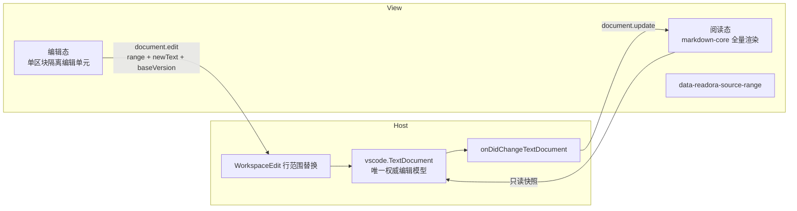

# ARC-009：Readora 编辑模式架构设计

| 属性 | 内容 |
|---|---|
| 文档编号 | ARC-009 |
| 文档名称 | 编辑模式架构设计 |
| 文档版本 | 1.0.0 |
| 文档状态 | Draft |
| 所属产品 | Readora |
| 关联文档 | PRD-001（F12）、ARC-002（§4 / §11 / §13）、ARC-004（§4.4 / §8 / §9）、ARC-005（§9）、ARC-008（§9 / §11） |
| 核心技术 | TypeScript、markdown-it AST 源位置、VS Code `WorkspaceEdit`、contenteditable、CodeMirror 6 |
| 适用范围 | 阅读视图内的就地编辑（Inline Editing） |
| 优先级 | P1（不阻塞任何已交付版本） |

---

## 1. 文档目标

本文档定义 Readora 从「只读阅读器」扩展出**就地编辑能力**的架构边界与契约。

需要解决：

1. 编辑入口与阅读态的隔离方式。
2. 渲染产物到 Markdown 源文件的**位置锚定**。
3. 编辑结果如何写回磁盘文件，且不失真、不越权。
4. 撤销、脏态、保存这些编辑生命周期由谁承担。
5. 各类内容（段落 / 标题 / 列表 / 表格 / 代码块 / 图表 / 公式 / frontmatter）的编辑语义。
6. 与既有渲染管线、搜索层、图表层、视觉基线的共存条件。

本文档**不**定义编辑器级别的完整所见即所得（块拖拽重排、样式面板、协作光标、实时渲染整页可输入），理由见 §3.2。

---

## 2. 前置事实：既有架构的四条硬约束

设计必须先承认现状，否则写到一半会推翻重来。以下四条是本次勘察的实测结论。

| # | 现状 | 证据 | 对编辑模式的后果 |
|---|---|---|---|
| C1 | 正文渲染是**全量重写**：`text` 变化即 `container.innerHTML = result.html`，并销毁重建 image / diagram / code 三个附加层 | `apps/webview/src/content/MarkdownContent.tsx` 的 innerHTML 写入点与随后的三次 `destroy()` | 任何时刻重写 DOM 都会丢掉光标、选区与 IME 组合态。编辑态**绝不能** living 在全量重写的容器里 |
| C2 | AST 带 `SourcePosition`（`positionOf` 取 `token.map`，`endLine` 已归一为块内最后一行、不含尾随空行），但**渲染出口不落地**，DOM 中没有任何源位置属性 | `packages/markdown-core/src/ast.ts`、`types.ts`；对照 `renderers/support.ts` 只输出 `data-align` / `data-readora-width` | 「点这段 → 改这段的源」这条锚链当前不存在，是编辑模式唯一的前置缺口 |
| C3 | 自定义编辑器实现的是 `CustomReadonlyEditorProvider`，无编辑模型、无脏态、无 `revert` / backup | `apps/extension/src/webview/custom-editor-provider.ts` | 需要决定写回路径；但宿主侧 `TextDocument` 模型本就存在（`onDidChangeTextDocument` 已在监听） |
| C4 | 协议 17 条消息（**立项时点实测值**；本篇 §5.1 新增 `document.edit` 后为 18 条），`document.update` 是 Host→View 单向快照，**没有 View→Host 的文本写回通道** | `packages/contracts/src/protocol.ts` | 需要新增消息；dispatcher 已有请求-应答与统一错误响应，拒收可复用 |

一条**可直接复用的资产**：CodeMirror 6（含 `@codemirror/lang-markdown`）已在 `apps/webview` 依赖树内，`code-editor-layer.ts` 已实现懒挂载、主题同步、失败单块降级，当前 `editable: false`。

---

## 3. 总体架构：双态分离

### 3.1 决策

**阅读态与编辑态是两条渲染路径，不是同一棵可编辑 DOM 的两种开关。**



- **阅读态**：完全沿用既有管线，一行不改。C1 的「全量重写」在读态是优点（简单、无陈旧），保持。
- **编辑态**：任一时刻**只有一个区块**处于可输入状态。用户点中某区块 → 该区块被一个隔离的编辑单元就地替换 → 提交 → 该次替换的源文本交回 Host → 宿主模型变更 → C4 现成的变更通知推回新快照 → 阅读态重新全量渲染。
- 光标只需要在**一个刚被用户主动激活、且自身不参与全量重写**的单元内保持。C1 的冲突因此消解，而不是被硬扛。

### 3.2 被否决的替代方案

| 替代 | 否决理由 |
|---|---|
| 把整页改成可增量 reconcile 的可编辑 DOM（ProseMirror / BlockNote 路线） | ① 必然要求 **AST → Markdown 全文序列化**，而序列化器会重写用户整个文件：转义风格、`{width=…}` 块属性写法、列表标记符号、未改动的正文全部被规范化掉 —— 这是对用户内容的破坏，不是体验问题。② 摧毁三项既有资产：搜索层依赖静态 `<pre>` 全文可搜（`code-editor-layer.ts` 头注明确写了 CodeMirror 只渲染视口内行、拿它的 DOM 搜索会漏命中）、图表/图片层的懒挂载与在途请求生命周期、10 档视觉基线。③ 撤销栈、脏态、文件监听三方冲突全部自建 |
| 切 `CustomTextEditorProvider` | 要接管 `saveCustomDocument` / `saveCustomDocumentAs` / `revertCustomDocument` / backup 全套生命周期。但写回目标就是宿主已有的 `TextDocument` 模型 —— 撤销栈、脏态标记、`Ctrl+S`、git 装饰、冲突提示**宿主已经做得比我们能做的更好**。这与 M6 面包屑那条决策同一口径：「用 VS Code 的，不用自己实现」 |
| 只做「并排打开源码编辑器」 | 工程量最小，但不是用户要的东西（不构成编辑模式）。作为 §12 的 E0 副产物自然存在，不单独设阶段 |

### 3.3 不变量

1. **源保真优先于所见即所得**：任何编辑只允许替换被编辑区块的源行范围，禁止全文序列化。没被点过的字节必须逐字节不变。
2. **静态产物是真相**：延续 `code-editor-layer.ts` 与 `diagram-layer.ts` 的设计线，markdown-core 的输出始终是权威，编辑层只做接管与降级，不反向持有内容。
3. **单活动单元**：同时最多一个编辑单元处于激活态。
4. **失败只降级一块**：任一区块无法锚定、无法编辑、写回失败，只影响该区块，不影响整篇渲染（与 code / diagram 层同口径）。
5. **无虚假 affordance**：不能真编辑的地方不摆编辑把手。与 PRD-003「没有实现就不给开关」、`section-metrics.ts`「position 缺失则不显示标签」同一条诚实性规则。

---

## 4. 源位置身份契约（前置依赖）

### 4.1 属性定义

块级渲染器必须为**顶层区块**输出源行范围：

```html
<p class="readora-paragraph" data-readora-source-range="12:15">…</p>
```

```ts
/** ARC-009 §4.1：区块 → 源行范围的 DOM 契约。 */
export const SOURCE_RANGE_ATTRIBUTE = "data-readora-source-range";

/** 序列化形状：`"${startLine}:${endLine}"`，0 基闭区间，取自 MarkdownNode.position。 */
export function sourceRangeAttribute(
  position: SourcePosition | undefined
): string;
```

约定：

| 项 | 规定 | 理由 |
|---|---|---|
| 行号基 | **0 基** | 与 `ast.ts` 的 `positionOf` 输出口径一致（直接来自 `token.map`），不在中途换基导致 off-by-one |
| 区间 | 闭区间 `[startLine, endLine]` | `positionOf` 已把 `map[1]` 减一，`endLine` 就是块内最后一行 |
| 缺失时 | **不输出该属性**，而不是输出 `-1:-1` | 合成节点（`footnoteSection`、processors 造的 `tableRow`/`tableCell`）没有可靠范围；属性缺失即「此区块不可编辑」的唯一信号 |
| 归属层级 | 只标**顶层区块**（`document.children` 一层） | 编辑单元 = 顶层区块。行内节点的 `map` 继承自所属块，逐行标会得到一堆同一个范围的假精度 |

### 4.2 嵌套容器的处理

列表项、引用块内部的段落**不单独标注**，它们随所属顶层区块（`list` / `blockquote`）整体进入编辑单元。于是：

- 编辑一个列表 = 编辑该列表的整段源（含全部嵌套层级）。
- 编辑一个引用块 = 编辑其整段源。

这不是妥协，而是**正确粒度**：Markdown 的缩进与标记连续性使「只改第 3 层第 2 项那一行」极易产出一个语法上不属于原结构的片段；整块替换在语义上总是可预期的。

### 4.3 Sanitizer 放行

`packages/markdown-core/src/sanitizer.ts` 的白名单必须放行 `data-readora-source-range`，并施加值形状校验（`^\d+:\d+$`）。

安全面评估：该属性是**只读元数据**，不产生任何可执行效果，不进 URL、不进样式、被 `JSON.stringify` 进导出物也只是多几个字节。风险等同于既有的 `data-readora-code-lang`。导出物（`export-document.ts`）保留该属性无副作用，但 HTML 导出**可以选择性剥离**（§12 E0 不做，避免与视觉/导出基线同时变动）。

### 4.4 门禁

```ts
// packages/markdown-core/src/__tests__/source-range.spec.ts
it("每个顶层区块都带源行范围，且范围与源文本一致", ...)
it("合成节点（脚注区）不带该属性", ...)
it("范围形状非法时 Sanitizer 剥离该属性", ...)
it("编辑属性不影响既有 HTML 产物快照", ...)
```

最后一条是回归护栏：E0 只**增加**属性，不得让既有断言 HTML 结构的测试集体转绿为红。

---

## 5. 写回通道：`document.edit`

### 5.1 契约

新增 **1 条**消息，协议 17 → 18。方向 `view-to-host`，**请求**（需要成功/失败应答）。

```ts
export interface DocumentEditPayload {
  /** 必须是当前会话的 documentUri；不符即拒。 */
  documentUri: string;
  /** 0 基闭区间，来自 data-readora-source-range 原样回传。 */
  range: { startLine: number; endLine: number };
  /** 该区块的新 Markdown 源，不含尾随换行。 */
  newText: string;
  /** 发起编辑时 View 持有的 documentVersion，用于乐观锁。 */
  baseVersion: number;
}

export interface DocumentEditResult {
  /** 写回后的新快照版本；View 据此判定后续 update 是否为自己的回声。 */
  version: number;
}
```

Schema 约束（`packages/contracts/src/schemas.ts`，与既有 strict 口径一致，拒绝未知字段）：

| 字段 | 约束 |
|---|---|
| `documentUri` | 非空字符串，长度 ≤ 既有 URI 上限 |
| `range.startLine` / `endLine` | 整数，`startLine >= 0`，`endLine >= startLine` |
| `newText` | 字符串，长度 ≤ `DOCUMENT_TEXT_MAX_LENGTH` |
| `baseVersion` | 整数，`>= 0` |

### 5.2 Host 侧处理

```
1. sessionId → 会话；documentUri ≠ 会话文档 → ReaderError(TARGET_INVALID)
2. 取 vscode.workspace.textDocuments 中该 URI 的模型；
   不存在则 openTextDocument(uri)
3. 乐观锁：model.version ≠ baseVersion → ReaderError(EDIT_STALE)
4. 范围合法性：endLine < model.lineCount 否则 ReaderError(EDIT_RANGE_INVALID)
5. 组装 WorkspaceEdit.replace(uri, range(model.line(s), model.line(e+1)), newText)
6. await vscode.workspace.applyEdit(we)
   返回 false → ReaderError(EDIT_APPLY_FAILED)
7. 返回 { version: model.version }
```

关键点：**第 6 步之后不需要主动推送快照**。宿主模型变更会触发既有的 `onDidChangeTextDocument` → 会话 → `document.update`，这是自动刷新已经跑通的同一条链（ARC-004 §9.2）。编辑模式不新增刷新机制。

`WorkspaceEdit` 作用在 `TextDocument` 模型上而非磁盘文件，因此：撤销栈归宿主、脏态标记自动亮起、`Ctrl+S` 是宿主行为、未保存内容不会被外部写覆盖。这一整串能力是零成本获得的，也是 §3.2 第二条否决理由的依据。

### 5.3 新增错误码

```ts
// packages/contracts/src/envelope.ts
EDIT_STALE: "readora.edit.stale",
EDIT_RANGE_INVALID: "readora.edit.rangeInvalid",
EDIT_APPLY_FAILED: "readora.edit.applyFailed",
```

三码必须可区分：`stale` 的用户动作是「重新同步后再改」，`rangeInvalid` 是「源已结构性变化、把手作废」，`applyFailed` 是「宿主拒绝改（文件被锁/只读）」。与既有的 `RESOURCE_DENIED` vs `RESOURCE_NOT_FOUND` 分工同一条理由。

### 5.4 陈旧写回的 View 侧行为

`document.edit` 被拒时**不弹窗打断**：保留用户刚输入的文本在单元里、标 `conflict` 状态、把最新快照渲染到该单元之外，并给出「源码已在别处变更 · 重新编辑 / 强制替换」两个动作。静默丢弃用户输入是不可接受的失败模式。

---

## 6. 编辑单元与各内容类型的编辑语义

### 6.1 编辑单元接口

```ts
export interface EditUnit {
  /** 由区块 DOM + 源范围创建；挂载即接管该区块。 */
  mount(block: HTMLElement, range: SourceRange): void;
  /** 当前输入的 Markdown 源。 */
  text(): string;
  /** 提交：返回待写回的源，单元进入 idle（不自行改正文 DOM）。 */
  commit(): string;
  /** 取消：交回原静态产物，正文未被触碰。 */
  cancel(): void;
  destroy(): void;
}

export interface EditLayer {
  scan(container: Element): void;
  /** 无该区块的编辑器实现时返回 null → 该区块不可编辑（不摆把手）。 */
  unitFor(nodeType: string): EditUnit | null;
  readonly activeUnit: EditUnit | null;
  destroy(): void;
}
```

与 image / diagram / code 三层同一形态：懒挂载、状态写在 `data-readora-edit-state`（`idle` / `active` / `conflict` / `failed`）、样式与测试共用一个口径、正文重写即销毁。

### 6.2 编辑语义矩阵

| 区块类型 | 编辑控件 | 是否所见即所得 | 决策依据 |
|---|---|---|---|
| `paragraph` | 该区块就地 `contenteditable`，展示渲染后文本 | **是** | 纯文本 + 少量行内标记，误判面最小 |
| `heading` | 同上 | **是** | 级别由把手上的 H1–H6 选择器改，写回时替换 `#` 前缀 |
| `list` / `listItem` | 就地 `contenteditable` 的整段列表 | **半**（项目符号按源标记种类显示） | 见 §4.2 整块粒度 |
| `blockquote` | 就地 `contenteditable` | **是** | 写回时逐行补 `> ` 前缀 |
| `codeBlock` | **现有 CodeMirror 实例翻 `editable: true`** | 不适用（源码即内容） | 零新增依赖；`code-editor-layer.ts` 已备好实例生命周期 |
| `table` | 单元格级文本输入 + 增删行列把手 | **半** | GFM 表格的列宽 `---` 对齐不由我们维护，见 §13 R3 |
| `mathBlock` / `mathInline` | 展围栏内 LaTeX 源码的等宽输入 | **否**（明确显示为源码） | KaTeX 输出不是可逆编辑面，做假 WYSIWYG 等于骗人 |
| `diagramBlock` | 展 mermaid 围栏源码的等宽输入（CodeMirror，无 mermaid 语法包则纯文本） | **否** | 同上；渲染产物与源不同构 |
| `wikiLink` | 随所属段落走行内编辑 | **是** | `[[…]]` 是文本，不是控件 |
| `footnoteDefinition` | 随正文段落编辑 | **是** | — |
| `footnoteSection`（合成节点） | **不可编辑** | — | 无 `position`，§4.1 缺属性即无把手 |
| `frontmatter` | 属性卡片逐键编辑（值按 `FrontmatterValueKind` 选输入形态） | **是** | 已有结构化解析（`frontmatter.ts`），行范围取 frontmatter 块自身 |
| `htmlBlock` | 展原始 HTML 源码的等宽输入 | **否** | `html: false` 策略下它本来就按转义文本展示，不存在渲染态可编辑 |
| `thematicBreak` | 仅删除把手，无内容编辑 | — | 无正文 |

**「否」这一列是刻意的。** 图表与公式做不成真所见即所得 —— 把 mermaid 图渲染成 SVG 再让用户拖节点，写回的源和原图必然不再同构。诚实的做法是明确显示「这是源码」，与 PRD-003 的诚实性规则一致。

### 6.3 行内格式化

编辑单元激活期间，浮动工具条提供：**加粗 / 斜体 / 删除线 / 行内代码 / 链接 / 脚注引用**。实现方式为**对选区做源文本包裹**，不是改 DOM class：

```
加粗：选中 "foo" → "**foo**"
已有 ** 包裹 → 解除包裹
链接：选中 → "[foo](url)"，url 由输入框取
```

由此导出的一条硬规则：**格式化操作永远作用在编辑单元的文本模型（源串）上，选区偏移按「渲染文本 ↔ 源文本」映射换算**。这份映射在 E2 只覆盖行内标记的包裹/解包，不追求全量精确 —— 精确性不足时宁可让操作降级为「在光标处插入字面标记」，也不能写出损坏的 Markdown。

---

## 7. 编辑态入口与状态

### 7.1 三个入口

| 入口 | 行为 |
|---|---|
| 顶栏 `Edit` 开关 | 切换 `editMode`；开启后正文容器加 `data-readora-edit-mode="on"`，有把手的区块在 hover / focus 时显形把手 |
| **双击**任意可编辑区块 | 直接激活该区块编辑单元，无需先开总开关（一次性动作，提交后不常驻） |
| 区块聚焦后按 `E` | 键盘可达；键位仅在 `editMode=on` 且无活动单元时生效，避免吃掉正常输入 |

### 7.2 状态归属

编辑模式开关是**会话视图状态**，不是配置项 —— 加进 `ViewStatePayload` 的 `editMode?: boolean`，走既有 `reader.viewState` 通道。

理由：这条通道是会话状态的权威（`App.tsx` 里 `viewState?.x ?? preferences.x` 的既有优先级口径）。若把它做成纯配置，就会重演「弹层改偏好但已开面板不生效」那个双通道陷阱。写回能力不持久化开关：每次打开面板默认只读，避免用户以为「用 Readora 打开就会可编辑」。

### 7.3 与其他模式的互斥

| 组合 | 规则 |
|---|---|
| 专注模式 × 编辑模式 | **互斥**。专注语义是「读」；进入专注自动退出编辑，反之亦然。顶栏只留一枚活动指示 |
| 搜索 × 编辑 | 搜索激活时**收起**当前编辑单元（先提示未提交内容），因为搜索高亮要改正文 DOM，与活动单元冲突 |
| Lightbox × 编辑 | 打开图片预览时编辑单元暂时失焦，不销毁 |
| 缩放 / 字号 × 编辑 | 正交，照常生效 |

### 7.4 提交时机

`blur`（点击单元外或切面板）与 `Ctrl+Enter` 提交；`Escape` 取消。

**不做 debounce 实时写回。** 每次击键都改宿主模型会让撤销栈碎成单字符（宿主 `applyEdit` 粒度即撤销粒度），并触发全量重渲染打断输入。提交粒度 = 用户的一次编辑意图 = 一个撤销步骤。

---

## 8. 与既有子系统的影响面

| 子系统 | 影响 | 处置 |
|---|---|---|
| 搜索（`search-engine.ts`） | 编辑单元接管期间，该区块的静态文本离开 DOM → 可搜文本源缺失 | 搜索激活时收起单元（§7.3），并在索引重建前保证正文是静态产物。绝不接受「搜不到正在编辑的那段」以外的静默不一致 |
| 大纲 / 节字数 | 提交后源变化，`extractOutline` 结果随之变化 | 走既有 `document.update` 链路自然刷新，无需新增逻辑 |
| 阅读位置保持（`use-reading-progress`、`heading-locator`） | 全量重写会改变滚动位置 | 提交后按 `data-readora-source-range` 找**编辑区块自身**作为恢复锚点，比按标题锚点更准；找不到锚点则保持当前 scrollTop 不动 |
| 图表 / 图片层 | 编辑单元的销毁与重建必须与三层同一时序 | `EditLayer` 注册进 `MarkdownContent` 既有的 create/destroy 序列，位置在 code 层**之前**（把手要挂在静态产物还在的时候） |
| 导出（M11） | 导出必须发生在静态产物上 | 导出前强制 `cancel` 活动单元并等正文回稳；`export-document.ts` 对 `data-readora-edit-state` 一律剥离 |
| 视觉基线（10 档） | E0 给 DOM 加属性，不改样式，理论上零影响 | 按既有规则：`tokens.css` 之外若动到样式必须显式 `visual:update`。E0 完成后先跑 `visual:check` 确认全等，再决定是否需要基线动作 |
| CSP（`strict-csp.ts`） | `contenteditable` 是属性不是脚本，无需放宽 | 不加任何 CSP 例外。若将来引入编辑器库需重新评估 |
| 性能门槛（F11） | 编辑把手是 hover/focus 伪类，无监听器风暴 | 把手用**事件委托**（`interactions.ts` 已有同形态），不按区块绑监听；`perf-report` 门槛不变 |

---

## 9. 安全边界

1. **写回路径不可由 View 指定**：`document.edit` 只带 `documentUri`，Host 校验它等于会话文档 URI。View 不能编辑任何其它文件 —— 这比 `resource.resolve` 的单篇解析面更必须收紧，因为这是**写**操作。
2. **workspace 边界**：会话文档的授权根判定沿用 ARC-008 §6 的四条约束，不因编辑而放宽。`file:` scheme 之外一律 `TARGET_INVALID`。
3. **粘贴**：编辑单元只接受 `text/plain`（拦截 `paste` 取 `clipboardData.getData("text/plain")`）。富文本 HTML 粘贴等于把未过 Sanitizer 的输入接进正文，禁止。降级提示「仅支持粘贴纯文本」。
4. **不做 Markdown 反解析**：`newText` 是用户直接写的源文本，不经 DOM→MD 转换。因此不存在「粘贴的 HTML 被静默转成 Markdown」这条不可预测路径。
5. **超大区块**：`newText` 长度受 §5.1 Schema 上限约束；单区块源超过阈值（与 `diagram-core` 的 over-limit 同一量级判据）时拒绝激活编辑，提示改用源码编辑器。
6. **只读文件**：宿主 `applyEdit` 对只读文档返回 false → `EDIT_APPLY_FAILED`，错误文案要区分「文件只读」与「未知失败」。

---

## 10. 需求映射

| 需求 | 本文档章节 |
|---|---|
| F12-001 编辑模式开关 | §7.1 §7.2 |
| F12-002 区块就地编辑 | §6.1 §6.2 |
| F12-003 行内格式化 | §6.3 |
| F12-004 源码保真写回 | §3.3 不变量 1、§5.2 |
| F12-005 撤销与脏态归宿主 | §5.2 |
| F12-006 图表公式源码编辑 | §6.2「否」列 |
| F12-007 Frontmatter 属性编辑 | §6.2 |
| F12-008 冲突写回保护 | §5.3 §5.4 |
| F12-009 编辑安全边界 | §9 |

---

## 11. 架构决策记录

| 编号 | 决策 | 结论 |
|---|---|---|
| ADR-009-01 | 编辑态形态 | 双态分离（单区块隔离编辑单元），不改整页 reconcile |
| ADR-009-02 | 写回粒度 | 源行范围整体替换，禁止全文序列化 |
| ADR-009-03 | 编辑模型归属 | 宿主 `TextDocument` + `WorkspaceEdit`；不切 `CustomTextEditorProvider` |
| ADR-009-04 | 位置锚定 | `data-readora-source-range`，0 基闭区间，仅顶层区块，缺失即不可编辑 |
| ADR-009-05 | 写回通道 | 新增 1 条请求型消息 `document.edit`，拒回复用既有 error response |
| ADR-009-06 | 提交时机 | blur / `Ctrl+Enter` 提交，`Escape` 取消；不做 debounce 实时写回 |
| ADR-009-07 | 开关状态归属 | 会话视图状态（`reader.viewState`），非配置项，不持久化 |
| ADR-009-08 | 非文本内容 | 图表 / 公式 / 原始 HTML 明确展源码，不做假 WYSIWYG |
| ADR-009-09 | 撤销栈 | 不自建，粒度 = 一次提交 = 一个宿主撤销步骤 |
| ADR-009-10 | 粘贴 | 仅 `text/plain` |

---

## 12. 分阶段实施

每阶段独立可交付、独立可验证，且**前一阶段不依赖后一阶段的能力**。

| 阶段 | 内容 | 交付判据 |
|---|---|---|
| **E0 位置锚定** | `sourceRangeAttribute` 落地顶层区块；Sanitizer 放行；`source-range.spec.ts` 四条门禁 | 全部门禁绿；`visual:check` 10 档全等；既有 HTML 结构断言无需改动 |
| **E1 写回链路** | `document.edit` 契约 + Schema + Host handler + 三枚错误码；单测覆盖乐观锁拒收 | 协议 spec 覆盖第 18 条；integration 走通「View 发 edit → 模型变更 → update 回声」；Host 无活动文档时不写盘 |
| **E2 段落编辑** | `EditLayer` 骨架 + paragraph / heading / blockquote / list 四类；顶栏开关 + 双击入口；提交/取消/冲突态 | e2e 覆盖「双击改文字 → 提交 → 静态产物已更新 → 未编辑区块逐字节不变」。**这是编辑模式真正可用的第一个版本** |
| **E3 行内格式化** | 浮动工具条 + 选区→源偏移映射（加粗/斜体/删除线/行内代码/链接） | 单测覆盖包裹与解包幂等；偏移不足时降级插入字面标记而不损坏 |
| **E4 源码型区块** | codeBlock 翻 `editable:true`；diagram / math / htmlBlock 展源码输入 | 各类型「编辑后围栏标记与缩进未被破坏」的源保真断言 |
| **E5 结构化区块** | 表格单元格与增删行列；frontmatter 属性卡片逐键编辑 | 表格写回的管道行形状合法；frontmatter 值按 kind 序列化且不引入非法 YAML |
| **E6 收尾** | 编辑期性能报告、快捷键登记进 manifest、PRD-003 视觉规范补章、README 能力边界 | `pnpm verify` 与 `perf` 门槛通过 |

E0 与 E1 之间**没有功能可见性**：E0 只是给 DOM 加了一个没人读的属性。这是刻意切的 —— 锚定契约的正确性必须能在与编辑无关的前提下独立证明。

阶段→任务→版本的映射：E0–E6 拆为 **IMP-002 §22 的 EPIC-13**（STORY-13-01 = E0，13-02 = E1，13-03 = E2+E3，13-04 = E4～E6），交付位置挂在 **IMP-003 §8 的 V1.4.x**。三处阶段名称一致，不得一处改一半。

---

## 13. 风险登记

| # | 风险 | 影响 | 缓解 |
|---|---|---|---|
| R1 | `token.map` 对 tight 列表解包后的段落可能给出与预期不符的范围 | 写回替换错行 | E0 用「按范围取源文本 === 该块渲染前源」的正向断言逐夹具验证；不符的类型在 E2 先不开放编辑 |
| R2 | 用户提交的源存在语法错误（未闭合围栏、坏表格） | 重渲染后区块边界移动，把手范围失效 | 冲突态（`EDIT_STALE`）自然覆盖此情形；重渲染后按新快照重新 scan，不缓存旧范围 |
| R3 | GFM 表格分隔行 `---` 的列宽对齐不维护 | 观感变差，语义不变 | 明确记为已知限制（PRD-001 F12-006 验收不含格式美化）；不做自动对齐以免引入二阶不一致 |
| R4 | IME 组合期间提交（中文输入法选词未上屏） | 丢字 | `compositionstart` / `compositionend` 期间屏蔽 `blur` 提交与 `Ctrl+Enter`；e2e 用插入式假事件覆盖 |
| R5 | 编辑模式与宿主默认编辑器（`priority: option`）并存，同一文件两窗口 | 双模型冲突 | `WorkspaceEdit` 作用在同一 `TextDocument` 上，宿主保证一致；`baseVersion` 乐观锁挡住迟到写回 |
| R6 | PRD-001 §2.2 把「独立 Markdown 编辑器」列为非目标 | 文档与实现冲突 | 已在本轮同步修订：保留「不建独立编辑器」，另立 F12「就地编辑」并明确能力边界（§3.2） |

---

## 14. 本篇范围边界

本文档定义：双态分离架构、源位置契约、写回通道、编辑语义矩阵、安全边界、阶段划分。

本文档**不**定义：编辑态视觉规范（PRD-003 在 E6 补章）、命令行与快捷键全集（ARC-004 §4 在 E6 登记）、协作与冲突合并（非目标）、块拖拽重排（非目标，见 §1）。

---

## 15. 验收标准

1. E0：任一顶层区块的 `data-readora-source-range` 取出的源文本，与该区块参与渲染的源逐字节一致。
2. E1：`baseVersion` 不匹配的写回被拒且返回 `readora.edit.stale`；View 保留用户输入并进入 `conflict` 态。
3. E2：编辑一段后提交，文件内**未编辑区块的字节完全不变**（逐行 diff 断言，不接受「大致相同」）。
4. E2：撤销一次 `Ctrl+Z` 回到编辑前；脏态标记由宿主显示；`Ctrl+S` 保存归宿主。
5. E2：`htmlBlock`、`footnoteSection` 等不可编辑类型不显示任何编辑 affordance。
6. 全阶段：既有 745+ 单测、e2e、安全 spec、视觉基线零回归。
7. 全阶段：`contenteditable` 不引入任何 CSP 放宽；粘贴富文本被拒。

---

## 16. 修订记录

### 16.1 版本历史

| 版本 | 日期 | 说明 |
|---|---|---|
| 1.0.0 | 2026-11-20 | 初版：确立双态分离、源行范围写回、宿主模型承载编辑生命周期；定义 E0–E6 阶段 |

### 16.2 状态说明

本文为 **Draft**。E0 与 E1 落地后按实测修订为 Final（重点回填 §13 R1 的实测结论与 §6.2 矩阵里最终开放的类型集合）。
