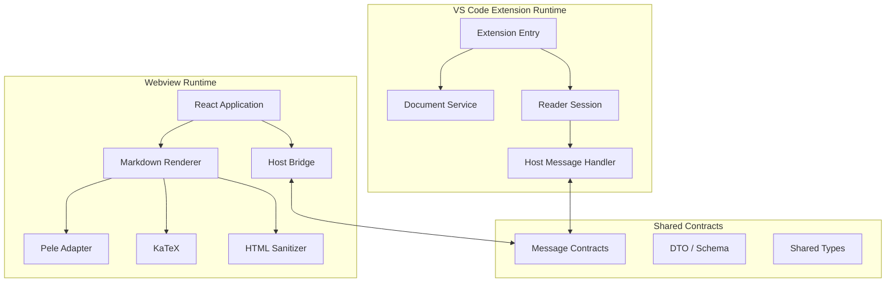
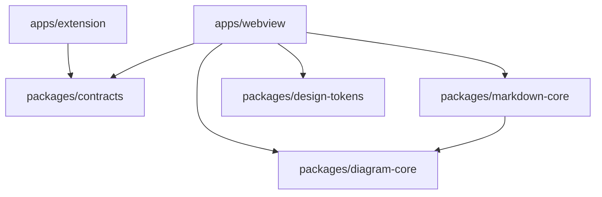
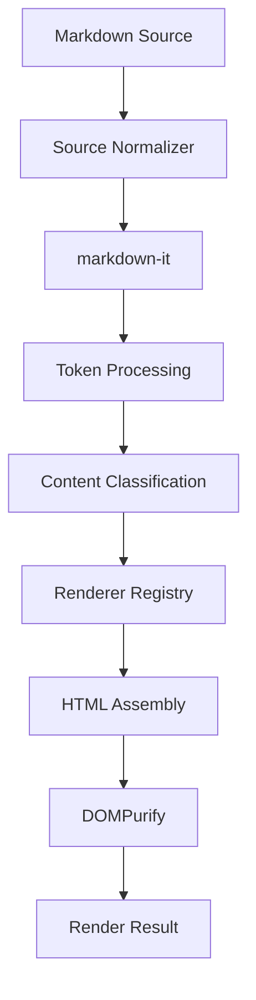
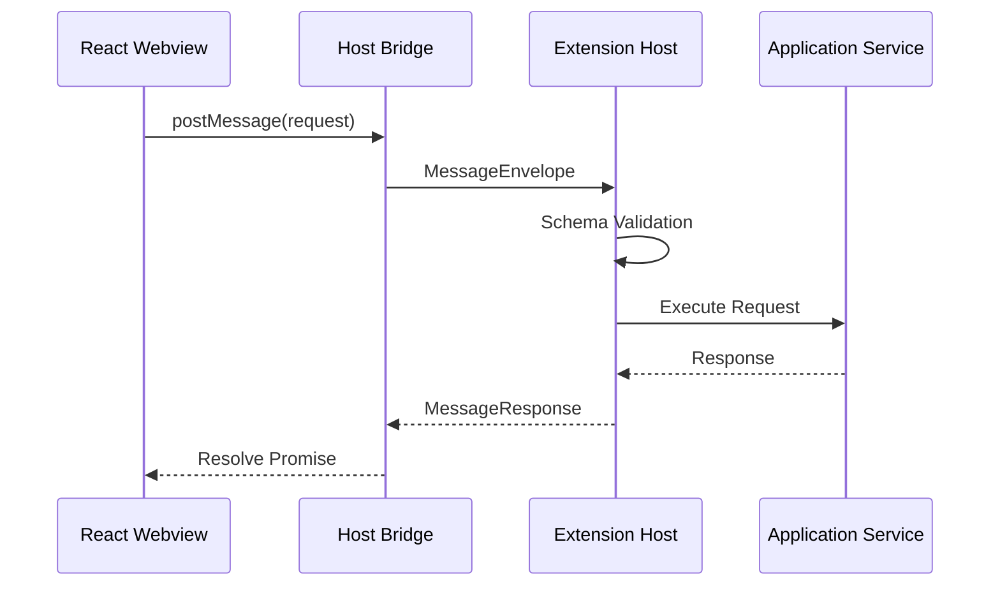
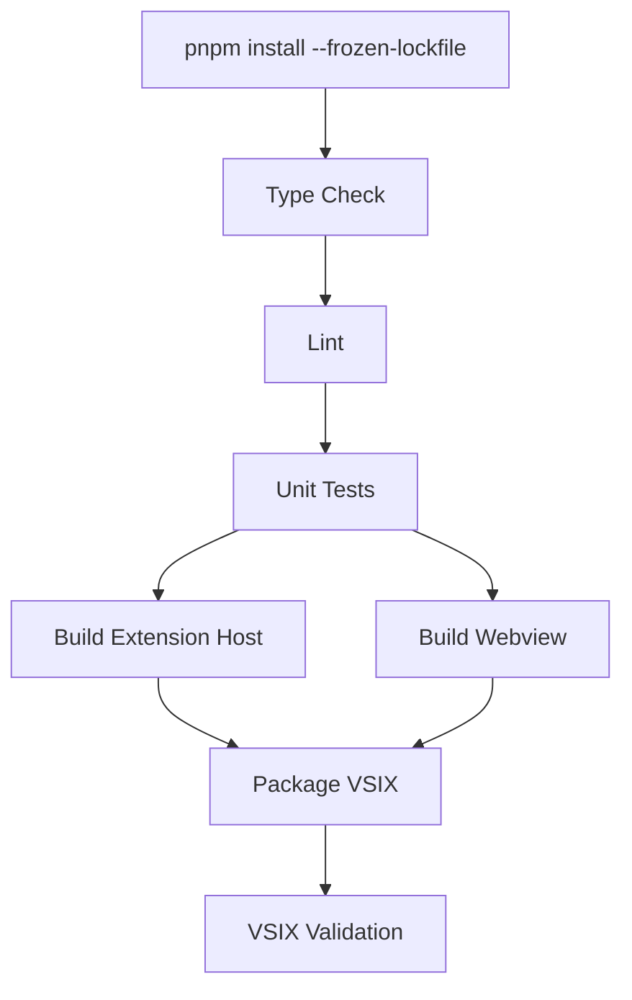

# IMP-001：Readora 技术实现规范

| 文档属性 | 内容 |
|---|---|
| 文档编号 | IMP-001 |
| 文档名称 | Readora 技术实现规范 |
| 文档版本 | 1.1.0 |
| 文档状态 | Draft |
| 所属阶段 | Implementation Specification |
| 上游文档 | PRD-001～003、ARC-001～008 |
| 下游文档 | IMP-002、IMP-003 |
| 适用产品 | Readora VS Code Extension |

---

## 1. 文档目的

本文档定义 Readora 的统一技术实现基线，将产品需求与架构设计转换为开发人员可以直接遵循的技术约束。

本文档主要解决：

1. 技术栈与依赖选型。
2. Extension Host 与 Webview 的运行时边界。
3. 项目结构与模块组织。
4. 构建、打包与发布方式。
5. Markdown、Mermaid、数学公式的渲染实现。
6. Host 与 Webview 的通信规范。
7. 安全实现约束。
8. 测试、质量与依赖治理标准。

本文档不重新定义产品功能和总体架构。具体功能范围以 PRD 为准，模块职责以 ARC 为准。

## 2. 技术实现原则

### 2.1 基本原则

| 原则 | 技术要求 |
|---|---|
| Runtime Isolation | Extension Host 与 Webview 严格隔离 |
| Type Safety | TypeScript 严格类型检查 |
| Contract First | 跨运行时通信必须先定义协议 |
| Local First | 默认在本地完成 Markdown 解析与渲染 |
| Security by Default | 所有外部内容默认视为不可信输入 |
| Dependency Isolation | 第三方渲染引擎必须通过 Adapter 接入 |
| Reproducible Build | 依赖锁定，构建过程可重复 |
| Testability | 核心业务逻辑必须可脱离 VS Code 独立测试 |
| Minimal Dependencies | 避免引入没有明确业务价值的依赖 |

### 2.2 技术边界



**强制约束：**

- Extension Host 不负责 React UI 渲染。
- Webview 不直接访问 Node.js 文件系统。
- Webview 不直接调用 VS Code Extension API。
- Shared Contracts 不允许依赖 React、VS Code 或 Node.js。
- 所有文件读取、文件监听和资源访问由 Extension Host 负责。
- Webview 只接收经过验证的文档内容和资源 URI。

---

## 3. 技术栈选型

### 3.1 核心技术栈

| 技术领域 | 技术选型 | 使用范围 | 决策 |
|---|---|---|---|
| 开发语言 | TypeScript | 全项目 | 采用 |
| 扩展平台 | VS Code Extension API | Extension Host | 采用 |
| UI 框架 | React | Webview | 采用 |
| 构建工具 | Vite | Webview | 采用 |
| 样式 Utility 层 | Tailwind CSS（构建期编译） | Webview | 采用（1.1.0 选型变更，见 §21） |
| Host 构建 | esbuild | Extension Host | 采用 |
| 包管理器 | pnpm | 全项目 | 采用 |
| Markdown 解析 | markdown-it | Webview | 采用 |
| 语法高亮 | highlight.js | Webview | 采用 |
| Mermaid 渲染 | Pele | Webview | 采用 |
| Mermaid 适配 | PeleAdapter | Webview | 自研 |
| 数学公式 | KaTeX | Webview | 采用 |
| HTML 安全处理 | DOMPurify | Webview | 采用 |
| 消息校验 | Zod | Shared / Host / Webview | 采用 |
| 单元测试 | Vitest | 全项目 | 采用 |
| 端到端测试 | Playwright | Webview | 采用 |
| 扩展测试 | VS Code Extension Test | Extension Host | 采用 |
| VSIX 打包 | @vscode/vsce | 发布阶段 | 采用 |

### 3.2 运行环境基线

| 项目 | 基线要求 |
|---|---|
| Node.js | 26.x LTS，开发与 CI 统一 |
| VS Code | 设置明确的最低兼容版本 |
| TypeScript | 稳定版，严格模式 |
| React | 19.x 稳定版 |
| pnpm | 12.x 稳定版 |
| 操作系统 | Windows / macOS / Linux |
| 浏览器运行环境 | VS Code Webview 内嵌浏览器 |

Node.js 26.x 已进入 LTS，适合作为当前开发工具链基线；Node.js 版本只约束开发、构建和测试环境，不代表扩展运行时可以随意使用 Node.js API。扩展运行能力仍然受到目标 VS Code 版本及其 Extension Host 环境约束。[Node.js Release Schedule](https://github.com/nodejs/Release)

### 3.3 依赖版本基准

以下版本是本规范编写时的技术参考，不等于最终发布版本。正式版本必须通过项目 CI 验证后写入锁文件。

| 依赖 | 参考版本 | 说明 |
|---|---:|---|
| React | 19.3.x | 稳定版本 |
| React DOM | 19.3.x | 与 React 保持一致 |
| Vite | 8.3.x | Webview 构建 |
| Tailwind CSS | 4.2.x | 样式 utility 层；Vite 8 兼容自 4.2.2 起，集成必须使用 `@tailwindcss/vite` 插件（与 tailwindcss 同版本） |
| markdown-it | 15.0.x | Markdown 解析 |
| highlight.js | 11.12.x | 代码块语法高亮（F01-009） |
| KaTeX | 0.19.x | 数学公式 |
| DOMPurify | 3.4.x | HTML / SVG 安全处理 |
| Pele | 锁定验证版本 | Mermaid 图形渲染 |
| Vitest | 5.1.x | 测试 |
| Playwright | 1.65.x | E2E 测试 |
| pnpm | 12.x | 包管理 |

版本参考依据：

- React 当前稳定版本信息：[React Versions](https://react.dev/versions)
- Vite：[npm](https://www.npmjs.com/package/vite)
- Tailwind CSS：[npm](https://www.npmjs.com/package/tailwindcss)
- markdown-it：[npm](https://www.npmjs.com/package/markdown-it)
- highlight.js：[npm](https://www.npmjs.com/package/highlight.js)
- KaTeX：[npm](https://www.npmjs.com/package/katex)
- DOMPurify：[npm](https://www.npmjs.com/package/dompurify)
- Pele：[GitHub](https://github.com/obsidianmd/pele)
- Vitest：[npm](https://www.npmjs.com/package/vitest)
- Playwright：[npm](https://www.npmjs.com/package/playwright)
- pnpm：[npm](https://www.npmjs.com/package/pnpm)

### 3.4 版本锁定规则

项目不得直接依赖不稳定版本。

必须遵守：

1. 禁止在生产依赖中使用 `latest`。
2. 禁止使用 `alpha`、`beta`、`canary`、`nightly` 作为默认生产依赖。
3. 生产依赖必须记录明确版本。
4. 所有依赖变更必须提交 `pnpm-lock.yaml`。
5. CI 必须使用冻结锁文件模式安装依赖。
6. 主要依赖升级必须执行回归测试。
7. Pele、markdown-it、DOMPurify、highlight.js 等关键依赖必须有独立兼容性测试。
8. 不允许未经评估自动升级主要版本。

语法高亮选型说明：highlight.js 为纯 JavaScript 实现，仅输出 `<span class="hljs-*">`，不引入 `eval`、Web Worker 和远程资产，满足 ARC-008 与 IMP-003 §7.2 的 CSP 约束（不使用 `unsafe-eval`）。基于 TextMate / WASM 的方案（如 Shiki）需要 `wasm-unsafe-eval` 与外部主题、语言资产，不符合当前 CSP 基线，故不采用。语言语法按需注册，禁止引入 `highlight.js/common` 全量语言包（F11-001 包体要求）。

建议配置：

```yaml
# pnpm-workspace.yaml
packages:
  - "packages/*"
  - "apps/*"
```

```json
{
  "packageManager": "pnpm@12.18.0",
  "engines": {
    "node": ">=26 <27"
  }
}
```

具体 patch 版本以仓库初始化时实际通过 CI 的版本为准。

---

## 4. 项目工程结构

### 4.1 目录结构

```text
readora/
├── apps/
│   ├── extension/
│   │   ├── src/
│   │   │   ├── extension.ts
│   │   │   ├── commands/
│   │   │   ├── document/
│   │   │   ├── session/
│   │   │   ├── webview/
│   │   │   ├── resource/
│   │   │   ├── configuration/
│   │   │   └── security/
│   │   ├── package.json
│   │   └── tsconfig.json
│   │
│   └── webview/
│       ├── src/
│       │   ├── main.tsx
│       │   ├── app/
│       │   ├── shell/
│       │   ├── features/
│       │   ├── components/
│       │   ├── renderer/
│       │   ├── adapters/
│       │   ├── bridge/
│       │   ├── theme/
│       │   └── styles/
│       └── vite.config.ts
│
├── packages/
│   ├── contracts/
│   │   └── src/
│   ├── markdown-core/
│   │   └── src/
│   ├── diagram-core/
│   │   └── src/
│   ├── design-tokens/
│   │   └── src/
│   └── test-utils/
│       └── src/
│
├── tests/
│   ├── integration/
│   ├── e2e/
│   ├── fixtures/
│   └── security/
│
├── scripts/
├── docs/
├── package.json
├── pnpm-lock.yaml
├── pnpm-workspace.yaml
├── tsconfig.base.json
├── .gitignore
└── README.md
```

### 4.2 工程模块职责

| 模块 | 职责 | 运行环境 |
|---|---|---|
| apps/extension | VS Code 扩展入口、命令、文件访问、会话管理 | Host |
| apps/webview | React 阅读器应用 | Webview |
| packages/contracts | Host 与 Webview 通信契约 | Shared |
| packages/markdown-core | Markdown 解析与渲染核心 | Webview |
| packages/diagram-core | 图形渲染抽象和 Pele Adapter | Webview |
| packages/design-tokens | 设计 Token 定义 | Shared |
| packages/test-utils | 测试工具与公共 Fixture | Test |

### 4.3 模块依赖约束



禁止以下依赖：

- `packages/contracts` 依赖 `apps/extension`。
- `packages/contracts` 依赖 `apps/webview`。
- `packages/markdown-core` 依赖 VS Code API。
- `packages/diagram-core` 依赖 Extension Host。
- Webview 代码依赖 Node.js 内置模块。
- Host 代码依赖 React 组件。

---

## 5. TypeScript 工程规范

### 5.1 编译配置

项目统一启用严格模式。

```json
{
  "compilerOptions": {
    "target": "ES2022",
    "module": "ESNext",
    "moduleResolution": "Bundler",
    "strict": true,
    "noImplicitAny": true,
    "strictNullChecks": true,
    "noUncheckedIndexedAccess": true,
    "exactOptionalPropertyTypes": true,
    "noFallthroughCasesInSwitch": true,
    "noImplicitOverride": true,
    "skipLibCheck": true,
    "forceConsistentCasingInFileNames": true
  }
}
```

Extension Host 应根据目标 VS Code 运行环境单独设置构建目标，不应仅根据开发机 Node.js 版本决定运行时语法兼容性。

### 5.2 编码要求

- 禁止使用隐式 `any`。
- 禁止通过类型断言掩盖未验证的数据。
- 外部输入必须先进行运行时校验。
- 公共 API 必须定义明确的输入与输出类型。
- 异常必须使用统一错误模型。
- 不允许跨模块访问其他模块的内部实现。
- 对外暴露的类型应优先放在模块公共入口。

### 5.3 命名约定

| 对象 | 规范 | 示例 |
|---|---|---|
| 类 | PascalCase | `ReaderSessionManager` |
| 接口 | PascalCase | `DocumentService` |
| 类型 | PascalCase | `RenderResult` |
| 函数 | camelCase | `resolveAssetUri` |
| 常量 | UPPER_SNAKE_CASE | `DEFAULT_READING_WIDTH` |
| React 组件 | PascalCase | `ReadingCanvas` |
| Hooks | use 前缀 | `useReaderSession` |
| 文件 | kebab-case | `reader-session.ts` |

---

## 6. Extension Host 实现规范

### 6.1 扩展入口

扩展入口只负责生命周期初始化和模块装配。

```ts
import * as vscode from "vscode";

export function activate(
  context: vscode.ExtensionContext
): void {
  registerCommands(context);
  registerConfiguration(context);
  registerDocumentWatchers(context);
}

export function deactivate(): void {
  // Release resources if necessary.
}
```

具体实现必须保证所有 Disposable 对象由 ExtensionContext 或对应 Session 统一管理。

### 6.2 文件访问

文件访问必须使用 VS Code 文件系统抽象。

推荐：

```ts
const content = await vscode.workspace.fs.readFile(uri);
const text = new TextDecoder("utf-8").decode(content);
```

禁止：

```ts
// 不允许在扩展业务逻辑中绕过 VS Code 文件系统抽象
import fs from "node:fs";
```

使用 `workspace.fs` 的目的是支持 VS Code 的文件系统抽象，包括远程和虚拟工作区场景。涉及本地路径的能力必须明确其适用范围，不能默认所有文档都具有普通磁盘路径。

### 6.3 文档变更监听

同时考虑：

- `workspace.onDidChangeTextDocument`
- `workspace.createFileSystemWatcher`
- `workspace.onDidSaveTextDocument`

其中：

- 未保存编辑内容由 TextDocument 事件处理。
- 外部文件变更由 FileSystemWatcher 处理。
- 保存事件用于同步文档状态。
- 事件必须经过防抖和版本检查。
- 旧版本渲染结果不得覆盖新版本。

### 6.4 Session 管理

每个 Reader Session 必须具备：

```ts
interface ReaderSession {
  id: string;
  documentUri: string;
  panel: vscode.WebviewPanel;
  documentVersion: number;
  isDisposed: boolean;
  createdAt: number;
}
```

具体实现可以扩展字段，但不得将 Session 生命周期交给 React 组件管理。

### 6.5 Webview 安全配置

必须：

- 设置 CSP。
- 使用 nonce 管理脚本授权。
- 设置最小化 `localResourceRoots`。
- 使用 `webview.asWebviewUri()` 转换资源地址。
- 禁止不必要的外部网络访问。
- 禁止任意 iframe、object 和 embed。
- 不使用 `unsafe-eval`。
- 默认关闭隐藏 Webview 上下文保留。

---

## 7. Webview 实现规范

### 7.1 React 应用入口

Webview 使用 React 独立启动。

```tsx
import React from "react";
import { createRoot } from "react-dom/client";
import { App } from "./app/App";

const rootElement = document.getElementById("root");

if (!rootElement) {
  throw new Error("Reader root element not found");
}

createRoot(rootElement).render(
  <React.StrictMode>
    <App />
  </React.StrictMode>
);
```

### 7.2 前端分层

| 层级 | 职责 |
|---|---|
| App | 应用启动与全局 Provider |
| Shell | 阅读器整体布局 |
| Feature | 文档、导航、图表、搜索等业务功能 |
| Component | 可复用 UI 组件 |
| Core | 通用工具、状态与基础能力 |
| Adapter | 外部引擎和 Host 通信适配 |

### 7.3 状态管理

第一阶段不引入 Redux、MobX 等全局状态管理框架。

使用 React Hooks 与 Context 实现：

- Document State
- Reading State
- UI State
- Configuration State

状态必须按业务边界划分，禁止将所有状态堆积在单一 Context 中。

### 7.4 样式规范

- 使用 CSS Variables。
- 使用 PRD-003 定义的 Design Tokens。
- 不允许组件随意定义与语义无关的颜色值。
- Light / Dark / VS Code 主题适配由 Theme System 统一管理。
- Mermaid 图形主题必须与阅读器主题保持一致。
- 禁止将主题色硬编码到业务组件中。
- Tailwind CSS 作为 utility 层（1.1.0 选型变更）：必须经 `@tailwindcss/vite` 在构建期编译为静态 CSS；主题色 utility 一律通过 `@theme` 映射引用 `--readora-*` Token（如 `--color-canvas: var(--readora-color-canvas)`），禁止在 `@theme` 或组件中写死色值；运行时主题切换仍由 CSS Variables 注入完成，不重新编译 utility。
- 禁止使用原型（`docs/stitch_/`）的 Tailwind CDN 运行时方案（`cdn.tailwindcss.com`）：其依赖外部网络与运行时编译，违反 ARC-008 §11 CSP 基线与 VSIX 离线要求。
- Utility 与既有 CSS 的边界、导入顺序与迁移策略见 ARC-005 §11.3；Token 消费契约见 ARC-006 §10.2；原型类名到 Token 的换算见 PRD-003 附录 A。

---

## 8. Markdown 渲染实现规范

### 8.1 渲染链路



### 8.2 markdown-it 配置

markdown-it 作为 Markdown 解析器，不直接承担完整的阅读器业务逻辑。

建议初始化：

```ts
import MarkdownIt from "markdown-it";

export function createMarkdownParser() {
  return new MarkdownIt({
    html: false,
    linkify: true,
    breaks: false,
    typographer: false
  });
}
```

规则：

1. 默认禁用原始 HTML。
2. 默认启用标准 Markdown 解析。
3. 扩展语法通过独立插件注册。
4. 不允许任意插件直接访问 Host 能力。
5. 不允许插件绕过统一渲染管线。
6. 所有生成 HTML 必须进入安全处理阶段。

### 8.3 渲染器接口

```ts
export interface MarkdownRenderer<T = unknown> {
  readonly name: string;

  supports(input: T): boolean;

  render(
    input: T,
    context: RenderContext
  ): Promise<RenderOutput> | RenderOutput;
}
```

```ts
export interface RenderContext {
  documentUri: string;
  theme: "light" | "dark";
  resolveAsset: (
    path: string
  ) => Promise<string | undefined>;
}
```

所有 Renderer 必须通过 Registry 注册。

### 8.4 HTML 安全处理

DOMPurify 用于 HTML / SVG 安全清理，但不能将其视为完整的安全策略。

必须结合：

- markdown-it 默认关闭原始 HTML。
- DOMPurify 白名单配置。
- URL Scheme 检查。
- SVG 元素和属性约束。
- Webview CSP。
- 本地资源访问策略。
- 外部链接跳转控制。

禁止：

```ts
container.innerHTML = untrustedHtml;
```

允许：

```ts
const cleanHtml = DOMPurify.sanitize(
  generatedHtml,
  sanitizerConfig
);

container.innerHTML = cleanHtml;
```

这里的 `generatedHtml` 仍必须经过 URL、资源和内容策略检查。Sanitizer 配置必须纳入安全测试。

### 8.5 渲染结果模型

```ts
export interface RenderResult {
  html: string;
  outline: OutlineItem[];
  metadata: DocumentMetadata;
  diagnostics: RenderDiagnostic[];
}
```

其中：

- `html`：安全处理后的阅读内容。
- `outline`：标题导航结构。
- `metadata`：文档元数据。
- `diagnostics`：渲染错误与警告。

Outline 必须从统一解析结果生成，不允许导航模块重新解析 Markdown。

---

## 9. Mermaid / Pele 实现规范

### 9.1 引擎接入

Pele 是 Mermaid 图形渲染引擎，不是 Markdown 解析器，也不承担阅读器的全部图形管理职责。

Pele 支持 Mermaid 12.1.0 内置图表类型，提供同步渲染、容器挂载和按需异步渲染等接口。其主题通过 CSS Variables 管理。[Pele README](https://github.com/obsidianmd/pele)

所有接入必须通过 `PeleAdapter`。

### 9.2 Adapter 接口

```ts
export interface DiagramEngine {
  render(
    source: string,
    options?: DiagramOptions
  ): Promise<DiagramRenderResult>;

  mount(
    container: HTMLElement,
    source: string,
    options?: DiagramOptions
  ): DiagramMountHandle;
}

export interface DiagramMountHandle {
  update(source: string): void;
  refresh(): void;
  destroy(): void;
}

export interface DiagramRenderResult {
  svg: string;
  diagnostics: string[];
}
```

该接口是产品内部抽象，不要求与 Pele 原生 API 完全一致。

### 9.3 实现约束

- 只允许 `PeleAdapter` 直接依赖 Pele。
- 不允许业务组件直接调用 Pele。
- 图表实例必须具有明确的生命周期。
- React 组件卸载时必须销毁对应挂载实例。
- 更新图表时优先复用实例。
- 主题切换优先更新 CSS Variables。
- 图表失败不得影响整个 Markdown 文档。
- 图表错误必须提供可见的错误状态和源码查看入口。

### 9.4 Mermaid 兼容性

必须建立版本锁定的兼容性测试清单。

至少测试：

- Flowchart
- Sequence Diagram
- Class Diagram
- State Diagram
- Entity Relationship Diagram
- Gantt
- Pie Chart
- Git Graph
- Mindmap
- Timeline
- Requirement Diagram
- Quadrant Chart
- Sankey
- XY Chart

上述清单是测试范围，不构成对每种图表语法变体的兼容承诺。

对于不支持的语法或图表类型，必须降级为明确错误状态，不允许静默输出空白。

### 9.5 图表性能

- 图表进入可视区域附近时再触发渲染。
- 不允许一次性无条件渲染整个长文档中的全部图表。
- 图表源码变化后才重新计算布局。
- 图表销毁后释放事件监听和 DOM 引用。
- 超大图表必须具备输入长度和输出大小限制。

---

## 10. 数学公式实现规范

### 10.1 技术选择

使用 KaTeX 处理行内公式和块级公式。

```ts
import katex from "katex";

export function renderMath(
  expression: string,
  displayMode: boolean
): string {
  return katex.renderToString(expression, {
    displayMode,
    throwOnError: false,
    strict: "warn",
    trust: false
  });
}
```

### 10.2 实现要求

- 默认关闭不可信命令能力。
- 数学公式错误不得中断整篇文档渲染。
- 行内公式和块级公式必须使用不同布局。
- KaTeX 样式和字体资源必须随扩展本地打包。
- 不依赖外部 CDN 加载数学公式资源。
- 必须测试长公式、嵌套表达式和非法表达式。

### 10.3 实现落点

- 定界符识别发生在解析阶段：`packages/markdown-core/src/parser.ts` 安装自定义 inline 规则 `readora.math_span`，判定逻辑在 `packages/markdown-core/src/math.ts`。顺序不可调换：markdown-it 的 `escape` 规则在分词阶段就会把 `\,`、`\%`、`\{`、`\_` 以及矩阵行尾的 `\\` 写成普通文本，等到 AST 再识别只能拿到损坏的源码；ARC-002 §3.1 将自定义语法规则列为选型依据。
- 语义归类发生在 AST 处理阶段：`packages/markdown-core/src/processors.ts` 的 `readora.ast.math` 处理器把标记的 span 归为 `mathInline` 或 `mathBlock`，判定不成立的表达式原样还原为散文，处理器顺序仍符合 ARC-002 §5.3。
- 渲染选项集中在 `KATEX_OPTIONS`：除 §10.1 的三项外还有 `maxSize`，要求尺寸超过 480px 的公式（如 `\rule{100m}{100m}`）按失败降级，不允许撑破版面。
- 输出包装为 `<span class="readora-math readora-math--inline|block">`，渲染结果由 `data-readora-math-status` 标记；降级内容是这条公式自身的源码，文档其余部分照常渲染。
- KaTeX 样式在 `apps/webview/src/main.tsx` 中先于 `global.css` 导入，`global.css` 只覆盖块级间距、超宽公式的横向滚动和降级源码的样式。
- 字体本地化由构建保证：`apps/webview/vite.config.ts` 的 `katexWoff2Only()` 在构建期剥离 woff/ttf 引用，只输出 20 个 woff2；`scripts/verify-vsix.mjs` 校验样式表每个 `url()` 都能在归档内解析，且归档不含 woff/ttf。
- 公式标记的 sanitizer 白名单见 ARC-002 §11（`MATH_MARKUP_TAGS`、`MATH_MARKUP_ATTRIBUTES`、`MATH_MARKUP_SCOPE`），文档自带的 HTML 取不到这些标签与属性。
- §10.2 最后一项的验证位于 `packages/markdown-core/src/__tests__/math.spec.ts`：长公式、嵌套表达式、非法表达式、单条公式失败不影响整篇，以及不可信命令与转义用例。

---

## 11. Host 与 Webview 通信规范

### 11.1 通信模型



### 11.2 消息模型

```ts
export interface MessageEnvelope<T = unknown> {
  id: string;
  type: string;
  version: 1;
  payload: T;
}

export interface MessageResponse<T = unknown> {
  id: string;
  success: boolean;
  data?: T;
  error?: {
    code: string;
    message: string;
  };
}
```

### 11.3 消息类型

| 消息类型 | 方向 | 用途 |
|---|---|---|
| document:load | Host → Webview | 加载文档 |
| document:update | Host → Webview | 更新文档 |
| document:metadata | Host → Webview | 更新元数据 |
| navigation:open | Webview → Host | 打开文档或资源 |
| resource:resolve | Webview → Host | 请求资源解析 |
| configuration:update | Host → Webview | 配置更新 |
| theme:update | Host → Webview | 主题更新 |
| session:restore | Host → Webview | 恢复阅读状态 |
| session:save | Webview → Host | 保存阅读状态 |
| host:response | Host → Webview | 请求响应 |

### 11.4 校验要求

使用 Zod 对跨运行时消息进行运行时校验。

```ts
import { z } from "zod";

export const MessageEnvelopeSchema = z.object({
  id: z.string().min(1).max(128),
  type: z.string().min(1).max(128),
  version: z.literal(1),
  payload: z.unknown()
});
```

必须验证：

- 消息结构。
- 消息类型。
- 协议版本。
- Payload Schema。
- 字符串长度和集合大小。
- 请求与响应 ID。
- 消息执行权限。

不得仅依靠 TypeScript 类型判断外部消息是否可信。

---

## 12. 资源访问实现规范

### 12.1 资源解析

资源访问统一经过：

```text
Resource Request
    ↓
Path Resolver
    ↓
Resource Access Policy
    ↓
Path Boundary Validation
    ↓
VS Code URI Conversion
    ↓
Webview Resource URI
```

### 12.2 安全要求

- 不允许 Webview 自行拼接本地文件路径。
- 不允许直接暴露任意文件系统路径。
- 必须检查资源是否位于允许的访问范围。
- 必须考虑路径规范化与符号链接逃逸。
- 外部资源访问必须经过明确策略。
- 资源不存在时返回可识别错误。
- 不允许资源解析失败导致整篇文档崩溃。

### 12.3 图片处理

图片至少支持：

- PNG
- JPEG
- GIF
- WebP
- SVG

SVG 必须经过安全处理。

远程图片默认遵循产品资源访问策略，不允许因为 Markdown 中存在图片 URL 就自动开放任意网络连接。

---

## 13. 构建与打包规范

### 13.1 构建分离

采用 Host 与 Webview 分离构建。

| 构建目标 | 工具 | 输出 |
|---|---|---|
| Extension Host | esbuild | 扩展入口 JS |
| Webview | Vite | HTML、JS、CSS、静态资源 |
| VSIX | @vscode/vsce | 安装包 |

选择分离构建的原因：

- Host 与 Webview 运行环境不同。
- Host 需要处理 VS Code API。
- Webview 需要浏览器兼容输出。
- 两者的依赖不能混合打包。
- 两者可以独立进行体积分析和测试。

### 13.2 构建流程



### 13.3 构建要求

- Host 构建必须明确指定 Node.js 平台目标。
- Webview 构建必须明确指定浏览器目标。
- Webview Bundle 不得包含 Node.js 内置模块。
- Host Bundle 不得意外包含 React UI。
- 构建产物不得依赖开发服务器。
- Webview 静态资源必须能够通过 VS Code Webview URI 正确访问。
- 必须检查最终 VSIX 中的文件清单。
- 发布前必须执行安装与启动测试。

### 13.4 示例构建命令

```json
{
  "scripts": {
    "typecheck": "tsc --noEmit",
    "lint": "eslint .",
    "test": "vitest run",
    "build:host": "node scripts/build-host.mjs",
    "build:webview": "pnpm --filter webview build",
    "build": "pnpm typecheck && pnpm test && pnpm build:host && pnpm build:webview",
    "package": "pnpm build && vsce package"
  }
}
```

具体脚本实现应放在 `scripts/` 中，避免在根目录堆积复杂构建逻辑。

---

## 14. 测试规范

### 14.1 测试层级

| 测试层级 | 工具 | 测试对象 |
|---|---|---|
| Unit Test | Vitest | 工具、Parser、Renderer、Adapter |
| Component Test | Vitest + Testing Library | React 组件 |
| Integration Test | Vitest | Host 与 Webview 协议、模块集成 |
| Extension Test | VS Code Extension Test | 扩展生命周期与 API |
| E2E Test | Playwright | Webview 阅读体验 |
| Security Test | Vitest + Playwright | XSS、SVG、资源访问、消息注入 |
| Packaging Test | VS Code CLI / 手工验证 | VSIX 安装与运行 |

### 14.2 必须覆盖的测试场景

**Markdown：**

- 标题层级。
- 列表和嵌套列表。
- 表格。
- 引用。
- 代码块。
- 链接和图片。
- 非法 Markdown。
- 超长文档。

**Mermaid：**

- 各类支持的图表。
- 语法错误。
- 主题切换。
- 图表更新。
- 图表销毁。
- 大型图表。
- 恶意输入。

**VS Code 集成：**

- 从资源管理器打开 Markdown。
- 从命令面板打开 Markdown。
- 多文档同时打开。
- 文档未保存变更。
- 外部文件变更。
- 关闭与重新打开。
- 工作区切换。
- Webview 重建。

**安全：**

- XSS 注入。
- 恶意链接。
- SVG 注入。
- 路径穿越。
- 符号链接逃逸。
- 消息伪造。
- 资源耗尽。
- CSP 绕过尝试。

### 14.3 质量门槛

| 指标 | 要求 |
|---|---|
| TypeScript 严格检查 | 必须通过 |
| Lint | 无错误 |
| 单元测试 | 必须通过 |
| 核心模块覆盖率 | 不低于 80% |
| 安全测试 | 所有 P0 安全用例通过 |
| 构建 | 可重复成功 |
| VSIX 安装 | Windows / macOS / Linux 验证 |
| 核心功能回归 | 全部通过 |

覆盖率指标不替代测试质量，不能为了达到数字而编写无实际断言的测试。

---

## 15. 性能实现约束

### 15.1 性能目标

以下是产品目标值，最终需要在统一测试设备和测试文档集上验证。

| 指标 | 目标 |
|---|---:|
| 普通 Markdown 首次渲染 | 不超过 500ms |
| 中型文档首次渲染 | 不超过 1000ms |
| 主题切换 | 不超过 150ms |
| Outline 导航响应 | 不超过 100ms |
| 普通图表首次展示 | 不超过 1000ms |
| 文档更新后的响应 | 不超过 500ms |

测试条件必须记录：

- 文档大小。
- 图表数量。
- 图片数量。
- 测试设备。
- VS Code 版本。
- 操作系统。
- 冷启动或热启动状态。

### 15.2 优化策略

第一阶段采用：

1. 文档级渲染缓存。
2. 图表延迟渲染。
3. 图片懒加载。
4. 搜索防抖。
5. Outline 数据复用。
6. Webview 资源按需加载。
7. 避免不必要的 React 重渲染。

暂不实施：

- 复杂 AST 局部增量渲染。
- 自定义虚拟滚动引擎。
- 多级分布式缓存。
- 独立后台渲染进程。

这些能力只有在性能测试证明存在实际瓶颈后才进入后续迭代。

---

## 16. 依赖治理与许可证

### 16.1 依赖分类

| 类别 | 示例 | 管理要求 |
|---|---|---|
| Runtime Dependency | React、markdown-it、Pele | 必须纳入生产依赖 |
| Build Dependency | Vite、esbuild、TypeScript | 开发依赖 |
| Test Dependency | Vitest、Playwright | 开发依赖 |
| Security Dependency | DOMPurify、Zod | 按运行环境管理 |

### 16.2 许可证要求

引入第三方依赖前必须确认：

- License 类型。
- 商业使用限制。
- 再分发要求。
- NOTICE 文件要求。
- 第三方资源和字体授权。
- Mermaid 测试语法与样例数据的许可条件。

优先选择 MIT、Apache-2.0、BSD 等许可清晰的依赖。

### 16.3 依赖审查

每次正式发布前：

- 检查依赖漏洞。
- 检查过期依赖。
- 检查许可证。
- 生成依赖清单。
- 对关键依赖记录版本与升级原因。

SBOM 可以采用 SPDX 或 CycloneDX 格式，作为发布审计材料，不要求在 MVP 中建设独立的供应链管理系统。

---

## 17. Git 与 CI 规范

### 17.1 分支管理

采用简化 Git Flow：

| 分支 | 用途 |
|---|---|
| main | 稳定版本 |
| develop | 日常集成 |
| feature/* | 功能开发 |
| fix/* | 缺陷修复 |
| release/* | 发布准备 |

### 17.2 Commit 规范

使用 Conventional Commits：

```text
feat: add markdown rendering
fix: resolve image path issue
refactor: isolate pele adapter
test: add diagram rendering tests
docs: update implementation specification
build: optimize webview bundle
```

### 17.3 CI 必须执行

```text
Install
  ↓
Type Check
  ↓
Lint
  ↓
Unit Test
  ↓
Integration Test
  ↓
Build Host
  ↓
Build Webview
  ↓
Package VSIX
  ↓
Package Validation
```

CI 必须使用固定 Node.js 和 pnpm 版本，禁止通过浮动版本导致构建结果不一致。

---

## 18. 技术决策记录（ADR）

本阶段确认以下技术决策：

| ADR 编号 | 决策 | 结果 |
|---|---|---|
| ADR-IMP-001 | 使用 TypeScript | Accepted |
| ADR-IMP-002 | 使用 React 构建 Webview | Accepted |
| ADR-IMP-003 | Host 与 Webview 分离构建 | Accepted |
| ADR-IMP-004 | 使用 markdown-it | Accepted |
| ADR-IMP-005 | 使用 Pele 作为 Mermaid 引擎 | Accepted |
| ADR-IMP-006 | 使用 KaTeX | Accepted |
| ADR-IMP-007 | 使用 DOMPurify | Accepted |
| ADR-IMP-008 | 使用 pnpm Workspace | Accepted |
| ADR-IMP-009 | 使用 Vitest 与 Playwright | Accepted |
| ADR-IMP-010 | 第一阶段不引入 Redux / MobX | Accepted |
| ADR-IMP-011 | 第一阶段不实施复杂增量渲染 | Accepted |

---

## 19. 实施验收标准

IMP-001 进入开发实施阶段前，必须完成以下事项：

- [ ] 创建 pnpm Workspace 工程。
- [ ] 创建 Extension Host 工程。
- [ ] 创建 React Webview 工程。
- [ ] 创建 Shared Contracts 工程。
- [ ] 配置 TypeScript 严格模式。
- [ ] 配置 Host / Webview 分离构建。
- [ ] 完成 VS Code Webview 基础启动。
- [ ] 完成 Host 与 Webview 消息通信。
- [ ] 完成 markdown-it 基础渲染。
- [ ] 完成 DOMPurify 安全处理。
- [ ] 完成 Pele Adapter 初步接入。
- [ ] 完成 KaTeX 基础接入。
- [ ] 完成 Light / Dark 主题切换。
- [ ] 完成基础单元测试。
- [ ] 完成 VSIX 打包。
- [ ] 完成 Windows / macOS / Linux 基础安装验证。

## 20. 范围收敛与后续文档

IMP-001 是本产品的统一技术实现规范，不再拆分出重复的技术架构文档。

后续仅保留两个实施文档：

| 文档编号 | 文档名称 | 目标 |
|---|---|---|
| IMP-002 | 开发任务分解规范 | 将 PRD 与 ARC 转换为 Epic、Story、Task 和验收条件 |
| IMP-003 | 版本实施与交付计划 | 确定 MVP 范围、开发顺序、里程碑和交付标准 |

后续不再新增 ARC 文档，也不再扩展新的一级架构体系。

### 阶段完成定义

IMP-001 完成后，技术方案进入可执行状态。下一阶段将以现有 11 个功能域和 8 篇架构文档为依据，进行开发任务拆分，不再重复进行产品需求和总体架构设计。

## 21. 修订记录

### 21.1 版本历史

| 版本 | 说明 |
|---|---|
| 1.0.0 | 初始技术实现规范基线 |
| 1.1.0 | 选型变更：引入构建期 Tailwind CSS 作为样式 utility 层（用户决策），同步修订 §3.1 / §3.3 / §7.4；Design Tokens 仍为视觉值唯一来源，CSP 与离线约束不变 |

### 21.2 1.1.0 修订内容

1. §3.1 核心技术栈新增「样式 Utility 层：Tailwind CSS（构建期编译）」，决策为采用。
2. §3.3 依赖版本基准新增 Tailwind CSS 4.2.x（Vite 8 兼容自 4.2.2 起，必须使用 `@tailwindcss/vite` 插件）及版本参考链接。
3. §7.4 样式规范新增 utility 层约束：构建期编译、`@theme` 映射引用 `--readora-*` Token、禁止写死色值、禁止 CDN 运行时方案。
4. 本变更推翻 PRD-003 附录 A 原「原型 Tailwind 类名不作为实现依据」裁决中的不采用部分，PRD-003 附录 A 与 ARC-001 §12、ARC-005 §2.1 / §11.3、ARC-006 §10.2、ARC-008 §11.2 已同步修订。
5. 实现侧迁移（安装依赖、`@theme` 映射、样式导入顺序调整、utility 护栏测试）属后续工程任务，不在本次文档修订范围；迁移完成前既有 CSS 方案继续有效。

---

**文档结束**

**版本：1.1.0**
**状态：Draft**
