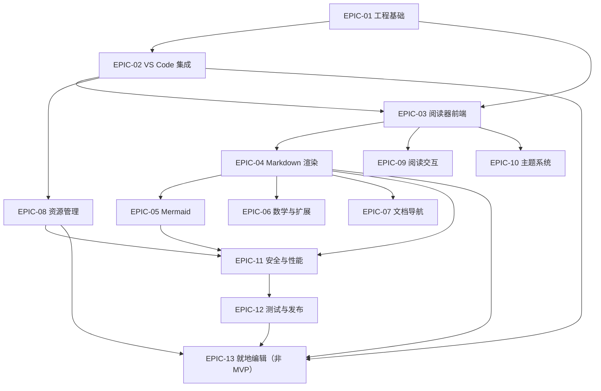
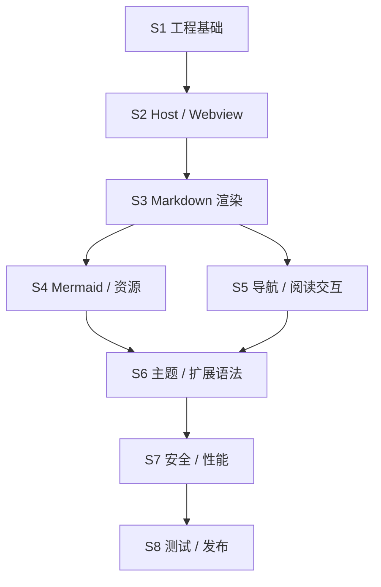

# IMP-002：Readora 开发任务分解规范

| 文档属性 | 内容 |
|---|---|
| 文档编号 | IMP-002 |
| 文档名称 | Readora 开发任务分解规范 |
| 文档版本 | 1.3.0 |
| 文档状态 | Final |
| 所属阶段 | Implementation Planning |
| 上游文档 | PRD-001～003、ARC-001～009、IMP-001 |
| 下游文档 | IMP-003 |
| 产品形态 | VS Code Extension |

---

## 1. 文档目的

本文档定义 Readora 的开发任务分解方式，将已经确认的产品需求与技术架构转换为可执行的开发工作。

主要目标：

1. 明确开发范围和 MVP 边界。
2. 建立 Epic、Story、Task 三级任务体系。
3. 明确各任务的依赖关系。
4. 定义每个 Story 的验收标准。
5. 确定开发顺序和交付要求。
6. 避免重复建设和需求范围持续膨胀。

本文档不新增产品功能，不重新定义架构，也不替代 PRD 和 ARC。

## 2. 任务分解规则

### 2.1 任务层级

| 层级 | 定义 | 示例 |
|---|---|---|
| Epic | 一个完整的业务或技术能力域 | Markdown 渲染 |
| Story | 用户可感知的功能或可独立交付的技术能力 | 支持代码块阅读 |
| Task | 可分配、可开发、可验收的具体工作 | 实现代码块 Renderer |

### 2.2 编号规范

统一使用：

```text
EPIC-XX
STORY-XX-YY
TASK-XX-YY-ZZ
```

示例：

```text
EPIC-01       Markdown 内容渲染
STORY-01-01   基础 Markdown 渲染
TASK-01-01-01 实现 markdown-it 初始化
TASK-01-01-02 实现标题 Renderer
TASK-01-01-03 实现段落 Renderer
```

编号规则：

- Epic 编号全局唯一。
- Story 编号必须归属于一个 Epic。
- Task 编号必须归属于一个 Story。
- 已分配编号不得重复使用。
- 删除任务后保留编号记录，不重新分配。
- 后续新增任务只能追加编号，不得改变既有任务身份。

### 2.3 优先级

| 优先级 | 含义 | 处理要求 |
|---|---|---|
| P0 | MVP 必须交付 | 不得延期 |
| P1 | 首个正式版本的重要能力 | MVP 后完成 |
| P2 | 增强能力 | 根据实际价值排期 |

### 2.4 完成状态

| 状态 | 说明 |
|---|---|
| Todo | 尚未开始 |
| In Progress | 开发中 |
| Blocked | 存在阻塞 |
| Review | 等待评审 |
| Done | 已通过验收 |

---

## 3. MVP 范围

### 3.1 MVP 目标

交付一个可以在 VS Code 中稳定使用的 Markdown 阅读扩展。

用户可以：

1. 从 VS Code 打开 Markdown 文档。
2. 在独立阅读界面中查看 Markdown。
3. 阅读标题、段落、列表、表格和代码块。
4. 查看 Mermaid 图表。
5. 查看数学公式。
6. 使用 Outline 导航。
7. 阅读本地图片。
8. 切换 Light / Dark 主题。
9. 在源文档变化后刷新阅读内容。
10. 在 Windows、macOS、Linux 上安装和使用扩展。

### 3.2 MVP 功能范围

| 功能域 | MVP 范围 | 优先级 |
|---|---|---|
| F01 Markdown 内容渲染 | 标题、段落、列表、引用、表格、链接、代码块 | P0 |
| F02 文档导航 | Outline、标题定位、活动标题同步 | P0 |
| F03 知识链接 | 基础 Wiki Link 识别与跳转 | P1 |
| F04 图形渲染引擎 | Mermaid 基础图表、错误处理、主题适配 | P0 |
| F05 阅读交互 | 滚动、代码复制、图片放大、图表缩放 | P0 |
| F06 资源管理 | 本地图片和附件解析 | P0 |
| F07 阅读布局 | 三栏基础布局、专注阅读 | P0 |
| F08 主题系统 | Light / Dark / VS Code 主题适配 | P0 |
| F09 Markdown 扩展语法 | 数学公式、Frontmatter、Wiki Link | P1 |
| F10 VS Code 集成 | 打开文档、Session、配置、文件变化监听 | P0 |
| F11 性能与安全 | Sanitizer、CSP、基础缓存、性能测试 | P0 |

### 3.3 暂不进入 MVP 的功能

以下内容明确不纳入首个可交付版本：

- 完整知识图谱。
- 多文档知识关联分析。
- 双向链接关系管理。
- 云端同步。
- 用户账户体系。
- 独立插件市场。
- 自定义脚本执行。
- 自定义 Markdown 扩展运行时。
- 复杂 AST 增量渲染。
- 自定义 Mermaid 布局引擎。
- 独立 Markdown 编辑器。
- AI 内容分析和生成。

这些内容不属于当前阅读器的核心交付目标。

> **1.1.0 澄清**：“独立 Markdown 编辑器”这条排除项继续有效，但它不等于“不做任何
> 编辑能力”。**EPIC-13 就地编辑（F12 / ARC-009）** 不在本排除项范围内：它不自建文档
> 模型与编辑生命周期（写回归宿主 `TextDocument`）、不提供块重排与拖拽、不回写全文。
> 边界对照表见 PRD-001 §2.2。
>
> 同时注意本节的「复杂 AST 增量渲染」也与 EPIC-13 无关：编辑态采用单区块隔离编辑 +
> 提交后全量重渲染，不引入局部重渲染（ARC-009 §3.1、ARC-002 §13.1）。

---

## 4. Epic 总览

本项目定义 13 个 Epic，覆盖工程基础、运行时集成、渲染、导航、交互、主题、安全和发布，以及 1.1.0 追加的就地编辑。

> EPIC-13 为 1.1.0 新增（F12 就地编辑），**不属于 MVP**，排在发布后的版本演进
> （IMP-003 §8 V1.4.x）。前 12 个 Epic 的划分与优先级未变。

| Epic | 名称 | 对应功能域 | 优先级 |
|---|---|---|---|
| EPIC-01 | 工程基础建设 | 技术基础 | P0 |
| EPIC-02 | VS Code 扩展集成 | F10 | P0 |
| EPIC-03 | 阅读器前端框架 | F07 | P0 |
| EPIC-04 | Markdown 渲染 | F01 | P0 |
| EPIC-05 | Mermaid 图形渲染 | F04 | P0 |
| EPIC-06 | 数学公式与扩展语法 | F09 | P1 |
| EPIC-07 | 文档导航 | F02 | P0 |
| EPIC-08 | 资源管理 | F06 | P0 |
| EPIC-09 | 阅读交互 | F05 | P0 |
| EPIC-10 | 主题系统 | F08 | P0 |
| EPIC-11 | 安全与性能 | F11 | P0 |
| EPIC-12 | 测试与发布 | 质量交付 | P0 |
| EPIC-13 | 就地编辑 | F12 | P1（非 MVP）|

> EPIC-13 的 Story / Task 明细见 **§22**（因编号兼容原因追加在末尾，不按 Epic 顺序插入，原因同节说明）。

### 4.1 Epic 依赖关系



---

## 5. EPIC-01：工程基础建设

**目标：** 建立统一、可构建、可测试的 TypeScript 工程。

**优先级：** P0

**关联文档：** ARC-001、ARC-005、IMP-001。

### STORY-01-01：初始化 Monorepo 工程

| Task | 名称 | 交付物 |
|---|---|---|
| TASK-01-01-01 | 初始化 Git 仓库 | Git 基础结构 |
| TASK-01-01-02 | 配置 pnpm Workspace | Workspace 配置 |
| TASK-01-01-03 | 配置 TypeScript | 基础 TS 配置 |
| TASK-01-01-04 | 配置 ESLint | Lint 配置 |
| TASK-01-01-05 | 配置统一脚本 | 根 package.json |

**验收标准：**

- 所有工程可以通过 pnpm 安装依赖。
- TypeScript 严格模式启用。
- Lint 可以在根目录执行。
- 所有依赖有锁定版本。
- 新成员按照 README 可以完成本地初始化。

### STORY-01-02：建立 Shared Contracts

| Task | 名称 | 交付物 |
|---|---|---|
| TASK-01-02-01 | 建立 contracts 包 | packages/contracts |
| TASK-01-02-02 | 定义消息 Envelope | MessageEnvelope |
| TASK-01-02-03 | 定义 Response 模型 | MessageResponse |
| TASK-01-02-04 | 定义公共 DTO | Shared DTO |
| TASK-01-02-05 | 建立消息 Schema | Zod Schemas |

**验收标准：**

- Host 和 Webview 可以引用同一套协议定义。
- 不存在反向依赖。
- 消息类型具有明确版本。
- 非法消息可以被拒绝。
- Shared 包可以独立执行测试。

### STORY-01-03：建立构建体系

| Task | 名称 | 交付物 |
|---|---|---|
| TASK-01-03-01 | 配置 Host 构建 | esbuild 配置 |
| TASK-01-03-02 | 配置 Webview 构建 | Vite 配置 |
| TASK-01-03-03 | 配置资源输出目录 | Build Output |
| TASK-01-03-04 | 配置构建检查 | Build Validation |
| TASK-01-03-05 | 配置 VSIX 打包 | Package Script |

**验收标准：**

- Host 与 Webview 可以独立构建。
- Webview 不包含 Node.js 依赖。
- 构建产物可以被 VS Code 正确加载。
- 可以成功生成 VSIX。

---

## 6. EPIC-02：VS Code 扩展集成

**目标：** 建立 VS Code Extension Host 运行环境和文档会话管理能力。

**优先级：** P0

**关联文档：** ARC-004、ARC-008。

### STORY-02-01：扩展生命周期管理

| Task | 名称 |
|---|---|
| TASK-02-01-01 | 实现 Extension Entry |
| TASK-02-01-02 | 实现 activate 生命周期 |
| TASK-02-01-03 | 实现 deactivate 生命周期 |
| TASK-02-01-04 | 统一 Disposable 管理 |

**验收标准：**

- 扩展可以正常激活。
- 扩展卸载时释放资源。
- 不存在未管理的事件监听。
- 重复激活和关闭不会产生资源泄漏。

### STORY-02-02：Markdown 文档打开

| Task | 名称 |
|---|---|
| TASK-02-02-01 | 注册打开阅读器命令 |
| TASK-02-02-02 | 注册编辑器标题栏入口 |
| TASK-02-02-03 | 实现文档 URI 解析 |
| TASK-02-02-04 | 实现文档内容读取 |
| TASK-02-02-05 | 实现 WebviewPanel 创建 |

**验收标准：**

- 可以从命令面板打开 Markdown。
- 可以从编辑器入口打开 Markdown。
- 可以正确读取本地文档。
- 不支持的文档类型能够给出明确提示。

### STORY-02-03：Reader Session 管理

| Task | 名称 |
|---|---|
| TASK-02-03-01 | 定义 Reader Session 模型 |
| TASK-02-03-02 | 实现 Session 创建 |
| TASK-02-03-03 | 实现 Session 查找与复用 |
| TASK-02-03-04 | 实现 Session 销毁 |
| TASK-02-03-05 | 实现基础阅读位置保存 |

**验收标准：**

- 同一文档默认复用对应 Session。
- 不同文档可以独立打开。
- Session 关闭后释放资源。
- 文档滚动位置可以在支持的恢复场景下保留。

### STORY-02-04：文档变更同步

| Task | 名称 |
|---|---|
| TASK-02-04-01 | 监听 TextDocument 变化 |
| TASK-02-04-02 | 监听文件系统变化 |
| TASK-02-04-03 | 实现更新防抖 |
| TASK-02-04-04 | 实现文档版本检查 |
| TASK-02-04-05 | 实现 Webview 内容更新 |

**验收标准：**

- 未保存编辑能够更新阅读内容。
- 外部文件变化能够被检测。
- 连续修改不会产生大量无意义渲染。
- 旧版本结果不会覆盖新版本结果。

---

## 7. EPIC-03：阅读器前端框架

**目标：** 建立 React 阅读器应用及其基础布局。

**优先级：** P0

**关联文档：** PRD-002、PRD-003、ARC-005。

### STORY-03-01：React 应用初始化

| Task | 名称 |
|---|---|
| TASK-03-01-01 | 初始化 Webview React 应用 |
| TASK-03-01-02 | 实现 App 入口 |
| TASK-03-01-03 | 建立应用 Provider |
| TASK-03-01-04 | 建立错误边界 |
| TASK-03-01-05 | 实现 Host Bridge 初始化 |

**验收标准：**

- React 可以在 Webview 中正常启动。
- Host Bridge 可以建立通信。
- React 运行异常不会直接导致整个 Webview 白屏。
- 不存在对 Node.js API 的直接依赖。

### STORY-03-02：阅读器 Shell

| Task | 名称 |
|---|---|
| TASK-03-02-01 | 实现 Reader Shell |
| TASK-03-02-02 | 实现左侧导航区域 |
| TASK-03-02-03 | 实现中央阅读区域 |
| TASK-03-02-04 | 实现右侧辅助面板 |
| TASK-03-02-05 | 实现面板显示与隐藏 |

**验收标准：**

- 具备左、中、右三栏布局。
- 中央阅读画布为主要视觉区域。
- 面板可以独立显示和隐藏。
- 窄窗口下布局不会发生不可用的溢出。

### STORY-03-03：基础阅读组件

| Task | 名称 |
|---|---|
| TASK-03-03-01 | 实现 Document Header |
| TASK-03-03-02 | 实现 Reading Canvas |
| TASK-03-03-03 | 实现 Toolbar |
| TASK-03-03-04 | 实现 Empty State |
| TASK-03-03-05 | 实现 Error State |

**验收标准：**

- 文档标题和基础元数据可以展示。
- 阅读区域具备合理的最大宽度。
- 空文档和加载失败状态清晰可见。
- UI 组件遵循 PRD-003 设计 Token。

---

## 8. EPIC-04：Markdown 内容渲染

**目标：** 实现 Markdown 核心语法的解析和展示。

**优先级：** P0

**关联文档：** PRD-001、ARC-002。

### STORY-04-01：Markdown Parser

| Task | 名称 |
|---|---|
| TASK-04-01-01 | 初始化 markdown-it |
| TASK-04-01-02 | 实现 Source Normalizer |
| TASK-04-01-03 | 实现 Token Processing |
| TASK-04-01-04 | 实现解析错误处理 |
| TASK-04-01-05 | 实现 RenderResult 输出 |

**验收标准：**

- 标准 Markdown 能够正确解析。
- 解析结果具备统一的数据结构。
- 非法内容不会导致应用崩溃。
- Outline 和 Metadata 可以从解析结果中生成。

### STORY-04-02：基础 Markdown Renderer

| Task | 名称 |
|---|---|
| TASK-04-02-01 | 实现 Heading Renderer |
| TASK-04-02-02 | 实现 Paragraph Renderer |
| TASK-04-02-03 | 实现 List Renderer |
| TASK-04-02-04 | 实现 Blockquote Renderer |
| TASK-04-02-05 | 实现 Table Renderer |
| TASK-04-02-06 | 实现 Link Renderer |
| TASK-04-02-07 | 实现 Horizontal Rule Renderer |

**验收标准：**

- 常用 Markdown 语法展示正确。
- 标题层级和列表嵌套正确。
- 表格不会破坏阅读画布宽度。
- 外部链接按照安全策略处理。

### STORY-04-03：代码块阅读

| Task | 名称 |
|---|---|
| TASK-04-03-01 | 实现 Code Block Renderer |
| TASK-04-03-02 | 实现代码语言标识 |
| TASK-04-03-03 | 实现代码复制 |
| TASK-04-03-04 | 实现长代码横向滚动 |
| TASK-04-03-05 | 实现代码主题样式 |

**验收标准：**

- 代码块与正文视觉区分明显。
- 语言标识正确展示。
- 复制功能可用。
- 长代码不会撑破阅读区域。

### STORY-04-04：HTML 安全处理

| Task | 名称 |
|---|---|
| TASK-04-04-01 | 定义 HTML Sanitizer 配置 |
| TASK-04-04-02 | 集成 DOMPurify |
| TASK-04-04-03 | 实现 URL Scheme 检查 |
| TASK-04-04-04 | 实现危险属性过滤 |
| TASK-04-04-05 | 编写 XSS 测试 |

**验收标准：**

- 默认不执行 Markdown 中的任意 HTML。
- 危险脚本和事件属性被过滤。
- 安全链接可以正常使用。
- XSS 测试用例全部通过。

---

## 9. EPIC-05：Mermaid 图形渲染

**目标：** 实现 Markdown 中 Mermaid 图表的解析、展示和交互。

**优先级：** P0

**关联文档：** ARC-003、IMP-001。

### STORY-05-01：Diagram Core

| Task | 名称 |
|---|---|
| TASK-05-01-01 | 建立 DiagramEngine 接口 |
| TASK-05-01-02 | 建立 DiagramRenderer 注册机制 |
| TASK-05-01-03 | 建立 Diagram 生命周期模型 |
| TASK-05-01-04 | 建立 Diagram 错误模型 |

**验收标准：**

- 图表引擎与业务组件隔离。
- 图表生命周期可追踪。
- 图表错误不会中断整篇文档。

### STORY-05-02：Pele Adapter

| Task | 名称 |
|---|---|
| TASK-05-02-01 | 验证 Pele 与目标 Webview 环境兼容性 |
| TASK-05-02-02 | 锁定 Pele 依赖版本 |
| TASK-05-02-03 | 实现 PeleAdapter |
| TASK-05-02-04 | 实现图表挂载与更新 |
| TASK-05-02-05 | 实现图表销毁 |

**验收标准：**

- Pele 只能通过 Adapter 使用。
- 图表能够正常挂载和更新。
- React 卸载时释放图表资源。
- 兼容性清单记录实际通过的图表类型。

### STORY-05-03：图表交互

| Task | 名称 |
|---|---|
| TASK-05-03-01 | 实现图表容器 |
| TASK-05-03-02 | 实现 Zoom |
| TASK-05-03-03 | 实现 Pan |
| TASK-05-03-04 | 实现 Fit |
| TASK-05-03-05 | 实现 Reset |
| TASK-05-03-06 | 实现 Fullscreen |
| TASK-05-03-07 | 实现 Copy Source |

**验收标准：**

- 图表可以放大、缩小和拖动。
- 图表可以恢复默认比例。
- 全屏模式可以正常退出。
- 原始 Mermaid 源码可以复制。

---

## 10. EPIC-06：数学公式与扩展语法

**目标：** 提供常用 Markdown 扩展能力。

**优先级：** P1

**关联文档：** PRD-001、ARC-002、IMP-001。

### STORY-06-01：数学公式

| Task | 名称 |
|---|---|
| TASK-06-01-01 | 集成 KaTeX |
| TASK-06-01-02 | 实现行内公式 |
| TASK-06-01-03 | 实现块级公式 |
| TASK-06-01-04 | 实现公式错误处理 |
| TASK-06-01-05 | 实现数学字体资源打包 |

**验收标准：**

- 行内公式正常展示。
- 块级公式正常展示。
- 非法公式不会中断文档渲染。
- 数学公式资源不依赖外部 CDN。

### STORY-06-02：Frontmatter

| Task | 名称 |
|---|---|
| TASK-06-02-01 | 识别 Frontmatter |
| TASK-06-02-02 | 解析基础 YAML |
| TASK-06-02-03 | 构建 Document Metadata |
| TASK-06-02-04 | 实现 Properties 展示 |

**验收标准：**

- 文档顶部 Frontmatter 可以识别。
- 元数据可以被统一读取。
- 非法 Frontmatter 不影响正文阅读。
- 不执行 Frontmatter 中的任何脚本或表达式。

### STORY-06-03：Wiki Link

| Task | 名称 |
|---|---|
| TASK-06-03-01 | 识别 Wiki Link 语法 |
| TASK-06-03-02 | 解析目标文档 |
| TASK-06-03-03 | 实现基础文档跳转 |
| TASK-06-03-04 | 实现目标不存在状态 |

**验收标准：**

- `[[document]]` 可以识别。
- 文档目标可以解析。
- 无法解析的目标有明确状态。
- 不存在的目标不会导致阅读器异常。

---

## 11. EPIC-07：文档导航

**目标：** 建立 Outline 和阅读位置同步能力。

**优先级：** P0

**关联文档：** PRD-002、ARC-007。

### STORY-07-01：Outline 生成

| Task | 名称 |
|---|---|
| TASK-07-01-01 | 从 RenderResult 获取标题 |
| TASK-07-01-02 | 生成 Outline Tree |
| TASK-07-01-03 | 生成标题 Anchor |
| TASK-07-01-04 | 实现 Outline 展示 |

**验收标准：**

- Outline 与文档标题层级一致。
- 标题 Anchor 唯一。
- 不重复解析 Markdown。
- 标题更新后 Outline 同步更新。

### STORY-07-02：标题导航

| Task | 名称 |
|---|---|
| TASK-07-02-01 | 实现 Outline 点击跳转 |
| TASK-07-02-02 | 实现活动标题检测 |
| TASK-07-02-03 | 实现标题高亮 |
| TASK-07-02-04 | 实现 Outline 折叠 |

**验收标准：**

- 点击 Outline 可以定位标题。
- 阅读位置变化后活动标题同步。
- 大纲折叠状态正确。
- 不出现持续跳动或错误高亮。

### STORY-07-03：文档内搜索

| Task | 名称 |
|---|---|
| TASK-07-03-01 | 实现搜索输入 |
| TASK-07-03-02 | 实现当前文档内容匹配 |
| TASK-07-03-03 | 实现匹配结果计数 |
| TASK-07-03-04 | 实现结果定位 |

**验收标准：**

- 仅搜索当前文档。
- 搜索结果可以定位。
- 空结果有明确提示。
- 输入过程使用防抖机制。

---

## 12. EPIC-08：资源管理

**目标：** 支持本地图片和附件安全加载。

**优先级：** P0

**关联文档：** ARC-008。

### STORY-08-01：资源路径解析

| Task | 名称 |
|---|---|
| TASK-08-01-01 | 实现相对路径解析 |
| TASK-08-01-02 | 实现工作区资源定位 |
| TASK-08-01-03 | 实现资源 URI 转换 |
| TASK-08-01-04 | 实现资源不存在处理 |

**验收标准：**

- 相对路径按照文档位置解析。
- 本地资源通过 Host 读取和授权。
- Webview 使用合法资源 URI。
- 资源路径不会越过允许访问的范围。

### STORY-08-02：图片阅读

| Task | 名称 |
|---|---|
| TASK-08-02-01 | 实现图片 Renderer |
| TASK-08-02-02 | 实现图片懒加载 |
| TASK-08-02-03 | 实现图片 Lightbox |
| TASK-08-02-04 | 实现图片加载失败状态 |

**验收标准：**

- 支持的图片格式可以正常展示。
- 图片不会撑破阅读画布。
- 点击图片可以放大。
- 图片加载失败时展示占位状态。

### STORY-08-03：资源安全

| Task | 名称 |
|---|---|
| TASK-08-03-01 | 实现资源访问策略 |
| TASK-08-03-02 | 实现路径边界验证 |
| TASK-08-03-03 | 实现 SVG Sanitizer |
| TASK-08-03-04 | 实现外部资源限制 |

**验收标准：**

- 禁止任意本地路径访问。
- SVG 不允许携带可执行脚本。
- 外部资源遵循明确访问策略。
- 资源访问异常有安全日志。

---

## 13. EPIC-09：阅读交互

**目标：** 提供阅读过程中的基础操作能力。

**优先级：** P0

**关联文档：** PRD-002。

### STORY-09-01：阅读布局交互

| Task | 名称 |
|---|---|
| TASK-09-01-01 | 实现侧栏显隐 |
| TASK-09-01-02 | 实现专注阅读模式 |
| TASK-09-01-03 | 实现阅读宽度控制 |
| TASK-09-01-04 | 实现基础快捷键 |

**验收标准：**

- 左右面板可以显示和隐藏。
- 专注模式突出正文阅读。
- 阅读宽度可以正确调整。
- 快捷键不与 VS Code 常用快捷键产生明显冲突。

### STORY-09-02：阅读状态恢复

| Task | 名称 |
|---|---|
| TASK-09-02-01 | 实现滚动位置记录 |
| TASK-09-02-02 | 实现活动标题记录 |
| TASK-09-02-03 | 实现 Session 状态恢复 |

**验收标准：**

- 文档重新显示时可以恢复合理的阅读位置。
- 状态与文档 Session 关联。
- 文档关闭后释放不需要的临时状态。

### STORY-09-03：辅助面板

| Task | 名称 |
|---|---|
| TASK-09-03-01 | 实现 Outline 面板 |
| TASK-09-03-02 | 实现 Properties 面板 |
| TASK-09-03-03 | 实现 Backlinks 占位状态 |
| TASK-09-03-04 | 实现面板切换 |

**验收标准：**

- 面板布局符合 PRD-002。
- P1 功能可以展示明确的不可用或空状态。
- 不得将未实现的 Backlinks 功能伪装成已完成能力。

---

## 14. EPIC-10：主题系统

**目标：** 建立统一设计 Token 和主题切换能力。

**优先级：** P0

**关联文档：** PRD-003、ARC-006。

### STORY-10-01：Design Tokens

| Task | 名称 |
|---|---|
| TASK-10-01-01 | 定义 Primitive Tokens |
| TASK-10-01-02 | 定义 Semantic Tokens |
| TASK-10-01-03 | 定义 Component Tokens |
| TASK-10-01-04 | 建立 CSS Variables 输出 |

**验收标准：**

- Token 分层符合 PRD-003。
- 组件使用语义 Token。
- 不存在大量重复硬编码颜色。
- Token 可以被 React 和 Mermaid 样式共同消费。

### STORY-10-02：主题切换

| Task | 名称 |
|---|---|
| TASK-10-02-01 | 实现 Light Theme |
| TASK-10-02-02 | 实现 Dark Theme |
| TASK-10-02-03 | 实现 VS Code 主题适配 |
| TASK-10-02-04 | 实现主题切换通知 |
| TASK-10-02-05 | 实现 Mermaid 主题联动 |

**验收标准：**

- Light / Dark 模式可以切换。
- VS Code 主题变化可以被识别。
- Markdown 内容样式同步变化。
- Mermaid 图表主题同步变化。

### STORY-10-03：视觉验收

| Task | 名称 |
|---|---|
| TASK-10-03-01 | 检查颜色对比度 |
| TASK-10-03-02 | 检查字体层级 |
| TASK-10-03-03 | 检查阅读宽度 |
| TASK-10-03-04 | 检查响应式布局 |

**验收标准：**

- 满足既定可访问性目标。
- 标题、正文、代码和引用具有明确层级。
- 不同窗口宽度下布局可用。
- 视觉规范与 PRD-003 一致。

---

## 15. EPIC-11：安全与性能

**目标：** 建立 MVP 必需的安全边界和性能基线。

**优先级：** P0

**关联文档：** ARC-008、IMP-001。

### STORY-11-01：Webview 安全

| Task | 名称 |
|---|---|
| TASK-11-01-01 | 实现 CSP |
| TASK-11-01-02 | 实现 nonce |
| TASK-11-01-03 | 限制 localResourceRoots |
| TASK-11-01-04 | 验证消息 Payload |
| TASK-11-01-05 | 验证外部链接 |

**验收标准：**

- CSP 配置有效。
- 不依赖 `unsafe-eval`。
- Webview 不能直接访问任意文件。
- 非法消息不能触发敏感操作。

### STORY-11-02：性能优化

| Task | 名称 |
|---|---|
| TASK-11-02-01 | 实现文档级缓存 |
| TASK-11-02-02 | 实现 Mermaid 延迟渲染 |
| TASK-11-02-03 | 实现图片懒加载 |
| TASK-11-02-04 | 实现搜索防抖 |
| TASK-11-02-05 | 建立性能测试样例 |

**验收标准：**

- 性能指标有可重复测试方法。
- 长文档不会造成明显的 UI 阻塞。
- 图表按需渲染。
- 缓存更新与文档版本保持一致。

### STORY-11-03：资源生命周期

| Task | 名称 |
|---|---|
| TASK-11-03-01 | 统一 Session Disposable |
| TASK-11-03-02 | 实现图表销毁 |
| TASK-11-03-03 | 实现监听器清理 |
| TASK-11-03-04 | 检查重复资源引用 |

**验收标准：**

- Session 关闭后释放资源。
- 图表销毁后无持续事件监听。
- Webview 重建不会累积旧状态。
- 长时间阅读不会持续增加无界资源占用。

---

## 16. EPIC-12：测试与发布

**目标：** 确保产品可测试、可安装、可发布。

**优先级：** P0

**关联文档：** IMP-001。

### STORY-12-01：自动化测试

| Task | 名称 |
|---|---|
| TASK-12-01-01 | 配置 Vitest |
| TASK-12-01-02 | 建立 Markdown Fixture |
| TASK-12-01-03 | 建立 Renderer 测试 |
| TASK-12-01-04 | 建立 Host Integration Test |
| TASK-12-01-05 | 配置 Playwright |

**验收标准：**

- 核心模块具有自动化测试。
- 关键交互可以通过 E2E 验证。
- 测试可以在 CI 中运行。
- 测试结果可追溯。

### STORY-12-02：跨平台验证

| Task | 名称 |
|---|---|
| TASK-12-02-01 | Windows 安装验证 |
| TASK-12-02-02 | macOS 安装验证 |
| TASK-12-02-03 | Linux 安装验证 |
| TASK-12-02-04 | 不同 VS Code 版本验证 |

**验收标准：**

- 支持平台能够安装扩展。
- 核心功能运行正常。
- Webview 资源加载正常。
- 平台差异问题有记录。

### STORY-12-03：发布准备

| Task | 名称 |
|---|---|
| TASK-12-03-01 | 配置扩展 Manifest |
| TASK-12-03-02 | 配置扩展图标与描述 |
| TASK-12-03-03 | 生成 VSIX |
| TASK-12-03-04 | 验证 VSIX 文件内容 |
| TASK-12-03-05 | 编写发布说明 |

**验收标准：**

- VSIX 可以安装。
- 扩展激活事件符合设计。
- 生产包不包含无用开发依赖。
- README 和版本说明完整。

---

## 17. 开发执行顺序

### 17.1 阶段划分

| 阶段 | 开发内容 | 主要 Epic | 交付结果 |
|---|---|---|---|
| S1 | 工程基础 | EPIC-01 | 工程可构建 |
| S2 | Host 与 Webview 集成 | EPIC-02、EPIC-03 | 阅读器可以启动 |
| S3 | Markdown 基础渲染 | EPIC-04 | 可以阅读 Markdown |
| S4 | 图表与资源 | EPIC-05、EPIC-08 | 支持 Mermaid 和图片 |
| S5 | 导航与交互 | EPIC-07、EPIC-09 | 阅读体验完整 |
| S6 | 主题与扩展语法 | EPIC-06、EPIC-10 | 主题与增强能力 |
| S7 | 安全和性能 | EPIC-11 | 满足质量基线 |
| S8 | 测试和发布 | EPIC-12 | MVP 可交付 |
| S9 | 就地编辑（非 MVP） | EPIC-13 | V1.4.x 可交付 |

### 17.2 关键开发路径



### 17.3 并行开发规则

可以并行：

- Shared Contracts 与 Host 工程。
- React Shell 与 Markdown Parser。
- Design Tokens 与基础 Renderer。
- Mermaid Adapter 与资源解析。
- 测试 Fixture 与功能开发。

不建议并行：

- 消息协议未确定前开发复杂通信逻辑。
- Renderer 接口未确定前开发所有渲染器。
- 资源访问策略未确定前开发图片和 SVG。
- Pele 兼容性未验证前批量开发图表交互。

---

## 18. Definition of Done

一个 Story 只有同时满足以下条件才可以标记为 Done：

1. 实现符合对应需求和架构约束。
2. 代码通过 TypeScript 检查。
3. 代码通过 Lint。
4. 相关自动化测试通过。
5. 错误状态和异常路径已处理。
6. 安全要求已验证。
7. 必要文档已更新。
8. 代码评审通过。
9. 不存在未解决的 P0 缺陷。
10. 验收人员确认交付结果。

Epic 完成条件：

- 所有 P0 Story 已完成。
- Epic 验收标准全部通过。
- 不存在影响其他 Epic 的阻塞问题。
- 对应功能已集成到主分支。

---

## 19. 需求变更控制

### 19.1 变更原则

开发过程中新增需求必须先判断：

- 是否属于现有功能域？
- 是否属于 MVP？
- 是否存在现有功能可以复用？
- 是否会影响既有架构？
- 是否引入额外依赖？
- 是否影响当前里程碑？

### 19.2 变更处理

| 变更类型 | 处理方式 |
|---|---|
| Bug 修复 | 直接进入缺陷任务 |
| 既有需求细化 | 更新现有 Story |
| MVP 必要缺失 | 评审后追加 Task |
| P1 增强需求 | 进入后续版本 |
| 新功能域 | 必须进行范围评审 |
| 架构变更 | 先更新对应 ARC / ADR |

### 19.3 禁止事项

- 不因实现便利随意增加一级功能域。
- 不重复创建已有 Story。
- 不为尚未验证的需求提前建设基础设施。
- 不将 P1 能力擅自升级为 P0。
- 不因某个第三方库能力丰富就扩大产品范围。

### 19.4 变更记录：F12 就地编辑（1.1.0）

本节按 §19.1 / §19.2 的要求逐条回答，目的是让这个变更可被审计而不是“仍在了”：

| §19.1 判断项 | 结论 |
|---|---|
| 是否属于现有功能域？ | 否。需新增 F12（第 12 个功能域） |
| 是否属于 MVP？ | **否**。MVP（V1.0.0）已完成的历史结论不回溯修改 |
| 是否存在现有功能可复用？ | 部分。CodeMirror（但 `editable:false`）、自动刷新链、接管层形态均可复用；源位置锚定链不存在，必须新建 |
| 是否会影响既有架构？ | 会。涉及 ARC-002 / 004 / 008 / IMP-001，均已同步修订 |
| 是否引入额外依赖？ | **否**（这是选型结论）。编辑模型归宿主 `TextDocument`，不引入 ProseMirror / Monaco |
| 是否影响当前里程碑？ | 否。挂在 IMP-003 §8 V1.4.x，不阻塞任何已交付版本 |

按 §19.2，本变更同时命中两行：**新功能域**（必须范围评审）与**架构变更**（先更新 ARC / ADR）。
执行顺序：PRD-001 §2.2 澄清 + §5.12 立项 → ARC-009 定架构与 ADR → 修订受影响的既有条款 →
本篇追加 EPIC-13。**代码未动。**

对照 §19.3 的五条禁止事项：功能域不是为实现便利加的（先有立项再有拆解）；未重复 Story
（EPIC-01～12 无编辑类 Story）；**基础设施一项需注意**——E0（源位置锚定）在没有编辑器 UI 的情况下
先行交付，它的正当性不来自“以后要建编辑器”，而来自 F12-004 源码保真写回对锚定的硬性依赖，
且它自身带完整门禁（ARC-002 §12.3）可独立验收；未将 P1 升 P0（F12-001/002/003 仍为 P1）；
未因 CodeMirror 可用就扩大范围（正因为它的存在，反而确认了不需要引入新编辑器库）。

### 19.5 变更记录：§22 STORY-13-01 口径按 E0 实测回写（1.1.1）

E0 实现时推翻了 §22 立项文本里的三条口径。按 §19.2「既有需求细化 → 更新现有 Story」处理（不动 Story 划分、不动
Task 编号、不新增 Epic），仅把拆解修正到与代码事实一致：

1. **TASK-13-01-03**：原写「Sanitizer 白名单放行该属性并按值形状校验」。实际 `ALLOW_DATA_ATTR` 已对 `data-*` 的名字
   早退放行且完全不查值，白名单一行都不需要改；需要的是清洗后的后置值形状剥离遍历 + 一枚新诊断码。
   保留原句会让下一个实现者去加一行无效的白名单。
2. **新增 TASK-13-01-05**（frontmatter 行偏移补偿）：立项时未意识到提取层是整段切掉 YAML 头的，AST 行号因此相对 body
   而非文件。本条不做，E1 的写回对任何带 frontmatter 的文档都会改错行 —— 属于遗漏的必要 Task，不是范围扩张。
3. **TASK-13-01-02 发射点 / TASK-13-01-04 门禁数**：发射点从「顶层区块渲染」改到「管线顶层组装处」（块级渲染器无法自辨
   层级）；四条门禁扩为六条（原四条盖不住 off-by-one 与偏移错算）。验收标准里「既有 HTML 结构断言无需改动」口径过宽，
   已改为区分「结构」与「钉住属性全集的精确串断言」（后者放宽 4 处）。

本节不记进度，交付取证见 AUD-001 §13.9。E1～E6 的 Story / Task 划分未动。

### 19.6 变更记录：§22 STORY-13-02 口径按 E1 实测回写（1.1.2）

与 §19.5 同一条处理路径（既有需求细化 → 更新现有 Story：不动 Story 划分、不动已编号的
Task 编号、不新增 Epic）。E1 实现时推翻四条立项口径，均已按代码事实回写：

1. **TASK-13-02-01**：原写「payload 四字段 + strict Schema」，未区分形状与语义。ARC-009 §5.1
   原文把 `endLine >= startLine` 列入 Schema 表，照它做会把「把手作废」类拒收退化成
   `payload.invalid`。现明记 Schema 只管形状，语义归 Host。
2. **TASK-13-02-03**：原写「Host handler：会话校验 → 乐观锁 → …」五步，实现为八步阶梯（多了
   面板存在、scheme、打不开、应用失败四道），且乐观锁基准从「当前模型 version」改为
   **快照空间的版本**。按原口径实现会把每一篇「只在阅读器里打开」的文档的首笔写回误杀；
   同时新增「判断收在不 import vscode 的 service、端口集合里不得有 save」两条结构约束。
3. **新增 TASK-13-02-06**（测试替身建模）：与 §19.5 第 2 条同性质 —— 立项时未意识到旧替身把
   `onDidChangeTextDocument` 的 listener 丢空、且没有 `WorkspaceEdit` / `applyEdit` / `openTextDocument`，
   于是 E1 的核心判据（回声）在现有基建里无法断言。属遗漏的必要 Task，不是范围扩张。
4. **验收标准里的「integration」重定义为 extension 侧 wiring 测试**：它不指 e2e 夹具，且本轮
   故意不动夹具（零 View 代码 = 没有发送者）。原写法会让下一个人去给夹具加一条永远没人调的
   应答器分支，把「没接发送者」伪装成「已集成」。

E2～E6 的 Story / Task 划分未动。本节不记进度，交付取证见 AUD-001 §13.10。

### 19.7 变更记录：§22 STORY-13-03 拆边界并按 E2 实测回写（1.2.0）

同 §19.5 / §19.6 的处理路径（既有需求细化 → 更新现有 Story：不动 Story 划分、不动已编号的 Task
编号、不新增 Epic）。E2 交付「段落与行内编辑」的**前半**，本轮改动分三类：

1. **显式拆出 E2 / E3 边界**。1.1.0 把 STORY-13-03 整条标为「ARC-009 E2 + E3」却没说哪几个 Task 属哪一
   阶段，于是验收标准里「一次 `Ctrl+Z` 回到编辑前」「偏移不足时降级插入字面标记」两条在 E2 无从执行。
   现按 Task 逐项标阶段：**TASK-13-03-05（浮动工具条与选区→源偏移映射）留 E3**，其余五条本轮交付。
2. **TASK-13-03-02 的形态按实测改为二分**。原口径等价于「四类区块都做所见即所得」，实现不成立：把渲染
   文本直接提交就是一次 DOM→源反解析，与 ARC-009 §9.4「不做 Markdown 反解析」互斥。现按 ARC-009 §6.2.1
   的单条判据二分为形态 A（改字，提交补前缀）/ 形态 B（改源，原样写回），**不写任何类型特判分支**。
3. **新增两条 Task**（TASK-13-03-07 / 08）。与 §19.5 第 2 条、§19.6 第 3 条同性质：这两件事在 ARC-009 里
   早就是需求（§7.3 搜索 × 编辑挂起、§8 导出必须发生在静态产物上、§9.3 粘贴白名单、§9.5 超大区块），但
   1.1.0 的 Task 拆解里没有落点 —— 漏掉任何一条都是可交付的缺陷（未提交草稿会被导出带走、草稿会被搜成
   命中），属遗漏的必要 Task，不是范围扩张。

另记一条与立项预测相反的实测：**`visual:check` 的差异不在 `rects`**。立项预期「顶栏多一枚按钮必然变宽」，
实测量到的是十档 `screenshot/sha256` 变化、25 个选择器 × 10 档 `rects` 零差异（`.readora-topbar` 是整宽条带，
`.readora-toolbar-button` 量的是首枚按钮）。本轮 `visual:update` 因此合法且必要，但这条预测的落空提醒后续
轮次：基线里 `rects` 覆盖不到顶栏按钮数量变化，靠它当「样式污染」的唯一护栏不够，须与 `shell.spec.ts` 的
高度断言合起来读。

本节不记进度，交付取证见 AUD-001 §13.11。

### 19.8 变更记录：§22 STORY-13-03 的 E3 半边按实测回写（1.3.0）

同 §19.5～§19.7 的处理路径（既有需求细化 → 更新现有 Story：不动 Story 划分、不动已编号的
Task 编号、不新增 Epic）。E3 交付 STORY-13-03 的后半，本轮改动分三类：

1. **TASK-13-03-05 的名称按实测拆细**。原一条把「浮动工具条 + 选区→源偏移映射 + 五个动作」并列，
   实现里这是三层各自可独立断言的东西：映射层（`selection-map.ts`）、纯字符串动作层
   （`inline-format.ts`）、节点与定位层（`format-toolbar.ts`）。名称改写为已交付形态并交代分层理由 ——
   前两层在 jsdom 里穷举，只有第三层的真像素留给 e2e 与浏览器取证。
2. **新增两条 Task**（TASK-13-03-09 / 10）。与 §19.6 第 3 条、§19.7 第 3 条同性质：级别选择器与脚注在
   ARC-009 §6.3 原文里与六个动作**并列**、看起来已被 05 一条覆盖，实测各有一处必须单独立项的收窄 ——
   级别改动「只改 marker、不改文本」会让 E2 的 `dirty()` 漏判（不单独立项就没人知道要扩脏判定），
   脚注定义行则受 ARC-009 §5.1「一次写回只带一个行范围」限制而只能插引用。属遗漏的必要 Task，
   不是范围扩张。
3. **1.2.0 划除的那条「无可执行对象」本轮兑现并回填取证**。「偏移不足时降级插入字面标记」从无对象
   可执行变成有 `applied` / `degraded` / `blocked` 三态与对应用例（见 §22 STORY-13-03 验收标准）。

另记一条实测补充：1.2.0 那条「`visual:check` 靠 `rects` + `shell.spec.ts` 双重护栏」的提醒在 E3 收到
回报 —— 本轮**必须十档全等**（工具条挂 `body` 不进导出序列化的正文容器，且 `dev/visual.tsx` 固定
`editMode={false}`，两条叠加才使阅读态零变化）。一旦这一轮出现要 `visual:update` 的情形就是越界信号，
与 E2 那次「顶栏真多了一枚按钮所以刷新合法」是相反的判据。

本节不记进度，交付取证见 AUD-001 §13.12。

---

## 20. 本阶段交付清单

| 交付项 | 状态 |
|---|---|
| 13 个 Epic 定义 | 已定义（EPIC-13 为 1.1.0 追加，见 §22） |
| Story 分解 | 已定义 |
| Task 分解 | 已定义 |
| MVP 范围 | 已明确 |
| 优先级 | 已明确 |
| Epic 依赖关系 | 已定义 |
| 开发阶段划分 | 已定义 |
| 验收标准 | 已定义 |
| Definition of Done | 已定义 |
| 需求变更控制 | 已定义 |

**任务总量说明：** 本文档建立的是开发任务基线。具体工时、人员、Story Points 和迭代分配应在 IMP-003 中确定，不在本篇中虚构。

---

## 21. 后续文档

本项目实施规范仅保留三个文档：

| 编号 | 文档名称 | 状态 |
|---|---|---|
| IMP-001 | 技术实现规范 | 已完成 |
| IMP-002 | 开发任务分解规范 | 已完成 |
| IMP-003 | 版本实施与交付计划 | 已完成 |

> **1.1.0 更正**：本表原写 `IMP-003 待编写`，与事实不符（IMP-003 早已交付，本篇 §17 的
> S1–S8 阶段划分即以它为准）。AUD-001 §3 登记过这处陈旧，本次回填。
>
> 下文「不再新增其他实施规划文档」的口径以 **IMP-003 §10.5（1.1.0 修订）** 为准：
> 它冻结的是「默认不扩张」，需求变更流程走完后的立项（如本篇 §22 的 EPIC-13）不在禁止之列。

IMP-003 将完成：

- MVP 版本边界最终确认。
- 开发里程碑。
- 迭代顺序。
- 交付物清单。
- 版本验收标准。
- 发布准入条件。

不再新增其他实施规划文档。

---

## 22. EPIC-13：就地编辑（1.1.0 新增，非 MVP）

**目标：** 在不自建文档模型的前提下，让阅读视图具备就地修改源文件的能力，且未编辑的字节逐字节不变。

**优先级：** P1（非 MVP，挂在 IMP-003 §8 V1.4.x）

**关联文档：** PRD-001 §5.12（F12）、ARC-009（架构与阶段权威）、ARC-002 §12.3（源位置契约）、ARC-004 §8.3/§9.4（`document.edit` 与写回）、ARC-008 §9.3.1/§14.5（安全边界）。

> **为什么追加在 §22 而不是按 Epic 顺序插在 §16 之后**：EPIC-01～12 的 Story/Task 编号已被
> 既有代码、测试与审计报告引用。若把本篇插为 §17 并后移原 §17～§21，AUD-001 中对
> `IMP-002 §18`（Definition of Done）与 `IMP-002 §21`（后续文档）的历史引用会全部指错。
> 章节号是对外契约，**不为排版整齐而重排**。§4 的 Epic 总览表已指向本节。

> **本节不重复 ARC-009 的设计结论。** Task 的「做什么」以 ARC-009 §12 的 E0–E6 为准，这里只做
> Epic/Story/Task 层级的拆解与验收口径对齐；两者的阶段映射在下表「对应阶段」列给出，不改写其判据。

### STORY-13-01：源位置锚定

**对应阶段：** ARC-009 E0

| Task | 名称 |
|---|---|
| TASK-13-01-01 | 在 `packages/markdown-core` 落地 `SOURCE_RANGE_ATTRIBUTE` / `SOURCE_RANGE_PATTERN` 与取值、装饰函数，并经门面导出（Webview 侧 E2 按同一常量读，不允许两处各写字面量） |
| TASK-13-01-02 | 在管线**顶层组装处**逐子节点渲染并输出 `data-readora-source-range`（0 基闭区间，`endLine` 收缩到最后一行非空行，`position` 缺失即不输出）。发射点不在块级渲染器：段落渲染器同时服务顶层与嵌套，无法自辨层级（ARC-002 §12.3「发射点」） |
| TASK-13-01-03 | Sanitizer **后置值形状剥离**：白名单不需要动（`ALLOW_DATA_ATTR` 已放行 `data-*` 且不校验值），改为清洗后遍历元素，值不匹配 `^\d+:\d+$` 或区间倒挂即 `removeAttribute`，并新增诊断码 `readora.render.source-range-stripped`（warning） |
| TASK-13-01-04 | 新建 `source-range.spec.ts` **六条**门禁（幂等逐字节回取 / 区间不相交且间隙只空行 / 文件绝对行号 / 只标顶层与合成节点缺位 / 后置剥离与诊断 / 只增属性）—— 原列四条不足以拦住 off-by-one 与偏移错算 |
| TASK-13-01-05 | `FrontmatterOutcome` 交出 `bodyLineOffset`（被剥掉的 frontmatter 行数），锚点行号输出前加回该偏移。**本条是 1.1.0 实现时新增的**：AST 行号相对 body，而契约要的是文件绝对行，不补偿则带 frontmatter 的文档每个区块整体前移，E1 写回直接改错行 |

**验收标准：**

- 任一顶层区块按属性取出的源文本，与该区块参与渲染的源**逐字节一致**（ARC-009 §15-1）；行号是**文件绝对行**，带 / 不带 frontmatter 的同一文档各区块行号差正好是被剥掉的行数。
- `pnpm visual:check` 10 档基线全等（含截图与 `getComputedStyle` 采样），真机 DOM 采集的锚点数等于顶层区块数、嵌套层零标。
- 既有 HTML **结构**断言无需改动；但钉住属性集末尾 `>` 的精确串断言不属于此列 —— 实际放宽了 `renderers.spec.ts` 的 4 处（改为只钉「标签 + class」，与 `renderers.spec.ts` 里 `h1` / `h2` 用例的既有写法一致）。1.1.0 原先写的「既有 HTML 结构断言无需改动」口径过宽，以本条为准。
- 本阶段交付后**没有任何用户可见变化**——这是刻意的，锚定契约的正确性必须能在与编辑无关的前提下独立证明。

> 交付取证登记于 AUD-001 §13.9；本节只定任务拆解与验收口径，不记进度。

### STORY-13-02：写回链路

**对应阶段：** ARC-009 E1

| Task | 名称 |
|---|---|
| TASK-13-02-01 | `document.edit` 契约与 Zod strict Schema（payload 四字段，拒绝未知字段）。**只管形状**（整数 / 非负 / 长度）：`endLine >= startLine` 与越界不得进 Schema，否则错误码从 `edit.rangeInvalid` 退化成 `payload.invalid`（ARC-009 §5.1）；`newText` 只有上限没有下限（删空一个区块是合法编辑），上限复用 `DOCUMENT_TEXT_MAX_LENGTH` 不开第二套 |
| TASK-13-02-02 | 注册表登记 + 方向标为 `view-to-host`（消息总数 17 → 18）；同时把 `DocumentEditResultSchema` 挂进 `RESPONSE_PAYLOAD_SCHEMAS` 做出口复判（该注册表的第二个使用者，Host 自己发错在出口就被挡） |
| TASK-13-02-03 | Host 侧八步阶梯，**判断全部收在 `edit/edit-service.ts`（不 import vscode）**，宿主转译在 `edit/vscode-port.ts`：会话/面板→URI 全等→scheme `file`→取模型→乐观锁（比**快照空间的版本**，`snapshotVersionOf` 抽为单一权威）→范围语义→`WorkspaceEdit.replace` + `applyEdit`→再取一次模型回传版本。端口集合里**不得**出现 `postMessage` / `pushUpdate` / `save`（「不新增刷新」「不隐式写盘」由类型结构保证） |
| TASK-13-02-04 | 三枚错误码：`readora.edit.stale` / `.rangeInvalid` / `.applyFailed`。三者的**用户动作不同**（重新同步后再改 / 把手作废 / 文件只读或被锁），合成一码会让用户去重试一个重试不了的操作 |
| TASK-13-02-05 | `protocol.spec.ts` 计数转 18（11 权威 + M4/M6 3 + M11 3 + F12 1）；补 `document.edit` 方向与 payload 用例组（含「倒挂范围 Schema 必须放行」这条契约钉）与响应出口复判用例 |
| TASK-13-02-06 | **测试替身建模**（本轮新增）：`__stubs__/vscode.ts` 补 `WorkspaceEdit` / `workspace.applyEdit` / 可用的 `onDidChangeTextDocument` / `openTextDocument`（新模型 **version = 1**）与可注入的文档正文；`TextDocument.save()` **故意不建模**。本条不是配套改造而是**前置阻塞**：替身里没有回声，ARC-009 §12 那条 E1 判据根本无从断言 |

**验收标准（1.1.2 按实测重写）：**

- **回声走通，且走的是既有链路**。这里的「integration」指 `apps/extension/src/__tests__/document-edit-wiring.spec.ts`（真 `createReaderApplication` + 替身），**不是 e2e 夹具**：E1 零 View 代码，没有任何发送者，现在给夹具加 `document.edit` 应答器是一条没人调的分支（等 E2 有真实发送者再加）。断言形式：写回 → `vi.advanceTimersByTimeAsync(FILE_EVENT_DEBOUNCE_MS)` → panel 收到 `document.update`，其 `text` / `version` 与宿主模型一致。
- `baseVersion` 不匹配的写回被拒且返回 `readora.edit.stale`（`edit-service.spec.ts` 逐码 + wiring 侧用回声带的版本复现）。**首笔写回必须成功**：文档只在阅读器里打开时快照报 `0`、`openTextDocument` 后模型报 `1`，拿后者当基准会误杀（wiring 第一条用例就是这条取证）。
- 每一条拒收路径都断言 `applyLineReplacement` **零调用**且模型零变化（ARC-008 §16.1 第 16–18 条）：绝不留部分效果。
- 无活动文档会话时拒收（`RESOURCE_DENIED`）；全程不写盘（ARC-008 §14.5 约束 5）：`writtenFiles` 与 `saveCalls` 恒空、磁盘侧 size / mtime 零变化。本阶段交付后**依旧没有任何用户可见变化** —— 编辑模式到 E2 才可用，这是 ARC-009 §12 刻意切分，不是缺陷。

> 交付取证登记于 AUD-001 §13.10；口径推翻的来龙去脉见本篇 §19.6 与 ARC-009 §16.4。

### STORY-13-03：段落与行内编辑

**对应阶段：** ARC-009 E2 + E3（1.2.0 按 Task 拆阶段：E2 = 01/02/03/04/06/07/08，E3 = 05；1.3.0 E3 追加 09/10）

| Task | 名称 |
|---|---|
| TASK-13-03-01 | `EditLayer` / `EditUnit` 骨架与单活动单元约束。**E2 已交付**，落地形状与 ARC-009 §6.1 草图有三处差别（见其 §6.1）：`createEditLayer(options)` / `createEditUnit(options)` 而非接口实现，单元**不发请求**（提交意图经 `onSubmit` 交回接管层），与桥的接口是一个 `EditPort`（`submit` / `documentUri()` / `version()`）而不是一个实例，且取值时机为提交那一刻现读 —— 缓存下来的那两份正是冲突的来源 |
| TASK-13-03-02 | paragraph / heading / blockquote / list 四类编辑单元。**E2 已交付，但是条件式 WYSIWYG**（1.1.0 的「四类都做所见即所得」口径不成立）：只一条判据 `readEditableText(block, type) === parseBlockSource(source, type).lines.join("\n")`，成立走形态 A（初值渲染文本，提交按 `markers` 逐行补前缀），不成立回落形态 B（初值源文本原样，提交不补前缀）；形态记在 `data-readora-edit="text\|source"`。判定天然回落的情形（行内标记 / 转义 / setext / 任务列表 / 嵌套列表 / 行内组合）全部靠用例而不是特判分支 |
| TASK-13-03-03 | 顶栏编辑开关 + 把手渲染 + 双击入口。**E2 已交付**：把手形态为 `tabindex="0"` + `data-readora-editable="<type>"` + `data-readora-edit-state="idle"`，CSS 在 `:hover` / `:focus-visible` 显形角标，`Enter` / `Space` 激活（容器事件委托，**不新增每块按钮节点**）；开关是 `App` 本地 state，**不进 `ViewStatePayload`、不新增消息**（ARC-009 §7.2 / §16.5 第 1 条）；只读性判据 `isFileSchemeUri` 为假时按钮 `disabled` 而非隐藏；双击入口与总开关同生同灭 |
| TASK-13-03-04 | 提交 / 取消 / 冲突（`conflict`）三态与用户输入保全。**E2 已交付**：提交 = `focusout` + `Ctrl+Enter`，取消 = `Escape`；被拒按错误码分派三套文案与动作集（`stale` 给重新编辑 + 强制替换，另两码只给重新编辑），DOM 一律不动，输入进 `parked` 表；新快照到达按「摘节点 → 重写 → 插回同 `rangeKey`」保住输入（**不抑制重写**） |
| TASK-13-03-05 | 浮动工具条与选区→源偏移映射（加粗/斜体/删除线/行内代码/链接）。**E3 已交付**，实现为三层各一份文件（ARC-009 §6.3.1～§6.3.4）：`selection-map.ts` 做 DOM 点 ↔ 文本下标双向映射，**必须与 `readEditableText` 走同一条遍历**（否则判据读路径 A、选区读路径 B），不新增行内源锚点；`inline-format.ts` 是纯字符串动作层（无 DOM），返回 `applied` / `degraded` / `blocked` 三态；`format-toolbar.ts` 只管节点与定位，**挂 `ownerDocument.body`** —— 导出序列化的是正文容器的克隆件，所以工具条是**结构性**进不了交付物，不需要新增剥离规则。跨行选区按文本行**逐行包裹**并跳过空行段，不视为失败、给一行 `.readora-inline-note`；`role="toolbar"` + roving tabindex 照 `ExportMenu` 的既有键盘模型。**一处被实测推翻的立项假设**：Chromium 的文档选区属于当前焦点控件，URL 输入框 `focus()` 会清掉正文选区，因此 `onUrlOpen` 必须在 `focus()` **之前**把选区换算成下标交给接管层（ARC-009 §16.6 第 1 条） |
| TASK-13-03-06 | IME 组合期屏蔽提交（ARC-009 §13 R4）。**E2 已交付**：`compositionstart` / `compositionend` 期间屏蔽 `blur` 提交与 `Ctrl+Enter` |
| TASK-13-03-07 | **编辑态与搜索 / 导出的互斥处置**（1.2.0 新增，本轮已交付）。挂起比冲突多一步「还静态产物」（`deactivate({ restore: true })`），否则导出取帧会把一段未落盘的草稿写进交付物（ARC-008 §16.1）；`.readora-edit-conflict` 加进 `search-engine.ts` 的排除集；「继续编辑」只向上发 `onResume` 请求而不擅自解除挂起，两个挂起信号（宿主 `searchOpen` / 导出一次性）取或得出生效态 |
| TASK-13-03-08 | **粘贴白名单与超大区块护栏**（1.2.0 新增，本轮已交付）。`paste` 只取 `clipboardData.getData("text/plain")` 并经 `Range#deleteContents()` + `insertNode(createTextNode(...))` 插入（不用 `document.execCommand`，jsdom 无实现），整条路径不读 `text/html`；单区块源超 `EDIT_BLOCK_MAX_SOURCE_LENGTH = 8_000` 不激活，原地走行内提示通道（ARC-009 §9.3 / §9.5） |
| TASK-13-03-09 | **H1–H6 级别选择器落在工具条、不落把手**（1.3.0 新增，本轮已交付）。ARC-009 §6.2 原写「级别由**把手上**的选择器改」，与 E2 已定的把手形态（只有属性 + 伪类、不新增每块按钮节点）冲突，且级别改动是一次源写回、脱离活动单元就没有提交通路。定为六枚按钮只在活动单元是 heading 时出现在工具条内，当前级别用 `aria-pressed` 标出。两条路径差别很大：形态 A 只换 `markers[0]`（`withHeadingLevel` 保留 `#` 后的原空白组）、**DOM 一个字符都不动** → E2 的 `unit.dirty()`「只比文本」会漏判，**必须扩成「文本变了 或 marker 签名变了」**（本轮最容易漏的缺陷）；形态 B 解析不出 ATX 前缀（setext、`#` 后无空格）时六枚 `disabled` + 一行提示，不猜 |
| TASK-13-03-10 | **脚注只插引用、不写定义行**（1.3.0 新增，本轮已交付）。ARC-009 §6.3 原文把六个按钮并列，未交代定义从哪来。`[^n]:` 必须是独立顶层区块，而一次 `document.edit` 只带一个行范围（§5.1）：补定义就得发两条写回，并把 `expectedEcho` 从 `{version, rangeKey}` 单值改成集合 —— 属协议外的心智负担。定：只插 `[^n]` 引用，编号由纯函数 `nextFootnoteLabel(documentText)` 从 `options.source()` 现算（**号段含已有定义行**，否则与 `[^1]:` 撞号），另给一行「定义需另起一段」提示。它是六个动作里唯一不受 `canWrap` 约束的一个（光标处即可插入） |

**验收标准（1.2.0 按实测重写，1.3.0 追加 E3 三条）：**

- e2e 覆盖「双击改文字 → 提交 → 静态产物已更新 → **未编辑区块逐字节不变**（逐行 diff，不接受「大致相同」）」。取证：`tests/e2e/edit.spec.ts` ①（逐字节写回 + `range` / `baseVersion` 取值正确）、②（heading 保留 `##` 与锚点属性）、⑧（清空区块的已知形态：留一个空行、其余字节不变）。
- **不可编辑类型不显示任何编辑 affordance**：`table` / `hr` / 代码 / 图表 / 公式 / 无 `rangeKey` 的合成区块上既无 `data-readora-editable` 也无 `tabindex`（取证：`edit.spec.ts` ④ + `edit-layer.spec.ts` 认领表一节）。
- **冲突不丢输入**：`stale` 卡片两动作可见且「强制替换」落进文件（`edit.spec.ts` ⑤），外部快照到达时正在输入的草稿不丢（⑥，jsdom 侧的硬证据是节点身份 `toBe`），`Escape` 放弃后正文回到静态产物且**零消息**（⑦）。
- **开关不产生任何 view→host 消息**（ARC-009 §7.2 零协议变更的契约钉）：取证 `app-edit-mode.spec.tsx`；反向护栏是「编辑中途下发一次 `reader.viewState` 不清本地开关」（`edit.spec.ts`）。
- ~~「一次 `Ctrl+Z` 回到编辑前；脏态与 `Ctrl+S` 归宿主」~~ —— 本条**仍不在 E2 取证**：本轮无宿主可测（e2e 夹具的模型在页内，没有撤销栈），取证依旧在 `apps/extension/src/__tests__/document-edit-wiring.spec.ts`（E1），按 §19.6 的写法显式交代而**不当成已验证**（ARC-009 §15-4）。
- ~~「偏移不足时降级插入字面标记」~~ —— 1.2.0 当时写的是「属 TASK-13-03-05（E3），本轮无选区→源映射代码，本条无可执行对象」；**E3 已交付并有对象可执行**（1.3.0 回填）：取证在 `inline-format.spec.ts` 的 `degraded` 用例组与 `edit-layer.spec.ts` 的选区注入口用例（`EditLayerOptions.selection`）。降级语义 = **不动结构**，只在能映射的那一端插成对标记并把光标落在两个标记之间 + 一行 `.readora-inline-note`；选区跨出本单元则夹回单元内（夹完长度 0 就什么都不做）。映射不出端点的判据是 `charOffsetOf` 返回 `null`。
- **行内格式化端到端**（1.3.0 新增，TASK-13-03-05 / 09 / 10）：取证 `tests/e2e/edit-inline.spec.ts` **九条**，逐条对应一个决策 —— ①工具条与所选词的框真像素重叠且加粗**只改那一个词**、其余行逐条 `toEqual` 原值；②同一段再选 `**paragraph**` 整段→回到原串（端到端幂等）；③跨两个列表项逐行包裹（标记插在 `- ` / `1. ` 之后）；④引用两行之间那条 `>` 空行没被包成 `**`；⑤URL 输入框展开时单元不销毁、回车写出 `[词](url)`；⑥改级别只动 `##` 那三个字节且 `data-readora-heading` 锚点不变；⑦`E` 键激活 + 活动单元内按 `E` 只是一个字（idle 护栏的浏览器版）；⑧脚注在光标处插 `[^2]` 且模型里不多出行；⑨code span 内加粗 `disabled` 且源里不出现 `` `** ``。反向护栏：**`tests/e2e/edit.spec.ts` 九条一字不改**（它们构成 E3 对 E2 越界的检测器）。
- **工具条生命周期零残留**（1.3.0 新增）：五种收起场合（单元销毁 / 正文重写 / 挂起 / 换文档 / `destroy()`）后 `document.body` 上**零枚** `.readora-edit-toolbar`（`format-toolbar.spec.ts` + `edit-layer.spec.ts` + `markdown-content-edit.spec.tsx` 重建路径各断言一次）。挂 body 换来的代价必须自己记账。

> 交付取证登记于 AUD-001 §13.11（E2）与 §13.12（E3）；口径推翻的来龙去脉见本篇 §19.7 / §19.8 与 ARC-009 §16.5 / §16.6。

### STORY-13-04：扩展类型与收尾

**对应阶段：** ARC-009 E4 + E5 + E6

| Task | 名称 |
|---|---|
| TASK-13-04-01 | codeBlock 翻 `editable: true`（复用既有 CodeMirror 实例，不新增依赖） |
| TASK-13-04-02 | diagram / math / htmlBlock 展**源码**输入，不做假 WYSIWYG（ARC-009 §6.2） |
| TASK-13-04-03 | 表格单元格编辑与增删行列 |
| TASK-13-04-04 | frontmatter 属性卡片逐键编辑与按 kind 序列化 |
| TASK-13-04-05 | 快捷键登记进 extension manifest。**1.3.0 加注**：`E` 键已在 E3 提前登记，但登记地是 **ARC-004 §4.5 的键位表而不是 manifest 的 `contributes.keybindings`** —— 单键 `e` 做成宿主全局键位会吃掉宿主 Markdown 编辑器里的字母 e，实际实现为 Webview 内容器委托 + idle-only 护栏（ARC-009 §6.3.7）。E6 只剩余下键位与 PRD-003 视觉章，本条不得被误读成「已改 manifest」 |
| TASK-13-04-06 | 编辑期性能报告 + PRD-003 视觉规范补章 + README 能力边界（**注：编辑可见性部分已在 E2 发生** —— 顶栏多一枚 Edit 开关、区块可双击就地改字，README 已按 M14 记录；E6 只补快捷键与 PRD-003 的编辑态视觉章） |

**验收标准：**

- 各源码型区块「编辑后围栏标记与缩进未被破坏」的源保真断言通过。
- 表格写回后管道行形状合法；frontmatter 不产生非法 YAML。
- `pnpm verify` 全绿，`perf` 门槛通过；既有 745+ 单测、e2e、安全 spec、视觉基线零回归。
- `contenteditable` 未引入任何 CSP 放宽；粘贴富文本被拒。

### 22.1 未纳入 EPIC-13 的事项

下列内容在 ARC-009 评审中被明确排除，**不得借 E4/E5 之名夹带**：

- 块拖拽与重排、大纲树内联改名。
- 全文 AST→Markdown 序列化回写（会重写转义风格与块属性，违反源保真不变量）。
- 图表的图形化编辑（只展源码）。
- 协作编辑与冲突合并。
- 独立编辑器能力（自建文档模型、自管撤销栈与保存），见 §3.3 澄清。

---

**文档结束**

**版本：1.3.0**  
**状态：Final**