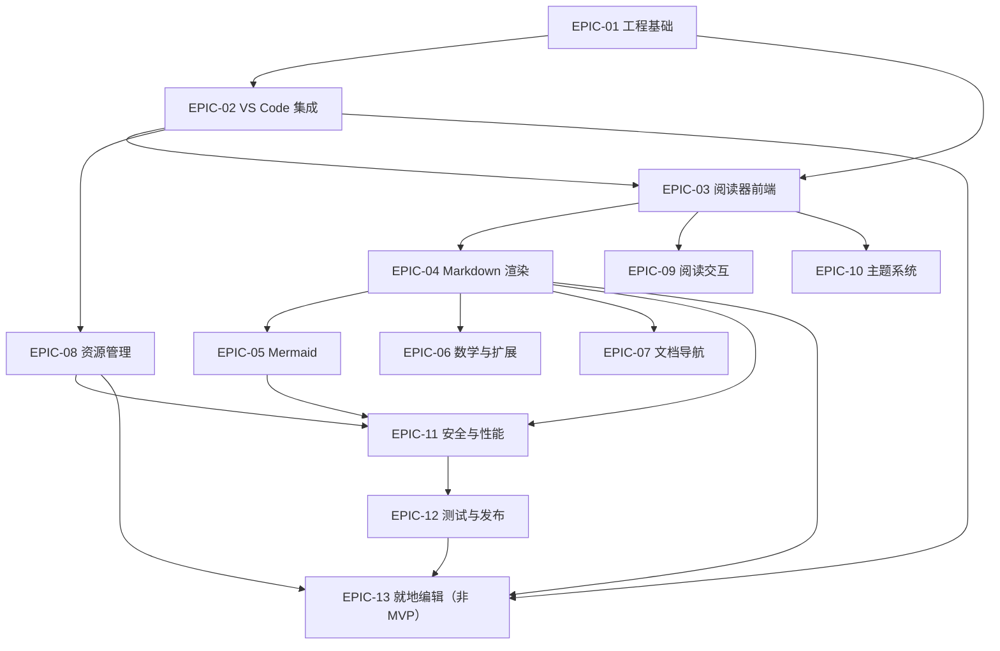
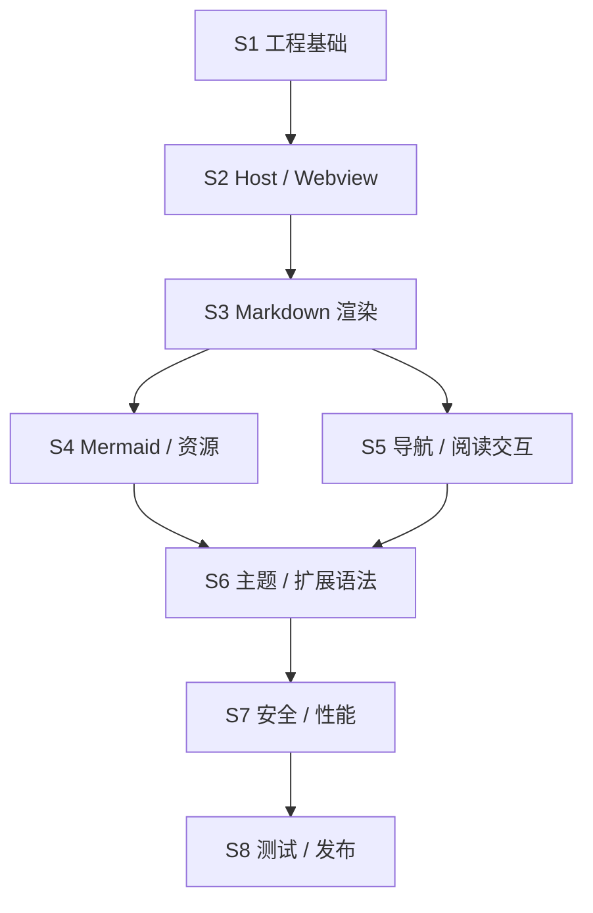

# IMP-002：Readora 开发任务分解规范

| 文档属性 | 内容 |
|---|---|
| 文档编号 | IMP-002 |
| 文档名称 | Readora 开发任务分解规范 |
| 文档版本 | 1.1.0 |
| 文档状态 | Final |
| 所属阶段 | Implementation Planning |
| 上游文档 | PRD-001～003、ARC-001～009、IMP-001 |
| 下游文档 | IMP-003 |
| 产品形态 | VS Code Extension |

---

## 1. 文档目的

本文档定义 Readora 的开发任务分解方式，将已经确认的产品需求与技术架构转换为可执行的开发工作。

主要目标：

1. 明确开发范围和 MVP 边界。
2. 建立 Epic、Story、Task 三级任务体系。
3. 明确各任务的依赖关系。
4. 定义每个 Story 的验收标准。
5. 确定开发顺序和交付要求。
6. 避免重复建设和需求范围持续膨胀。

本文档不新增产品功能，不重新定义架构，也不替代 PRD 和 ARC。

## 2. 任务分解规则

### 2.1 任务层级

| 层级 | 定义 | 示例 |
|---|---|---|
| Epic | 一个完整的业务或技术能力域 | Markdown 渲染 |
| Story | 用户可感知的功能或可独立交付的技术能力 | 支持代码块阅读 |
| Task | 可分配、可开发、可验收的具体工作 | 实现代码块 Renderer |

### 2.2 编号规范

统一使用：

```text
EPIC-XX
STORY-XX-YY
TASK-XX-YY-ZZ
```

示例：

```text
EPIC-01       Markdown 内容渲染
STORY-01-01   基础 Markdown 渲染
TASK-01-01-01 实现 markdown-it 初始化
TASK-01-01-02 实现标题 Renderer
TASK-01-01-03 实现段落 Renderer
```

编号规则：

- Epic 编号全局唯一。
- Story 编号必须归属于一个 Epic。
- Task 编号必须归属于一个 Story。
- 已分配编号不得重复使用。
- 删除任务后保留编号记录，不重新分配。
- 后续新增任务只能追加编号，不得改变既有任务身份。

### 2.3 优先级

| 优先级 | 含义 | 处理要求 |
|---|---|---|
| P0 | MVP 必须交付 | 不得延期 |
| P1 | 首个正式版本的重要能力 | MVP 后完成 |
| P2 | 增强能力 | 根据实际价值排期 |

### 2.4 完成状态

| 状态 | 说明 |
|---|---|
| Todo | 尚未开始 |
| In Progress | 开发中 |
| Blocked | 存在阻塞 |
| Review | 等待评审 |
| Done | 已通过验收 |

---

## 3. MVP 范围

### 3.1 MVP 目标

交付一个可以在 VS Code 中稳定使用的 Markdown 阅读扩展。

用户可以：

1. 从 VS Code 打开 Markdown 文档。
2. 在独立阅读界面中查看 Markdown。
3. 阅读标题、段落、列表、表格和代码块。
4. 查看 Mermaid 图表。
5. 查看数学公式。
6. 使用 Outline 导航。
7. 阅读本地图片。
8. 切换 Light / Dark 主题。
9. 在源文档变化后刷新阅读内容。
10. 在 Windows、macOS、Linux 上安装和使用扩展。

### 3.2 MVP 功能范围

| 功能域 | MVP 范围 | 优先级 |
|---|---|---|
| F01 Markdown 内容渲染 | 标题、段落、列表、引用、表格、链接、代码块 | P0 |
| F02 文档导航 | Outline、标题定位、活动标题同步 | P0 |
| F03 知识链接 | 基础 Wiki Link 识别与跳转 | P1 |
| F04 图形渲染引擎 | Mermaid 基础图表、错误处理、主题适配 | P0 |
| F05 阅读交互 | 滚动、代码复制、图片放大、图表缩放 | P0 |
| F06 资源管理 | 本地图片和附件解析 | P0 |
| F07 阅读布局 | 三栏基础布局、专注阅读 | P0 |
| F08 主题系统 | Light / Dark / VS Code 主题适配 | P0 |
| F09 Markdown 扩展语法 | 数学公式、Frontmatter、Wiki Link | P1 |
| F10 VS Code 集成 | 打开文档、Session、配置、文件变化监听 | P0 |
| F11 性能与安全 | Sanitizer、CSP、基础缓存、性能测试 | P0 |

### 3.3 暂不进入 MVP 的功能

以下内容明确不纳入首个可交付版本：

- 完整知识图谱。
- 多文档知识关联分析。
- 双向链接关系管理。
- 云端同步。
- 用户账户体系。
- 独立插件市场。
- 自定义脚本执行。
- 自定义 Markdown 扩展运行时。
- 复杂 AST 增量渲染。
- 自定义 Mermaid 布局引擎。
- 独立 Markdown 编辑器。
- AI 内容分析和生成。

这些内容不属于当前阅读器的核心交付目标。

> **1.1.0 澄清**：“独立 Markdown 编辑器”这条排除项继续有效，但它不等于“不做任何
> 编辑能力”。**EPIC-13 就地编辑（F12 / ARC-009）** 不在本排除项范围内：它不自建文档
> 模型与编辑生命周期（写回归宿主 `TextDocument`）、不提供块重排与拖拽、不回写全文。
> 边界对照表见 PRD-001 §2.2。
>
> 同时注意本节的「复杂 AST 增量渲染」也与 EPIC-13 无关：编辑态采用单区块隔离编辑 +
> 提交后全量重渲染，不引入局部重渲染（ARC-009 §3.1、ARC-002 §13.1）。

---

## 4. Epic 总览

本项目定义 13 个 Epic，覆盖工程基础、运行时集成、渲染、导航、交互、主题、安全和发布，以及 1.1.0 追加的就地编辑。

> EPIC-13 为 1.1.0 新增（F12 就地编辑），**不属于 MVP**，排在发布后的版本演进
> （IMP-003 §8 V1.4.x）。前 12 个 Epic 的划分与优先级未变。

| Epic | 名称 | 对应功能域 | 优先级 |
|---|---|---|---|
| EPIC-01 | 工程基础建设 | 技术基础 | P0 |
| EPIC-02 | VS Code 扩展集成 | F10 | P0 |
| EPIC-03 | 阅读器前端框架 | F07 | P0 |
| EPIC-04 | Markdown 渲染 | F01 | P0 |
| EPIC-05 | Mermaid 图形渲染 | F04 | P0 |
| EPIC-06 | 数学公式与扩展语法 | F09 | P1 |
| EPIC-07 | 文档导航 | F02 | P0 |
| EPIC-08 | 资源管理 | F06 | P0 |
| EPIC-09 | 阅读交互 | F05 | P0 |
| EPIC-10 | 主题系统 | F08 | P0 |
| EPIC-11 | 安全与性能 | F11 | P0 |
| EPIC-12 | 测试与发布 | 质量交付 | P0 |
| EPIC-13 | 就地编辑 | F12 | P1（非 MVP）|

> EPIC-13 的 Story / Task 明细见 **§22**（因编号兼容原因追加在末尾，不按 Epic 顺序插入，原因同节说明）。

### 4.1 Epic 依赖关系



---

## 5. EPIC-01：工程基础建设

**目标：** 建立统一、可构建、可测试的 TypeScript 工程。

**优先级：** P0

**关联文档：** ARC-001、ARC-005、IMP-001。

### STORY-01-01：初始化 Monorepo 工程

| Task | 名称 | 交付物 |
|---|---|---|
| TASK-01-01-01 | 初始化 Git 仓库 | Git 基础结构 |
| TASK-01-01-02 | 配置 pnpm Workspace | Workspace 配置 |
| TASK-01-01-03 | 配置 TypeScript | 基础 TS 配置 |
| TASK-01-01-04 | 配置 ESLint | Lint 配置 |
| TASK-01-01-05 | 配置统一脚本 | 根 package.json |

**验收标准：**

- 所有工程可以通过 pnpm 安装依赖。
- TypeScript 严格模式启用。
- Lint 可以在根目录执行。
- 所有依赖有锁定版本。
- 新成员按照 README 可以完成本地初始化。

### STORY-01-02：建立 Shared Contracts

| Task | 名称 | 交付物 |
|---|---|---|
| TASK-01-02-01 | 建立 contracts 包 | packages/contracts |
| TASK-01-02-02 | 定义消息 Envelope | MessageEnvelope |
| TASK-01-02-03 | 定义 Response 模型 | MessageResponse |
| TASK-01-02-04 | 定义公共 DTO | Shared DTO |
| TASK-01-02-05 | 建立消息 Schema | Zod Schemas |

**验收标准：**

- Host 和 Webview 可以引用同一套协议定义。
- 不存在反向依赖。
- 消息类型具有明确版本。
- 非法消息可以被拒绝。
- Shared 包可以独立执行测试。

### STORY-01-03：建立构建体系

| Task | 名称 | 交付物 |
|---|---|---|
| TASK-01-03-01 | 配置 Host 构建 | esbuild 配置 |
| TASK-01-03-02 | 配置 Webview 构建 | Vite 配置 |
| TASK-01-03-03 | 配置资源输出目录 | Build Output |
| TASK-01-03-04 | 配置构建检查 | Build Validation |
| TASK-01-03-05 | 配置 VSIX 打包 | Package Script |

**验收标准：**

- Host 与 Webview 可以独立构建。
- Webview 不包含 Node.js 依赖。
- 构建产物可以被 VS Code 正确加载。
- 可以成功生成 VSIX。

---

## 6. EPIC-02：VS Code 扩展集成

**目标：** 建立 VS Code Extension Host 运行环境和文档会话管理能力。

**优先级：** P0

**关联文档：** ARC-004、ARC-008。

### STORY-02-01：扩展生命周期管理

| Task | 名称 |
|---|---|
| TASK-02-01-01 | 实现 Extension Entry |
| TASK-02-01-02 | 实现 activate 生命周期 |
| TASK-02-01-03 | 实现 deactivate 生命周期 |
| TASK-02-01-04 | 统一 Disposable 管理 |

**验收标准：**

- 扩展可以正常激活。
- 扩展卸载时释放资源。
- 不存在未管理的事件监听。
- 重复激活和关闭不会产生资源泄漏。

### STORY-02-02：Markdown 文档打开

| Task | 名称 |
|---|---|
| TASK-02-02-01 | 注册打开阅读器命令 |
| TASK-02-02-02 | 注册编辑器标题栏入口 |
| TASK-02-02-03 | 实现文档 URI 解析 |
| TASK-02-02-04 | 实现文档内容读取 |
| TASK-02-02-05 | 实现 WebviewPanel 创建 |

**验收标准：**

- 可以从命令面板打开 Markdown。
- 可以从编辑器入口打开 Markdown。
- 可以正确读取本地文档。
- 不支持的文档类型能够给出明确提示。

### STORY-02-03：Reader Session 管理

| Task | 名称 |
|---|---|
| TASK-02-03-01 | 定义 Reader Session 模型 |
| TASK-02-03-02 | 实现 Session 创建 |
| TASK-02-03-03 | 实现 Session 查找与复用 |
| TASK-02-03-04 | 实现 Session 销毁 |
| TASK-02-03-05 | 实现基础阅读位置保存 |

**验收标准：**

- 同一文档默认复用对应 Session。
- 不同文档可以独立打开。
- Session 关闭后释放资源。
- 文档滚动位置可以在支持的恢复场景下保留。

### STORY-02-04：文档变更同步

| Task | 名称 |
|---|---|
| TASK-02-04-01 | 监听 TextDocument 变化 |
| TASK-02-04-02 | 监听文件系统变化 |
| TASK-02-04-03 | 实现更新防抖 |
| TASK-02-04-04 | 实现文档版本检查 |
| TASK-02-04-05 | 实现 Webview 内容更新 |

**验收标准：**

- 未保存编辑能够更新阅读内容。
- 外部文件变化能够被检测。
- 连续修改不会产生大量无意义渲染。
- 旧版本结果不会覆盖新版本结果。

---

## 7. EPIC-03：阅读器前端框架

**目标：** 建立 React 阅读器应用及其基础布局。

**优先级：** P0

**关联文档：** PRD-002、PRD-003、ARC-005。

### STORY-03-01：React 应用初始化

| Task | 名称 |
|---|---|
| TASK-03-01-01 | 初始化 Webview React 应用 |
| TASK-03-01-02 | 实现 App 入口 |
| TASK-03-01-03 | 建立应用 Provider |
| TASK-03-01-04 | 建立错误边界 |
| TASK-03-01-05 | 实现 Host Bridge 初始化 |

**验收标准：**

- React 可以在 Webview 中正常启动。
- Host Bridge 可以建立通信。
- React 运行异常不会直接导致整个 Webview 白屏。
- 不存在对 Node.js API 的直接依赖。

### STORY-03-02：阅读器 Shell

| Task | 名称 |
|---|---|
| TASK-03-02-01 | 实现 Reader Shell |
| TASK-03-02-02 | 实现左侧导航区域 |
| TASK-03-02-03 | 实现中央阅读区域 |
| TASK-03-02-04 | 实现右侧辅助面板 |
| TASK-03-02-05 | 实现面板显示与隐藏 |

**验收标准：**

- 具备左、中、右三栏布局。
- 中央阅读画布为主要视觉区域。
- 面板可以独立显示和隐藏。
- 窄窗口下布局不会发生不可用的溢出。

### STORY-03-03：基础阅读组件

| Task | 名称 |
|---|---|
| TASK-03-03-01 | 实现 Document Header |
| TASK-03-03-02 | 实现 Reading Canvas |
| TASK-03-03-03 | 实现 Toolbar |
| TASK-03-03-04 | 实现 Empty State |
| TASK-03-03-05 | 实现 Error State |

**验收标准：**

- 文档标题和基础元数据可以展示。
- 阅读区域具备合理的最大宽度。
- 空文档和加载失败状态清晰可见。
- UI 组件遵循 PRD-003 设计 Token。

---

## 8. EPIC-04：Markdown 内容渲染

**目标：** 实现 Markdown 核心语法的解析和展示。

**优先级：** P0

**关联文档：** PRD-001、ARC-002。

### STORY-04-01：Markdown Parser

| Task | 名称 |
|---|---|
| TASK-04-01-01 | 初始化 markdown-it |
| TASK-04-01-02 | 实现 Source Normalizer |
| TASK-04-01-03 | 实现 Token Processing |
| TASK-04-01-04 | 实现解析错误处理 |
| TASK-04-01-05 | 实现 RenderResult 输出 |

**验收标准：**

- 标准 Markdown 能够正确解析。
- 解析结果具备统一的数据结构。
- 非法内容不会导致应用崩溃。
- Outline 和 Metadata 可以从解析结果中生成。

### STORY-04-02：基础 Markdown Renderer

| Task | 名称 |
|---|---|
| TASK-04-02-01 | 实现 Heading Renderer |
| TASK-04-02-02 | 实现 Paragraph Renderer |
| TASK-04-02-03 | 实现 List Renderer |
| TASK-04-02-04 | 实现 Blockquote Renderer |
| TASK-04-02-05 | 实现 Table Renderer |
| TASK-04-02-06 | 实现 Link Renderer |
| TASK-04-02-07 | 实现 Horizontal Rule Renderer |

**验收标准：**

- 常用 Markdown 语法展示正确。
- 标题层级和列表嵌套正确。
- 表格不会破坏阅读画布宽度。
- 外部链接按照安全策略处理。

### STORY-04-03：代码块阅读

| Task | 名称 |
|---|---|
| TASK-04-03-01 | 实现 Code Block Renderer |
| TASK-04-03-02 | 实现代码语言标识 |
| TASK-04-03-03 | 实现代码复制 |
| TASK-04-03-04 | 实现长代码横向滚动 |
| TASK-04-03-05 | 实现代码主题样式 |

**验收标准：**

- 代码块与正文视觉区分明显。
- 语言标识正确展示。
- 复制功能可用。
- 长代码不会撑破阅读区域。

### STORY-04-04：HTML 安全处理

| Task | 名称 |
|---|---|
| TASK-04-04-01 | 定义 HTML Sanitizer 配置 |
| TASK-04-04-02 | 集成 DOMPurify |
| TASK-04-04-03 | 实现 URL Scheme 检查 |
| TASK-04-04-04 | 实现危险属性过滤 |
| TASK-04-04-05 | 编写 XSS 测试 |

**验收标准：**

- 默认不执行 Markdown 中的任意 HTML。
- 危险脚本和事件属性被过滤。
- 安全链接可以正常使用。
- XSS 测试用例全部通过。

---

## 9. EPIC-05：Mermaid 图形渲染

**目标：** 实现 Markdown 中 Mermaid 图表的解析、展示和交互。

**优先级：** P0

**关联文档：** ARC-003、IMP-001。

### STORY-05-01：Diagram Core

| Task | 名称 |
|---|---|
| TASK-05-01-01 | 建立 DiagramEngine 接口 |
| TASK-05-01-02 | 建立 DiagramRenderer 注册机制 |
| TASK-05-01-03 | 建立 Diagram 生命周期模型 |
| TASK-05-01-04 | 建立 Diagram 错误模型 |

**验收标准：**

- 图表引擎与业务组件隔离。
- 图表生命周期可追踪。
- 图表错误不会中断整篇文档。

### STORY-05-02：Pele Adapter

| Task | 名称 |
|---|---|
| TASK-05-02-01 | 验证 Pele 与目标 Webview 环境兼容性 |
| TASK-05-02-02 | 锁定 Pele 依赖版本 |
| TASK-05-02-03 | 实现 PeleAdapter |
| TASK-05-02-04 | 实现图表挂载与更新 |
| TASK-05-02-05 | 实现图表销毁 |

**验收标准：**

- Pele 只能通过 Adapter 使用。
- 图表能够正常挂载和更新。
- React 卸载时释放图表资源。
- 兼容性清单记录实际通过的图表类型。

### STORY-05-03：图表交互

| Task | 名称 |
|---|---|
| TASK-05-03-01 | 实现图表容器 |
| TASK-05-03-02 | 实现 Zoom |
| TASK-05-03-03 | 实现 Pan |
| TASK-05-03-04 | 实现 Fit |
| TASK-05-03-05 | 实现 Reset |
| TASK-05-03-06 | 实现 Fullscreen |
| TASK-05-03-07 | 实现 Copy Source |

**验收标准：**

- 图表可以放大、缩小和拖动。
- 图表可以恢复默认比例。
- 全屏模式可以正常退出。
- 原始 Mermaid 源码可以复制。

---

## 10. EPIC-06：数学公式与扩展语法

**目标：** 提供常用 Markdown 扩展能力。

**优先级：** P1

**关联文档：** PRD-001、ARC-002、IMP-001。

### STORY-06-01：数学公式

| Task | 名称 |
|---|---|
| TASK-06-01-01 | 集成 KaTeX |
| TASK-06-01-02 | 实现行内公式 |
| TASK-06-01-03 | 实现块级公式 |
| TASK-06-01-04 | 实现公式错误处理 |
| TASK-06-01-05 | 实现数学字体资源打包 |

**验收标准：**

- 行内公式正常展示。
- 块级公式正常展示。
- 非法公式不会中断文档渲染。
- 数学公式资源不依赖外部 CDN。

### STORY-06-02：Frontmatter

| Task | 名称 |
|---|---|
| TASK-06-02-01 | 识别 Frontmatter |
| TASK-06-02-02 | 解析基础 YAML |
| TASK-06-02-03 | 构建 Document Metadata |
| TASK-06-02-04 | 实现 Properties 展示 |

**验收标准：**

- 文档顶部 Frontmatter 可以识别。
- 元数据可以被统一读取。
- 非法 Frontmatter 不影响正文阅读。
- 不执行 Frontmatter 中的任何脚本或表达式。

### STORY-06-03：Wiki Link

| Task | 名称 |
|---|---|
| TASK-06-03-01 | 识别 Wiki Link 语法 |
| TASK-06-03-02 | 解析目标文档 |
| TASK-06-03-03 | 实现基础文档跳转 |
| TASK-06-03-04 | 实现目标不存在状态 |

**验收标准：**

- `[[document]]` 可以识别。
- 文档目标可以解析。
- 无法解析的目标有明确状态。
- 不存在的目标不会导致阅读器异常。

---

## 11. EPIC-07：文档导航

**目标：** 建立 Outline 和阅读位置同步能力。

**优先级：** P0

**关联文档：** PRD-002、ARC-007。

### STORY-07-01：Outline 生成

| Task | 名称 |
|---|---|
| TASK-07-01-01 | 从 RenderResult 获取标题 |
| TASK-07-01-02 | 生成 Outline Tree |
| TASK-07-01-03 | 生成标题 Anchor |
| TASK-07-01-04 | 实现 Outline 展示 |

**验收标准：**

- Outline 与文档标题层级一致。
- 标题 Anchor 唯一。
- 不重复解析 Markdown。
- 标题更新后 Outline 同步更新。

### STORY-07-02：标题导航

| Task | 名称 |
|---|---|
| TASK-07-02-01 | 实现 Outline 点击跳转 |
| TASK-07-02-02 | 实现活动标题检测 |
| TASK-07-02-03 | 实现标题高亮 |
| TASK-07-02-04 | 实现 Outline 折叠 |

**验收标准：**

- 点击 Outline 可以定位标题。
- 阅读位置变化后活动标题同步。
- 大纲折叠状态正确。
- 不出现持续跳动或错误高亮。

### STORY-07-03：文档内搜索

| Task | 名称 |
|---|---|
| TASK-07-03-01 | 实现搜索输入 |
| TASK-07-03-02 | 实现当前文档内容匹配 |
| TASK-07-03-03 | 实现匹配结果计数 |
| TASK-07-03-04 | 实现结果定位 |

**验收标准：**

- 仅搜索当前文档。
- 搜索结果可以定位。
- 空结果有明确提示。
- 输入过程使用防抖机制。

---

## 12. EPIC-08：资源管理

**目标：** 支持本地图片和附件安全加载。

**优先级：** P0

**关联文档：** ARC-008。

### STORY-08-01：资源路径解析

| Task | 名称 |
|---|---|
| TASK-08-01-01 | 实现相对路径解析 |
| TASK-08-01-02 | 实现工作区资源定位 |
| TASK-08-01-03 | 实现资源 URI 转换 |
| TASK-08-01-04 | 实现资源不存在处理 |

**验收标准：**

- 相对路径按照文档位置解析。
- 本地资源通过 Host 读取和授权。
- Webview 使用合法资源 URI。
- 资源路径不会越过允许访问的范围。

### STORY-08-02：图片阅读

| Task | 名称 |
|---|---|
| TASK-08-02-01 | 实现图片 Renderer |
| TASK-08-02-02 | 实现图片懒加载 |
| TASK-08-02-03 | 实现图片 Lightbox |
| TASK-08-02-04 | 实现图片加载失败状态 |

**验收标准：**

- 支持的图片格式可以正常展示。
- 图片不会撑破阅读画布。
- 点击图片可以放大。
- 图片加载失败时展示占位状态。

### STORY-08-03：资源安全

| Task | 名称 |
|---|---|
| TASK-08-03-01 | 实现资源访问策略 |
| TASK-08-03-02 | 实现路径边界验证 |
| TASK-08-03-03 | 实现 SVG Sanitizer |
| TASK-08-03-04 | 实现外部资源限制 |

**验收标准：**

- 禁止任意本地路径访问。
- SVG 不允许携带可执行脚本。
- 外部资源遵循明确访问策略。
- 资源访问异常有安全日志。

---

## 13. EPIC-09：阅读交互

**目标：** 提供阅读过程中的基础操作能力。

**优先级：** P0

**关联文档：** PRD-002。

### STORY-09-01：阅读布局交互

| Task | 名称 |
|---|---|
| TASK-09-01-01 | 实现侧栏显隐 |
| TASK-09-01-02 | 实现专注阅读模式 |
| TASK-09-01-03 | 实现阅读宽度控制 |
| TASK-09-01-04 | 实现基础快捷键 |

**验收标准：**

- 左右面板可以显示和隐藏。
- 专注模式突出正文阅读。
- 阅读宽度可以正确调整。
- 快捷键不与 VS Code 常用快捷键产生明显冲突。

### STORY-09-02：阅读状态恢复

| Task | 名称 |
|---|---|
| TASK-09-02-01 | 实现滚动位置记录 |
| TASK-09-02-02 | 实现活动标题记录 |
| TASK-09-02-03 | 实现 Session 状态恢复 |

**验收标准：**

- 文档重新显示时可以恢复合理的阅读位置。
- 状态与文档 Session 关联。
- 文档关闭后释放不需要的临时状态。

### STORY-09-03：辅助面板

| Task | 名称 |
|---|---|
| TASK-09-03-01 | 实现 Outline 面板 |
| TASK-09-03-02 | 实现 Properties 面板 |
| TASK-09-03-03 | 实现 Backlinks 占位状态 |
| TASK-09-03-04 | 实现面板切换 |

**验收标准：**

- 面板布局符合 PRD-002。
- P1 功能可以展示明确的不可用或空状态。
- 不得将未实现的 Backlinks 功能伪装成已完成能力。

---

## 14. EPIC-10：主题系统

**目标：** 建立统一设计 Token 和主题切换能力。

**优先级：** P0

**关联文档：** PRD-003、ARC-006。

### STORY-10-01：Design Tokens

| Task | 名称 |
|---|---|
| TASK-10-01-01 | 定义 Primitive Tokens |
| TASK-10-01-02 | 定义 Semantic Tokens |
| TASK-10-01-03 | 定义 Component Tokens |
| TASK-10-01-04 | 建立 CSS Variables 输出 |

**验收标准：**

- Token 分层符合 PRD-003。
- 组件使用语义 Token。
- 不存在大量重复硬编码颜色。
- Token 可以被 React 和 Mermaid 样式共同消费。

### STORY-10-02：主题切换

| Task | 名称 |
|---|---|
| TASK-10-02-01 | 实现 Light Theme |
| TASK-10-02-02 | 实现 Dark Theme |
| TASK-10-02-03 | 实现 VS Code 主题适配 |
| TASK-10-02-04 | 实现主题切换通知 |
| TASK-10-02-05 | 实现 Mermaid 主题联动 |

**验收标准：**

- Light / Dark 模式可以切换。
- VS Code 主题变化可以被识别。
- Markdown 内容样式同步变化。
- Mermaid 图表主题同步变化。

### STORY-10-03：视觉验收

| Task | 名称 |
|---|---|
| TASK-10-03-01 | 检查颜色对比度 |
| TASK-10-03-02 | 检查字体层级 |
| TASK-10-03-03 | 检查阅读宽度 |
| TASK-10-03-04 | 检查响应式布局 |

**验收标准：**

- 满足既定可访问性目标。
- 标题、正文、代码和引用具有明确层级。
- 不同窗口宽度下布局可用。
- 视觉规范与 PRD-003 一致。

---

## 15. EPIC-11：安全与性能

**目标：** 建立 MVP 必需的安全边界和性能基线。

**优先级：** P0

**关联文档：** ARC-008、IMP-001。

### STORY-11-01：Webview 安全

| Task | 名称 |
|---|---|
| TASK-11-01-01 | 实现 CSP |
| TASK-11-01-02 | 实现 nonce |
| TASK-11-01-03 | 限制 localResourceRoots |
| TASK-11-01-04 | 验证消息 Payload |
| TASK-11-01-05 | 验证外部链接 |

**验收标准：**

- CSP 配置有效。
- 不依赖 `unsafe-eval`。
- Webview 不能直接访问任意文件。
- 非法消息不能触发敏感操作。

### STORY-11-02：性能优化

| Task | 名称 |
|---|---|
| TASK-11-02-01 | 实现文档级缓存 |
| TASK-11-02-02 | 实现 Mermaid 延迟渲染 |
| TASK-11-02-03 | 实现图片懒加载 |
| TASK-11-02-04 | 实现搜索防抖 |
| TASK-11-02-05 | 建立性能测试样例 |

**验收标准：**

- 性能指标有可重复测试方法。
- 长文档不会造成明显的 UI 阻塞。
- 图表按需渲染。
- 缓存更新与文档版本保持一致。

### STORY-11-03：资源生命周期

| Task | 名称 |
|---|---|
| TASK-11-03-01 | 统一 Session Disposable |
| TASK-11-03-02 | 实现图表销毁 |
| TASK-11-03-03 | 实现监听器清理 |
| TASK-11-03-04 | 检查重复资源引用 |

**验收标准：**

- Session 关闭后释放资源。
- 图表销毁后无持续事件监听。
- Webview 重建不会累积旧状态。
- 长时间阅读不会持续增加无界资源占用。

---

## 16. EPIC-12：测试与发布

**目标：** 确保产品可测试、可安装、可发布。

**优先级：** P0

**关联文档：** IMP-001。

### STORY-12-01：自动化测试

| Task | 名称 |
|---|---|
| TASK-12-01-01 | 配置 Vitest |
| TASK-12-01-02 | 建立 Markdown Fixture |
| TASK-12-01-03 | 建立 Renderer 测试 |
| TASK-12-01-04 | 建立 Host Integration Test |
| TASK-12-01-05 | 配置 Playwright |

**验收标准：**

- 核心模块具有自动化测试。
- 关键交互可以通过 E2E 验证。
- 测试可以在 CI 中运行。
- 测试结果可追溯。

### STORY-12-02：跨平台验证

| Task | 名称 |
|---|---|
| TASK-12-02-01 | Windows 安装验证 |
| TASK-12-02-02 | macOS 安装验证 |
| TASK-12-02-03 | Linux 安装验证 |
| TASK-12-02-04 | 不同 VS Code 版本验证 |

**验收标准：**

- 支持平台能够安装扩展。
- 核心功能运行正常。
- Webview 资源加载正常。
- 平台差异问题有记录。

### STORY-12-03：发布准备

| Task | 名称 |
|---|---|
| TASK-12-03-01 | 配置扩展 Manifest |
| TASK-12-03-02 | 配置扩展图标与描述 |
| TASK-12-03-03 | 生成 VSIX |
| TASK-12-03-04 | 验证 VSIX 文件内容 |
| TASK-12-03-05 | 编写发布说明 |

**验收标准：**

- VSIX 可以安装。
- 扩展激活事件符合设计。
- 生产包不包含无用开发依赖。
- README 和版本说明完整。

---

## 17. 开发执行顺序

### 17.1 阶段划分

| 阶段 | 开发内容 | 主要 Epic | 交付结果 |
|---|---|---|---|
| S1 | 工程基础 | EPIC-01 | 工程可构建 |
| S2 | Host 与 Webview 集成 | EPIC-02、EPIC-03 | 阅读器可以启动 |
| S3 | Markdown 基础渲染 | EPIC-04 | 可以阅读 Markdown |
| S4 | 图表与资源 | EPIC-05、EPIC-08 | 支持 Mermaid 和图片 |
| S5 | 导航与交互 | EPIC-07、EPIC-09 | 阅读体验完整 |
| S6 | 主题与扩展语法 | EPIC-06、EPIC-10 | 主题与增强能力 |
| S7 | 安全和性能 | EPIC-11 | 满足质量基线 |
| S8 | 测试和发布 | EPIC-12 | MVP 可交付 |
| S9 | 就地编辑（非 MVP） | EPIC-13 | V1.4.x 可交付 |

### 17.2 关键开发路径



### 17.3 并行开发规则

可以并行：

- Shared Contracts 与 Host 工程。
- React Shell 与 Markdown Parser。
- Design Tokens 与基础 Renderer。
- Mermaid Adapter 与资源解析。
- 测试 Fixture 与功能开发。

不建议并行：

- 消息协议未确定前开发复杂通信逻辑。
- Renderer 接口未确定前开发所有渲染器。
- 资源访问策略未确定前开发图片和 SVG。
- Pele 兼容性未验证前批量开发图表交互。

---

## 18. Definition of Done

一个 Story 只有同时满足以下条件才可以标记为 Done：

1. 实现符合对应需求和架构约束。
2. 代码通过 TypeScript 检查。
3. 代码通过 Lint。
4. 相关自动化测试通过。
5. 错误状态和异常路径已处理。
6. 安全要求已验证。
7. 必要文档已更新。
8. 代码评审通过。
9. 不存在未解决的 P0 缺陷。
10. 验收人员确认交付结果。

Epic 完成条件：

- 所有 P0 Story 已完成。
- Epic 验收标准全部通过。
- 不存在影响其他 Epic 的阻塞问题。
- 对应功能已集成到主分支。

---

## 19. 需求变更控制

### 19.1 变更原则

开发过程中新增需求必须先判断：

- 是否属于现有功能域？
- 是否属于 MVP？
- 是否存在现有功能可以复用？
- 是否会影响既有架构？
- 是否引入额外依赖？
- 是否影响当前里程碑？

### 19.2 变更处理

| 变更类型 | 处理方式 |
|---|---|
| Bug 修复 | 直接进入缺陷任务 |
| 既有需求细化 | 更新现有 Story |
| MVP 必要缺失 | 评审后追加 Task |
| P1 增强需求 | 进入后续版本 |
| 新功能域 | 必须进行范围评审 |
| 架构变更 | 先更新对应 ARC / ADR |

### 19.3 禁止事项

- 不因实现便利随意增加一级功能域。
- 不重复创建已有 Story。
- 不为尚未验证的需求提前建设基础设施。
- 不将 P1 能力擅自升级为 P0。
- 不因某个第三方库能力丰富就扩大产品范围。

### 19.4 变更记录：F12 就地编辑（1.1.0）

本节按 §19.1 / §19.2 的要求逐条回答，目的是让这个变更可被审计而不是“仍在了”：

| §19.1 判断项 | 结论 |
|---|---|
| 是否属于现有功能域？ | 否。需新增 F12（第 12 个功能域） |
| 是否属于 MVP？ | **否**。MVP（V1.0.0）已完成的历史结论不回溯修改 |
| 是否存在现有功能可复用？ | 部分。CodeMirror（但 `editable:false`）、自动刷新链、接管层形态均可复用；源位置锚定链不存在，必须新建 |
| 是否会影响既有架构？ | 会。涉及 ARC-002 / 004 / 008 / IMP-001，均已同步修订 |
| 是否引入额外依赖？ | **否**（这是选型结论）。编辑模型归宿主 `TextDocument`，不引入 ProseMirror / Monaco |
| 是否影响当前里程碑？ | 否。挂在 IMP-003 §8 V1.4.x，不阻塞任何已交付版本 |

按 §19.2，本变更同时命中两行：**新功能域**（必须范围评审）与**架构变更**（先更新 ARC / ADR）。
执行顺序：PRD-001 §2.2 澄清 + §5.12 立项 → ARC-009 定架构与 ADR → 修订受影响的既有条款 →
本篇追加 EPIC-13。**代码未动。**

对照 §19.3 的五条禁止事项：功能域不是为实现便利加的（先有立项再有拆解）；未重复 Story
（EPIC-01～12 无编辑类 Story）；**基础设施一项需注意**——E0（源位置锚定）在没有编辑器 UI 的情况下
先行交付，它的正当性不来自“以后要建编辑器”，而来自 F12-004 源码保真写回对锚定的硬性依赖，
且它自身带完整门禁（ARC-002 §12.3）可独立验收；未将 P1 升 P0（F12-001/002/003 仍为 P1）；
未因 CodeMirror 可用就扩大范围（正因为它的存在，反而确认了不需要引入新编辑器库）。

---

## 20. 本阶段交付清单

| 交付项 | 状态 |
|---|---|
| 13 个 Epic 定义 | 已定义（EPIC-13 为 1.1.0 追加，见 §22） |
| Story 分解 | 已定义 |
| Task 分解 | 已定义 |
| MVP 范围 | 已明确 |
| 优先级 | 已明确 |
| Epic 依赖关系 | 已定义 |
| 开发阶段划分 | 已定义 |
| 验收标准 | 已定义 |
| Definition of Done | 已定义 |
| 需求变更控制 | 已定义 |

**任务总量说明：** 本文档建立的是开发任务基线。具体工时、人员、Story Points 和迭代分配应在 IMP-003 中确定，不在本篇中虚构。

---

## 21. 后续文档

本项目实施规范仅保留三个文档：

| 编号 | 文档名称 | 状态 |
|---|---|---|
| IMP-001 | 技术实现规范 | 已完成 |
| IMP-002 | 开发任务分解规范 | 已完成 |
| IMP-003 | 版本实施与交付计划 | 已完成 |

> **1.1.0 更正**：本表原写 `IMP-003 待编写`，与事实不符（IMP-003 早已交付，本篇 §17 的
> S1–S8 阶段划分即以它为准）。AUD-001 §3 登记过这处陈旧，本次回填。
>
> 下文「不再新增其他实施规划文档」的口径以 **IMP-003 §10.5（1.1.0 修订）** 为准：
> 它冻结的是「默认不扩张」，需求变更流程走完后的立项（如本篇 §22 的 EPIC-13）不在禁止之列。

IMP-003 将完成：

- MVP 版本边界最终确认。
- 开发里程碑。
- 迭代顺序。
- 交付物清单。
- 版本验收标准。
- 发布准入条件。

不再新增其他实施规划文档。

---

## 22. EPIC-13：就地编辑（1.1.0 新增，非 MVP）

**目标：** 在不自建文档模型的前提下，让阅读视图具备就地修改源文件的能力，且未编辑的字节逐字节不变。

**优先级：** P1（非 MVP，挂在 IMP-003 §8 V1.4.x）

**关联文档：** PRD-001 §5.12（F12）、ARC-009（架构与阶段权威）、ARC-002 §12.3（源位置契约）、ARC-004 §8.3/§9.4（`document.edit` 与写回）、ARC-008 §9.3.1/§14.5（安全边界）。

> **为什么追加在 §22 而不是按 Epic 顺序插在 §16 之后**：EPIC-01～12 的 Story/Task 编号已被
> 既有代码、测试与审计报告引用。若把本篇插为 §17 并后移原 §17～§21，AUD-001 中对
> `IMP-002 §18`（Definition of Done）与 `IMP-002 §21`（后续文档）的历史引用会全部指错。
> 章节号是对外契约，**不为排版整齐而重排**。§4 的 Epic 总览表已指向本节。

> **本节不重复 ARC-009 的设计结论。** Task 的「做什么」以 ARC-009 §12 的 E0–E6 为准，这里只做
> Epic/Story/Task 层级的拆解与验收口径对齐；两者的阶段映射在下表「对应阶段」列给出，不改写其判据。

### STORY-13-01：源位置锚定

**对应阶段：** ARC-009 E0

| Task | 名称 |
|---|---|
| TASK-13-01-01 | 在 `packages/markdown-core` 落地 `SOURCE_RANGE_ATTRIBUTE` 常量与类型 |
| TASK-13-01-02 | 顶层区块渲染输出 `data-readora-source-range`（0 基闭区间，`position` 缺失即不输出） |
| TASK-13-01-03 | Sanitizer 白名单放行该属性并按值形状 `^\d+:\d+$` 校验 |
| TASK-13-01-04 | 新建 `source-range.spec.ts` 四条门禁（存在性 / 基序 / 缺位 / 逐字节回取） |

**验收标准：**

- 任一顶层区块按属性取出的源文本，与该区块参与渲染的源**逐字节一致**（ARC-009 §15-1）。
- `pnpm visual:check` 10 档基线全等；既有 HTML 结构断言无需改动。
- 本阶段交付后**没有任何用户可见变化**——这是刻意的，锚定契约的正确性必须能在与编辑无关的前提下独立证明。

### STORY-13-02：写回链路

**对应阶段：** ARC-009 E1

| Task | 名称 |
|---|---|
| TASK-13-02-01 | `document.edit` 契约与 Zod strict Schema（payload 四字段，拒绝未知字段） |
| TASK-13-02-02 | 注册表登记 + 方向标为 `view-to-host`（消息总数 17 → 18） |
| TASK-13-02-03 | Host handler：会话校验 → 乐观锁 → 范围合法性 → `WorkspaceEdit.replace` → `applyEdit` |
| TASK-13-02-04 | 三枚错误码：`readora.edit.stale` / `.rangeInvalid` / `.applyFailed` |
| TASK-13-02-05 | 更新 `protocol.spec.ts` 的方向计数与命名（现测试名仍写「17 条」口径） |

**验收标准：**

- integration 走通「View 发 edit → 宿主模型变更 → `onDidChangeTextDocument` 推回 `document.update`」，**不新增刷新机制**（ARC-004 §9.4）。
- `baseVersion` 不匹配的写回被拒且返回 `readora.edit.stale`。
- 无活动文档会话时不写盘；全程不出现隐式 `document.save()`（ARC-008 §14.5）。

### STORY-13-03：段落与行内编辑

**对应阶段：** ARC-009 E2 + E3

| Task | 名称 |
|---|---|
| TASK-13-03-01 | `EditLayer` / `EditUnit` 骨架与单活动单元约束 |
| TASK-13-03-02 | paragraph / heading / blockquote / list 四类编辑单元 |
| TASK-13-03-03 | 顶栏编辑开关 + 双击入口 + 把手渲染 |
| TASK-13-03-04 | 提交 / 取消 / 冲突（`conflict`）三态与用户输入保全 |
| TASK-13-03-05 | 浮动工具条与选区→源偏移映射（加粗/斜体/删除线/行内代码/链接） |
| TASK-13-03-06 | IME 组合期屏蔽提交（ARC-009 §13 R4） |

**验收标准：**

- e2e 覆盖「双击改文字 → 提交 → 静态产物已更新 → **未编辑区块逐字节不变**（逐行 diff，不接受「大致相同」）」。
- 一次 `Ctrl+Z` 回到编辑前；脏态与 `Ctrl+S` 归宿主。
- 不可编辑类型（`htmlBlock`、`footnoteSection` 等）**不显示任何编辑 affordance**。
- 偏移不足时降级插入字面标记，不损坏源文本。

### STORY-13-04：扩展类型与收尾

**对应阶段：** ARC-009 E4 + E5 + E6

| Task | 名称 |
|---|---|
| TASK-13-04-01 | codeBlock 翻 `editable: true`（复用既有 CodeMirror 实例，不新增依赖） |
| TASK-13-04-02 | diagram / math / htmlBlock 展**源码**输入，不做假 WYSIWYG（ARC-009 §6.2） |
| TASK-13-04-03 | 表格单元格编辑与增删行列 |
| TASK-13-04-04 | frontmatter 属性卡片逐键编辑与按 kind 序列化 |
| TASK-13-04-05 | 快捷键登记进 extension manifest |
| TASK-13-04-06 | 编辑期性能报告 + PRD-003 视觉规范补章 + README 能力边界 |

**验收标准：**

- 各源码型区块「编辑后围栏标记与缩进未被破坏」的源保真断言通过。
- 表格写回后管道行形状合法；frontmatter 不产生非法 YAML。
- `pnpm verify` 全绿，`perf` 门槛通过；既有 745+ 单测、e2e、安全 spec、视觉基线零回归。
- `contenteditable` 未引入任何 CSP 放宽；粘贴富文本被拒。

### 22.1 未纳入 EPIC-13 的事项

下列内容在 ARC-009 评审中被明确排除，**不得借 E4/E5 之名夹带**：

- 块拖拽与重排、大纲树内联改名。
- 全文 AST→Markdown 序列化回写（会重写转义风格与块属性，违反源保真不变量）。
- 图表的图形化编辑（只展源码）。
- 协作编辑与冲突合并。
- 独立编辑器能力（自建文档模型、自管撤销栈与保存），见 §3.3 澄清。

---

**文档结束**

**版本：1.1.0**  
**状态：Final**