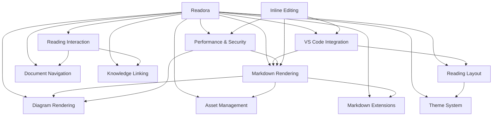

# PRD-001：Readora 产品需求规格

| 属性 | 内容 |
|---|---|
| 文档编号 | PRD-001 |
| 文档名称 | Readora 产品需求规格 |
| 产品名称 | Readora |
| 文档版本 | 1.1.0 |
| 文档状态 | Draft |
| 产品形态 | Visual Studio Code Extension |
| 核心技术栈 | TypeScript、VS Code Extension API、Webview |
| 核心参考 | Obsidian、Obsidian Pele |
| 目标平台 | Windows、macOS、Linux |
| 文档类型 | Product Requirements Document |

---

## 1. 产品概述

### 1.1 产品背景

Visual Studio Code 内置 Markdown Preview，可以满足基本的 Markdown 文档预览需求，但在阅读体验、文档导航、视觉表现、图形渲染和个性化能力方面仍有提升空间。

Obsidian 提供了优秀的 Markdown 阅读体验，其排版、主题、文档导航、双向链接和图形展示能力具有较高的参考价值。

Obsidian Pele 则提供了独立的 Mermaid 图形渲染能力，将 Mermaid 描述转换为 SVG，具备同步渲染、无运行时依赖、CSS 变量主题控制和自适应布局等特点。

本产品以 VS Code 为运行环境，构建一套独立的 Markdown 阅读体验。

### 1.2 产品定位

Readora 是一款面向开发者、技术文档作者和知识工作者的 VS Code Markdown 阅读器扩展。

产品以阅读为中心，重点改善：

1. Markdown 内容的视觉呈现。
2. 长文档的阅读和导航体验。
3. Mermaid、数学公式等专业内容的展示。
4. Obsidian 风格的文档关联体验。
5. 阅读主题和布局的个性化。
6. VS Code 原生工作流集成。

### 1.3 产品愿景

让 VS Code 不仅是优秀的代码编辑器，也成为优秀的技术文档阅读环境。

### 1.4 产品设计原则

| 原则 | 定义 |
|---|---|
| Reading First | 阅读体验优先于编辑功能 |
| Beautiful by Default | 默认视觉效果具有高品质 |
| Native Integration | 遵循 VS Code 原生交互习惯 |
| Markdown First | 优先兼容标准 Markdown |
| Lightweight | 避免不必要的运行时依赖 |
| Responsive | 适应不同窗口和阅读宽度 |
| Extensible | 采用模块化渲染架构 |
| Secure | 安全处理文档内容和外部资源 |

---

## 2. 产品目标

### 2.1 核心目标

| 编号 | 目标 | 衡量方向 |
|---|---|---|
| OBJ-001 | 提供高品质阅读体验 | 排版和视觉质量 |
| OBJ-002 | 支持完整 Markdown 内容 | 语法兼容性 |
| OBJ-003 | 提供 Obsidian 风格导航 | 导航功能完整性 |
| OBJ-004 | 提供高质量图形渲染 | 图表类型和布局质量 |
| OBJ-005 | 提供丰富主题能力 | 主题覆盖和可配置性 |
| OBJ-006 | 与 VS Code 深度集成 | 工作流完整性 |
| OBJ-007 | 保持轻量和稳定 | 性能、内存和错误恢复 |

### 2.2 非目标

第一阶段明确不建设：

- 独立 Markdown 编辑器。
- 完整 Obsidian Vault 管理系统。
- 知识图谱管理平台。
- 数据库式知识管理。
- 云同步和用户账户系统。
- AI 知识管理系统。
- 独立插件市场。
- 完整的笔记管理系统。

「独立 Markdown 编辑器」这条非目标**始终有效**，但需要澄清它与 F12 的边界（1.8.0 需求评审）：

| | F12 就地编辑（要做） | 独立 Markdown 编辑器（不做） |
|---|---|---|
| 定位 | 阅读过程中顺手改内容 | 以写作为主的生产工具 |
| 编辑模型 | 归宿主 `TextDocument`（撤销 / 脏态 / 保存都是 VS Code 的） | 自建模型、自建撤销栈与文件生命周期 |
| 块操作 | 无重排、无拖拽 | 需要 |
| 所见即所得范围 | 文本类区块；图表与公式明确显示为源码 | 全类型真 WYSIWYG |
| 能力边界 | 只替换被编辑区块的源行范围 | 全文序列化与格式化 |

判据：**F12 不得成为「用户不得不用它写作」的东西**。它降低的是「读到一处错、要切窗口找那行」的摩擦，不承担编辑器职责。完整设计见 ARC-009 §3.2。

---

## 3. 用户角色

### 3.1 技术文档阅读者

主要需求：

- 阅读 README。
- 阅读项目技术文档。
- 查看架构设计和流程图。
- 阅读 API 说明。
- 浏览复杂 Markdown 文档。

### 3.2 技术文档作者

主要需求：

- 预览 Markdown 排版。
- 检查 Mermaid 图表。
- 验证公式和表格。
- 查看文档结构。
- 快速定位文档内容。

### 3.3 知识工作者

主要需求：

- 阅读大量 Markdown 文件。
- 通过双向链接浏览关联文档。
- 使用目录和反向链接导航。
- 通过主题配置改善阅读体验。

---

## 4. 产品功能架构

产品划分为 12 个一级功能域。

| 编号 | 功能域 | 英文名称 | 优先级 |
|---|---|---|---|
| F01 | Markdown 内容渲染 | Markdown Rendering | P0 |
| F02 | 文档导航 | Document Navigation | P0 |
| F03 | 知识链接 | Knowledge Linking | P1 |
| F04 | 图形渲染引擎 | Diagram Rendering | P0 |
| F05 | 阅读交互 | Reading Interaction | P0 |
| F06 | 资源管理 | Asset Management | P0 |
| F07 | 阅读布局 | Reading Layout | P0 |
| F08 | 主题系统 | Theme System | P0 |
| F09 | Markdown 扩展语法 | Markdown Extensions | P1 |
| F10 | VS Code 集成 | VS Code Integration | P0 |
| F11 | 性能与安全 | Performance & Security | P0 |
| F12 | 就地编辑 | Inline Editing | P1 |

### 4.1 功能域依赖关系

---

## 5. 核心功能需求

### 5.1 F01 — Markdown 内容渲染

**功能目标：** 提供高品质、标准化的 Markdown 内容展示能力。

功能要求：

| ID | 功能 | 优先级 | 验收要求 |
|---|---|---|---|
| F01-001 | CommonMark 渲染 | P0 | 正确展示标准语法 |
| F01-002 | GFM 扩展 | P0 | 支持 GFM 语法 |
| F01-003 | 标题渲染 | P0 | H1-H6 层级清晰 |
| F01-004 | 段落排版 | P0 | 行距和段间距合理 |
| F01-005 | 列表渲染 | P0 | 有序及无序列表正确展示 |
| F01-006 | 嵌套列表 | P0 | 正确处理多层级列表 |
| F01-007 | 引用块 | P0 | 支持多层级引用 |
| F01-008 | 表格渲染 | P0 | 支持对齐和长内容 |
| F01-009 | 代码块 | P0 | 语法高亮 |
| F01-010 | 行号 | P1 | 支持显示和隐藏 |
| F01-011 | 代码复制 | P0 | 一键复制代码 |
| F01-012 | 代码折叠 | P1 | 展开和收起 |
| F01-013 | 行内代码 | P0 | 独立视觉样式 |
| F01-014 | 图片渲染 | P0 | 自适应展示 |
| F01-015 | 超链接 | P0 | 正确处理外部链接 |
| F01-016 | 任务列表 | P0 | 展示任务状态 |
| F01-017 | 脚注 | P1 | 支持脚注引用 |
| F01-018 | 分割线 | P0 | 统一视觉风格 |
| F01-019 | HTML 内容 | P1 | 按安全策略处理 |
| F01-020 | 文档渲染错误 | P0 | 不影响其他内容展示 |

### 5.2 F02 — 文档导航

**功能目标：** 提供 Obsidian 风格的文档内部导航。

| ID | 功能 | 优先级 |
|---|---|---|
| F02-001 | 自动生成文档大纲 | P0 |
| F02-002 | 标题层级展示 | P0 |
| F02-003 | 点击标题定位 | P0 |
| F02-004 | 当前章节高亮 | P0 |
| F02-005 | 阅读位置同步 | P0 |
| F02-006 | 文档内目录 | P0 |
| F02-007 | 标题折叠 | P1 |
| F02-008 | 返回顶部 | P1 |
| F02-009 | 阅读进度 | P1 |
| F02-010 | 面包屑导航 | P2 |

### 5.3 F03 — 知识链接

**功能目标：** 提供 Obsidian 风格的文档关联和跳转能力。

| ID | 功能 | 优先级 |
|---|---|---|
| F03-001 | Wiki Link | P1 |
| F03-002 | Wiki Link Alias | P1 |
| F03-003 | 标题链接 | P1 |
| F03-004 | 块引用链接 | P2 |
| F03-005 | 反向链接 | P1 |
| F03-006 | 未解析链接 | P1 |
| F03-007 | 链接悬浮预览 | P2 |
| F03-008 | 文档跳转 | P1 |
| F03-009 | 相对路径解析 | P1 |
| F03-010 | 文档关系视图 | P2 |

说明：

Wiki Link 属于 Obsidian 风格扩展语法，并非标准 CommonMark。实现时必须与标准 Markdown 链接区分。

### 5.4 F04 — 图形渲染引擎

**功能目标：** 建立独立图形渲染子系统，为 Mermaid 和后续图形内容提供统一渲染能力。

#### 5.4.1 Mermaid 解析和渲染

| ID | 功能 | 优先级 |
|---|---|---|
| F04-001 | Flowchart | P0 |
| F04-002 | Sequence Diagram | P0 |
| F04-003 | Class Diagram | P0 |
| F04-004 | State Diagram | P0 |
| F04-005 | ER Diagram | P0 |
| F04-006 | Gantt Chart | P1 |
| F04-007 | Pie Chart | P1 |
| F04-008 | Git Graph | P1 |
| F04-009 | Mindmap | P1 |
| F04-010 | Timeline | P1 |
| F04-011 | Journey | P1 |
| F04-012 | Quadrant Chart | P1 |
| F04-013 | Requirement Diagram | P1 |
| F04-014 | C4 Diagram | P1 |
| F04-015 | Architecture Diagram | P1 |
| F04-016 | Block Diagram | P1 |
| F04-017 | Sankey Diagram | P1 |
| F04-018 | XY Chart | P1 |
| F04-019 | Kanban Diagram | P1 |
| F04-020 | 其他 Mermaid 图表 | P2 |

兼容性基线：

- 以 Pele 项目实际支持的 Mermaid 语法为准。
- 当前参考基线为 Mermaid 12.1.0。
- 不自行实现 Mermaid 语法解析器。
- 不以 Mermaid.js 作为默认运行时渲染引擎。
- 对 Pele 不支持的语法提供明确错误反馈。

#### 5.4.2 布局和 SVG 输出

| ID | 功能 | 优先级 |
|---|---|---|
| F04-021 | 自动布局 | P0 |
| F04-022 | 节点尺寸计算 | P0 |
| F04-023 | 边线路由 | P0 |
| F04-024 | 连接线避障 | P0 |
| F04-025 | 文本尺寸测量 | P0 |
| F04-026 | 布局方向 | P0 |
| F04-027 | 容器自适应 | P0 |
| F04-028 | SVG 输出 | P0 |
| F04-029 | 图形布局稳定性 | P0 |
| F04-030 | 大型图表布局优化 | P1 |

#### 5.4.3 图形交互

| ID | 功能 | 优先级 |
|---|---|---|
| F04-031 | 图形缩放 | P0 |
| F04-032 | 图形拖动 | P0 |
| F04-033 | 滚轮缩放 | P1 |
| F04-034 | 双击缩放 | P2 |
| F04-035 | 适应窗口 | P0 |
| F04-036 | 重置缩放 | P0 |
| F04-037 | 键盘交互 | P2 |
| F04-038 | SVG 导出 | P1 |
| F04-039 | PNG 导出 | P2 |
| F04-040 | 错误提示 | P0 |

#### 5.4.4 图形主题

| ID | 功能 | 优先级 |
|---|---|---|
| F04-041 | Light Theme | P0 |
| F04-042 | Dark Theme | P0 |
| F04-043 | 背景色变量 | P0 |
| F04-044 | 前景色变量 | P0 |
| F04-045 | 线条颜色变量 | P0 |
| F04-046 | 强调色变量 | P0 |
| F04-047 | 节点表面颜色 | P0 |
| F04-048 | 边框颜色 | P0 |
| F04-049 | 字体变量 | P0 |
| F04-050 | 图表系列颜色 | P1 |
| F04-051 | 自定义图形主题 | P1 |
| F04-052 | 主题实时同步 | P0 |

#### 5.4.5 性能和安全

| ID | 功能 | 优先级 |
|---|---|---|
| F04-053 | 同步渲染 | P0 |
| F04-054 | 按需加载图表类型 | P1 |
| F04-055 | 渲染结果缓存 | P1 |
| F04-056 | 容器变化适配 | P0 |
| F04-057 | 字体变化适配 | P1 |
| F04-058 | 输入大小限制 | P0 |
| F04-059 | SVG 安全处理 | P0 |
| F04-060 | 外部链接安全控制 | P0 |
| F04-061 | 外部图片加载控制 | P0 |
| F04-062 | 渲染失败隔离 | P0 |
| F04-063 | 大型图表保护 | P0 |

技术约束：

1. 使用 Pele 作为 Mermaid 渲染引擎。
2. 优先使用 Pele 的同步 `render()` 接口。
3. 对需要容器自适应的场景评估 `mount()`。
4. 对按需加载场景评估 `pele/lazy` 的 `renderAsync()`。
5. 使用 CSS Variables 统一图形主题。
6. 不允许直接信任用户 Markdown 中的 SVG 或 HTML。
7. 对渲染错误进行独立隔离。
8. 不允许图形渲染错误导致整个阅读页面崩溃。

官方技术参考：

- https://github.com/obsidianmd/pele
- https://pele.run/api

### 5.5 F05 — 阅读交互

| ID | 功能 | 优先级 |
|---|---|---|
| F05-001 | 文档内搜索 | P0 |
| F05-002 | 搜索结果高亮 | P0 |
| F05-003 | 搜索结果导航 | P0 |
| F05-004 | 文本选择 | P0 |
| F05-005 | 文本复制 | P0 |
| F05-006 | 上下文菜单 | P1 |
| F05-007 | 外部链接跳转 | P0 |
| F05-008 | 阅读位置记忆 | P1 |
| F05-009 | 快捷键 | P1 |
| F05-010 | 阅读状态恢复 | P1 |

### 5.6 F06 — 资源管理

| ID | 功能 | 优先级 |
|---|---|---|
| F06-001 | 本地图片 | P0 |
| F06-002 | 相对路径解析 | P0 |
| F06-003 | 工作区路径解析 | P0 |
| F06-004 | 附件预览 | P1 |
| F06-005 | PDF 资源 | P2 |
| F06-006 | 图片缺失提示 | P0 |
| F06-007 | 文件链接跳转 | P0 |
| F06-008 | 文件变化监听 | P0 |
| F06-009 | 多文档阅读 | P0 |
| F06-010 | 图片放大预览 | P1 |

### 5.7 F07 — 阅读布局

| ID | 功能 | 优先级 |
|---|---|---|
| F07-001 | 沉浸式阅读 | P0 |
| F07-002 | 居中阅读布局 | P0 |
| F07-003 | 最大内容宽度 | P0 |
| F07-004 | 左侧目录栏 | P0 |
| F07-005 | 右侧信息栏 | P2 |
| F07-006 | 阅读与编辑分栏 | P1 |
| F07-007 | 全屏阅读 | P1 |
| F07-008 | 侧栏显隐 | P0 |
| F07-009 | 自适应布局 | P0 |
| F07-010 | 多标签阅读 | P0 |

### 5.8 F08 — 主题系统

| ID | 功能 | 优先级 |
|---|---|---|
| F08-001 | Light Theme | P0 |
| F08-002 | Dark Theme | P0 |
| F08-003 | System Theme | P0 |
| F08-004 | 正文字体 | P0 |
| F08-005 | 代码字体 | P0 |
| F08-006 | 字号配置 | P0 |
| F08-007 | 行高配置 | P0 |
| F08-008 | 内容宽度配置 | P0 |
| F08-009 | CSS Variables | P0 |
| F08-010 | 主题预设 | P1 |
| F08-011 | 自定义 CSS | P2 |
| F08-012 | VS Code 主题适配 | P0 |
| F08-013 | 主题实时切换 | P0 |

主题系统应采用统一的设计 Token，不允许各功能模块独立定义互不兼容的颜色体系。

### 5.9 F09 — Markdown 扩展语法

| ID | 功能 | 优先级 |
|---|---|---|
| F09-001 | YAML Frontmatter | P1 |
| F09-002 | 文档属性展示 | P1 |
| F09-003 | Tags | P1 |
| F09-004 | Callout | P1 |
| F09-005 | 高亮文本 | P1 |
| F09-006 | 删除线 | P0 |
| F09-007 | 内嵌文档 | P2 |
| F09-008 | 内嵌区块 | P2 |
| F09-009 | 自定义容器 | P2 |
| F09-010 | 注释处理 | P1 |

### 5.10 F10 — VS Code 集成

| ID | 功能 | 优先级 |
|---|---|---|
| F10-001 | 命令面板入口 | P0 |
| F10-002 | 编辑器右键菜单 | P0 |
| F10-003 | 自定义阅读器打开 | P0 |
| F10-004 | Markdown 文件关联 | P1 |
| F10-005 | 快捷键配置 | P0 |
| F10-006 | 状态栏集成 | P2 |
| F10-007 | 多窗口支持 | P1 |
| F10-008 | 工作区配置 | P0 |
| F10-009 | 自动刷新 | P0 |
| F10-010 | VS Code 主题同步 | P0 |
| F10-011 | 国际化 | P1 |
| F10-012 | Webview 生命周期管理 | P0 |
| F10-013 | CSP 安全策略 | P0 |
| F10-014 | 插件启用和禁用 | P0 |

### 5.11 F11 — 性能与安全

| ID | 功能 | 优先级 |
|---|---|---|
| F11-001 | Webview 资源优化 | P0 |
| F11-002 | 首次渲染优化 | P0 |
| F11-003 | 增量刷新 | P1 |
| F11-004 | 渲染缓存 | P1 |
| F11-005 | 大文档处理 | P0 |
| F11-006 | 图片加载优化 | P1 |
| F11-007 | 内存释放 | P0 |
| F11-008 | XSS 防护 | P0 |
| F11-009 | CSP | P0 |
| F11-010 | 外部资源控制 | P0 |
| F11-011 | SVG 安全 | P0 |
| F11-012 | 异常隔离 | P0 |
| F11-013 | 错误日志 | P1 |
| F11-014 | 性能指标采集 | P1 |

### 5.12 F12 — 就地编辑

**功能目标：** 让读者在阅读过程中直接修正内容，不必切换到文本编辑器定位行号。

架构与实现边界见 **ARC-009**（双态分离、源行范围写回、编辑模型归宿主）。

| ID | 功能 | 优先级 |
|---|---|---|
| F12-001 | 编辑模式开关 | P1 |
| F12-002 | 区块就地编辑（段落 / 标题 / 引用 / 列表） | P1 |
| F12-003 | 行内格式化（加粗 / 斜体 / 删除线 / 行内代码 / 链接） | P1 |
| F12-004 | 源码保真写回 | P0 |
| F12-005 | 撤销与脏态由宿主承担 | P0 |
| F12-006 | 图表 / 公式 / 原始 HTML 的源码编辑 | P2 |
| F12-007 | Frontmatter 属性编辑 | P2 |
| F12-008 | 陈旧写回保护 | P0 |
| F12-009 | 编辑安全边界 | P0 |
| F12-010 | 表格单元格编辑 | P2 |

要求说明：

1. **F12-004 源码保真写回是本功能域的 P0 门槛**，不是可协商项：编辑一段内容后，文件中未被编辑的字节必须逐字节不变。任何会规范化重写全文的实现（AST → Markdown 全文序列化）一律否决。
2. **F12-006 明确不做假所见即所得**：图表与公式在编辑态显示为源码，不呈现为可拖拽的图形。理由同 §2.2 非目标澄清与 PRD-003 的诚实性规则（没有实现就不给开关）。
3. **F12-008**：写回携带发起时的快照版本；版本不匹配必须拒收并保留用户已输入的文本，静默丢弃输入不可接受。
4. **F12-009**：写回目标只能是当前会话文档；粘贴仅接受纯文本；不得因编辑能力放宽 CSP。
5. **默认只读**：每次打开面板都处于阅读态，编辑模式不持久化开关，避免用户认为「用 Readora 打开就会可编辑」。
6. **与专注模式互斥**：专注语义是「读」。

优先级依据：F12-004 / 005 / 008 / 009 为 P0，是因为它们定义了「这个功能是否诚实、是否会毁掉用户内容」，属于准入门槛；F12-001 / 002 / 003 这三条真正被用户感知的能力取 P1 —— 整个功能域不阻塞任何已交付版本。

---

## 6. 核心用户场景

### UC-001：打开 Markdown 阅读器

1. 用户在 VS Code 中打开 Markdown 文件。
2. 用户执行 Open in Readora。
3. 扩展创建阅读 Webview。
4. 读取当前文件内容。
5. 执行 Markdown 解析。
6. 根据内容类型分发渲染。
7. 展示完整阅读页面。

预期结果：用户无需离开 VS Code 即可获得独立阅读体验。

### UC-002：阅读 Mermaid 图表

1. 用户打开包含 Mermaid 代码块的文档。
2. Markdown Parser 识别 Mermaid 代码块。
3. Mermaid Adapter 获取图表源码。
4. Pele 执行图形解析和 SVG 渲染。
5. 阅读器展示图形。
6. 用户可以缩放和拖动图形。

预期结果：图形布局清晰，主题与阅读器一致。

### UC-003：阅读目录导航

1. 用户打开长文档。
2. 阅读器提取 H1-H6。
3. 自动生成文档目录。
4. 用户点击某个标题。
5. 阅读器定位至目标章节。
6. 当前章节同步高亮。

预期结果：用户能够快速浏览和定位长文档内容。

### UC-004：主题切换

1. 用户打开主题设置。
2. 选择 Light 或 Dark。
3. 阅读器更新设计 Token。
4. 内容、代码、图形同步更新。
5. 保持当前阅读位置。

预期结果：主题切换不影响阅读状态。

### UC-005：就地编辑（F12）

1. 用户在阅读时发现某段落有错别字。
2. 双击该段落（或先开顶栏 Edit 开关）。
3. 该段落就地变为可编辑，其余正文不动。
4. 用户改字，点击区块外或按 Ctrl+Enter 提交。
5. 编辑层把该段的 Markdown 源交回 Host，Host 用 `WorkspaceEdit` 替换该段源行范围。
6. 宿主 `TextDocument` 变脏；用户按 Ctrl+S 保存；Ctrl+Z 可撤销。
7. 自动刷新链把新快照推回阅读态，全量重渲染，阅读位置不跳。

预期结果：未编辑的段落逐字节不变；撤销、脏态、保存均为 VS Code 原生行为。（架构见 ARC-009。）

---

## 7. 非功能需求

### 7.1 性能要求

以下为首版工程验收目标，最终通过实际设备基准测试确认。

| 指标 | 目标 |
|---|---|
| 小型文档首次渲染 | P95 不超过 300ms |
| 中型文档首次渲染 | P95 不超过 800ms |
| 主题切换 | 不超过 150ms |
| 目录定位 | 不超过 100ms |
| 普通文档刷新 | 不超过 300ms |
| 图表渲染 | 独立测量，不阻塞整个页面 |

测试环境应记录操作系统、CPU、内存、文档大小、图表数量和图表复杂度。

### 7.2 兼容性

- 支持 Windows。
- 支持 macOS。
- 支持 Linux。
- 兼容 VS Code 稳定版。
- 兼容常见 VS Code 深色和浅色主题。
- 不依赖 Obsidian 运行环境。
- 不要求用户安装独立 Mermaid 服务。

### 7.3 安全要求

- Webview 使用严格 CSP。
- 默认禁止不必要的远程资源加载。
- Markdown HTML 经过安全处理。
- SVG 输出执行安全策略。
- 不允许未经验证的脚本执行。
- 文件访问遵循 VS Code 工作区权限。
- 不将本地文件内容发送到外部服务。

---

## 8. 产品版本规划

### V0.1 — Reading Foundation

范围：

- F01 Markdown 基础渲染。
- F02 文档大纲。
- F07 阅读布局。
- F08 基础主题。
- F10 VS Code 基础集成。
- F11 基础安全。

目标：形成可用的独立 Markdown 阅读器。

### V0.2 — Visual Experience

范围：

- F04 Pele 集成。
- Mermaid 基础图表。
- 图形缩放与拖动。
- 图形主题同步。
- KaTeX。
- 代码块视觉增强。

目标：建立差异化阅读体验。

### V0.3 — Knowledge Navigation

范围：

- F03 Wiki Link。
- 反向链接。
- 文档跳转。
- F02 导航增强。
- F05 阅读交互增强。

目标：提供 Obsidian 风格文档浏览能力。

### V0.4 — Extended Markdown

范围：

- F09 扩展语法。
- F06 资源增强。
- 图表类型扩展。
- 阅读布局增强。
- 主题个性化。

目标：完善文档兼容性。

### V1.0 — Production Release

范围：

- P0 功能完整。
- 核心 P1 功能完成。
- 性能验收。
- 安全验收。
- 多平台验收。
- 文档和发布流程完善。

### V1.4 — In-place Editing（1.1.0 新增，不属于 MVP）

范围：**F12 就地编辑**（§5.12）。默认只读、逐字节保真写回、撤销与保存归宿主。

目标：让阅读视图具备修改源文件的能力，同时**不改变本产品以阅读为中心的定位**（§2.2）。

> 本节不给出发布日期与迭代分配——那是 IMP-003 §8 的职责（V1.4.x 行），本篇只定需求边界。
> F12 不阻塞任何已交付版本。

---

## 9. 验收原则

产品发布前必须满足：

1. 标准 Markdown 文档正确渲染。
2. 复杂技术文档具有良好的阅读体验。
3. Mermaid 图表能够正确渲染。
4. Pele 图形主题与阅读主题保持一致。
5. 大纲导航和阅读位置同步正常。
6. 本地图片和资源路径正确。
7. 阅读器可以在多个文档之间切换。
8. VS Code 主题变化能够正确同步。
9. Webview 不存在明显安全漏洞。
10. 多平台运行正常。

---

## 10. 需求管理规则

### 10.1 功能编号

统一采用：

`F{功能域编号}-{三位序号}`

示例：

- F01-001：Markdown 渲染。
- F02-001：文档大纲。
- F04-001：Mermaid Flowchart。

### 10.2 优先级

| 优先级 | 定义 |
|---|---|
| P0 | 产品核心功能，必须实现 |
| P1 | 重要增强功能 |
| P2 | 可选功能，后续版本考虑 |

### 10.3 需求变更

- 不随意增加一级功能域。
- 新需求优先归入已有功能域。
- 修改已有功能时保留原始功能编号。
- 删除功能时记录废弃原因。
- 新增功能时使用未占用编号。
- 每个功能必须具备明确的验收标准。
- 技术实现细节不得替代产品需求定义。

> **1.1.0 对本节的显式回应**：本次新增了一级功能域 F12，按上面第一条“不随意增加一级功能域”，
> 它必须走变更评审而不是静默插一个域。实际执行：先修订 §2.2 非目标口径→立项 ARC-009
> →回填本篇与 IMP-002/003（逐条处置见 IMP-002 §19.4）；F12 为未占用编号；优先级取 P1/P2，
> **未把任何 P1 升为 P0**，也未回溯修改 MVP 结论。变更当时的代码未动。

### 10.4 文档体系

> **1.1.0 更正**：本表长期陈旧——它仍写着 PRD-002/003 与 ARC-001/002/004 为“待编写”，
> 并列着已改名的 TSD-001 / TSD-002（它们即 IMP-001 / IMP-003）。现按仓库实际文件回填，
> 并登记新增的 ARC-009。

| 文档编号 | 文档名称 | 状态 |
|---|---|---|
| PRD-001 | 产品需求规格 | 当前文档 |
| PRD-002 | 用户体验与交互规范 | 已完成 |
| PRD-003 | 视觉设计规范 | 已完成 |
| ARC-001 | 总体架构设计 | 已完成 |
| ARC-002 | Markdown 渲染架构 | 已完成 |
| ARC-003 | 图形渲染引擎架构 | 已完成 |
| ARC-004 | VS Code 扩展集成架构 | 已完成 |
| ARC-005 | 前端应用架构 | 已完成 |
| ARC-006 | 主题系统架构 | 已完成 |
| ARC-007 | 文档导航架构 | 已完成 |
| ARC-008 | 资源与安全架构 | 已完成 |
| ARC-009 | 编辑模式架构 | 已编写（Draft，E0 / E1 落地后转 Final） |
| IMP-001 | 技术实现规范 | 已完成 |
| IMP-002 | 开发任务分解规范 | 已完成 |
| IMP-003 | 版本实施与交付计划 | 已完成 |
| AUD-001 | 完成进度评估报告 | 已完成 |

早期规划的 `TSD-001 技术选型与技术规范` / `TSD-002 Pele 集成技术规范` **不再单独出文档**：
前者由 IMP-001 承担，后者已归入 ARC-003（图形渲染引擎）与 ARC-006（主题同步）。

---

## 11. 本文档结论

Readora 的产品边界确定为：

**一款以阅读体验为中心、以 Obsidian 为设计参考、以 Pele 为 Mermaid 图形渲染技术参考、深度集成 VS Code 的 Markdown 阅读器扩展。**

产品采用 12 个一级功能域组织需求（F01～F11 为阅读主体，**F12 就地编辑为 1.1.0 新增且不属于 MVP**）。

F12 的加入不改变下面的第一阶段结论：它不追求复刻 Obsidian 的编辑能力，边界见 §2.2。

第一阶段不追求复刻 Obsidian 的全部能力，而是集中实现：

1. 优秀的 Markdown 阅读排版。
2. 完整的文档导航。
3. 高质量 Mermaid 图形渲染。
4. 统一的阅读主题系统。
5. 稳定的 VS Code 原生集成。

**文档状态：Draft，等待产品范围与功能基线确认。**

> **1.1.0 注记**：上面这句是 1.0.0 的遗留描述——产品范围与功能基线已由 MVP 交付与
> AUD-001 评估确认，本轮修订未改变该结论。保留而不删，是为了不回溯修改历史口径；
> 当前状态以本文档属性表的「文档状态」为准。

---

## 12. 修订记录

### 12.1 版本历史

| 版本 | 日期 | 说明 |
|---|---|---|
| 1.0.0 | — | 初始需求基线：11 个功能域、F01～F11、V0.1～V1.0 版本规划 |
| 1.1.0 | 2026-11-20 | F12 就地编辑立项（需求变更，非 MVP） |

### 12.2 1.1.0 修订内容

1. §2.2 非目标：对「独立 Markdown 编辑器」这条排除项补**边界对照表**——它继续有效，
   但不等于不做任何编辑能力。
2. §4 功能域 11 → 12（新增 F12 Inline Editing，P1）；§4.1 依赖图同步。
3. 新增 §5.12 F12：10 条需求（F12-001～010）+ 6 条要求说明 + 优先级依据。其中
   F12-004 / 005 / 008 / 009 为**准入门槛**（P0）：它们定义的是“会不会毁掉用户内容”，
   而不是功能多少。
4. §6 新增 UC-005 就地编辑场景。
5. §8 新增 V1.4 规划节，仅定需求边界，不给日期。
6. §10.3 补上对本节“不随意增加一级功能域”的显式回应；§10.4 文档表按仓库实际回填
   并登记 ARC-009（原表写着 PRD-002/ARC-001 等待编写与已改名的 TSD-001/002，属陈旧）。
7. §11 结论功能域数量同步。

本轮只改文档，**代码未动**；实现阶段见 ARC-009 §12 与 IMP-002 §22。