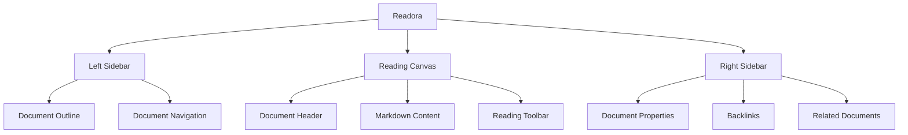
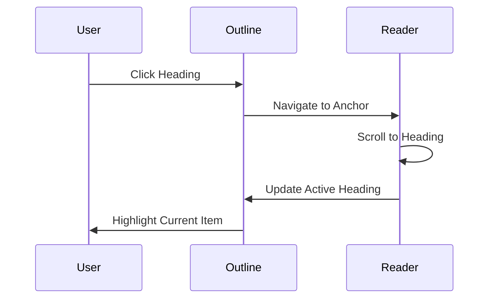

# PRD-002：Readora 用户体验与交互规范

| 属性 | 内容 |
|---|---|
| 文档编号 | PRD-002 |
| 文档名称 | 用户体验与交互规范 |
| 文档版本 | 1.3.0 |
| 文档状态 | Draft |
| 所属产品 | Readora |
| 关联文档 | PRD-001 |
| 设计参考 | Obsidian |
| 运行平台 | Visual Studio Code |

---

## 1. 文档目标

### 1.1 目标

定义 Readora 的用户体验、信息架构、页面布局和交互规范。

本规范回答以下问题：

- 阅读器应该由哪些界面组成？
- 用户如何打开和浏览 Markdown 文档？
- 如何组织目录、正文和辅助信息？
- 如何操作 Mermaid 图表？
- 如何切换主题和阅读布局？
- 如何处理加载、错误和空状态？
- 如何与 VS Code 原生工作流融合？

### 1.2 设计原则

| 原则 | 说明 |
|---|---|
| Content First | 内容始终是视觉中心 |
| Minimal Interface | 尽量减少不必要的界面元素 |
| Clear Hierarchy | 建立明确的信息层级 |
| Consistent Interaction | 保持交互行为一致 |
| Contextual Operation | 根据阅读上下文提供操作 |
| Progressive Disclosure | 高级功能按需呈现 |
| Keyboard Friendly | 支持键盘操作 |
| Responsive Layout | 自适应窗口尺寸 |

---

## 2. 用户体验架构

### 2.1 整体界面结构

采用三栏式阅读器布局。



### 2.2 页面组成

| 区域 | 名称 | 职责 |
|---|---|---|
| A | VS Code Workbench | 原生工作台 |
| B | Left Sidebar | 文档目录与导航 |
| C | Reading Canvas | 核心阅读区域 |
| D | Right Sidebar | 属性和关联信息 |
| E | Reading Toolbar | 阅读操作 |
| F | Status Area | 阅读状态 |

### 2.3 页面布局

建议默认采用：

- 左侧：文档目录。
- 中央：Markdown 阅读内容。
- 右侧：默认关闭，按需打开。
- 顶部：文档标题及轻量操作。
- 底部：可选阅读进度和状态信息。

阅读区域必须保持足够的内容宽度，不能让左右面板挤压正文。

---

## 3. IA 信息架构

### 3.1 信息架构定义

```text
Readora
│
├── Reader Workspace
│   ├── Document Header
│   │   ├── Document Title
│   │   ├── Document Path
│   │   └── Document Actions
│   │
│   ├── Left Sidebar
│   │   ├── Outline
│   │   ├── Document Navigation
│   │   └── Search Results
│   │
│   ├── Reading Canvas
│   │   ├── Reading Toolbar
│   │   ├── Markdown Content
│   │   ├── Code Blocks
│   │   ├── Tables
│   │   ├── Images
│   │   ├── Diagrams
│   │   └── Mathematics
│   │
│   └── Right Sidebar
│       ├── Properties
│       ├── Backlinks
│       ├── Related Documents
│       └── Tags
│
├── Commands
│   ├── Open Reader
│   ├── Toggle Reading Mode
│   ├── Toggle Outline
│   ├── Toggle Right Sidebar
│   ├── Toggle Focus Mode
│   └── Reset Layout
│
└── Preferences
    ├── Appearance
    ├── Typography
    ├── Layout
    ├── Interaction
    └── Advanced
```

### 3.2 导航层级

采用两级导航：

一级导航：
- 文档目录
- 搜索
- 文档关联

二级导航：
- 当前文档章节
- 搜索结果
- 反向链接列表

不在首版引入复杂的知识库管理导航。

---

## 4. 核心阅读界面

### 4.1 Document Header

文档头部包含：

| 元素 | 说明 |
|---|---|
| Document Title | 当前文档标题 |
| Document Path | 文档所在路径 |
| Open Source | 打开原始 Markdown |
| Copy Link | 复制文档链接 |
| More Actions | 更多操作 |

交互要求：

1. 标题支持超长截断。
2. 路径支持悬浮显示完整内容。
3. 操作按钮默认低视觉权重。
4. 鼠标悬浮时显示 Tooltip。
5. 小屏幕下隐藏非核心操作。

### 4.2 Reading Canvas

阅读画布是产品最重要的区域。

设计要求：

- 居中排版。
- 限制正文最大宽度。
- 使用舒适的行高。
- 段落之间保留适当间距。
- 标题具有明显层级。
- 代码块与正文形成视觉区分。
- 表格支持横向滚动。
- 图片默认自适应。
- Mermaid 图表独立布局。

建议默认内容宽度：

```text
Reading Width: 760px - 900px
Body Font Size: 16px
Body Line Height: 1.75
Paragraph Spacing: 1em
Heading Spacing: 1.5em
```

这些数值作为默认设计基线，允许用户调整。

### 4.3 阅读工具栏

工具栏采用轻量化设计。

功能：

| ID | 操作 | 行为 |
|---|---|---|
| UX-001 | Toggle Outline | 显示或隐藏目录 |
| UX-002 | Toggle Right Panel | 显示或隐藏右侧面板 |
| UX-003 | Focus Mode | 进入专注模式 |
| UX-004 | Font Size + | 增大字号 |
| UX-005 | Font Size - | 减小字号 |
| UX-006 | Search | 搜索当前文档 |
| UX-007 | More | 更多阅读操作 |
| UX-008 | Edit Mode | 切换编辑模式：开启后认领的区块拿把手，双击 / `Enter` 就地改字（E2）。与 UX-003 互斥：进专注退编辑，反之亦然；非本地文件时 `disabled` 而非隐藏 |
| UX-009 | Inline Format Toolbar | 活动单元上方的浮动格式化条：加粗 / 斜体 / 删除线 / 行内代码 / 链接 / 脚注引用六枚动作，活动单元是标题时再多出 H1–H6 六枚级别按钮（E3），末尾再多出一枚**常驻的 Cancel**（E8）：它不属于任何格式化动作，**永远可点**，点下去等价于在区块上按 `Escape` —— 标记撤掉、正文回到进入编辑时那一版、一个 `document.edit` 都不发。**出现条件是「有一个活动单元」而不是「已经选中一段」**：无选区时它照样浮着，只是四枚包裹类按钮置灰（脚注是纯插入，始终可点；Cancel 也是）；**随单元一起消失**（提交 / 取消 / 挂起 / 换文档 / 正文重写五种场合都要收起）。它**不是顶栏按钮**，不进本节下方的常驻按钮计数 |
| UX-010 | Outline Section Menu | 大纲行尾的 `⋯` 菜单（E7）：悬停或聚焦该行才显现，点开得到三个动作 ——「在其后新增章节」（平级）/「新增子节」/「删除本节」。删除是**两步确认**：第一步就把代价说出来（`Delete 8 lines including 1 sub-section?`，无子节时只报行数），第二步才是「确认删除 / 取消」。**门槛与 UX-008 同生同灭**：只在编辑模式 × 本地文件 × 该条目带源行区间时存在，否则行上零 affordance（不是置灰，是没有）。**失败不收起菜单**（错误就发生在用户刚点的那一行上，收了就要他从开菜单重做），提示落在面板内 `role="status"` 一行，**不弹窗**；成功才收菜单。它同样不是顶栏按钮 |

工具栏应避免常驻大量按钮。

> **E2 现状（按代码实测补记，不虚构未实现的行为）**：上表是需求清单，与屏上按钮不是一对一关系 ——
> 已实现的是 UX-001 / 003 / 006 / 008（外加 UX-004/005 以缩放组「Zoom out / Reset zoom / Zoom in」三枚的
> 形态存在）与未列入本表的 **Export document**、**Reader settings**；UX-002（右侧面板）与 UX-007（More）
> 至今不是顶栏按钮。
>
> E2 带来的变化是**常驻动作按钮从 5 枚增至 6 枚**（`.readora-toolbar-button`：Outline / **Edit** / Focus /
> Search / Export / Settings），连缩放组三枚（`.readora-zoom-button`）共 9 枚。新增的 **Edit 排在 Focus 之前** ——
> 两个互斥的模式开关相邻摆放，看一眼就知道不能同开。专注模式下顶栏整段不渲染（既有行为），
> 因此「常驻」仅适用于只读 / 编辑两种态。取证的另一点：开关以 `aria-pressed` 表达按下态，与本章
> 状态可见性要求一致（ARC-009 §7.1 / §7.3）。
>
> **E3 现状（1.1.0 补记，同样按代码与浏览器实测）**：UX-009 是**浮层不是顶栏按钮** —— `role="toolbar"` +
> `aria-label="Formatting"`，挂在 `document.body` 上（因此结构上不进导出件、不进搜索命中，ARC-009 §6.3.4）；
> 实测渲染高度 37px，贴在被选词上方 5px（CSS 意图是 8px，定位用的是估算高 34px，差 3px），所以屏上
> 判据写的是「与选区 X 相交 + 在其上方 + 垂直间距 < 24px」而不是「正好 8px」（e2e ①）。
> 键盘模型照既有浮层：整条在 tab 序列里只占一格，内部走 `ArrowLeft` / `ArrowRight` / `Home` / `End`。
> 按钮可见内容是字面字形（`B` / `I` / `S` / `<>` / `[]` / `[^n]` / `H1`…`H6`）而**没有图标**，可访问名走
> `aria-label` —— 这是刻意的过渡形态，PRD-003 的编辑态视觉章仍属 E6。
> 按下态只在级别按钮上用 `aria-pressed` 表达（当前那枚同时 `disabled`），六枚动作按钮用 `disabled`
> 表达可用性 —— 与 UX-008 那种模式开关的 `aria-pressed` 不是同一类语义，不得往回统一。
>
> **E8 现状（1.3.0 补记，用户报「文本编辑样式后没法取消」后实测补的出口）**：取消从「只有 `Escape`」
> 变成两条可达路径 —— 工具条末尾那枚看得见的 `Cancel`，与**焦点在工具条内时也能按到的** `Escape`。
> 后者之前是个死区：`Escape` 的监听挂在区块元素上，而工具条挂在 `document.body`（ARC-009 §6.3.4），
> 冒泡路径不经过区块 —— 焦点一走进工具条（Tab 进入，或点开链接 URL 输入框之后）就没人接这个键。
> 两条路径共用同一次取消（同一对 `cancelActive` + 重刷 affordance），**不存在第二套回滚**。
>
> 两个刻意保留的不对称：（a）**`Cancel` 不进 tab 序列**（`tabIndex` 恒 `-1`）—— 格式化按钮那一格
> 只属于动作，键盘用户的退路是 `Escape`，不是多 Tab 一次；（b）**URL 输入框展开时的 `Escape` 仍只收
> 输入框**（不退整次编辑），否则「我填错了地址」会顺带把刚做的加粗也撤掉。鼠标路径上另有一条
> 不是缺陷的语义：点正文**之外**是**提交**而不是取消（ARC-009 §7.4，切走即存、不静默丢输入），
> 本轮不改它，而是把取消做成看得见 —— 要「点别处就放弃」得去按 `Cancel`。

---

## 5. 左侧目录交互

### 5.1 Outline

目录自动根据 Markdown 标题生成。

支持：

- H1-H6 层级。
- 标题缩进。
- 章节折叠。
- 当前章节高亮。
- 点击定位。
- 搜索标题。
- 滚动位置同步。

### 5.2 目录行为



要求：

1. 点击目录项目后定位到对应标题。
2. 使用平滑滚动。
3. 当前章节高亮。
4. 手动滚动正文时同步目录状态。
5. 不因目录高亮而触发不必要的重复滚动。

### 5.3 当前章节判断

以阅读视口内最靠近顶部的有效标题作为当前章节。

对于标题较短、章节内容较少的情况，允许使用下一个标题和视口边界辅助判断。

---

## 6. 右侧辅助面板

### 6.1 面板定位

右侧面板不是主要阅读区域，而是辅助信息区域。

默认关闭。

### 6.2 面板组成

| 面板 | 内容 | 优先级 |
|---|---|---|
| Properties | Frontmatter 属性 | P1 |
| Backlinks | 反向链接 | P1 |
| Related Documents | 关联文档 | P2 |
| Tags | 文档标签 | P1 |

### 6.3 交互要求

- 支持展开和关闭。
- 支持宽度调整。
- 不改变正文滚动位置。
- 点击关联文档可以打开目标文档。
- 不存在关联数据时展示空状态。

---

## 7. Mermaid 图表交互

### 7.1 图表容器

每个 Mermaid 图表拥有独立容器。

容器结构：

```text
Diagram Container
│
├── Diagram Header
│   ├── Diagram Type
│   └── Actions
│
├── Diagram Viewport
│   └── SVG Canvas
│
└── Diagram Toolbar
    ├── Zoom In
    ├── Zoom Out
    ├── Fit
    ├── Reset
    └── Export
```

### 7.2 默认状态

- 默认显示完整图表。
- 默认缩放适配容器。
- 默认保持图表居中。
- 不出现多余边框。
- 图表背景与阅读主题协调。
- 图表内容不得超出容器。

### 7.3 缩放交互

| 操作 | 行为 |
|---|---|
| 滚轮向上 | 放大 |
| 滚轮向下 | 缩小 |
| 拖动 | 移动图表 |
| Fit | 适应容器 |
| Reset | 恢复初始状态 |
| Zoom In | 放大一级 |
| Zoom Out | 缩小一级 |

约束：

- 设置合理的最大缩放比例。
- 设置合理的最小缩放比例。
- 缩放以鼠标指针位置为参考。
- 图表拖动不能影响正文滚动。
- 不同图表的缩放状态互相独立。

### 7.4 图表错误状态

图表解析失败时：

1. 不显示空白区域。
2. 展示图表类型。
3. 显示简明错误信息。
4. 提供查看源码操作。
5. 不影响其他 Markdown 内容。
6. 不将原始异常堆栈直接暴露给普通用户。

---

## 8. 代码块交互

### 8.1 代码块样式

代码块采用独立表面样式。

组成：

- 语言标识。
- 代码内容。
- 复制按钮。
- 可选行号。
- 可选折叠按钮。

### 8.2 操作行为

| 操作 | 行为 |
|---|---|
| Copy | 复制全部代码 |
| Select | 允许选择部分代码 |
| Collapse | 折叠代码 |
| Expand | 展开代码 |
| Show More | 展开较长代码 |

### 8.3 复制反馈

复制成功时提供轻量反馈，例如按钮图标短暂变化。

不使用阻断式弹窗。

---

## 9. 图片交互

### 9.1 图片展示

- 图片自适应正文宽度。
- 保持原始比例。
- 默认居中。
- 支持最大高度限制。
- 图片加载失败时展示占位状态。

### 9.2 Lightbox

点击图片进入图片预览。

支持：

- 放大。
- 缩小。
- 拖动。
- 适应窗口。
- 关闭预览。

键盘操作：

- Escape：关闭。
- +：放大。
- -：缩小。
- 0：恢复默认。

---

## 10. 搜索交互

### 10.1 搜索入口

提供两种入口：

1. 工具栏搜索。
2. 快捷键搜索。

### 10.2 搜索面板

包含：

- 搜索输入框。
- 匹配数量。
- 上一个匹配。
- 下一个匹配。
- 关闭按钮。

### 10.3 搜索行为

- 不区分大小写作为默认行为。
- 支持实时匹配。
- 高亮命中内容。
- 支持键盘上下导航。
- 支持 Escape 关闭。
- 关闭搜索时清除临时高亮。

---

## 11. 专注模式

### 11.1 设计目标

让用户专注于当前 Markdown 内容。

### 11.2 显示规则

进入专注模式后：

- 隐藏左侧目录。
- 隐藏右侧辅助面板。
- 隐藏非必要工具栏。
- 保留文档标题。
- 保留核心阅读内容。
- 保留必要的退出入口。

### 11.3 状态恢复

退出专注模式时：

- 恢复原有布局。
- 保持阅读位置。
- 保持字号设置。
- 不重置当前文档状态。

---

## 12. 文档切换

### 12.1 切换场景

用户可以通过 VS Code 原生标签页切换不同 Markdown 阅读器。

### 12.2 状态隔离

每个文档独立维护：

- 当前滚动位置。
- 当前章节。
- 图表缩放状态。
- 搜索状态。
- 文档临时交互状态。

### 12.3 文档刷新

当源 Markdown 文件发生变化时：

1. 检测文件变化。
2. 重新获取内容。
3. 执行渲染。
4. 更新阅读画布。
5. 尽可能恢复阅读位置。

如果内容发生较大变化，允许根据标题锚点重新定位。

---

## 13. 空状态与异常状态

### 13.1 空文档

展示：

- 简洁空状态。
- 当前文件路径。
- 引导用户编辑原文件。

### 13.2 文件不存在

展示：

- 文件不可访问提示。
- 文件路径。
- 重新加载操作。

### 13.3 资源加载失败

展示资源占位符，不影响其他内容。

### 13.4 图形解析失败

展示图表错误卡片和源码入口。

### 13.5 渲染异常

采用局部降级：

- 优先保留其他正常内容。
- 对异常模块独立隔离。
- 提供重新渲染入口。

---

## 14. 快捷键规范

首版建议：

| 快捷键 | 操作 |
|---|---|
| Ctrl/Cmd + Shift + M | 在阅读器中打开 |
| Ctrl/Cmd + F | 文档内搜索 |
| Ctrl/Cmd + + | 增大字号 |
| Ctrl/Cmd + - | 减小字号 |
| Ctrl/Cmd + 0 | 恢复默认字号 |
| Escape | 关闭当前浮层 |
| Ctrl/Cmd + Shift + F | 专注模式 |

快捷键必须遵循 VS Code 的键位习惯，避免与宿主默认快捷键冲突。

> **1.1.0 口径（E3）**：本表**不重复键位事实**。键位的唯一权威表是 **ARC-004 §4.5**：编辑态那三枚
> （`E` 激活就地编辑、`Ctrl+Enter` 提交、`Escape` 取消编辑）登记在那里，其中 `E` 是 1.4.0（ARC-004）
> 随 E3 新增的一行。本表已有的 `Escape` 与编辑态的 `Escape` 是同一条按键的**分派**而不是两套事实：
> 有浮层时关掉浮层，在编辑单元里时取消编辑（ARC-009 §6.3.7）。本表其余条目本轮未变。

---

## 15. 响应式布局

### 15.1 宽屏

- 左侧目录可见。
- 中央阅读区域居中。
- 右侧辅助面板可选。

### 15.2 普通窗口

- 左侧目录可见。
- 右侧面板默认隐藏。
- 正文宽度自适应。

### 15.3 窄窗口

- 左右侧栏默认隐藏。
- 通过浮层打开目录。
- 工具栏简化。
- 图表支持横向适配。

### 15.4 布局切换

布局变化不应导致：

- 阅读位置丢失。
- 文档重新加载。
- 图表状态意外重置。

---

## 16. 无障碍设计

- 所有交互按钮提供可访问名称。
- 支持键盘导航。
- 交互焦点清晰可见。
- 不仅通过颜色传达状态。
- 图表提供适当的替代文本。
- 支持系统减少动态效果设置。
- 保证文本和背景之间具有足够对比度。

---

## 17. 用户体验验收标准

| 编号 | 验收项目 | 验收要求 |
|---|---|---|
| UX-AC-001 | 阅读布局 | 正文居中且宽度合理 |
| UX-AC-002 | 文档目录 | 点击后准确定位 |
| UX-AC-003 | 章节同步 | 滚动时目录高亮同步 |
| UX-AC-004 | Mermaid | 图表可缩放和拖动 |
| UX-AC-005 | 图表错误 | 局部降级，不影响页面 |
| UX-AC-006 | 图片预览 | 支持放大和关闭 |
| UX-AC-007 | 搜索 | 命中内容正确高亮 |
| UX-AC-008 | 专注模式 | 能够完整恢复原布局 |
| UX-AC-009 | 文档切换 | 阅读状态独立 |
| UX-AC-010 | 主题切换 | 内容和图表同步更新 |
| UX-AC-011 | 窄窗口 | 布局能够自适应 |
| UX-AC-012 | 键盘操作 | 核心操作可通过键盘完成 |

---

## 18. 设计约束与后续工作

本规范只定义交互和体验行为，不规定最终颜色、字体、阴影、圆角和图标设计。

这些内容统一由 PRD-003《视觉设计规范》定义。

同时遵守：

1. 不引入独立于 VS Code 的完整工作台。
2. 不重复实现 VS Code 已有的文件管理功能。
3. 不把右侧辅助面板变成复杂知识管理系统。
4. 不让 Mermaid 图表操作干扰正文阅读。
5. 不因功能增加而破坏阅读界面的简洁性。
6. 所有布局和交互必须支持键盘操作及合理的响应式行为。

---

## 19. 文档结论

Readora 采用以中央阅读画布为核心的三栏式交互架构。

左侧负责导航，中央负责阅读，右侧负责辅助信息。

图表、代码、图片均采用独立交互容器。

整体遵循 Obsidian 的简洁阅读理念，同时充分利用 VS Code 的原生工作区能力。   

**版本：1.3.0**（E8 取消出口回写：只改 §4.3 的 UX-009 一行与那段 E3 现状补记。上一版 1.2.0 的口径仍适用 —— 本轮同样未逐条重验其余章节）。

**文档状态：Draft。**