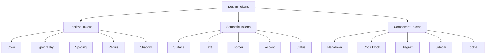

# PRD-003：Readora 视觉设计规范

| 属性 | 内容 |
|---|---|
| 文档编号 | PRD-003 |
| 文档名称 | 视觉设计规范 |
| 文档版本 | 1.8.4 |
| 文档状态 | Draft |
| 所属产品 | Readora |
| 关联文档 | PRD-001、PRD-002 |
| 设计参考 | Obsidian、Minimal Reading UI |
| 设计体系 | Design Tokens + Tailwind Utilities + Component Styles |
| 主题模式 | Light / Dark |

---

## 1. 设计目标

### 1.1 核心目标

构建一套适用于 VS Code Markdown 阅读器的视觉设计系统。

重点解决：

1. Markdown 文档的阅读舒适度。
2. 长文档的信息层次。
3. 代码块和技术内容的视觉呈现。
4. Mermaid 图形与正文的视觉统一。
5. Light / Dark 双主题的一致性。
6. 组件之间的设计一致性。
7. 不同显示尺寸下的阅读体验。

### 1.2 设计理念

产品采用：

**Minimal Editorial + Technical Elegance**

即编辑出版物式的阅读排版与现代技术产品视觉风格相结合。

设计关键词：

- Elegant：优雅。
- Minimal：简洁。
- Calm：平静。
- Readable：易读。
- Structured：有序。
- Precise：精确。
- Consistent：一致。

### 1.3 视觉原则

| 原则 | 说明 |
|---|---|
| Typography First | 优先通过字体和排版建立视觉层次 |
| Content Dominance | 内容是界面主体 |
| Restrained Color | 克制使用强调色 |
| Consistent Rhythm | 统一间距和视觉节奏 |
| Subtle Separation | 使用轻量边界区分区域 |
| Semantic Color | 颜色表达语义而非装饰 |
| Theme Consistency | 所有模块遵循统一主题 |

---

## 2. 整体视觉方向

### 2.1 设计参考

参考 Obsidian 的阅读体验，但不直接复制其 UI。

重点借鉴：

- 正文居中布局。
- 清晰的标题层级。
- 低干扰界面。
- 舒适的正文行距。
- 轻量的代码块背景。
- 柔和的边框。
- 统一的主题变量。

### 2.2 不采用的设计方式

- 大面积高饱和度颜色。
- 过度使用阴影。
- 过多卡片容器。
- 高频渐变背景。
- 过度装饰性的图标。
- 过多圆角嵌套。
- 过多分割线。
- 过度紧凑的正文排版。

---

## 3. Design Token 架构

### 3.1 Token 分层

采用三级设计 Token 架构。



### 3.2 Primitive Tokens

Primitive Token 表示基础设计值，不直接承担业务语义。

主要类别：

- Color Palette。
- Typography Scale。
- Spacing Scale。
- Radius Scale。
- Shadow Scale。
- Motion Scale。

### 3.3 Semantic Tokens

Semantic Token 将基础设计值映射为使用语义。

例如：

| Token | 作用 |
|---|---|
| color.surface.canvas | 阅读画布背景 |
| color.surface.panel | 侧栏背景 |
| color.text.primary | 正文主文字 |
| color.text.secondary | 辅助文字 |
| color.border.default | 默认边框 |
| color.accent.primary | 主要强调色 |
| color.status.success | 成功状态 |
| color.status.warning | 警告状态 |
| color.status.danger | 错误状态 |

### 3.4 Component Tokens

组件 Token 由 Semantic Token 派生。

例如：

- markdown.heading.color。
- markdown.paragraph.line-height。
- code.background。
- diagram.node.background。
- sidebar.item.active.background。
- toolbar.button.hover.background。

组件不得直接使用未经定义的颜色值。

---

## 4. 色彩系统

### 4.1 色彩设计原则

采用低饱和、中等对比度的阅读色彩体系。

避免将 VS Code 编辑器主题中的高对比色直接应用到阅读正文。

阅读器拥有独立的语义颜色体系，但可以继承 VS Code 的主题偏好。

### 4.2 Light Theme

基准取自 `docs/stitch_/serene_editorial_modern/DESIGN.md` 的机读 token（frontmatter 为准，其正文散文提到的暖白纸色 `#FBFBF9` 与之矛盾，不采用）。

| Token | 色值 | 用途 |
|---|---|---|
| canvas | #F7F8FA | 阅读画布 |
| surface | #F1F3F6 | 卡片及面板 |
| surface-subtle | #E9EDF1 | 次级表面 |
| surface-raised | #E2E6EC | 抬升表面（悬停、选中底色） |
| surface-sunken | #FFFFFF | 下沉表面（代码块、表格、数学块） |
| text-primary | #0B1C30 | 正文 |
| text-secondary | #4A4455 | 次级文字 |
| text-muted | #6B6478 | 弱化文字 |
| border | #D3D7DE | 分隔边界 |
| border-strong | #C2C7CF | 控件与容器边界 |
| accent | #7642DE | 强调填充（按钮、进度、选中轨） |
| accent-text | #592DAC | 正文可读紫（链接、强调文字） |
| accent-on | #FFFFFF | 填充之上的文字 |
| accent-soft | rgb(11 28 48 / 0.06) | 强调背景 |
| link | #592DAC | 链接 |
| info | #00645B | 信息提示（tertiary） |
| success | #0F6A43 | 成功 |
| warning | #8A5A00 | 警告 |
| danger | #BA1A1A | 错误 |
| glass | rgb(255 255 255 / 0.86) | 浮动件背景（配 `backdrop-filter`） |

`text-muted` 相对原型基准值 `#7B7486` 做了加深：`#7B7486` 在 `#F7F8FA` 上的对比度约 4.2:1，低于 §14.1 要求的 4.5:1，而该 token 用于 12–13px 的标签与元信息，属于小字号，必须过 AA。调整由 `apps/webview/src/styles/__tests__/contrast.spec.ts` 固化，回归即红灯。§4.2 的面族取中性灰蓝、边界取实色、强调底取中性柔光（1.4.0）：蓝紫相的层叠在浅底上呈整体光晕，半透明边界轮廓发虚。

### 4.3 Dark Theme

基准取自 `docs/stitch_/readora_webview_system/DESIGN.md` 与 `docs/stitch_/readora_1/code.html`。

| Token | 色值 | 用途 |
|---|---|---|
| canvas | #10141A | 阅读画布 |
| surface | #181C22 | 卡片及面板 |
| surface-subtle | #1C2026 | 次级表面 |
| surface-raised | #262A31 | 抬升表面（悬停、选中底色） |
| surface-sunken | #0A0E14 | 下沉表面（代码块、表格、数学块） |
| text-primary | #DFE2EB | 正文 |
| text-secondary | #C2C8D2 | 次级文字 |
| text-muted | #8E949F | 弱化文字 |
| border | rgb(67 72 80 / 0.6) | 分隔边界 |
| border-strong | #434850 | 控件与容器边界 |
| accent | #7642DE | 强调填充 |
| accent-text | #D2CCF0 | 正文可读紫（链接、强调文字） |
| accent-on | #EDE0FF | 填充之上的文字 |
| accent-soft | rgb(118 66 222 / 0.2) | 强调背景 |
| link | #58A6FF | 链接 |
| info | #A2C9FF | 信息提示（tertiary） |
| success | #34D399 | 成功 |
| warning | #FBBF24 | 警告 |
| danger | #FFB4AB | 错误 |
| glass | rgb(49 53 60 / 0.9) | 浮动件背景 |

暗色中性档去紫（1.6.0）：`text-secondary` / `text-muted` / `border` / `border-strong` 的旧值彩度 0.029~0.031、色相 301~305°，比正文档（271°、0.013）紫了一倍多，于是 13px 的次级文字压在 `#10141A` 上呈"白里透紫 + 边缘发雾"（大纲条目是最典型的落点）。新值按「同 OKLCH L、彩度砍半、色相拉回正文同族 263°」重算，四表面最低对比度逐项不低于旧值（secondary 8.56 / 旧 8.48，muted 4.72 / 旧 4.53，border-strong 1.56 / 旧 1.54），可读性不是这次调整的代价。`accent-text` 按产品决策压淡一档（L 0.895→0.861、C 0.056→0.050，色相 293° 不动）：品牌紫仍是点睛位，只是不再在暗底上发光。这次只动暗色，§4.2 的亮色中性档保持 1.4.0 的取值。

暗色块必须覆盖 §4.2 列出的**全部**语义 token，一个都不能漏：漏掉的那个会沿用亮色值，表现为"暗色里渗出一块亮色"。这条约束由 `design-tokens.spec.ts` 的必需清单逐名断言，扩充语义 token 时必须同步扩充清单。

原型 token 与本表命名不一致处见**附录 A**：本仓库一律使用 §13.1 的 `--readora-{category}-{name}` 命名，不照搬 Material 3 的 `surface-container-high` 一类名称。

### 4.4 色彩语义

| 语义 | 应用 |
|---|---|
| Primary | 主要操作和交互状态 |
| Secondary | 次要操作 |
| Success | 成功提示 |
| Warning | 警告提示 |
| Danger | 错误提示 |
| Info | 信息提示 |
| Neutral | 普通内容 |

强调色有两个值，不可混用：`accent` 是**填充色**，只出现在背景与进度条上，上面的文字必须是 `accent-on`；`accent-text` 是**文字色**，用于正文链接与强调文字，直接落在 `canvas`/`surface` 上。把 `accent`（暗色 `#7642DE`）直接当文字色用，在 `#10141A` 上只有约 3.2:1，小字号不过 AA。

### 4.5 强调色规则

强调色不应大量出现在正文中。

主要应用于：

- 当前章节。
- 链接。
- 选中状态。
- 焦点状态。
- 关键交互。

### 4.6 区块渲染诚实性规则

本里程碑（V1.2.0）的验收口径：**任何区块只在有真实数据源时渲染；无数据源则整块不出现。**

原型 `docs/stitch_/readora_1/code.html` 是一张静态高保真稿，其中若干区块在真实运行时没有数据来源。它们不进入实现，也不允许用占位文案或写死的假数据"补齐视觉"——那会让读者把一个从未接入的能力当成已经存在。据此剔除：

| 原型区块 | 剔除理由 |
|---|---|
| 右侧 Document Inspector 多标签面板 | 反向链接 / 图谱 / 审计均无数据源；`App.tsx` 原有的 `Properties` 占位栏一并删除，其信息改由正文内的 frontmatter 卡片承载 |
| Graph View 标签 | 无图谱能力 |
| 反向链接、Outgoing links | 无链接图索引 |
| 安全 & CSP 审计面板 | 无审计器 |
| PDF / SVG 导出按钮 | 无导出实现 |
| 状态条 `Ln 142, Col 18`、`UTF-8` | webview 没有光标位置与文件编码信息 |
| 面包屑（整条） | 当年（≤1.4）无 reveal-in-explorer 能力，顶栏面包屑为纯文本，不给假 affordance。1.5.0 一度以"切换同目录文档是真能力"为由恢复为自绘可点按钮 + `document.list` 通道；**1.7.0 撤销该自绘方案**：readora 迁移到自定义编辑器（ARC-004 §7.2），文档路径链与同级文件切换由 **VS Code 原生面包屑**在编辑器上方提供。原生那条出现后，顶栏再留一条（哪怕纯文本）就是**两层冗余导航**，故 **1.7.0 把顶栏面包屑整条删除**，`document.list` 通道一并移除 |

同一条规则也约束开关：Reader Settings 弹层不提供"代码行号 / 关闭 KaTeX / 平滑滚动"三项，因为当前没有对应实现，给了就是假开关。

状态条只保留能自证的阅读字段：`字数`、`缩放 z%`、`主题 light/dark`。

`文档版本 v{n}` 已按产品反馈删除：它是内部快照版本，没有文本编辑器模型时可能为 `v0`，容易被误认为插件版本。内部版本仍用于消息时序、搜索与导出一致性，不再由状态条接收或展示。

原第六项 `Bridge: Connected`（判据为收到过 `document.load`）已按同一条诚实性规则删除：状态条随外壳一起只在第一份快照落地后才渲染（`App.tsx` 的 loading 分支不渲染外壳），字段出现即已连接，于是它恒为 Connected —— 一个永不变化的字段等于没有信息量，且 "Bridge" 是 `HostBridge` 的内部术语，读者无从理解。「收到过快照」改由状态条本身的存在来证明，不再重复报一遍。

原第一项 `N 节`（顶层分节数）**1.7.2 起删除**（产品反馈）：节数是目录那一栏直接数得出来的东西，在底部再报一次只把同一个信息说两遍；旧口径（取 `buildOutlineTree(outline).length`，h2/h3 不计，单复数跟值走）需要读者先理解「只算顶层」才和目录对得上，本身也是一处负担。`buildOutlineTree` 仍由 `App.tsx` 建一次，只供活动标题的祖先展开使用。

---

## 5. 字体系统

### 5.1 字体设计目标

阅读字体需要满足：

- 长时间阅读舒适。
- 中文与英文混排自然。
- 数字和标点清晰。
- 代码与正文容易区分。

### 5.2 字体分类

三套字族，各自一个 token，跨主题统一（主题只改颜色不改字族）：

| Token | 字族栈 | 类别 |
|---|---|---|
| `--readora-font-family-display` | Newsreader, "Songti SC", "Noto Serif CJK SC", serif | 标题、文档大标题 |
| `--readora-font-family-body` | Geist, Inter, -apple-system, "Segoe UI", "PingFang SC", "Microsoft YaHei", sans-serif | 正文、界面控件 |
| `--readora-font-family-mono` | "JetBrains Mono", --vscode-editor-font-family, ui-monospace, "SF Mono", Consolas, monospace | 代码、行内码、状态条 |

拉丁字形由 `@fontsource` 的** latin 子集**随扩展分发（`apps/webview/src/styles/fonts.css`），CJK 一律走系统回退栈。

**不打包 CJK 字库**，这是一条刻意的决策而不是待办：一套中文黑体子集常在数 MB 到数十 MB，会直接把 VSIX 体积推过市场建议上限，而 macOS 的 Songti SC / PingFang SC、Windows 的 Microsoft YaHei、Linux 的 Noto Serif CJK SC 已经提供了与设计意图接近的字形。后果是中文标题在部分环境下会落到系统字族，这被接受。写在这里是为了防止后来者"顺手补个中文字体"。

字族回退是设计的一部分，`font-display: swap`（由 fontsource 的 CSS 入口提供）意味着首帧可能先看到系统字形再替换；这是可用性优先于防抖动的取舍。

用户可在 Reader Settings 里把正文字族在 Newsreader / Geist / Inter 之间切换（`readora.typography`），该偏好落到 `document.body.dataset.readoraTypography`，由 `[data-readora-typography="…"]` 覆盖 display 与 body 两个字族 token。

### 5.3 字号体系

| Token | 字号 | 用途 |
|---|---:|---|
| font-xs | 12px | 辅助信息 |
| font-sm | 13px | 标签、元信息 |
| font-md | 14px | 辅助内容 |
| font-base | 16px | 正文 |
| font-lg | 18px | 大正文 |
| font-xl | 20px | 小标题 |
| font-2xl | 24px | H2 |
| font-3xl | 30px | H3 / H1（默认字号下） |
| font-4xl | 36px | 文档标题区主标题 |

字距 token：

| Token | 数值 | 用途 |
|---|---:|---|
| tracking-tight | -0.02em | 大字号标题（display 字族在 24px 以上需要收紧） |
| tracking-label | 0.04em | 全大写标签、状态条、表头 |

`font-xs` 至 `font-3xl` 的名称不可更改：`design-tokens.spec.ts` 按名断言其存在，它们是两套主题共同的排版基线。

### 5.4 标题排版

标题用 display 字族，字号相对正文（`--readora-font-size`）按比例给出：

| 元素 | 字号 | 字重 | 行高 | 字距 | 字族 |
|---|---:|---:|---:|---|---|
| 文档标题（标题区 H1） | 2.25em（= font-4xl @16px） | 500 | 1.15 | tracking-tight | display |
| H1 | 1.875em | 600 | 1.25 | tracking-tight | display |
| H2 | 1.5em | 600 | 1.3 | tracking-tight | display |
| H3 | 1.25em | 600 | 1.4 | — | display |
| H4 | 1.125em | 600 | 1.5 | — | body |
| H5 | 1em | 600 | 1.5 | — | body |
| H6 | 0.875em | 600 | 1.5 | tracking-label | body |

标题字重取 500–600 而非 700：Newsreader 是一支点阵较小的衬线阅读体，700 在大字号下会显得发闷。用 `em` 而不是绝对像素，是为了让 §11.4 的缩放能整体驱动标题——缩放改的是 `--readora-font-size` 一个变量。

### 5.5 正文排版

默认参数：

| 属性 | 默认值 |
|---|---|
| 字号 | 16px |
| 字重 | 400 |
| 行高 | 1.75 |
| 段落间距 | 1em |
| 字母间距 | Normal |
| 内容最大宽度 | 820px |

所有排版参数应支持用户自定义。

### 5.6 阅读时长口径

顶栏的 `N min read` pill 与状态条的字数共用一个计数函数 `apps/webview/src/app/text-metrics.ts`，规则是 CJK 感知的：

1. 每个 CJK 表意字符（含日文假名、CJK 扩展 A 区）计 **1 个单元**——中文一个字就是一个词。
2. 连续的非 CJK 字母数字序列按**词**计，一个序列 1 个单元。
3. 标点、空白、Markdown 语法字符不计。

时长换算：`minutes = max(1, ceil(units / 300))`。300 单元/分钟是中英混排文档的保守舒适读数，与主流技术博客的估算器一致取值。空文档返回 0 字、不显示 pill。

之所以要专门的计数函数：原先的 `text.split(/\s+/).length` 对中文按空白切分，一整段汉字算 1 个词，一篇 3000 字的中文笔记会被报成"1 min read"，属于可感知的错误而不是精度差异。

---

## 6. 间距系统

### 6.1 Spacing Scale

采用 4px 基础间距单位。

| Token | 数值 |
|---|---:|
| space-1 | 4px |
| space-2 | 8px |
| space-3 | 12px |
| space-4 | 16px |
| space-5 | 20px |
| space-6 | 24px |
| space-8 | 32px |
| space-10 | 40px |
| space-12 | 48px |
| space-16 | 64px |

### 6.2 应用规则

| 场景 | 推荐间距 |
|---|---|
| 正文段落 | 16px |
| 标题与正文 | 12px |
| H2 章节前 | 40px |
| H3 章节前 | 28px |
| 代码块外边距 | 20px |
| 表格外边距 | 20px |
| 引用块内边距 | 16px |
| 卡片内部 | 16px |
| 工具栏按钮间距 | 4px |

---

## 7. 圆角与阴影

### 7.1 Radius Scale

| Token | 数值 | 应用 |
|---|---:|---|
| radius-none | 0 | 特殊边界 |
| radius-sm | 4px | 小型控件 |
| radius-md | 6px | 输入框、按钮 |
| radius-lg | 8px | 代码块、图片 |
| radius-xl | 12px | 浮层、弹窗、图表容器 |
| radius-full | 999px | 圆形按钮、pill |

### 7.2 Shadow Scale

阅读器应尽量减少阴影使用。

| Token | 应用 |
|---|---|
| shadow-none | 正文和普通组件 |
| shadow-sm | 浮动工具栏 |
| shadow-md | 弹出菜单 |
| shadow-lg | 模态预览 |
| shadow-pill | 浮动快速条、顶栏 pill（暗色 `0 8px 24px rgb(0 0 0 / .35)`，亮色 `0 4px 12px rgb(11 28 48 / .08)`） |

默认使用边框而不是阴影区分普通内容区域。亮色的阴影一律用正文同相的深藏青 `rgb(11 28 48)`：品牌紫投影在浅底上呈辉光（整体光晕感），纯黑投影在蓝白底上发脏。

**hairline**：`--readora-hairline: 1px` 是所有分隔线的唯一来源，高对比模式下不提粗——提粗会让 3px 的 callout 左轨变成 7px 的色块。

**backdrop-filter 预算**：整个界面只在三处小面积使用毛玻璃——浮动快速条、Reader Settings 弹层、lightbox 工具条。三处都必须写 `@supports (backdrop-filter: blur(1px))` 与 `prefers-reduced-transparency: reduce` 双重回退到 `--readora-color-glass` 的实色形态。大面积毛玻璃在长文档滚动时会掉帧。

---

## 8. Markdown 元素视觉规范

### 8.1 标题

要求：

- 标题具有明显层级。
- H1 不需要额外装饰。
- H2 可以使用轻量分隔。
- H3-H6 逐步降低视觉权重。
- 标题与上下文间距合理。

### 8.2 正文

要求：

- 使用较高可读性的颜色。
- 不使用纯黑作为浅色主题正文默认值。
- 不使用纯白作为深色主题正文默认值。
- 链接与普通文字有清晰区分。
- 行长保持合理。

### 8.3 引用块

采用低对比背景与左侧强调边界。

不同引用层级不得出现过多装饰。

普通 `blockquote` 的左轨宽 3px，颜色 `--readora-color-border-strong`；嵌套引用不再增加装饰，仅缩进。

### 8.3.1 Obsidian callout

V1.2.0 起支持 `> [!TYPE]` 语法（NOTE / TIP / WARNING / DANGER / INFO 及 Obsidian 别名）。视觉规则：

| 要素 | 规则 |
|---|---|
| 容器 | `--readora-color-surface` 底 + 左轨 4px，轨色取该类型的语义色 |
| 标题 | `--readora-color-text-primary`，600 字重，前置图标 |
| 图标 | CSS `mask-image` 引 `src/assets/icons/callout-*.svg`，`background-color: currentColor` 上色 |
| 折叠标记 | `-` 默认折叠、`+` 默认展开，标题行整体可点 |

**图标不得使用内联 `<svg>`**：ARC-002 §11.4 规定 SVG 不进正文白名单，这是安全不变量，不得为一个图标破例。callout 的 DOM 只用 `div / span / p / strong` 加 `class` 属性，因此 sanitizer 白名单零改动。

### 8.4 列表

- 列表符号清晰。
- 嵌套层级间距统一。
- 有序列表数字对齐。
- 任务列表 Checkbox 与文字垂直居中。

### 8.5 表格

要求：

- 表头与正文具有层次区分。
- 单元格内边距统一。
- 边框颜色柔和。
- 支持长内容换行。
- 超宽表格支持横向滚动。
- 表格不应强制撑开阅读画布。

### 8.6 代码块

代码块是技术文档的重要视觉元素。

设计要求：

- 使用独立背景表面。
- 保留代码缩进。
- 语法高亮颜色适中。
- 代码字体使用等宽字体。
- 顶部显示语言标识。
- 复制按钮采用低干扰样式。
- 超长代码支持横向滚动。
- 可选行号。

### 8.6.1 行内代码

行内代码（反引号包裹，产物 `.readora-inline-code`）与代码块同属一套代码语汇，但它是嵌在正文行里的一枚**色块**，因此除了字体外还要有底色、描边、前景三条线索（1.7.3）：

| 要素 | 规则 |
|---|---|
| 底色 | `--readora-inline-code-background`，取「正文前景掺 12% 透明」的派生柔光 `color-mix(in srgb, var(--readora-color-text-primary) 12%, transparent)` |
| 描边 | 1px `--readora-color-border-strong`（不依赖底色） |
| 文字 | `--readora-syntax-attr`，与代码块里的变量 / 属性同色，挂在 `[data-readora-scheme]` 轴上 |
| 字体 | `--readora-font-family-mono`，0.9em，圆角 `--readora-radius-sm` |

**色块不得复用任何一档 `surface`**：`surface-subtle` 同时是引用块的底（§8.3），色块取它就在引用里与背景逐字节同色（实测 1.00:1，色块直接消失），落在正文画布上也只有 1.11:1。用户报的「亮色下 `code` 对比度不够」量的是**色块与容器的区分度**，当时的文字对比度是 14.59:1、完全合格 —— 所以只调底色治不了根：任何复用五档表面阶梯的取值迟早与同档容器撞色，描边与前景这两条不依赖底色的线索必须同时在。改用前景掺透明的派生柔光还有一个附带收益：宿主模式（§13.3）下它跟着编辑器的 `editorForeground` / `editorBackground` 走，不必为三套 palette 各抄一个经验值（同 §8.6 代码块的处理口径）。

门禁：`contrast.spec.ts`「行内代码色块与它的落点」按 light / dark × 五档落点（canvas / surface / surface-subtle / surface-raised / surface-sunken）逐个合成后断言 ① 色块 vs 容器 ≥ 1.15 ② 色块内文字过 AA 4.5:1，另加一条「声明里不得出现 `color-surface`」的结构断言。改后实测：色块区分度 1.27~1.28（亮）/ 1.29~1.38（暗），前景最低 4.66:1（亮色压 `surface-raised`）。

### 8.7 图片

- 保持原始宽高比。
- 默认不超过正文宽度。
- 圆角统一。
- 不添加不必要阴影。
- 点击可进入 Lightbox。

---

## 9. Mermaid 图形视觉规范

### 9.1 设计目标

Mermaid 图表必须与阅读器整体设计体系保持一致。

不允许出现：

- 图表采用独立的高饱和度主题。
- 深色阅读器搭配浅色图表。
- 节点颜色与文字对比不足。
- 不同图表使用完全不同的视觉语言。

### 9.2 图形语义 Token

| Token | 用途 |
|---|---|
| diagram.canvas | 图表背景 |
| diagram.node.surface | 节点背景 |
| diagram.node.text | 节点文字 |
| diagram.node.border | 节点边框 |
| diagram.edge | 连接线 |
| diagram.edge.label | 连线标签 |
| diagram.accent | 重点节点 |
| diagram.success | 成功节点 |
| diagram.warning | 警告节点 |
| diagram.danger | 错误节点 |

### 9.3 图表类型视觉规则

| 类型 | 视觉重点 |
|---|---|
| Flowchart | 节点层次与连接关系 |
| Sequence | 生命线与消息区分 |
| Class | 属性与方法层级 |
| ER | 实体和关系清晰 |
| State | 状态与转换明确 |
| Gantt | 时间和任务层次 |
| Mindmap | 中心节点与分支层级 |

### 9.4 Pele 集成要求

- 使用 Pele 输出 SVG。
- 使用统一的 CSS Variables。
- 支持 Light / Dark。
- 支持自适应宽度。
- 保持图表文字清晰。
- 主题变化不应要求用户修改 Mermaid 源码。
- 图表缩放时文字与线条保持合理表现。

---

## 10. 组件视觉规范

### 10.1 按钮

按钮分为：

- Primary。
- Secondary。
- Ghost。
- Icon Button。

阅读器工具栏默认使用 Ghost 和 Icon Button。

Primary 仅用于明确的主要操作。

### 10.2 标签

标签用于：

- 文件类型。
- 文档属性。
- 标签分类。
- 图表类型。
- 状态信息。

避免大量彩色标签。

### 10.3 Tooltip

要求：

- 简洁。
- 延迟显示。
- 不遮挡核心内容。
- 支持键盘焦点触发。

### 10.4 面板

面板通过背景和轻量边框区分。

不采用大量卡片嵌套。

### 10.5 外壳布局组件（V1.2.0）

面包屑删除后，外壳定型为**大纲通顶的侧栏布局**：主体段是「大纲列 | 内容列」的 grid，
顶栏与搜索行**移进右列**（不再横压左列、也就不再遮住大纲顶部），状态条仍横贯整窗。
滚动容器仍是 window、各带 `position: sticky`，只是大纲列 `sticky top: 0` 一路贯到状态条上沿。
尺寸由组件 token 固定：

| 组件 | 类名 | 高度/宽度 | 内容 |
|---|---|---|---|
| TopBar | `.readora-topbar` | `--readora-topbar-height`（44px），**只占右列宽** | **大纲开合靠左且只给图标**（紧邻大纲列，`.readora-toolbar-button--icon`），专注 / 搜索 / 缩放组 / Export 下拉 / Reader Settings 成组靠右；不含面包屑（1.7.0 删除）、不含 pill（迁状态条右端） |
| 搜索行 | `.readora-searchbar` | 随内容 | 在右列顶栏之下整行展开（原型的 `doc-search-toolbar`） |
| 主体 | `.readora-body` | grid 两列：`--readora-outline-width`（256px，可关）+ 内容列 | 左列大纲（`.readora-shell-nav`，`sticky top:0` **通顶**）+ 右列内容（`.readora-shell-main`：顶栏 → 搜索行 → 快速条 + 画布） |
| StatusBar | `.readora-statusbar` | `--readora-statusbar-height`（24px） | 横贯整窗，见 §4.6 的诚实字段清单 |

- **大纲通顶 + 顶栏让位**（1.7.0，面包屑删除的直接结果）：路径链交给宿主原生面包屑后，顶栏左侧空了出来，于是把大纲开合按钮挪到顶栏**左侧**，让它和它控制的大纲列同侧；同时把顶栏/搜索行从"横贯整窗的第一段"改成"只在右侧内容列"，左列大纲得以从视口顶贯到底（`sticky top:0`，高 `calc(100vh − 状态条 − hairline)`）。**单列形态**（目录收起 / 专注 / ≤900px 窄窗）没有左列可让位，顶栏随内容列铺满整窗——这与旧版四段形态一致。
- **面包屑**：**1.7.0 起顶栏不再自绘任何面包屑**。readora 迁移到自定义编辑器（ARC-004 §7.2）后，宿主在编辑器上方原生给出**文档路径链 + 同级文件切换**的面包屑；顶栏再留一条（哪怕纯文本、不可点）就是**两层冗余导航**，故整条删除——`TopBar.tsx` 去掉 `Breadcrumb`/`breadcrumbOf`/`BREADCRUMB_*` 常量与 `documentUri` prop，`shell.css` 去掉面包屑样式，`App.tsx`/`dev/visual.tsx` 去掉 `documentUri` 透传。（历史：≤1.4 纯文本不可点；1.5.0 曾以"切换同目录文档是真能力"恢复为自绘可点目录段 + `document.list` 通道 + `BreadcrumbMenu.tsx`，该通道与菜单已随 1.7.0 一并删除，消息 18→17。）
- **pill**：`radius-full` + `shadow-pill` + `font-xs` + `tracking-label`，用于阅读时长与模式标签。
- **缩放组**：`−` `100%` `+` 三枚连排，点百分号复位；字号 50%–200%，步长 10%。
- **开合 toggle（Outline / Search）**：用 `aria-pressed` 表达当前开合。顶栏 Outline 使用双态侧栏图标：大纲显示时箭头向左（收起），隐藏时箭头向右（展开），`title` 对应 `Hide outline` / `Show outline`；两态均无常驻灰底，保留通用悬停反馈与键盘焦点环。Search 仍用淡底（`--readora-outline-active-bg`）+ 加粗（600）表达按下态，不上 accent 紫描边、不改文字色。
- **纯图标控件（1.7.2，1.8.3 改大纲头部）**：顶栏的 Outline 开合与大纲面板头部的「展开全部 / 折叠全部 / 过滤」只给图标不给文字（产品要求：只要图标；位置常驻的开关本就不需要文字自证）。大纲头部原来是**一枚**双向箭头靠状态换 `aria-label`（`Collapse all` ↔ `Expand all`），图形不变、标签又读不到，用户实测反馈「点了样式没变化」，1.8.3 拆成**两枚**常驻按钮，每枚只做一件事、每个图形只说一个方向。它们仍分别带 `aria-label`（`Toggle outline` / `Expand all` / `Collapse all` / `Filter`）与 `title` 悬停文案，**可读名称不因去文字而丢失**（§10.6：图标只是装饰）。头部三枚图标由 12px 调到 **16px**（与顶栏基准图标同尺寸），内边距改 `4px var(--readora-space-1)`，点击区实测 **26×26**（旧 22×18）；顶栏 Outline 实测 34×24（旧「图标+文字」82×29）。量级对齐 VS Code 侧栏图标按钮。展开/折叠两枚的当前态由 `aria-pressed` 的淡底（`surface-raised`）表达——按下折叠全部，底色就从折叠那枚换到展开那枚；禁用那枚不上底色，只留 `text-muted` 前景。顶栏其余四个动作仍图标 + 文字。
- **Reader Settings 触发器**：它是弹层触发器不是路由，`aria-haspopup="dialog"` + `aria-expanded`。
- **Export 下拉（M11）**：动作区里排在缩放组之后、Reader Settings 之前（导出是动作，
  Settings 恒为末位）。触发器复用同一枚 `.readora-toolbar-button`，额外带
  `.readora-toolbar-export` 与 `data-readora-export-menu="true"`，`aria-haspopup="menu"` +
  `aria-expanded` + `aria-label="Export document"`；与它同包在一个
  `.readora-toolbar-export-group`（`position: relative`，菜单面板的唯一定位锚）里。
  菜单面板是 `role="menu"` + 三枚 `role="menuitem"`（Export as HTML / PDF / PNG），
  项上带 `data-readora-export-format`；外观与定位一律走 Token 变量（色、间距、圆角），
  不新增颜色常量。键盘与 Esc 行为与 Reader Settings 弹层同一口径（焦点环、
  click-outside、焦点归还触发器）。**专注模式下不可达**：专注模式的早退分支只渲染
  一枚 Exit，整个动作区不渲染，本控件随之消失（不另做一套专注模式的导出入口）。
- **浮动快速条**：`position: sticky; bottom`，显示当前活动标题 + 进度百分比 + 回到顶部；专注模式下额外出现"展开大纲"按钮。
- **不实现的外壳**：VS Code 标题栏、活动栏、编辑器标签栏、窗口控制按钮属于装饰外壳，不在 webview 内（原型自身注释 `READORA WEBVIEW ROOT SHELL (STRICTLY EMBEDDED INSIDE THIS EDITOR TAB)` 已划定边界）。

### 10.6 图标

图标一律是内联 SVG React 组件（`apps/webview/src/app/Icon.tsx`），统一 24 viewBox、`stroke="currentColor"`、`stroke-width: 1.5`、`aria-hidden="true"`。

Outline 图形在 1.7.2 由「三个项目点 + 三条右对齐横线」（与正文里的 `ul` 同形，看着像列表视图而不像目录）改为**层级树**：根行在上、竖向连接线引出两个缩进一级的子行。大纲的辨识特征是缩进层级，与 §10.7 条目的层级缩进同源语义。

不引入图标字体：Material Symbols 全量 woff2 是 MB 级且需要 CI 增加 fonttools 子集化这一原生工具依赖，codicons 的字形与原型不符。内联 SVG 组件的代价只是几百行 JSX，且随 tree-shaking 只打包用到的部分。

顶栏的开合控件改用 `OutlineToggleIcon`（侧栏轮廓 + 左右箭头），按显示/隐藏状态切换图形；快速条的大纲入口仍用上述层级树图标。

### 10.7 大纲面板

在既有的树/折叠/active 之上，下表三行的取舍如下（1.2.0 起进度块下线，1.8.3 起行内标签
也下线，只剩头部这一块是扩展；阅读信息只由 §10.5 的浮动快速条与 §4.6 的状态条各一处报告）：

| 区块 | 数据源 |
|---|---|
| 头部（展开全部 / 折叠全部 / 过滤）+ heading 过滤输入框 | 本地状态；三枚**纯图标 16px 靠右排列**（见 §10.5 / §10.6），展开与折叠拆两枚而不是共用一枚双向箭头；过滤按 `title` 子串并自动展开命中项，`Escape` 清空；过滤中展开/折叠没有可见效果，两枚同时禁用并把 `title` 写成原因（§4.6 诚实性） |
| 行内标签 | **1.8.3 起全部下线**：H1 的分节字数（旧 `93w` / `840w`）是估读的体量、更深层级的源行号（旧 `L28`）是编辑器坐标，都不是阅读信息；字数在状态条已有一份（§4.6），节数读者在目录自己数得出来 |
| 底部 | 不摆统计：面板内没有 footer，也没有 `Sections` / `Depth` 两个口子。节数连 §4.6 状态条那一份也在 1.7.2 删掉了，不再在任何地方重复报 |

列表使用 **3px 极细滚动条**（Chromium / VS Code），轨道透明、滑块使用 `border-strong`，悬停使用 `text-muted`；不支持 WebKit 滚动条伪元素的引擎回退到标准 `thin`。仅列表滚动，头部图标常驻，正文滚动与活动项跟随逻辑不变。

活动条目（active）的高亮在 1.7.2 由「强调色 + `inset 2px` 左侧指示条」改为**强调色 + 淡底背景**（`--readora-outline-active-bg`，产品反馈）：旧那根指示条跟着 `.readora-outline-link` 的 padding 走，而条目按层级缩进，于是它停在标题左侧的空档里，读者要顺着它去找「是哪一行」；背景铺在标题那一块上，不需要解释就能看出当前在读哪一节。

加粗（600）保留，**文字色在 1.8.4 由 accent 改为中性 `text-primary`**（用户实测「激活状态字体白里透紫、不够清爽」）：暗色旧档 `#d2ccf0` 的通道差（max − min）是 36，新档 `#dfe2eb` 是 12，这一把尺直接量得出紫味被消掉。当前条目的辨识本来就有三重线索 —— 比常规行更亮的一档（暗色 `#dfe2eb` 对 link 的 `#c2c8d2`）、600 加粗、整块淡底，不需要再叠一层品牌色相；这与 §10.5 顶栏 toggle 在 1.4.1 立的「按下态只留淡底 + 加粗，紫与焦点环撞色」是同一条口径。`--readora-outline-active-color` 不删：快速条、设置选项、搜索工具三枚按下态仍吃它做点睛（那是瞬时控件，不是读者一路跟着走的当前节）。

**高对比预设的一处副作用（实测登记）**：预设刻意把文字三档压成两档（`text-secondary` 取 `text-primary` 的 Primitive，见 `tokens.css` 高对比块注释第 3 条「高对比要的是可读性而不是层级感」），且不覆写 `text-primary`；于是 `high-contrast` 下活动条目与常规行读到**同一档文字色**（暗色两档都是 `#dfe2eb`，亮色都是 `#0b1c30`），区分只剩 600 加粗与淡底。这不是无障碍回归 —— WCAG 1.4.1 本就要求不得靠颜色单独传递信息，`tests/e2e/outline.spec.ts` 有一条用例把这一形态钉住；旧实现在那一档靠 `accent-text` 的 hc 值（`#eeebff` / `#3f2279`）拉开的差也只有 12 个通道单位。

分节字数与它那套「相邻标题源行区间」的算法（`content/section-metrics.ts`，`useMemo` 依赖
`[text, outline]`）随行内标签一起在 1.8.3 删掉，`formatSectionUnits`（`Nw` formatter）同时移除。
行号与 `OutlineItem.position.startLine` 仍在数据结构里：它是 §16 / E7 章节结构菜单切写回区间的
边界（`outline-section-ops.ts` 的 `bodyLineOffsetOf` 补偿 frontmatter）。区间口径仍是 **0 基**、
左闭右开：第 i 节是 `[startLine_i, startLine_{i+1})`，最后一节到文件末尾——把行号当 1 基算会把
首行的 H1 整条判成没有区间。

**行尾章节结构菜单（1.8.0，E7）**：只在编辑模式下的本地文件上存在，形态三句话：

- `⋯` 按钮用 **`opacity: 0` + transition** 而非 `visibility` / `display`：它一直**占宽**，行不会在悬停时抖一下，鼠标从标题滑到按钮也不会因为布局位移而丢命中；显现的三个触发条件是行悬停 / 行内任一元素聚焦（`:focus-within`）/ 菜单已开（`[aria-expanded="true"]`）。
- 菜单**行内展开**而不是浮层：它是大纲那一行的延伸（`margin-left: 18px` 与标题文本左对齐 —— 折叠按钮 16px + 行 gap 2px），不需要定位计算也不需要额外的层叠语境，代价是展开时侧栏里多占一段高度 —— 这是接受的（一次只做一件结构动作）。
- **零新增颜色 Token**：三枚动作按钮复用面板文本色族，唯「删除本节」一枚换前景 `var(--readora-danger-color)`（不换底色，避免在侧栏里出现第二块重色）；确认态只加一句说明 + 两枚按钮，不加描边。失败提示 `.readora-outline-note` 用 `text-muted`，`role="status"` 不带图标。

> 取证口径（给后续写 e2e 的人）：`opacity: 0` 的元素对 Playwright 的 **role 引擎不可见**（`getByRole` 拿到 0 个，jsdom 单测则全绿），e2e 必须走 CSS 属性选择器 + 先 `hover()` 再断言可见；不要为了选择器把一个悬停才出现的按钮改成常驻（ARC-009 §16.7 第 7 条）。

---

## 11. Light / Dark 主题规范

### 11.1 Light Theme

视觉特点：

- 柔和背景。
- 深色正文。
- 轻量边框。
- 克制强调色。
- 清晰的层次关系。

### 11.2 Dark Theme

视觉特点：

- 深灰而非纯黑背景。
- 灰白正文。
- 柔和边界。
- 适度提高辅助文字亮度。
- 避免高饱和颜色刺激。

### 11.3 主题切换

必须同步：

- 正文。
- 标题。
- 链接。
- 代码块。
- 表格。
- 引用块。
- 图片容器。
- Mermaid 图表。
- 交互控件。

切换由 `document.body.dataset.readoraTheme` 驱动单个属性选择器，不做逐组件的类名增删，因此不存在"某块没跟上"的中间态。主题变量都是自定义属性，替换不触发布局重排，唯一要保证的是**不闪白**：初始值必须在首帧 paint 之前写入，这由 Host 在 HTML 内联脚本里预置 `data-readora-theme` 完成（ARC-006 §5）。

### 11.4 缩放

缩放实现为 `--readora-font-size: round(prefs.fontSize × zoom)`，**不用 `transform: scale`**——后者会破坏锚点滚动定位、lightbox 的 `position: fixed` 计算和文字次像素渲染。缩放是 webview 会话内状态，不写入 `readora.*` 配置。

`Ctrl/Cmd` + `=`/`-`/`0` 在页面内响应，沿用 `Ctrl+F` 的既有策略：仅在画面上有文档时接管按键，否则把键还给宿主。

---

## 12. Motion 设计

### 12.1 动效原则

动效应辅助理解，不应干扰阅读。

### 12.2 时间规范

| Token | 时间 | 用途 |
|---|---:|---|
| motion-fast | 100ms | Hover |
| motion-normal | 160ms | 按钮状态 |
| motion-slow | 220ms | 面板切换 |
| motion-dialog | 260ms | 弹窗 |

### 12.3 动效约束

- 避免大幅位移动画。
- 避免长时间过渡。
- 支持减少动态效果。
- 不在正文阅读过程中自动播放装饰动画。

---

## 13. CSS Variables 规范

### 13.1 Token 命名

统一使用：

```css
--readora-{category}-{name}
```

示例：

```css
:root {
  --readora-color-canvas: var(--readora-palette-light-canvas);
  --readora-color-surface: var(--readora-palette-light-surface);
  --readora-color-text-primary: var(--readora-palette-light-text-primary);
  --readora-color-border: var(--readora-palette-light-border);
  --readora-color-accent: var(--readora-palette-light-accent);

  --readora-font-xs: 12px;
  --readora-font-base: 16px;
  --readora-font-4xl: 36px;
  --readora-tracking-tight: -0.02em;
  --readora-font-family-display: Newsreader, "Songti SC", serif;

  --readora-space-1: 4px;
  --readora-space-2: 8px;
  --readora-space-3: 12px;
  --readora-space-4: 16px;

  --readora-radius-sm: 4px;
  --readora-radius-md: 6px;
  --readora-radius-lg: 8px;

  --readora-topbar-height: 44px;
  --readora-statusbar-height: 24px;
  --readora-outline-width: 256px;
  --readora-hairline: 1px;
}
```

语义层的颜色**必须引用 Primitive 层的 `--readora-palette-` 前缀变量**，不得直接写十六进制：`design-tokens.spec.ts` 断言 `--readora-color-canvas` 的值包含 `--readora-palette-`。亮暗两套分别落在 `--readora-palette-light-*` 与 `--readora-palette-dark-*` 两组。

组件层（`--readora-panel-background`、`--readora-code-background` 等）只能引用语义层，即值里必须出现 `var(--readora-color-`；这条同样被测试断言。新增外壳尺寸类组件 token：`--readora-topbar-height`、`--readora-statusbar-height`、`--readora-outline-width`、`--readora-shadow-pill`、`--readora-hairline`。（原列于此的 `--readora-progress-fill-start/end` 随大纲进度块下线一并移除，见 §10.7 与附录 B。）

### 13.2 Dark Theme

```css
[data-readora-theme="dark"] {
  --readora-color-canvas: var(--readora-palette-dark-canvas);
  --readora-color-surface: var(--readora-palette-dark-surface);
  --readora-color-text-primary: var(--readora-palette-dark-text-primary);
  --readora-color-border: var(--readora-palette-dark-border);
  --readora-color-accent: var(--readora-palette-dark-accent);
}
```

选择器是 `[data-readora-theme="dark"]`，不是 `[data-theme="dark"]`——带产品前缀是为了不与宿主页面上可能存在的同名属性打架。该块必须覆盖 §4.2 全部语义 token（含 §4.3 新增的 `surface-raised`、`surface-sunken`、`border-strong`、`accent-text`、`accent-on`、`link`、`info`、`glass`）。

### 13.3 VS Code 主题适配

允许将 VS Code 主题变量映射到阅读器语义 Token。

例如：

```css
--readora-host-editor-background: var(--vscode-editor-background);
--readora-host-editor-foreground: var(--vscode-editor-foreground);
--readora-host-focus-border: var(--vscode-focusBorder);
```

但不直接将宿主变量全部暴露为阅读器设计 Token。

### 13.4 样式文件划分

V1.2.0 起 `styles/global.css`（1511 行）拆为六个文件，按 `main.tsx` 的固定顺序引入：

```
katex/dist/katex.min.css
  → styles/fonts.css        @font-face
  → styles/tokens.css       三层 token + 主题覆盖 + a11y 媒体查询
  → styles/base.css         body / reset / 滚动条
  → styles/markdown.css     .readora-content 文档内容
  → styles/components.css   按钮 / 输入 / chip / tooltip / focus ring
  → styles/shell.css        外壳布局与新组件
  → styles/lightbox-search.css  预览与搜索
```

KaTeX 样式必须在最前、阅读器覆盖在后，这是既有不变量（IMP-001 §10.2）：阅读器要改的是 display 公式的垂直节奏而非引擎本身，覆盖只有排在后面才生效。

拆分不夹带语义变更——内容是迁移，不是重写。`design-tokens.spec.ts` 相应改为读取 `styles/` 目录下全部 `.css` 拼接后断言，保持"从源码文本断言 token"的既有做法。

---

## 14. 视觉质量验收

| 编号 | 验收项目 | 验收要求 |
|---|---|---|
| VIS-001 | 正文 | 长时间阅读舒适 |
| VIS-002 | 标题 | 层级清晰 |
| VIS-003 | 代码块 | 视觉统一且易读 |
| VIS-004 | 表格 | 信息结构清晰 |
| VIS-005 | 图片 | 不失真、不溢出 |
| VIS-006 | Mermaid | 与主题一致 |
| VIS-007 | Light Theme | 对比度合格 |
| VIS-008 | Dark Theme | 对比度合格 |
| VIS-009 | 组件 | Token 使用一致 |
| VIS-010 | 响应式 | 不同尺寸下布局合理 |
| VIS-011 | 动效 | 低干扰 |
| VIS-012 | 无障碍 | 关键内容可访问 |

### 14.1 对比度要求

参考 WCAG 2.2：

- 普通正文对比度至少 4.5:1。
- 大字号文字对比度至少 3:1。
- 重要 UI 边界和控件状态应满足相应非文本对比度要求。
- 色块类元素（行内代码）除了自身文字过 AA，还要与它实际落进的容器拉开可辨识的区分度，否则「一块与背景同色的补丁」不会被读成代码（口径见 §8.6.1）。

---

## 15. 视觉设计交付物

后续设计和开发必须形成以下成果：

| 编号 | 交付物 |
|---|---|
| VD-001 | Light Theme 色板 |
| VD-002 | Dark Theme 色板 |
| VD-003 | Design Token 定义 |
| VD-004 | Typography 规范 |
| VD-005 | Spacing 规范 |
| VD-006 | Markdown 元素样式 |
| VD-007 | Code Block 样式 |
| VD-008 | Diagram Theme |
| VD-009 | Component Styles |
| VD-010 | Responsive Guidelines |

---

## 16. 编辑态视觉规范

本节定义 F12 编辑接管层在正文区块上的视觉表现（ARC-009 §5–§7）。

### 16.1 把手角标

- 每个可编辑区块的 `::after` 伪元素以绝对定位显示一枚 **8 px 圆点**（`border-radius: 50%`）在右上角。
- **idle 态**：`opacity: 0`，不可见、不干预阅读。
- **hover / focus-visible 态**：`opacity: 1`，填色取 `var(--readora-color-accent)`。
- 键盘 Tab 进入时同样显形（focus-visible），保证无障碍可发现。

### 16.2 活动单元

- 当前双击进入的区块为「活动单元」，描边：`outline: 1px solid var(--readora-color-focus)`，`outline-offset: 3px`。
- 活动单元的 `::after` 把手隐藏（`opacity: 0`），避免描边 + 圆点双重吸引视线。

### 16.3 形态 A / B 字体区分

| 形态 | 字体 | 字号 | 场景 |
|------|------|------|------|
| A（改字 WYSIWYG） | 继承正文 | 不变 | paragraph / heading / blockquote / list |
| B（改源 Source） | `var(--readora-font-mono)` | `var(--readora-font-size-sm)` | codeBlock / diagramBlock / table / mathBlock |

形态 B 在区块上直接覆写 `font-family` + `font-size`，给用户「你在编辑原始源吗」的即时视觉提示。

### 16.4 冲突态

- 活动单元外围描边颜色切换为 `var(--readora-color-warning)`，提示外部快照与本地编辑产生分歧。
- 紧跟活动单元下方插入**冲突卡片**：圆角容器（`border-radius: var(--readora-radius-md)`）、一句说明文字、「放弃编辑」与「保留我的版本」两枚动作按钮。

### 16.5 格式化工具条

- 绝对定位于当前选区上方（上方放不下则翻到下方），**只要有一个活动单元就出现，不以「已选中一段」为前提**；源码型区块（codeBlock / diagramBlock / table / mathBlock）不出现工具条。
- 按钮内容用**字面字形**（`B` / `I` / `` ` ``…）配合 `aria-label`，不使用 SVG 图标（过渡形态）。
- 键盘 Tab 序列中占一格，可纯键盘操作。
- **取消出口（1.8.1 / ARC-009 E8）**：末尾一枚 `Cancel`，与最后一枚格式化动作之间划一条 hairline 分隔线（`border-left: var(--readora-hairline) solid var(--readora-panel-border)` + `margin-left: var(--readora-space-1)` + `padding-left: var(--readora-space-2)`，与级别组 `__levels` 前那道同一手法）。它**不参与可点性三档**（永远可点 —— 灰掉的取消等于没有取消，因此 CSS 不多写一档状态），也**不进 tab 序列**（`tabIndex` 恒 `-1`，键盘退路是 `Escape`）。零新增颜色 Token。

> 1.8.1 顺手纠正：本节首条原写「仅形态 A 且**选区非空**时显示」，与实现不符（ARC-009 §6.3.4 早已按实测定为「有活动单元就显示」，1.4.0 那轮甚至专门写过「为什么不给「有选区才弹」」）。选区只决定按钮**可不可点**，不决定工具条**在不在这**。

### 16.6 源码型区块 cursor

四类源码型区块（codeBlock / diagramBlock / table / mathBlock）在 idle 态统一设置 `cursor: pointer`，暗示「可点击 / 可双击」。

### 16.7 编辑手册弹层（随 ARC-009 1.7.0 / E9）

入口是顶栏一枚纯图标 `?`（`.readora-toolbar-edit-help`），复用 `.readora-toolbar-button` + `--icon` 两档，因此**不新增尺寸变量也不改 44px 顶栏高度**；它只在 `editMode` 为真时渲染进 DOM，阅读态下顶栏宽度与旧版逐字节一致。

弹层（`.readora-edit-help-dialog`）**不自己发明一套弹层视觉**：backdrop、header、title、close、note 五个类直接复用 Settings 弹层那一份定义，本层只补它特有的两列行与键帽。

| 项 | 取值 |
|---|---|
| 宽度 | `min(560px, 100%)` —— 比 Settings 宽一档（键位列要留够），但仍收在 `min()` 里，窄窗口不越界 |
| 高度 | `max-height: calc(100vh − space-16)` + `overflow-y: auto`（手册是一页读完的东西，不得撑出窗口） |
| 表面 | `panel-background` + `panel-border`（hairline）+ `radius-lg` + `shadow-lg`，与 Settings 弹层同档 |
| 字号 / 行高 | `font-sm` / `line-height: 1.5` —— 与 `shell.css` 里 Settings 弹层同一条钉法（不写这一行就继承 body 的 `--readora-line-height`，实测拖 Line height 滑杆会把面板从 529px 顶到 690px） |
| 行 | `grid-template-columns: minmax(120px, 32%) 1fr`，`align-items: baseline`，键位右对齐 |
| 小节标题 | `font-xs` + `font-weight: 600` + `uppercase` + `tracking-label` + `text-secondary`，字族取 `font-family-body` —— 手册标题不是文档标题，不进大纲也不继承正文行衬线字族 |
| 键帽 `<kbd>` | `hairline` + `button-border` 描边、`radius-sm`、`canvas` 底、`font-family-mono` + `font-xs`，内边距 `0 4px`，`white-space: nowrap`。一眼看出是「按的」而不是「读的」 |
| 字面标记 `<code>` | 取 `code-background` + `radius-sm`，与 §8.6.1 行内代码同一块底（但不拿它做对比度验收 —— 手册里的标记是举例，不是正文） |
| 尾注 / 提示 | `font-xs` + `text-muted`，与 Settings 的 note 同档 |
| 窄窗口 | `@media (max-width: 560px)` 收为单列、键位改左对齐 —— 两列在这种宽度下都会挤到不可读 |

**零新增颜色 Token**：描边 / 底 / 前景全部取已有的 `panel-border`、`canvas`、`button-border`、`code-background`、`text-secondary`、`text-muted`。

为什么本节不往 §10.5 顶栏控件清单加一行：那一节定的是**阅读态常驻**控件（Outline / Search / Export / Settings），而 `?` 与 §16.5 那枚工具条同属「只在编辑态存在」的一类。写进 §10.5 就会让人以为它在阅读态也占一位，而那是实测不成立的事实（只读态 DOM 里根本没有这一枚，`app-edit-mode.spec.tsx` 与 `tests/e2e/edit-help.spec.ts` 各钉了一条）。

视觉基线：`edit-help.css` 只进 `main.tsx` 与 `dev/e2e.tsx`，**不进 `dev/visual.tsx`**（它固定 `editMode={false}`，而入口与弹层都只活在编辑态），所以 10 档基线不需重采也不会变。

---

## 17. 文档结论

Readora 采用 Minimal Editorial + Technical Elegance 作为视觉设计方向。

通过统一的 Design Tokens 管理颜色、字体、间距、边框和组件视觉。

Light / Dark 两套主题共享同一套语义结构。

Markdown、代码块、Mermaid 图表和辅助面板必须使用统一的设计语言。

**文档状态：Draft。**

---

## 附录 A：原型 token 映射表

原型（`docs/stitch_/`）沿用 Material 3 的命名，本仓库沿用 §13.1 的 `--readora-{category}-{name}`。两套名称**不通用**：照搬 M3 名会违反 §13.1，并使 `design-tokens.spec.ts` 的按名断言失去意义。实现时按下表逐个换算，色值取 §4.2 / §4.3。

| 语义 | Stitch / M3 名 | 本仓库 token | Dark | Light |
|---|---|---|---|---|
| 画布 | `background` / `surface` / `surface-dim` | `--readora-color-canvas` | `#10141a` | `#f7f8fa` |
| 面板 | `surface-container-low` | `--readora-color-surface` | `#181c22` | `#f1f3f6` |
| 次级面 | `surface-container` | `--readora-color-surface-subtle` | `#1c2026` | `#e9edf1` |
| 抬升面 | `surface-container-high` | `--readora-color-surface-raised`（新） | `#262a31` | `#e2e6ec` |
| 最高实面 | `surface-container-highest` | `--readora-color-surface-highest`（新） | `#31353c` | `#d3e4fe` |
| 下沉面 | `surface-container-lowest` | `--readora-color-surface-sunken`（新） | `#0a0e14` | `#ffffff` |
| 浮动面 | （原型 `surface-container-highest/90`） | `--readora-color-glass`（新，仅浮动件） | `rgb(49 53 60 / .9)` | `rgb(255 255 255 / .86)` |
| 主文字 | `on-surface` | `--readora-color-text-primary` | `#dfe2eb` | `#0b1c30` |
| 次文字 | `on-surface-variant` | `--readora-color-text-secondary` | `#c2c8d2` | `#4a4455` |
| 弱文字 | `outline` | `--readora-color-text-muted` | `#8e949f` | `#6b6478`（原型 `#7b7486` 加深以过 AA） |
| 边界 | `outline-variant` | `--readora-color-border` | `rgb(67 72 80 / .6)` | `#d3d7de` |
| 强边界 | `outline` | `--readora-color-border-strong`（新） | `#434850` | `#c2c7cf` |
| 主色填充 | `primary-container` | `--readora-color-accent` | `#7642de` | `#7642de` |
| 主色文字 | `primary` | `--readora-color-accent-text`（新） | `#d2ccf0` | `#592dac` |
| 填充上文字 | `on-primary-container` | `--readora-color-accent-on`（新） | `#ede0ff` | `#ffffff` |
| 主色淡底 | （原型自算） | `--readora-color-accent-soft` | `rgb(118 66 222 / .2)` | `rgb(11 28 48 / .06)` |
| 链接 | `link` | `--readora-color-link`（新） | `#58a6ff` | `#592dac` |
| 信息 | `tertiary` | `--readora-color-info`（新） | `#a2c9ff` | `#00645b` |
| 成功 | `tertiary-fixed-dim` | `--readora-color-success` | `#34d399` | `#0f6a43` |
| 警告 | — | `--readora-color-warning` | `#fbbf24` | `#8a5a00` |
| 错误 | `error` | `--readora-color-danger` | `#ffb4ab` | `#ba1a1a` |

字族映射：原型的 `Instrument_Serif` / `Geist` / `JetBrains Mono` 对应本仓库的 display / body / mono 三个字族 token（§5.2）；`serene_editorial_modern` 正文散文里提到的 Plus Jakarta Sans 不采用，它与该文档 frontmatter 的 Geist 冲突，且会多出一套字形要打包。

原型 Tailwind 类名（`h-11`、`text-xs`、`tracking-tight`、`rounded-xl` 等）作为尺寸与层级的意图来源，换算结果写进 §10.5 与 §13.1 的 token。

**Tailwind 裁决变更（1.1.0，选型变更见 IMP-001 §21）**：原「Tailwind 类名不作为实现依据」的裁决调整为——引入**构建期 Tailwind CSS v4** 作为样式 utility 层，与 `stitch_` 原型的 utility 表达方式对齐，但以下边界不变：

1. **Token 仍是视觉值唯一来源**：utility 的主题色必须经 `@theme` 映射引用本附录换算后的 `--readora-*` token（如 `--color-canvas: var(--readora-color-canvas)`），不得照搬原型 tailwind.config 中的 M3 色值或写死任意色值；上表映射关系继续有效。
2. **禁止原型的 CDN 运行时方案**：`cdn.tailwindcss.com` 依赖外部网络与运行时编译，违反 ARC-008 §11 CSP 基线与 VSIX 离线要求；必须经 `@tailwindcss/vite` 构建期编译为静态 CSS（IMP-001 §3.3 / §7.4）。
3. **暗色机制不采用原型的 `darkMode: "class"`**：主题切换仍由 `[data-readora-theme]` + CSS Variables 注入完成（ARC-006 §8.1），不使用 `dark:` 变体。
4. 尺寸类意图（间距、圆角、字号）继续按 §10.5 / §13.1 换算为 token 后供 utility 消费；utility 层架构与迁移策略见 ARC-005 §11.3。

## 附录 B：修订记录

| 版本 | 说明 |
|---|---|
| 1.0.0 | 初始视觉设计规范基线 |
| 1.1.0 | 附录 A Tailwind 裁决变更：引入构建期 Tailwind utility 层（用户决策，IMP-001 §21 登记），Token 映射、色值基准与 CSP 约束不变；元数据设计体系同步更新 |
| 1.2.0 | §10.7 大纲面板去进度块与源行号标签（用户要求，进度只留 §10.5 快速条一处）；§13.1 随之移除无消费方的 `--readora-progress-fill-start/end`；`docs/ARC-006` §4 示例同步；§10.7 补写分节的 0 基行号口径（去行号后字数成了唯一行内标签，旧实现的 1 基误读会让首行 H1 静默不显示） |
| 1.3.0 | §10.5 顶栏控件清单新增 Export 下拉（M11 导出链路）：位置、类名、`data-readora-export-menu` 探针、`aria-haspopup="menu"` 与三枚 `role="menuitem"`，并记明专注模式下不可达。未新增任何颜色 Token 与尺寸变量，44px 顶栏高度不变（10 档视觉基线因此只改像素不改取值） |
| 1.4.0 | §4.2 亮色去光晕修订（用户反馈「整体有光晕感、不够清爽」）：面族从蓝紫相改中性灰蓝（canvas `#F8F9FF→#F7F8FA`、surface `#EFF4FF→#F1F3F6`、subtle `#E5EEFF→#E9EDF1`、raised `#DCE9FF→#E2E6EC`），边界改实色去紫（border `rgb(204 195 215 / .7)→#D3D7DE`、border-strong `#CCC3D7→#C2C7CF`），强调底改中性柔光（accent-soft `rgb(109 40 217 / .08)→rgb(11 28 48 / .06)`）；§7.2 亮色阴影同批由品牌紫相改正文同相深藏青 `rgb(11 28 48)`。品牌色相（accent / accent-text / link / focus）不变；暗色板不动；AA 矩阵实测仍全过 |
| 1.4.1 | §10.5 顶栏开合 toggle（Outline / Search）按下态去紫：`shell.css` 的 `.readora-toolbar-button[aria-pressed="true"]` 移除 `border-color: accent` 与 `color: outline-active-color`，只留淡底 + 加粗。用户实测反馈：大纲默认可见使 Outline 常驻按下态，紫描边与 `:focus-visible` 焦点环同色，看着像被聚焦/选中、抢阅读注意力。未改任何 Token 取值，焦点环仍由 `components.css` 独占；10 档视觉基线因此改 `.readora-toolbar-button` 的 computed `color`/`borderColor`（紫→中性）与像素，`visual:update` 重采后 `check` 全等 |
| 1.5.0 | §10.5 面包屑**目录段恢复为可点按钮**（切换同目录文档）：新增补设通道 `document.list`（view-to-host，返回该目录直属 Markdown，上限 200），切换复用既有 `document.navigate`。安全边界：只允许列当前文档所在目录本身或其祖先、且落在 workspace folder 内、`allowWorkspaceResources` 为真，否则 `RESOURCE_DENIED`。§4.6 对当年剔除结论补更正（reveal-in-explorer ≠ 切换文档）。新增 `BreadcrumbMenu.tsx`（复用 ExportMenu 键盘/焦点骨架），`shell.css` 面包屑容器由 `overflow:hidden` 改 `visible` 以让菜单溢出（截断仍由分段负责）；未新增颜色 Token。视觉基线因目录段 span→button、容器 overflow 变更需 `visual:update` 重采，核对 diff 只落在 breadcrumb 相关选择器与像素 |
| 1.6.0 | §4.3 暗色中性档去紫（用户反馈「左侧大纲视图字体白里透紫、雾茫茫的」）：`text-secondary` `#CCC3D8→#C2C8D2`、`text-muted` `#958DA1→#8E949F`、`border` `rgb(74 68 85 / .6)→rgb(67 72 80 / .6)`、`border-strong` `#4A4455→#434850`，高对比预设暗色同两档 `#B8B3C0→#B1B6C0`、`#807C88→#7A7F88`；`accent-text` `#DDD6FF→#D2CCF0` 按产品决策压淡一档（色相 293° 不动）。取档口径为「同 OKLCH L、中性档彩度砍半、色相拉回正文同族 263°」，四表面最低对比度逐项不低于旧值，AA/AAA 矩阵实测仍全过。根因不是对比度而是色相：旧中性档彩度 0.029~0.031 / 301~305°，比正文档（0.013 / 271°）紫一倍多，13px 亮字压深底即呈紫雾。亮色板与 1.4.0 的面族/边界/柔光取值不动 |
| 1.7.0 | §10.5 面包屑**整条从顶栏删除、改用 VS Code 原生面包屑**（用户决策「readora 也用 VS Code 的，不用自己实现」；实测发现迁移后出现两层面包屑）：readora 文档面板从 `createWebviewPanel` 迁移为自定义编辑器 `registerCustomEditorProvider`（只读，`priority: option`，ARC-004 §4.4/§7.2），宿主在编辑器上方原生给出路径链与同级文件切换。原生那条出现后顶栏再留一条（哪怕纯文本）即冗余，故**顶栏面包屑整条不渲染**：删 `TopBar` 的 `Breadcrumb`/`breadcrumbOf`/`BREADCRUMB_*` 常量与 `documentUri` prop、删 `shell.css` 面包屑样式、`App.tsx`/`dev/visual.tsx` 去掉 `documentUri` 透传；同时删除 `BreadcrumbMenu.tsx` 与补设通道 `document.list`（消息 18→17）、`resource-service.listMarkdown`、`ports.readDirectory`。§4.6 记录「两层导航」的撤销理由。视觉基线因顶栏少一段需 `visual:update` 重采（核对 diff 只落在面包屑选择器删除 + 截图像素） |
| 1.7.1 | §10.5 外壳由「纵向四段」改为**大纲通顶的侧栏布局**（1.7.0 删面包屑后顶栏左侧空出，顺势定型）：主体段 `.readora-body` 仍是「大纲列 \| 内容列」两列 grid（保留 grid 以守住基线的 `gridTemplateColumns` 收单列护栏），但顶栏 `.readora-topbar` 与搜索行 `.readora-searchbar` **移进右列 `.readora-shell-main`**，横向不再压过左列；大纲列 `.readora-shell-nav` 从 `sticky top: var(--readora-topbar-height)` 改 `sticky top: 0`、高度去掉 topbar 项（`calc(100vh − statusbar − hairline)`），一路贯到状态条上沿。`TopBar` 的 Outline 按钮从靠右的 `.readora-toolbar-actions` 移到工具栏**首节点（左侧）**，与它控制的大纲列同侧；动作组仍 `margin-left: auto` 靠右。状态条仍横贯整窗（Q：只有顶栏让位）。滚动模型不变（window + sticky），专注 / 窄窗 / 目录收起的单列形态下顶栏随内容列铺满整窗、回到旧观。`ReaderShell` DOM 层级重排但 props 与 band 名不变；`reader-shell.spec` band 顺序改 `["body","topbar",…,"statusbar"]`，e2e 新增「大纲通顶 + 顶栏让位」几何断言。视觉基线因 topbar 变窄、nav 变高、body/main 变高需 `visual:update` 重采 |
| 1.7.2 | 外壳细节四处按产品反馈收敛（均不改 Token 取值，10 档视觉基线只改像素需 `visual:update` 重采）：① §10.5 / §10.6 **三枚控件改为纯图标** —— 顶栏 Outline 开合与大纲面板头部的「展开全部 / 过滤」去掉文字，`aria-label` + `title` 保留可读名称与悬停解释，内边距由 `.readora-toolbar-button--icon` / `.readora-outline-action--icon` 收成与图标等宽的定量（点击区实测 34×24 与 22×18，随文字一同收窄）；② §10.6 `OutlineIcon` 图形由项目点列表改为**层级树**（旧图形与正文 `ul` 同形）；③ §10.7 **活动条目高亮改背景** —— `.readora-outline-link[aria-current="location"]` 去掉 `inset 2px` 左侧指示条（它随条目缩进停在空档里），改用 `--readora-outline-active-bg` 淡底，accent 文字色与加粗保留；④ §4.6 **状态条删掉 `N sections` 字段**（节数目录那一栏直接数得出来，五降到四），`StatusBar` 去 `sectionCount` prop 与 `sections` 字段名，`App.tsx`/`dev/visual.tsx` 不再透传 |
| 1.7.3 | §8.6.1 **新增行内代码小节，色块改三重线索**（用户反馈「` 包裹内容` 在亮色模式下对比度不够」）：`--readora-inline-code-background` 由 `var(--readora-color-surface-subtle)` 改为 `color-mix(in srgb, var(--readora-color-text-primary) 12%, transparent)`，`.readora-inline-code` 补 `border: var(--readora-hairline) solid var(--readora-color-border-strong)` 与 `color: var(--readora-syntax-attr)`。诊断口径：旧写法的文字对比度 14.59:1 本来就合格，缺陷在色块与容器——对画布 1.11:1、落进引用块（同取 `surface-subtle`）1.00:1 逐字节撞色。未新增 Token 名（描边复用 `border-strong`、前景复用 `syntax-attr`），亮／暗两套 palette 同步；§14.1 补一条色块类元素的验收要求；`contrast.spec.ts` 新增「行内代码色块与它的落点」21 条门禁；10 档视觉基线取值只改 `--readora-inline-code-background` 与 `.readora-inline-code` 的 computed 三项，需 `visual:update` 重采 |
| 1.7.4 | **新增 §16 编辑态视觉规范**（随 ARC-009 E4–E6 收尾补章）：16.1 把手角标（8px 圆点、`:after` 绝对定位）、16.2 活动单元、16.3 形态 A/B 字体区分、16.4 冲突态（warning 描边 + 冲突卡片）、16.5 格式化工具条、16.6 源码型区块 `cursor: pointer`。未新增颜色 Token（描边/背景/前景均取已有的 `border-strong` / `accent-soft` / `warning` / `danger`）；编辑态元素只在 `editMode` 为真时存在，而 `dev/visual.tsx` 固定 `editMode={false}`，故 10 档基线不受影响。**补记说明**：本行是 1.8.0 编辑时补登的 —— §16 落地当时只改了正文没写修订行，附录 B 停在 1.7.3 而元数据表已写 1.5.0，两处都已脱节 |
| 1.8.0 | §10.7 新增**行尾章节结构菜单**三句口径（随 ARC-009 1.5.0 / E7）：`⋯` 用 `opacity: 0` + transition 而非 `visibility`（一直占宽，行不抖、鼠标不丢命中）；菜单**行内展开**而不是浮层（`margin-left: 18px` 与标题文本左对齐，不做定位计算）；零新增颜色 Token（删除那枚只换前景 `danger`，失败提示用 `text-muted`）。另补一段 e2e 取证口径：`opacity: 0` 对 Playwright role 引擎不可见。元数据表 1.5.0→1.8.0 是**追平**（见 1.7.4 行的脱节说明）。本轮面板 DOM 有新增元素，10 档基线需 `visual:update` 重采（已核：差异只落在大纲行右侧新增的隐形按钮占位） |
| 1.8.1 | §16.5 格式化工具条补**取消出口**一句（随 ARC-009 1.6.0 / E8）：末尾一枚 `Cancel`，与动作组之间一条 hairline 分隔线（复用级别组 `__levels` 前那道的手法），不参与可点性三档（永远可点，故 CSS 不多写一档状态）、不进 tab 序列（`tabIndex` 恒 -1）。零新增颜色 Token。同时**纠正 1.7.4 遗留的一处与实现不符的口径**：原首条写「仅形态 A 且选区非空时显示」，实测为「有活动单元就显示，选区只决定按钮可不可点」（ARC-009 §6.3.4）。编辑态元素仍只在 `editMode` 为真时存在而 `dev/visual.tsx` 固定 `editMode={false}`，10 档基线预期不受影响（已跑 `visual:check` 证实未刷） |
| 1.8.2 | 新增 §16.7 **编辑手册弹层**（随 ARC-009 1.7.0 / E9）：顶栏一枚纯图标 `?`（复用 `.readora-toolbar-button` + `--icon`，不改 44px 顶栏高度）+ 一块复用 Settings 弹层五个类的 `min(560px, 100%)` 面板，本层只补两列行、`<kbd>` 键帽与字面标记三样。零新增颜色 Token 与尺寸变量。同时明记两条口径：① 手册入口**不进 §10.5 常驻控件清单**（只读态 DOM 里没有这一枚，写进去就是一句不成立的事实）；② `edit-help.css` 不进 `dev/visual.tsx`，10 档基线不需重采 |
| 1.8.3 | §10.7 行内标签**全部下线**（产品反馈「这个 93w 是什么，去掉」）：H1 的分节字数不再上 UI，`content/section-metrics.ts`、`formatSectionUnits` 与 `.readora-outline-meta` 样式一并删除（`position.startLine` 仍供 E7 章节结构菜单切区间，口径搬进 `outline-section-ops.ts` 注释）。§10.5 大纲头部**展开/折叠拆成两枚常驻图标**（原一枚双向箭头靠状态换标签，用户实测「点了样式没变化」），新增 `CollapseIcon`（朝中间收拢）与 `ExpandIcon`（朝外张开）成对，当前态由 `aria-pressed` 的淡底表达；三枚图标 12px→**16px**，内边距 `2px`→`4px`，点击区实测 22×18→**26×26**。零新增颜色 Token；头部按钮不在视觉基线的 `SELECTORS × STYLE_PROPS` 覆盖面内，10 档取值未变（已跑 `visual:update` + `visual:check` 证实全等） |
| 1.8.4 | §10.7 大纲**活动条目文字去 accent 取中性**（用户反馈「激活状态字体白里透紫、不够清爽」）：`.readora-outline-link[aria-current="location"]` 的 `color` 由 `--readora-outline-active-color`（= `accent-text`）改为 `--readora-color-text-primary`，加粗与淡底不变；`--readora-outline-active-color` 保留给快速条 / 设置选项 / 搜索工具三枚按下态。零 Token 取值变化：10 档基线只改该选择器的 computed `color` / `borderTopColor` / `borderLeftColor`（后两条默认取 `currentColor` 因此跟着变）与像素，暗色 `rgb(210,204,240)→rgb(223,226,235)`、亮色 `rgb(89,45,172)→rgb(11,28,48)`，需 `visual:update` 重采。`contrast.spec.ts` 那条「活动条目文字」断言同时修正：旧写法拿 `accent-soft` 当底色，而暗色那档在 1.6.0 已解耦成 `text-primary` 掺 12%，量的并不是用户看到的落点；现按 `--readora-outline-active-bg` 真值合成，并拆成大纲（`text-primary`）与按下态（`accent-text`）两档。**副作用登记**：`high-contrast` 预设不覆写 `text-primary`，该档下活动条目与常规行同文字色，区分只剩 600 加粗 + 淡底（符合 1.4.1，`outline.spec.ts` 有用例钉住这一形态） |
