# Pele 图表夹具（STORY-05-01 / 05-02，IMP-001 §9.4）

本文件是 Pele 全部 33 类图表源码的**唯一来源**：`packages/diagram-core` 的兼容测试逐节解析它，
浏览器 harness 直接把它当文档加载。夹具与单测各写一套源码的话，
「测过的类型」和「看得见的类型」迟早会分叉。

约定（解析规则见 `src/__tests__/fixture-source.ts`）：

- 二级标题即用例 id；不带点的是**已注册类型**，必须出图；
- `invalid.<name>` 必须落到错误态；全部内置类型都必须通过渲染和 SVG 安全检查；
- 每节只取第一个围栏块，语言必须是 `mermaid`；
- 每类源码都刻意混入中文、长文本、特殊字符（`< > & 「」 ()`）与大节点，避免只测最顺利路径。

超长样本（> 50 000 字符）由 `node scripts/gen-fixture-assets.mjs` 生成到
`tests/fixtures/diagrams-over-limit.md`：那是一段机器拼出来的规则文本，
塞进本文件只会让人读不动，所以单独成文。

## flowchart

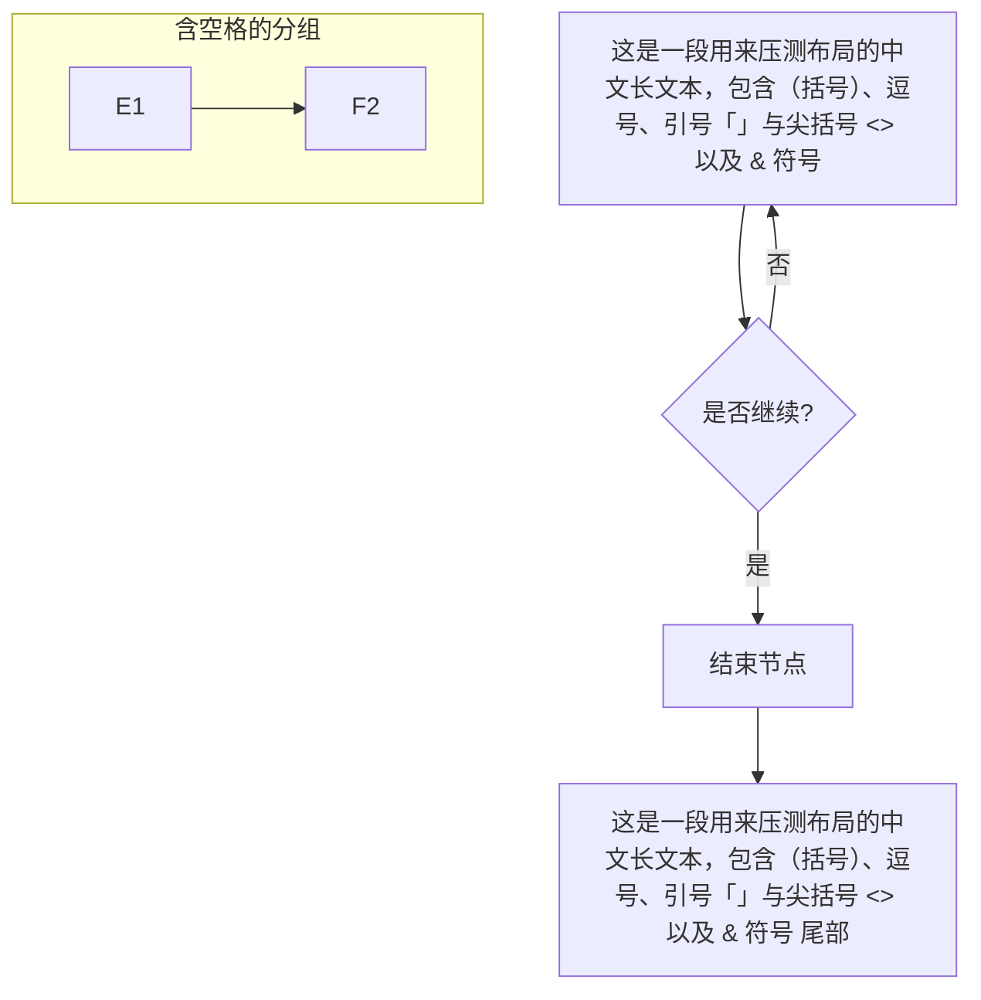

## sequence

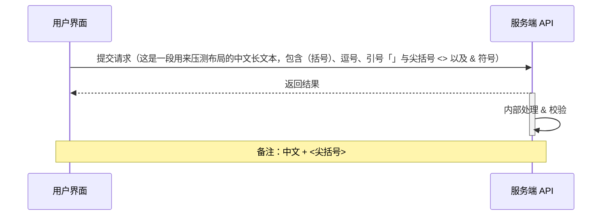

## class

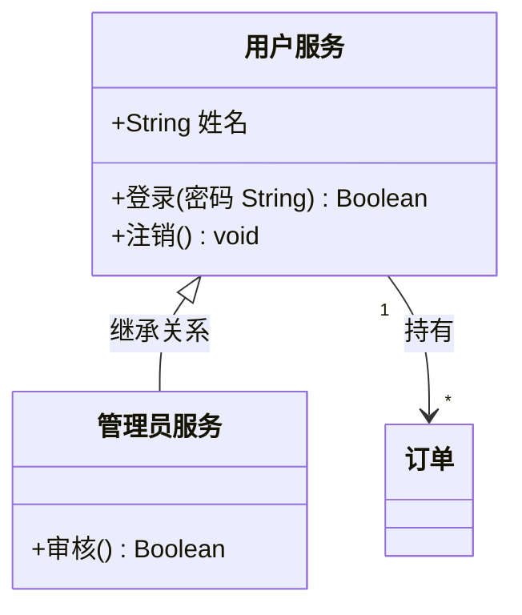

## state

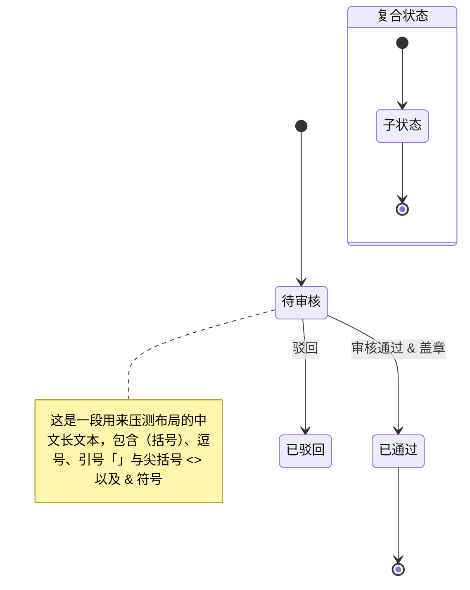

## er

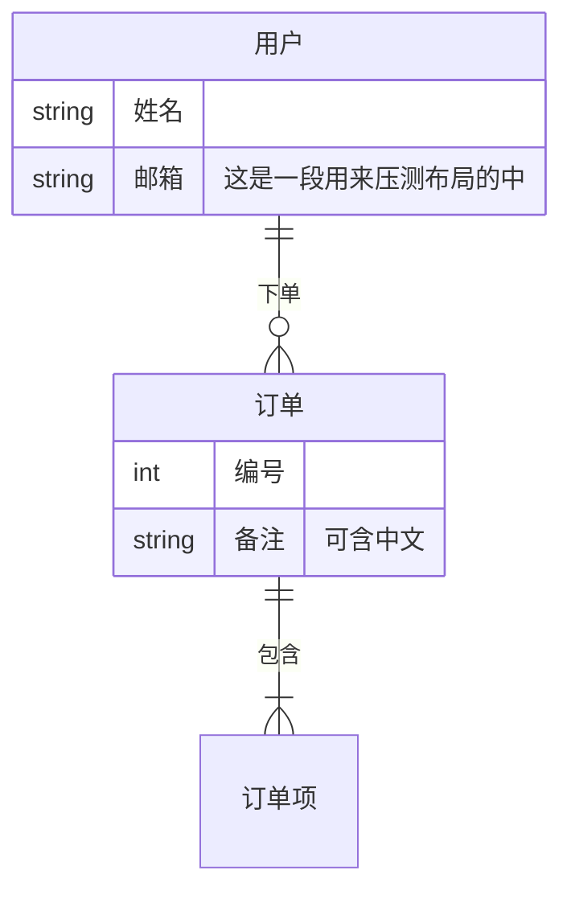

## gantt

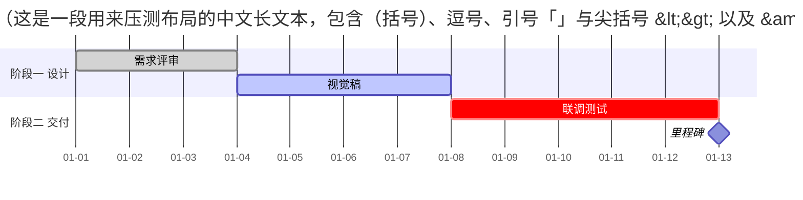

## pie

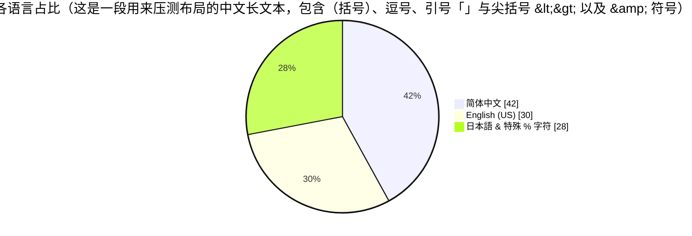

## gitGraph

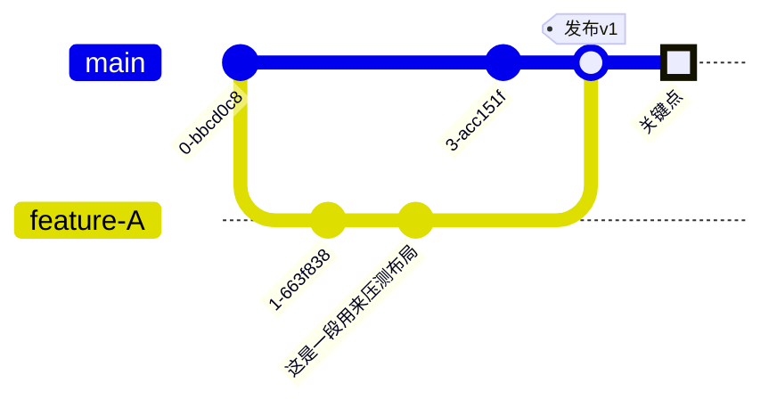

Pele 的 gitGraph 分支名走独立词法，中文分支名会被拒——这是引擎限制，
写在夹具里是为了让「退化到 ASCII 分支名」这个决定留下痕迹（README 已登记）。

## mindmap

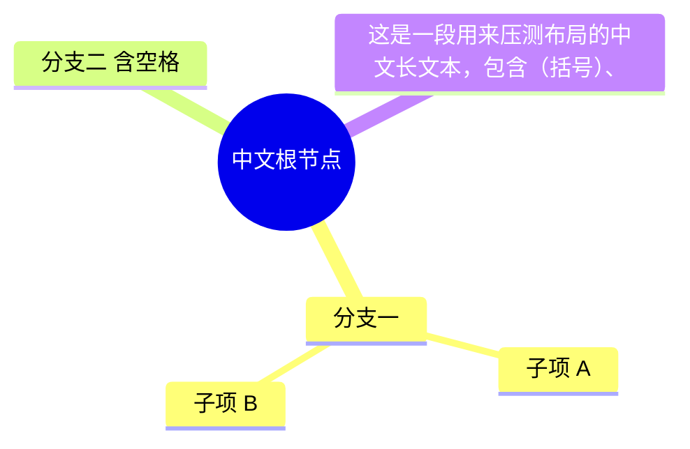

## timeline

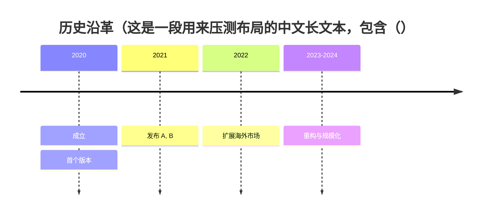

## requirement

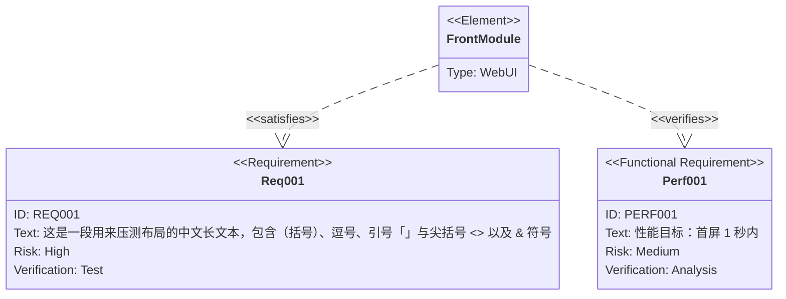

requirement 的名称与 id 只接受 ASCII 标识符，中文说明必须写成引号串（引擎词法限制）。

## quadrantChart

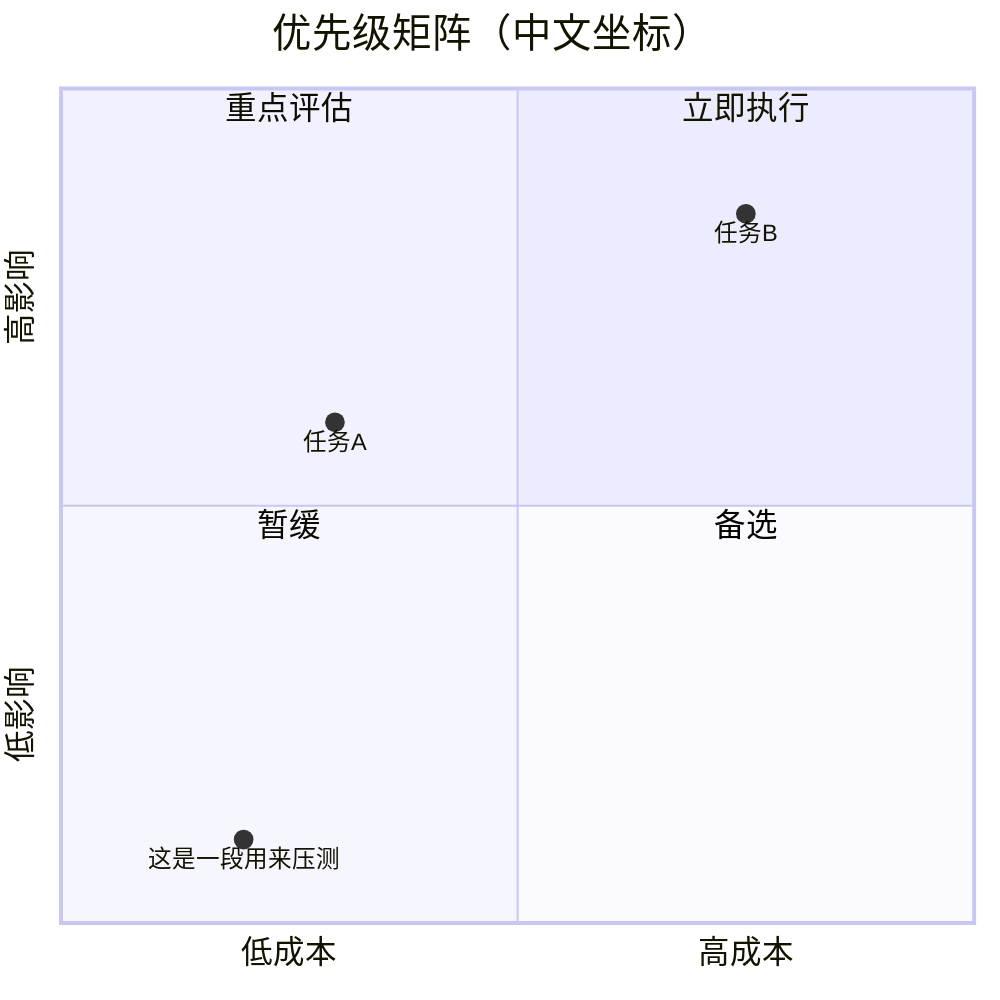

## sankey

```mermaid
sankey-beta
  流量来源,落地页,1000
  落地页,注册流程,600
  落地页,跳出,400
  注册流程,付费转化,250
  注册流程,留存观察,350
```

## xychart

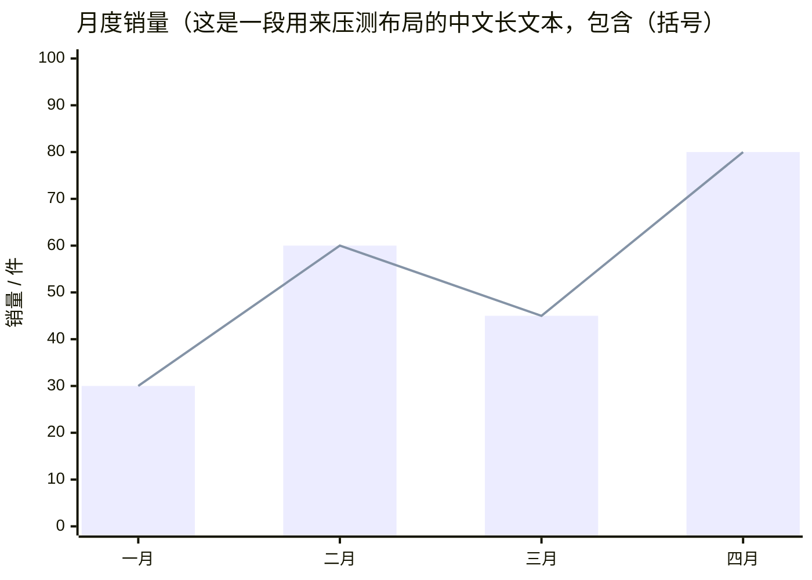

## agentflow
```mermaid
agentflow-beta TB
  User[Reader] --> Agent[Assistant]
```

## architecture
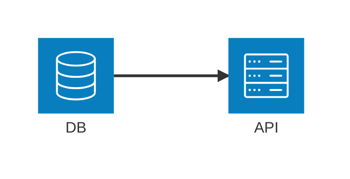

## block
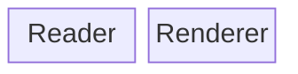

## c4
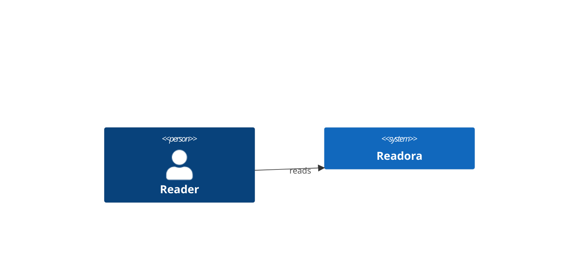

## cynefin
```mermaid
cynefin-beta
```

## eventmodeling
```mermaid
eventmodeling
```

## ishikawa
```mermaid
ishikawa-beta
  延迟交付
    流程
      审核耗时
    人员
      资源不足
```

## info
```mermaid
info
```

## journey
```mermaid
journey
  title Reader journey
  section Reading
    Open document: 5: Reader
```

## kanban
```mermaid
kanban
  Todo
    task1[Read]
  Done
    task2[Finish]
```

## packet
```mermaid
packet-beta
  0-7: "magic"
  8-15: "length"
```

## radar
```mermaid
radar-beta
  axis Ease,Speed,Quality
  curve Current{3,4,5}
```

## railroad
```mermaid
railroad-ebnf-beta
  entry = "start" "end" ;
```

## swimlane
```mermaid
swimlane-beta
```

## treemap
```mermaid
treemap-beta
  "Root"
    "Docs": 2
```

## treeView
```mermaid
treeView-beta
  Readora/
    docs/
      guide.md
```

## usecase
```mermaid
usecase-beta
  actor Reader("Reader")
  Read("Read document")
  Reader --> Read
```

## venn
```mermaid
venn-beta
```

## wardley
```mermaid
wardley-beta
```

## invalid.syntax

```mermaid
graph TD
  A[开始 --> B[结束]
```

节点标签的中括号没闭合：Pele 报 syntax，挂载层出错误卡，同一篇里其它图表照常渲染（局部降级）。

## invalid.unknown-syntax

```mermaid
这不是图表源码，也没有任何可识别的类型关键字。
```

识别不出类型 → `unknown-syntax`，同样走错误卡，不炸整篇。
