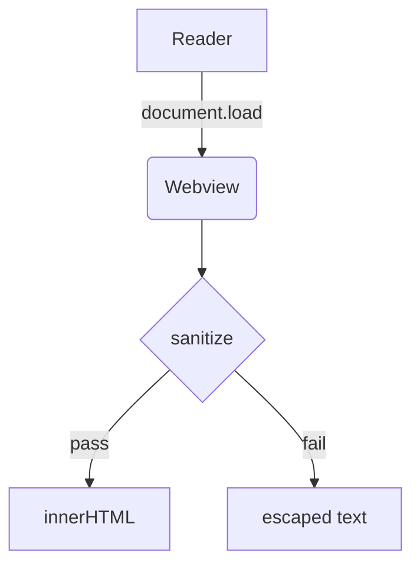

# Readora Sample

A fixture document for manual and automated verification. 打开本文件后应能在阅读视图里
逐项核对 M2 已落地的渲染能力；文末「降级行为」列出了本期**有意**不做的事情。

## Formatting

**Bold**, *italic*, `inline code`, ~~strikethrough~~, ***bold italic***,
以及自动链接 <https://example.com>、[示例文档站](https://example.com/docs)
和裸邮箱 <someone@example.com>。

软换行（下一行仍是同一段落）。

硬换行结尾：这是第一行\
这是第二行。

### Heading level 3

#### Heading level 4

##### Heading level 5

###### Heading level 6

## CJK 标题

### 中文标题锚点测试

CJK 标题的锚点应保留原文：点击下一段的锚点链接可以滚动到本段。

[跳转到「中文标题锚点测试」](#中文标题锚点测试)、[跳转到「Lists」](#lists)、
[相对链接（本期降级）](./other-note.md)、[站内锚点带编码](#%E4%B8%AD%E6%96%87%E6%A0%87%E9%A2%98%E9%94%9A%E7%82%B9%E6%B5%8B%E8%AF%95)。

## 重复标题

第一次出现的「重复标题」。

## 重复标题

第二次出现，锚点必须追加序号而不是覆盖前一个。

## 重复标题

第三次出现。

## Lists

无序、有序与起始序号：

1. First item
2. Second item
   - Nested item
     - Deeper nested item
3. Third item

起始序号大于 1 的列表（前面有段落隔断，必须独立成组并保留 start）：

10. 起始序号第十项
11. 第十一项

任务列表（本期只展示勾选态，不可交互）：

- [x] 已完成任务
- [ ] 未完成任务
  - [ ] 嵌套未完成任务

## Tables

对齐与长文本换行，列数足够多时容器需要横向滚动：

| 左对齐 | 居中 | 右对齐 | 长文本自动换行验证列 | 代码列 | 空列 | 第八列 | 第九列 | 第十列 |
| :----- | :--: | -----: | :------------------- | :----- | ---- | :----- | :----- | :----- |
| left   | mid  |  right | 这是一段非常长的中文说明文字，用来验证表格单元格的换行表现 | `inline` |      | a      | b      | c      |
| 中文   | 1    |      2 |  shorter             | **bold** |    | d      | e      | f      |

## Code

```ts
export function greet(name: string): string {
  return `Hello, ${name}!`;
}
```

```python
def fib(n: int) -> int:
    """长代码块：验证横向滚动与复制按钮。"""
    a, b = 0, 1
    for _ in range(n):
        a, b = b, a + b
    return a
```

未标注语言的代码块走普通渲染：

```
plain text without a language hint
```

未知语言不会中断整篇渲染，只降级为普通代码块：

```not-a-real-language
whatever ( content )
```

## Mermaid（本期只识别不渲染）



## Blockquote

> Reading is thinking with someone else's head instead of one's own.
>
> > 嵌套引用第一层
> >
> > > 嵌套引用第二层，内部段落与 `inline code` 仍需正常渲染。

引用内可以有列表：

> - 引用内第一项
> - 引用内第二项

## Images

图片本期只输出语义结构与占位降级，不解析任何本地路径：


## Thematic Break

段落之间的分隔线：

---

## Math（EPIC-06 已落地）

行内公式 $E=mc^2$ 与句中写的 $$\sum_{i=1}^{n} x_i$$：
前者落 `mathInline`，后者源码写的是双美元符，按 display 语义落 `mathBlock`。

独占一行的块级公式，根式会用到 KaTeX 的 svg：

$$
\sqrt{\frac{a^2 + b^2}{c}} = 5
$$

货币写法不得误判为公式：

总价 $100 和 $200 都还是普通文本。

不可渲染的表达式只降级本条，正文其余照常：

未闭合的表达式 $\frac{1}{$ 之后的一句话仍然可读。

## 降级行为（本期有意不做）

- Mermaid 图形渲染：属 ARC-003 / M3，本期转 `diagramBlock` 占位。
- 图片资源与跨文档跳转：依赖 M3 的 `resource.resolve`。
- Outline 侧栏面板：属 EPIC-07 / M4，本期只产出 outline 数据。
- 增量渲染：本期为全量渲染 + 内容 hash 跳过重复渲染。

## 安全样例（必须被降级，不得执行）

以下 HTML 片段在 `html: false` 口径下一律转义为可见文本，不进入 DOM：

<div onclick="alert('xss')">原始 HTML 块</div>


<script>alert('script 标签必须消失')</script>

<svg onload="alert('svg')"><foreignObject><script>alert(1)</script></foreignObject></svg>

<a href="javascript:alert('xss')">javascript: 协议链接</a>

[data 协议链接](data:text/html;base64,PHNjcmlwdD5hbGVydCgxKTwvc2NyaXB0Pg==)

[本地文件协议链接](file:///etc/passwd)

内联事件与 style 属性也不会保留：<span style="color:red" onmouseover="alert(1)">红色文字</span>。

## Closing

最后一节，用于验证页尾内容与滚动位置。
